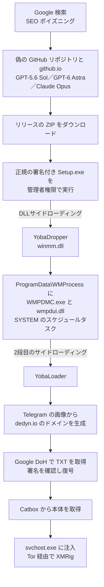

# Yoba ― 偽のChatGPT・Claudeアプリで署名済み実行ファイルを悪用

## 要点

### 影響範囲

- 脆弱性ではなく、偽のソフトウェアの配布である。対象は、検索で見つけた「ChatGPT や Claude のデスクトップ版」を GitHub からダウンロードして実行した Windows の利用者（Check Point Research）。
- 確認された偽のソフトは「GPT-5.6 Sol」「GPT-6 Astra」「Claude Opus」。6月ごろの古い版は `Cursor.exe` という名前の実行ファイルで読み込まれており、Cursor を装っていたとみられる（Check Point Research）。
- OpenAI や Anthropic が侵害されたわけではない。正規の署名付き実行ファイルが「入れ物」として使われた（Check Point）。

### 今すぐやること

- AI ツールのデスクトップ版は、ベンダーの公式サイトや公式ストアから入れる。名前の似た GitHub のリポジトリや github.io のページからは入れない（考察）。
- 端末に `C:\ProgramData\WMProcess\` フォルダ、そこにある `WMPDMC.exe` と `wmpdui.dll`、作成者が「Microsoft Corporation」で説明が「Collects device metadata for Windows Media Player.」のスケジュールタスクがないかを確かめる（Check Point Research）。
- プロキシや DNS のログで、`dns.google/resolve` への `*.dedyn.io` の TXT 問い合わせ、`t.me/yoba_fanclub`、`files.catbox.moe` への通信を探す（Check Point Research）。

## 概要

- Check Point Research（CPR）は、約2か月追跡してきた「Yoba」と呼ぶキャンペーンを公表した。新しい AI ツールの人気に便乗し、偽のデスクトップアプリとしてマルウェアを配っていた（Check Point Research）。
- 配布物の ZIP には、**OpenAI や Anthropic の正規の署名付き実行ファイル**と、悪意のある DLL が一緒に入っている。正規の実行ファイルを起動すると、同じフォルダの DLL を読み込む（DLLサイドローディング）（Check Point Research）。
- 専用の C2 サーバーを持たず、Telegram、Google の DNS over HTTPS（DoH）、ファイル共有サービスの Catbox、Tor を組み合わせて指示と本体を受け渡す。最後に動いていたのは暗号資産の採掘ソフト XMRig だが、ローダーは任意の実行ファイルや PowerShell を動かせる（Check Point Research、Check Point）。

> この記事では、ベンダー・公的機関・研究者・報道で確認できた内容を「事実」、筆者の推測や意見を「考察」として分けて書いています。

## 何が起きたか（時系列）

| 日付 | 出来事 |
| --- | --- |
| 2026年6月上旬 | `Cursor.exe` に読み込まれる初期の YobaDropper が出回る（Check Point Research） |
| 2026年7月16日 | 最初のリポジトリ `gpt-5-6/sol-free-desktop` と `gpt-5-6/gpt-5-6.github.io` が作られる（Check Point Research） |
| 2026年8月30日〜31日 | `sol-setup.zip`（ChatGPT を装う）と `Setup-Claude.zip` がリリースとして公開される（Check Point Research） |
| 2026年9月4日 | `GPT-6-Astra-Setup.zip` が公開される（Check Point Research） |
| 2026年10月29日 | Check Point Research が分析を公表。The Hacker News などが報道（Check Point Research、The Hacker News） |

## 技術的な問題点（根本原因）

**事実（Check Point Research）：配布と最初の実行**

- リポジトリごとに別のメールアドレスを使い、コミットのタイムゾーンも UTC+4、UTC-4、UTC+3 とばらばらで、拠点の時間帯を隠そうとしていた。スターやフォークの水増しはなかったが、Google の検索では上位に出ており、SEO ポイズニングとみられる。
- ZIP にはパスワードがかかっていなかった。解析を妨げる仕掛けがあり、検出率がすでに低かったためとみられる。
- ZIP の中の `winmm.dll` だけが、ZIP に入れられた日にコンパイルされていた。これが YobaDropper である。180個のエクスポート関数は中身が空で、`DllEntryPoint` だけにコードがある。

**事実（Check Point Research）：解析を逃れる仕掛け**

| 仕掛け | 内容 |
| --- | --- |
| 実行ファイル名の確認 | 自分を読み込んだ実行ファイルの名前の DJB2 ハッシュが、`Setup.exe` の値（`0xE6C2F326`）と一致しないと先へ進まない。DLL 単体でサンドボックスに入れると、`Sleep(5500)` を20万回（約12.73日）繰り返す |
| 地域の除外 | キーボードの言語がロシア語、ベラルーシ語、タジク語、アルメニア語、アゼルバイジャン語、ジョージア語、カザフ語、キルギス語、トルクメン語、ウズベク語、タタール語なら感染しない。以前はこの種の除外に含まれることが多かったウクライナ語は外されている |
| 管理者権限の要求 | 管理者権限で動いていなければ「Please run this program as Administrator.」と表示して終わる |

**事実（Check Point Research）：居座りと通信**

- YobaDropper は `C:\ProgramData\WMProcess\` を作り、System32 から正規の `WMPDMC.exe` を写し、復号した YobaLoader を `wmpdui.dll` として同じ場所に置く。起動3分後に SYSTEM 権限で `WMPDMC.exe` を動かすスケジュールタスクを作り、2段目のサイドローディングで YobaLoader を読み込ませる。
- YobaLoader は Telegram のチャンネル `t.me/yoba_fanclub` のプロフィール画像を取り、その最後の50バイトから「形容詞-名詞-動詞-数字.dedyn.io」の形のドメインを作る（DGA）。画像を差し替えれば接続先が変わる。
- そのドメインの TXT レコードを `https://dns.google/resolve?name=...&type=TXT` で引き、Ed25519 の署名を確かめてから AES で復号し、`files.catbox.moe` 上の本体の URL を得る。本体は svchost.exe への注入、%TEMP% に置いた実行ファイル、PowerShell スクリプトの3通りで動かせる。実行ファイルの場合は、インターネットから来たことを示す Zone.Identifier を消してから起動する。
- 確認された最終ペイロードは XMRig 6.26.0 で、同梱の Tor と obfs4 のブリッジを通じて .onion の採掘サーバーにつなぐ。利用者が操作している間は採掘を止める。

**考察**

- 指示の取得に使う通信先は、Telegram、Google の DNS、Catbox と、どれも普段から使われうるサービスである。DoH を使うので、社内の DNS サーバーのログにはドメインの問い合わせが残らない。指示に署名を付けているので、第三者がドメインを取ってもボットを乗っ取れない。小さな採掘キャンペーンにしては作りが丁寧である。

## 攻撃・侵入経路

## なぜ防げなかったか・構造的要因の考察

**考察**

- **署名は「その1ファイル」しか保証しない。** Check Point も指摘するとおり、署名が正しいのは Setup.exe だけで、横に置かれた DLL は保証されない。Windows は実行ファイルと同じフォルダの DLL を優先して読む場合があり、署名を見て安心した利用者や、署名済みの実行ファイルを信頼する一部の製品の判断をすり抜ける。
- **「まだ出ていない新製品」への期待を突く。** GPT-5.6 Sol や GPT-6 Astra のような、実在が確かでない名前のデスクトップ版を「無料で先に使える」と見せている。新しいモデルが次々出る状況では、利用者が本物かどうかを判断しにくい。
- **GitHub そのものの信頼。** github.com や github.io のドメインは、URL フィルタやメールの検査で止められにくい。開発者が日常的にリリースから ZIP を落とすので、その行為自体は怪しく見えない。
- **管理者権限での実行を求めても止まらない。** インストーラーが管理者権限を求めるのは普通のことなので、利用者は承認しやすい。これで SYSTEM 権限のスケジュールタスクまで作られた。

## 運用者向けの具体的な対策と検知ポイント

**事実（Check Point Research が示した痕跡）**

- ファイル：`C:\ProgramData\WMProcess\WMPDMC.exe`、`C:\ProgramData\WMProcess\wmpdui.dll`。古い版では、スタートアップフォルダの `msdefender_scheduler{7940-8490-6670-1081}.lnk` と、`%APPDATA%\Microsaft Difendir\` の `msdtc.exe`・`mswsock.dll`（つづりは原文のまま）。
- スケジュールタスク：作成者「Microsoft Corporation」、説明「Collects device metadata for Windows Media Player.」、起動3分後、SYSTEM で実行。
- 通信：`t.me/yoba_fanclub`、`dns.google/resolve` への `*.dedyn.io` の TXT 問い合わせ（古い版は `*.aber.ir`）、`files.catbox.moe`。
- 実行：Tor 0.4.9.12 と lyrebird 0.8.1 を展開し、`127.0.0.1:9550` の SOCKS5 経由で採掘する。データは `%TEMP%\torbundle\data`。ミューテックスは `Local\WindowsSecurity`。

**考察（検知と予防の工夫）**

- `ProgramData` や `%APPDATA%` の下で、System32 にあるはずの Windows の実行ファイル（`WMPDMC.exe` など）が動いていたら疑う。正規のパス以外から起動された署名付きの実行ファイルが、署名のない DLL を読み込むことを EDR の検知条件にする。
- 会社の端末では、AI ツールを含むソフトの入手先を公式の配布元に限り、利用者に管理者権限を渡さない。
- DoH を会社の方針で使わないなら、業務端末から `dns.google` などの公開 DoH への HTTPS 通信を止めるか記録する。
- 採掘は CPU を使うので、利用者が席を外している間だけ CPU 使用率が上がる端末も手がかりになる（このマルウェアは操作中は止まる）。

## 参考リンク

- [Tricks from the Past deployed via signed ChatGPT and Claude binaries（Check Point Research）](https://research.checkpoint.com/2026/tricks-from-the-past-deployed-via-signed-chatgpt-and-claude-binaries/)
- [Yoba Malware Targets ChatGPT & Claude Users With Fake AI Apps（Check Point Blog）](https://blog.checkpoint.com/research/yoba-malware-abuses-signed-chatgpt-and-claude-binaries-to-target-ai-users/)
- [Fake ChatGPT and Claude Apps Abuse Signed Executables to Deploy Crypto Miners（The Hacker News、2026年10月29日）](https://thehackernews.com/2026/10/fake-chatgpt-and-claude-apps-abuse.html)
