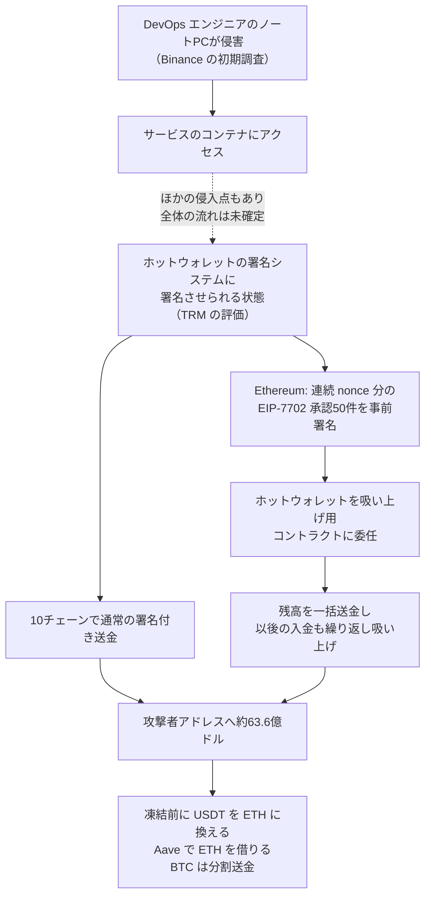

# Binance ― ホットウォレットから暗号資産が大量流出

## 要点

### 対象

- 盗まれたのは Binance 自身のホットウォレット（出金処理用にネットにつながったウォレット）。Ethereum、Bitcoin、Tron、XRP Ledger、Solana、Arbitrum、Avalanche、Optimism、Base、Polygon の10のチェーンにまたがる（TRM Labs）。
- Binance は損失を SAFU（利用者保護の基金）と自社資金で全額補うとし、「利用者の資金は安全」としている。出金は止めているが、入金は通常どおり動いている（Binance）。
- 製品の脆弱性ではないため、「影響バージョン」はない。

### 今すぐやること（取引所・カストディ・財務チーム向け）

- Ethereum 系のウォレットに **EIP-7702 の委任（本来コードがないはずのアドレスにコードが付いている状態）** が出ていないかを監視し、出たらすぐ警報にする。取り消しの署名手順を事前に決めてテストしておく（TRM Labs）。
- 署名ポリシーで、想定していない EIP-7702 の承認は拒否する。**連続した nonce に対して大量の承認を求める署名要求** は侵害の兆候として扱う（TRM Labs）。
- 署名基盤と承認経路を、チェーンごと・ウォレットの階層ごとに分ける。今回は1人の攻撃者が数時間で10チェーンのウォレットの有効な署名を得た（TRM Labs）。
- 入金や取引相手を、TRM などが公開している攻撃者アドレスと照合する。Bitcoin の分割送金や ETH の集約ウォレットから、今後ほかの取引所や OTC に資金が流れ込むとみられている（TRM Labs）。

## 概要

- 10月29日 20:05 UTC（日本時間30日 5:05）から、Binance のウォレットから資金が流出し始め、大半が約20分で攻撃者のアドレスに移った。TRM Labs の集計で約63.6億ドル、2025年2月の Bybit（15億ドル）の約4倍で、記録上最大の暗号資産窃取となった（TRM Labs）。
- Binance は初期調査として「DevOps エンジニアのノートPCが侵害され、攻撃者がサービスのコンテナにアクセスして不正な出金トランザクションを送った可能性がある」と発表した。ウォレットの秘密鍵が漏れた証拠は見つかっていないという（Binance）。
- その後、共同CEO の Richard Teng 氏は、侵入点はほかにも見つかっており、攻撃者は痕跡とツールを消す「自己消滅」の仕組みを使っていたと述べた。一連の流れはまだ確定していない（BBC、CoinDesk）。
- TRM Labs と Chainalysis は、北朝鮮の国家系グループ TraderTraitor によるものと高い確度で評価している。Binance 自身は攻撃者を特定しておらず、政府による帰属もまだない（TRM Labs、BleepingComputer）。

> この記事では、ベンダー・公的機関・研究者・報道で確認できた内容を「事実」、筆者の推測や意見を「考察」として分けて書いています。

## 何が起きたか（時系列）

時刻は UTC。日本時間は9時間足す。

| 日時 | 出来事 |
| --- | --- |
| 10月28日朝 | 攻撃者の操作用ウォレットが Tornado Cash（資金の出所を隠すサービス）から少額を3回受け取る（TRM Labs） |
| 10月29日早朝 | 攻撃用のコードを最初にデプロイし、2つのウォレットで試す。同日中に最終版を3つ目のウォレットでリハーサルし、資金を自分に戻す（TRM Labs） |
| 10月29日 20:05〜20:09 | XRP Ledger で Binance の5つのウォレットから 2億3346万 XRP が攻撃者のアドレスへ（TRM Labs） |
| 20:10すぎ | Solana と Optimism の Binance ウォレットからも流出（TRM Labs） |
| 20:20 | Bitcoin のホットウォレットから 18,270 BTC。同じ時刻に Ethereum で EIP-7702 の委任50件を1トランザクションで送信。2分以内に Tron から 6億1270万 USDT と 4640万 TRX（TRM Labs） |
| 20:23ごろ | 委任から3分24秒後、Ethereum のホットウォレットの残高全部（167,464 ETH と、16.15億 USDT を含む63種のトークン）を一括で送金（TRM Labs） |
| 20:41〜23:56 | 委任が残ったため、新しく入ってきた資金を6回にわたって再び吸い上げる（TRM Labs） |
| 21:01〜 | Tether、Circle、Ripple、World Liberty Financial が順に凍結（TRM Labs） |
| 23:05ごろ | 第2波として Avalanche と Polygon の Binance ウォレットから流出（TRM Labs） |
| 10月30日 00:08 | Arbitrum のセキュリティ評議会が攻撃者のウォレットから 8,426 ETH と 7460万 ARB を強制移動（TRM Labs） |
| 10月30日 | Binance が DevOps エンジニアの端末侵害の可能性を発表。Teng 氏が動画で、ほかの侵入点、EIP-7702 の悪用、日曜の出金再開目標を説明（Binance、BBC、CoinDesk） |

## 技術的な問題点（根本原因）

**事実（Binance）**

- 初期調査では、DevOps エンジニアのノートPCの侵害から、攻撃者がサービスのコンテナにアクセスし、不正な出金トランザクションを送ったとみている。Teng 氏は「1人のエンジニアの権限をそのまま使ったのではなく、ワンクリックで済む操作でもない、もっと複雑な攻撃だった」とし、個人に責任を帰していない（Binance、BleepingComputer）。
- Teng 氏によると、EIP-7702 による委任は **通常の承認の仕組みを通っていなかった**。このため出金サービスを止め、作り直して厳しいテストを通すまで再開しないとしている（BBC）。
- Binance は、クラウドのシステム、従業員の端末、秘密鍵の管理、トランザクションの署名手順を見直している（CoinDesk）。

**事実（TRM Labs）：Ethereum のホットウォレットの乗っ取り方**

- EIP-7702 は、2025年5月の Ethereum のアップグレード（Pectra）で入った仕組みで、普通のウォレットが「承認（authorization）」に署名すると、そのウォレットへの呼び出しがすべて指定したスマートコントラクトのコードで動くようになる。新しい承認に署名し直すまで、この状態は続く。
- 攻撃者は、Binance のホットウォレットが署名した承認50件を1つのトランザクションにまとめて送った。どれも、攻撃者の操作用ウォレットからしか命令を受けない「吸い上げ用」コントラクトを指していた。
- 承認は、ウォレットの送信回数の通し番号（nonce）がその時点の値と一致したときだけ有効になる。ホットウォレットは出金で nonce が次々に進むため、攻撃者は **連続する50個の nonce 分の署名を事前にまとめて用意** し、実行時にどれか1つが当たるようにした。実際に1つが一致した。
- 委任は残り続けたので、攻撃者はその後も入ってくる資金を何度も吸い上げた。このホットウォレットは別の Binance のスマートアカウントの実行者でもあり、そこから 8.23億 USDC も引き出した（その後 Circle が凍結）。

**事実（TRM Labs）：ほかのチェーン**

- 同じ時間帯に、XRP Ledger、Arbitrum、Avalanche、Optimism、Base、Bitcoin、Tron、Solana の Binance ウォレットと、委任のない別の Ethereum ホットウォレットからも、**普通の署名付き送金** で資金が出ていった。
- チェーンも鍵の種類も署名方式も違うウォレットが、30分ほどの間にそろって攻撃者向けの有効な署名を出している。TRM は、最もありそうな説明は「攻撃者が Binance のホットウォレット署名システムに、好きなトランザクションへ署名させられる状態になった」ことだと評価している。署名をまとめて事前に用意していた点から、アクセスが時間的に限られていたか、署名をシステム経由で依頼する必要があった可能性も指摘している。
- 初期には Ethereum の承認がフィッシングで取られたという見方もあったが、それではほかのチェーンを説明できない。

**考察**

- Binance の「秘密鍵が漏れた証拠はない」と、TRM の「署名システムに署名させられた」は矛盾しない。鍵そのものを持ち出さなくても、**鍵を使って署名する仕組みに正規の経路で依頼できれば**、結果は鍵の漏えいと同じになる。今回の「サービスのコンテナから出金トランザクションを送った」という説明は、この形に近い。
- EIP-7702 の委任は、送金そのものではなく「ウォレットの振る舞いを変える署名」である。出金額や送り先を見る承認ルールには引っかからない形で、後から何度でも資金を動かせる状態を作れた。Teng 氏の「通常の承認を通っていない」という発言は、署名システム側がこの種類の署名を出金とは別物として扱っていた可能性を示している。ただし、Binance の承認の仕組みの詳細は公表されていない。

## 攻撃・侵入経路

**事実（TRM Labs）**

- 凍結は約27億ドル。Tether 約17.7億 USDT、Circle 約8.25億 USDC、Ripple 4050万 RLUSD、World Liberty Financial 2780万 USD1、Arbitrum のセキュリティ評議会が約3000万ドル分。
- 攻撃者は凍結と競うように、約3.25億 USDT を UniswapX などを通じてマーケットメーカーに売って約12.23万 ETH に換え（相場より1割以上不利なレート）、別のウォレットでは 6000万 USDT を Aave に預けて約19,760 ETH を借りた。Tron では 3億 USDT を JustLend に入れ始めた。
- 凍結できない資産として、42万 ETH 超と 18,270 BTC、約24億ドル分を攻撃者がまだ持っている。BTC は1,000 BTC・100 BTC単位に分けて送る「ピールチェーン」で動かしている。
- 事前の Tornado Cash での資金準備、前もっての試験、事前に用意した署名を一気に実行する点は、Bybit（2025年2月）や KelpDAO（2026年4月）の事件と共通する。一方で、今回の資金洗浄はブリッジ中心だった Bybit と違い、マーケットメーカーとレンディングを使う形になっている。

## なぜ防げなかったか・構造的要因の考察

**考察**

- **開発・運用担当者の端末から出金系の基盤までの距離。** Binance の説明が正しければ、1台の端末の侵害が、出金を送れるサービスのコンテナにつながった。Teng 氏は「1人の権限ではない」と言っており、途中に複数の段階があったことになる。それでも最終的に署名システムまで届いたことは、運用担当の端末・クラウドの管理面・署名サービスの間の分離が、国家系の攻撃者に対しては十分でなかったことを示している。
- **チェーンをまたいだ単一の署名基盤。** チェーンも鍵方式も違うウォレットが、同じ攻撃者に30分以内にそろって署名した。利便性のために署名の入口を1つにまとめると、そこを取られたときの被害は全チェーンに及ぶ。TRM が「チェーンごと・階層ごとに分けろ」と書いているのはこの点である。
- **新しい署名の種類が既存のルールの外にあった。** EIP-7702 は導入から1年半ほどの仕組みで、送金ではない「委任」の署名を、出金と同じ厳しさで審査していなかった可能性がある。資金を動かせる署名の種類が増えたら、署名ポリシーも一緒に見直す必要がある。
- **凍結は「時間との勝負」になる。** ステーブルコインの発行体は数十分で凍結を始めたが、攻撃者はその間に大きな損を出してでも凍結できない資産に換えた。凍結が効く資産の割合が、被害額の上限を事実上決めた。

## 運用者向けの具体的な対策と検知ポイント

**事実（TRM Labs）**

- EIP-7702 の委任の監視：財務用ウォレットのアドレスにコードが付いたら即時に警報。取り消しを署名する手順は事前承認・事前テストしておく。
- 署名ポリシー：想定外の EIP-7702 承認は拒否。連続した nonce に対する大量の承認要求は侵害の指標。
- 署名基盤と承認経路をチェーンとウォレット階層で分ける。
- 攻撃者アドレス（TRM などがラベル付けしたもの）との入金・取引相手の照合。

**考察（運用上の工夫）**

- **署名システムに「何を署名しているか」を理解させる。** 生のトランザクションをそのまま署名するのではなく、種類（送金、委任、コントラクト呼び出し）、送り先、金額、nonce の範囲を解釈し、種類ごとに承認ルールを変える。まとめて事前署名する要求は原則として出さない作りにする。
- **出金系サービスへの経路を端末から切り離す。** 運用担当者のノートPCから出金系のコンテナや署名サービスに直接届かないよう、専用の管理端末・踏み台・短時間だけ有効な権限付与を組み合わせ、操作には別の人の承認を必要にする。
- **ホットウォレットの残高を小さく保つ。** 出金に必要な分だけをホットウォレットに置き、補充の頻度を上げる。今回の被害額は、ホットウォレットにどれだけ置かれていたかに直接左右された。
- **オンチェーンの異常を自社で即時に見る。** 短時間に複数チェーンで残高がほぼゼロになる、通常と違う送り先への大口送金、などを自社で監視し、署名システムを自動で止める「緊急停止」を用意しておく。

## 参考リンク

- [Security Incident Update (2026-10-30)（Binance、2026年10月29日公開・30日更新）](https://www.binance.com/en/support/announcement/detail/c5a8729a97ac486d963784d96c5642d7)
- [North Korea Steals USD 6.36 Billion From Binance in the Largest Hack in History（TRM Labs、2026年10月29日）](https://www.trmlabs.com/resources/blog/north-korea-steals-usd-6-36-billion-from-binance-in-the-largest-hack-in-history)
- [Binance links $6.3 billion crypto theft to compromised DevOps laptop（BleepingComputer、2026年10月30日）](https://www.bleepingcomputer.com/news/security/binance-links-63-billion-crypto-theft-to-compromised-devops-laptop/)
- [Binance discovers multiple breach points in $6.3 billion attack, eyes Sunday reopening（CoinDesk、2026年10月30日）](https://www.coindesk.com/tech/2026/10/30/binance-uncovers-wider-breach-in-usd6-3-billion-exploit-targets-sunday-withdrawal-restart)
- [Binance hack updates（BBC、ライブ記事）](https://www.bbc.com/news/live/cqrmynd3042gt)
