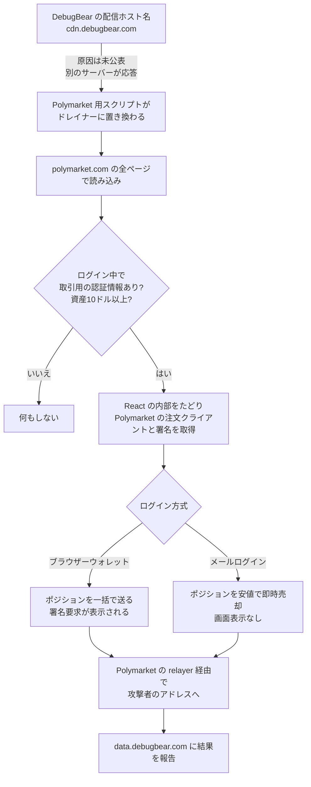

# Polymarket ― 外部の計測スクリプトが資金抜き取りコードに

## 要点

### 影響を受けたもの

- 予測市場 Polymarket の国際版サイト（polymarket.com）で、2026年10月29日 16:54〜17:59（UTC）ごろ、日本時間では30日 1:54〜2:59ごろに、**ログインした状態でサイトを開いていた利用者**（Ohey）。
- 読み込まれていたのは DebugBear の RUM（実際の利用者の表示速度を計測する）スクリプト `cdn.debugbear.com/C7xcKKrjUnXK.js`。中身が Polymarket だけを狙ったコードに置き換わっていた（Ohey、Polymarket）。
- 秘密鍵、パスワード、シードフレーズは取られていない。開いていたセッションがそのまま使われた（Yeeth Security）。
- 製品の脆弱性ではないため、「影響バージョン」はない。

### 今すぐやること

- **DebugBear の RUM を使っているサイト**：DebugBear の指示どおり埋め込みコードを外す（DebugBear）。外したあとも、キャッシュに古いスクリプトが残っていないか確かめる。
- **自社サイトで外部の計測・広告スクリプトを読み込んでいる運営者**：ログイン後のページや資金・決済を扱うページで動いている外部スクリプトを洗い出し、本当に必要なものだけ残す。残すものは、版の固定、内容のハッシュ照合、別オリジンの iframe への隔離などを検討する（詳しくは後述）。
- **Polymarket の利用者**：Polymarket は全セッションをリセットしており、対象のウォレットは請求なしで返金するとしている。金額がおかしい場合は Polymarket の案内する窓口から再確認を求める（Polymarket）。

## 概要

- 10月29日、DebugBear の配信サーバーから Polymarket に配られていた計測スクリプトが、15,187 バイトの資金抜き取りコード（ウォレットドレイナー）に差し替えられた。本来のファイルは 60,493 バイトだった（Ohey）。
- コードは、ページの中で Polymarket 自身が作った取引クライアントと署名の仕組みを見つけ出し、利用者のポジションと現金を攻撃者のアドレスへ移した。外部への通信は DebugBear のドメイン以外はすべて Polymarket の CSP（読み込みや通信先を制限する設定）で許可された宛先だった（Ohey）。
- Polymarket は約1時間でスクリプトを外し、取引と中継サーバー（relayer）を止めた。翌30日の事後報告では、影響を受けたウォレットの95%に全額返金済みで、取引停止中の損失分を含め合計390万ドルを返すとしている（Polymarket）。
- DebugBear は侵害を認め、RUM の利用者に埋め込みコードを外すよう呼びかけた。どうやって差し替えられたかは公表していない（DebugBear、Polymarket、Yeeth Security）。

> この記事では、ベンダー・公的機関・研究者・報道で確認できた内容を「事実」、筆者の推測や意見を「考察」として分けて書いています。

## 何が起きたか（時系列）

時刻は UTC。日本時間は9時間足す。

| 日時 | 出来事 |
| --- | --- |
| 10月27日 12:50 | 後に配信されたドレイナーのファイルの日時（配信サーバーの応答から）（Ohey） |
| 10月29日 12:06 | Internet Archive が本来の計測スクリプト（Google Cloud Storage から配信、60,493 バイト）を保存。これが最後の正常な記録（Ohey） |
| 16:54:57 | Cloudflare が `cdn.debugbear.com` の配信元につながらず、エラー 521 を返す（Ohey） |
| 17:10:23 | 攻撃者のアドレスに最初の資金が届く（Ohey） |
| 17:38 | Polymarket がステータスページでウォレットへの不正な動きを調査中と告知（Polymarket） |
| 17:59:20 | Polymarket がスクリプトを外した版をビルド（Ohey、BleepingComputer） |
| 18:00:58 | DebugBear が X で「進行中のセキュリティインシデントの影響を受けている」と投稿し、RUM の利用者に埋め込みコードを外すよう呼びかけ（Ohey、BleepingComputer） |
| 18:05 | Polymarket が取引を注文取消のみに制限し、relayer を停止（Polymarket） |
| 18:28〜18:38 | 攻撃者のアドレスが受け取った POL をすべて別の3つのアドレスへ移す（Ohey） |
| 18:37 | Polymarket が「外部の提供元が侵害された」と告知し、法執行機関に通報、被害者は全額補償すると表明（Polymarket） |
| 19:00ごろ | 取引再開（Polymarket、Ohey） |
| 20:37 | `cdn.debugbear.com` と `data.debugbear.com` が名前解決できなくなる（Ohey） |
| 10月30日 20:07 | Polymarket が事後報告を公開（Polymarket） |

## 技術的な問題点（根本原因）

**事実（Ohey、Yeeth Security）：差し替えの様子**

- 正常なファイルは Google Cloud Storage から配信され、そのヘッダーが付いていた。ドレイナーの応答には nginx 形式の ETag が付き、Cloud Storage のヘッダーはなかった。18:13 には `data.debugbear.com` も `nginx/1.24.0 (Ubuntu)` の 404 ページを返した。**DebugBear の2つのホスト名に、それまでと別のサーバーが応答していた**ことになる。
- これは保存されたファイルの書き換えではなく、配信元の切り替わりを示している。ただし、それが DNS の変更か、配信元の侵害か、CDN の設定変更か、ほかの方法かはわかっていない。DebugBear は原因を公表していない（Yeeth Security）。
- Polymarket は「ベンダーが侵害を公に認めた」としている（Polymarket）。

**事実（Ohey）：ドレイナーの動き**

1. **ログイン中の利用者を選ぶ。** Polymarket の地域制限 API で利用できない地域と判定された訪問者は対象外。`localStorage` の `polymarket.auth.params`（ログイン方式とウォレット）、`polymarket.auth.proxyWallet`（資金を預けるウォレット）、`poly_clob_api_key_map`（取引 API の認証情報）を読み、ログインと取引用の認証情報がない訪問者はそこで止まる。
2. **ページの取引クライアントを借りる。** React が DOM 要素に付ける内部オブジェクト（`__reactFiber$` で始まるキー）をたどり、`postOrder` と `createOrder` を持つオブジェクト、つまり Polymarket の注文クライアントとその署名の仕組みを探す。見つからなければ、ウォレットのページに移動してもう一度読み込ませる。**ドレイナー自体は鍵を持っていない。**
3. **資金とポジションを移す。** 残高と最大200件のポジションを読み、合計10ドル未満なら何もしない。現金は `api.fun.xyz` で POL に交換して攻撃者に送る。各操作は EIP-712 形式の `DepositWallet` バッチとしてページの署名の仕組みで署名し、Polymarket の `relayer-v2.polymarket.com` に送る。
   - ブラウザーウォレット（MetaMask など）の利用者：条件付きトークンのコントラクトの `safeBatchTransferFrom` で、ポジションを1回でまとめて送る。ウォレットには `DepositWallet` の署名要求が表示される。
   - メールでログインする利用者：ポジションを現在値の97%、50%、最小刻みの順で即時売りに出し、売却代金を現金と同じ方法で送る。画面には何も表示されない（Yeeth Security）。
4. **報告する。** 資産額、ポジション、送金結果、IP アドレスと国などを `data.debugbear.com` の `/metrics/submit`・`/update`・`/handle` に送る。

**事実（Ohey、Polymarket）：被害**

- 攻撃者のアドレス `0x3F99139F1C5854bb628c2e576Aaf638e99dFfc18`（Polygon）は、17:10〜18:02 の52分間に、28,636,284.45 POL、33のウォレットからの36件のポジション、約1.7万ドルのステーブルコインを受け取った（Ohey）。
- 研究者の TheFatMbappe 氏は、721のウォレットから 272.4万 pUSD が流れたと追跡している（Ohey）。
- Polymarket は、攻撃で取られた分として270万ドル、取引停止に伴う損失分として120万ドル、合計390万ドルを返すとしている（Polymarket）。

**考察**

- このドレイナーは、Polymarket の CSP を一切破っていない。外部の通信先は「DebugBear」と「Polymarket が普段使う宛先」だけで、署名も送信も Polymarket 自身の部品で行った。**CSP は「どこと通信するか」は制限できるが、許可したスクリプトがページの中で何をするかは制限できない。** 読み込みを許可した時点で、そのスクリプトはログインした利用者のページで、正規のコードとほぼ同じことができる。
- メールでログインする利用者に確認画面なしで売却が実行された点は、操作に利用者の確認を求めない設計の便利さが、そのまま攻撃者に使われたことを示している。

## 攻撃・侵入経路

## なぜ防げなかったか・構造的要因の考察

**考察**

- **計測ツールは「全ページ・ログイン後」に置かれる。** RUM は利用者の実際の体験を測るのが目的なので、ログイン後のページや取引画面にこそ入れられる。性能監視という目的と、資金を動かせるページに第三者のコードを入れるという危険の大きさが、釣り合っていなかった。
- **委託先の配信基盤が、自社のセキュリティの一部になっている。** Polymarket から見て、DebugBear の配信ホスト名に誰が応答するかは制御できない。前回の [Convertr の事例](/security-notes/notes/2026-10-28-convertr-plausible-tracker-skimmer-brazil-checkouts/) は分析サーバーの脆弱性、今回は計測ベンダーの配信元と、入口は違うが「全ページに配られる補助的なスクリプト」が狙われる点は同じである。
- **Polymarket 専用に作られている。** ストレージのキー名、API、注文クライアントの探し方まで Polymarket に合わせて作られており、事前に Polymarket のフロントエンドを調べたうえでの標的型の攻撃だったとみられる。ファイルの日時が実行の2日前（10月27日）である点も、準備期間があったことを示す。ただし、攻撃者や DebugBear 側の侵入経路はわかっていない。
- **検知と停止は速かった。** 最初の資金移動から約50分でスクリプトを外し、その直後に取引と relayer を止め、全セッションをリセットした。被害を受けたウォレットが数十〜数百にとどまったのは、この速さによるところが大きいと考えられる。

## 運用者向けの具体的な対策と検知ポイント

**事実（Polymarket、Ohey）**

- Polymarket の再発防止策：外部スクリプトを、より厳しい CSP、明示的な版の固定、サンドボックス化、継続的な監視と検証を加えて入れ直す（Polymarket）。
- 侵害の指標（Ohey）
  - ドレイナーの SHA-256: `0755e767504d8103f6c27b9e765a1026507a17c04513242adb503df7777879e5`（15,187 バイト）。同じ URL の正常なファイルは `0525f046c83daa429e0f676d36650d51d9e283ba5cacfa56097c80bad586128b`（60,493 バイト）。
  - 通信先: `data.debugbear.com/metrics/init`、`/metrics/submit`、`/metrics/update`、`/metrics/handle`
  - Polygon のアドレス: `0x3F99139F1C5854bb628c2e576Aaf638e99dFfc18`（受取）、`0x5a2764fbbe5d139ef0ed988ec5f95320ce730c0b`（ポジションの移動先）、POL の移動先 `0xe4c4c39c1733e1c7c06b79f97ed442b68df41ec6`、`0x5392587814ce8c6af6789764f88e5e9ab0b9962c`、`0xc91ee0574a14446de200923729c349b9cae19b60`

**考察（運用上の工夫）**

- **資金を動かせるページから第三者のスクリプトを外す。** 取引、送金、決済、設定変更の画面では外部の計測・広告スクリプトを読み込まない。どうしても測りたいなら、自社のドメインから配る計測コードに切り替えるか、データだけを外部に送る形にする。
- **内容を固定する。** 外部スクリプトを自社で取り込んで版を固定するか、SRI（`integrity` 属性）で中身のハッシュを指定する。今回のように配信元が別のサーバーに変わっても、中身が違えばブラウザーが読み込みを拒む。顧客ごとに中身が変わる配信方式では使いにくいので、ベンダーに固定版を出してもらえるか確認する。
- **重要な操作には利用者の確認を挟む。** 一括のポジション移動や、相場から大きく外れた売り注文など、通常の利用ではあまりない操作は、ページ内のコードから呼ばれても、サーバー側で追加の確認や遅延を入れる。
- **配信されている中身を外から監視する。** 自社ページが読み込む外部スクリプトを定期的に取得し、サイズやハッシュの急な変化、配信元のヘッダーの変化（今回なら Cloud Storage から nginx への変化）を検知する。
- **止めるスイッチを用意しておく。** Polymarket のように、取引を注文取消のみにする、中継サーバーを止める、全セッションを切るといった操作を、すぐ実行できるようにしておく。

## 参考リンク

- [Notice history（Polymarket Status、10月29日のインシデントと10月30日の事後報告）](https://status.polymarket.com/history/1)
- [Polymarket wallet drainer served from DebugBear's script CDN（Ohey、2026年10月29日）](https://ohey.ca/research/polymarket-debugbear-wallet-drainer/)
- [Page Load Is a Trust Boundary: The Polymarket Script Drain（Yeeth Security）](https://yeethsecurity.com/blog/2026-10-29-Polymarket-DebugBear-Drainer)
- [Polymarket halts trading after crypto-draining script breach, $2.5M traced（BleepingComputer）](https://www.bleepingcomputer.com/news/security/polymarket-halts-trading-after-crypto-draining-script-breach-25m-traced/)
- [Polymarket confirms cyberattack on third-party provider after outages（The Record）](https://therecord.media/polymarket-confirms-cyberattack-third-party)
