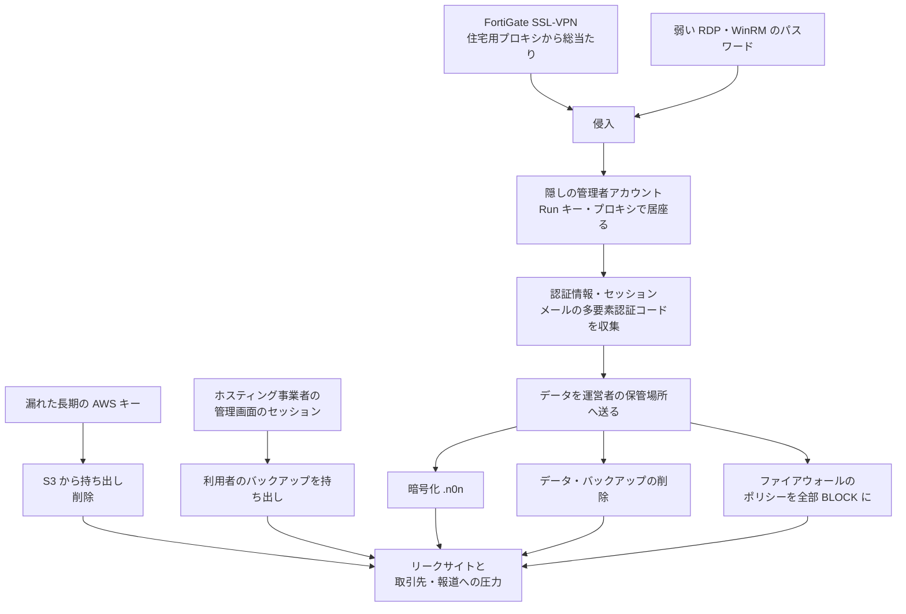

# n0nランサムウェア ― 公開状態の作業サーバーから手口が判明

## 要点

### 影響を受けたもの

- 作業サーバーに記録が残っていた **14か国の少なくとも23組織**。リークサイトに載ったのが15、侵入されたが載っていないのが4、試行の結果が記録からはわからないのが4（SOCRadar）。
- 名前が出ている例は、米国の小売 Fanatics（AWS の S3 から40バケット分のデータを持ち出され、12バケットのデータを削除）、ベネズエラの通信事業者 Inter（Cisco の Firewall Management Center のポリシーを書き換えられた）、米国の IT 運用委託先 ChiBiTek（FortiGate 経由で侵入）、オランダの金融サービス Transcom など（SOCRadar、The Register）。
- n0n のリークサイトには、10月19日時点で93件、要求額の合計2億8,370万ドルが載っていた（SOCRadar）。The Register は10月30日の記事で、n0n は先月の登場以来108件の被害を主張しているとしている。
- 製品の脆弱性の公表ではないため、「影響バージョン」はない。

### 今すぐやること

- **FortiGate SSL-VPN**：VPN のログインにフィッシングに強い多要素認証を必須にする。`/remote/logincheck` への失敗が多数の住宅用 IP アドレスから来ていないか、クッキーに `APBSID=n0n` を含む要求がないかを確認する（SOCRadar）。
- **AWS などのクラウド**：長期間有効なアクセスキーを洗い出して、使っていないものは止め、短時間で切れるロールに切り替える。重要な S3 バケットには Object Lock をかける（SOCRadar）。
- **ファイアウォールの管理画面**：Cisco FMC や FortiManager など管理画面には、接続元の IP アドレスの制限と多要素認証をかける（SOCRadar）。
- **バックアップ**：書き換えできない（イミュータブルな）バックアップと、ネットワークから切り離したバックアップを用意する。n0n は暗号化だけでなくデータやバックアップの削除もしている（SOCRadar）。
- 下の「検知ポイント」にある痕跡（隠しの管理者アカウント、Run キー、フォルダなど）を探す。

## 概要

- 脅威インテリジェンス企業 SOCRadar は、スウェーデンのホスティング（AS42675）上の `185.157.161[.]148:8877` で、ディレクトリの中身がそのまま見える Python の HTTP サーバーを見つけ、9月25日と26日に中身を記録した。攻撃スクリプト829本、C++ で書かれた暗号化ツールのソース5本を含む1,719ファイルがあり、ランサムウェア n0n の運営者の作業場所だった（SOCRadar）。
- 記録された侵入では、**脆弱性の悪用は1件も見つからず**、入口はすべて弱いか盗まれた認証情報だった。SOCRadar の CISO は The Register に「AI を使った開発と、ごく普通の入口の組み合わせが目立つ」と話している（SOCRadar、The Register）。
- 運営者は AI コーディングエージェント OpenCode を、7つの事業者の154のモデル設定とともに使っていた。安全対策を外したモデルや「無検閲」をうたうモデル、自前で動かすモデルも含まれ、AI の利用料は10月22日までに7,216ドルを超えていた。ただし、AI が自律的に攻撃していた証拠はなく、人が指示して進めていたと SOCRadar は判断している（SOCRadar）。
- 同じ SOCRadar は10月に、INC Ransomware と The Gentlemen にかかわるアフィリエイトの基盤から、AI で侵入を進めた記録を見つけたと報告していた（[既存記事](/security-notes/notes/2026-10-24-inc-gentlemen-affiliates-phantom-ai-opencode-exposed-servers/)）。こちらは既知の脆弱性が入口だったのに対し、n0n は認証情報だけだった点が違う。

> この記事では、ベンダー・公的機関・研究者・報道で確認できた内容を「事実」、筆者の推測や意見を「考察」として分けて書いています。

## 何が起きたか（時系列）

| 日付 | 出来事 |
| --- | --- |
| 2026年9月 | n0n が登場（The Register） |
| 9月25日・26日 | SOCRadar が公開状態の作業サーバーの中身を記録（SOCRadar） |
| 10月12日 | 18か国の海運・港湾・物流38組織をリークサイトに一度に掲載。少なくとも21組織は韓国の海運ソフトウェア会社 CyberLogitec の顧客と結びつくが、同社は侵入を認めていない（SOCRadar、The Register） |
| 10月16日 | 集めた55の支払い用ウォレットのいずれにも取引がないことを SOCRadar が確認（SOCRadar） |
| 10月19日 | 海運38組織への支払い期限。どの掲載も「解決済み」にならず、データは公開された。この時点でリークサイトには93件、要求額合計2億8,370万ドル（SOCRadar、The Register） |
| 10月22日 | AI の利用料がこの日までに7,216ドルを超える（SOCRadar） |
| 10月28日 | SOCRadar が分析を公表（SOCRadar） |
| 10月30日 | The Register が報道（The Register） |

## 技術的な問題点（根本原因）

**事実（SOCRadar、The Register）：入口はすべて認証情報**

| 入口 | 内容 |
| --- | --- |
| FortiGate SSL-VPN への総当たり | 305台の FortiGate を順位付けした一覧に対し、住宅用の SOCKS5 プロキシ群から「IP:ポート:ユーザー:パスワード」の組を試した。ChiBiTek にはこの流れで侵入し、15スレッドで試していた |
| 漏れた長期の AWS キー | Fanatics では、S3 の一覧・読み取り・削除の権限を持つキーで40バケット（1バケット最大110GB）を持ち出し、銀行取引の記録を含む12バケットのデータを削除した。要求は30BTC |
| 弱い RDP・WinRM のパスワード | 大規模な RDP のスキャンと組み合わせた |
| ホスティング事業者の管理画面のセッション | Dediserve では、管理者のブラウザから盗んだ認証情報で管理画面に入り、利用者のバックアップを持ち出した。Linux 用の暗号化ツールが使われた唯一の事例 |

**事実（SOCRadar）：侵入後の流れと暗号化ツール**

- どの事案も、侵入、永続化と認証情報の収集（サービスに見せかけた隠しの管理者アカウント、隠れたプロキシ、認証情報やセッショントークンの窃取、メールで届く多要素認証のコードの読み取り）、データの収集と運営者の保管場所への送信、最後に情報窃取・暗号化・破壊・ネットワーク妨害のいずれか、という同じ流れだった。
- Inter では、Cisco FMC のすべてのポリシーを「BLOCK」に書き換え、Snort のルール「n0n-lock」（sid 2100001）を追加した。運営者は国全体の通信に障害が出たと主張し、15BTC を要求した。
- 暗号化ツールは AES-256-CBC で、Windows 用、Linux 用、PowerShell 用と、FMC 用の OpenSSL を使う段階がある。鍵はビルドごとに1つ埋め込まれており、同じ鍵が2つの被害組織で使い回された可能性がある。
- 暗号化の前に MSSQL、W3SVC（IIS）、MySQL を止め、`vssadmin` でシャドウコピーを消し、空き領域を上書きする。暗号化したファイルには拡張子 `.n0n` が付き、身代金の要求文は `n0n_READ_ME.txt`。

**事実（SOCRadar、The Register）：恐喝のやり方**

- 交渉ルームを開くには要求額の10%を先に払う必要がある。リークサイトでは期限までのカウントダウンを表示し、被害組織の取引先、顧客、報道機関にも自動で警告を送る。
- Transcom の件では、データは Transcom のネットワークにしかなかったが、PayPal のセキュリティチームにも直接メールを送って圧力をかけた。
- リークサイトで「支払い済み・データ削除」とされた掲載もあるが、SOCRadar はブロックチェーン上で支払いを確認できていない。

**考察**

- 入口が脆弱性ではなく認証情報だけだったことは、「AI が脆弱性を次々に見つける」という話題とは逆の現実を示している。AI は入口を作るのではなく、手に入れた入口を**被害組織ごとに合わせた数百本のスクリプト**に変える作業を速くしていた。
- 1つの鍵を埋め込んだ暗号化ツールや作業サーバーの放置など、運営側の管理は粗い。それでも、データの削除やファイアウォールの書き換えのように**復号鍵があっても戻らない被害**を出している点は軽く見られない。

## 攻撃・侵入経路

## なぜ防げなかったか・構造的要因の考察

**考察**

- **VPN が今も「パスワードだけ」で開く。** 305台の FortiGate を一覧にして総当たりできたということは、多要素認証なしでパスワードだけで入れる VPN がまだ多いことを示している。住宅用 IP アドレスからの試行は、IP アドレスの遮断だけでは止めにくい。
- **長期のクラウドキーは「鍵の束」になる。** Fanatics の件では、1本のキーで一覧、読み取り、削除までできた。読み取りと削除を同じキーに持たせない、重要なバケットに Object Lock をかけるといった設定があれば、持ち出しは防げなくても削除による損害は避けられた可能性がある。
- **委託先・基盤事業者が入口になる。** IT 運用委託先の ChiBiTek やホスティングの Dediserve の事例は、1か所の侵入が多数の顧客に広がる構造を示す。CyberLogitec の顧客とされる海運38組織の一斉掲載も、同じ構造を疑わせるが、侵入経路は確認されていない。
- **AI で攻撃者の作業量の上限が上がった。** 人数の少ない運営者でも、被害組織ごとに違う環境（Windows、Linux、FMC、クラウド）に合わせた道具を短期間でそろえられた。OpenCode を使った侵入は INC・The Gentlemen 系でも報告されており、同じ道具の使い方が広がっていると考えられる。

## 運用者向けの具体的な対策と検知ポイント

**事実（SOCRadar）：検知に使える痕跡**

| 種類 | 内容 |
| --- | --- |
| VPN のログ | FortiGate の `/remote/logincheck` への要求で、クッキーに `APBSID=n0n` を含むもの |
| フォルダ | `C:\Users\Public\n0n\` |
| レジストリ | Run キーの `n0nNote` |
| アカウント | 隠しの管理者 `svc_upd`、`svc_reg`、`svc`（ログオン画面に出さない `UserList` 設定が0） |
| ブラウザ | `--remote-debugging-port` 付きで起動された Chrome、`netsh` の portproxy で 9223 を 9222 に転送 |
| Linux | `authorized_keys` の末尾が `root@3090-AI` の鍵 |
| AWS | CloudTrail で `ListBuckets` の直後に大量の `GetObject`、続いて1,000件単位の `DeleteObjects` |
| 通信 | `/x/i` への JSON の POST で、`ippay-web` を含むもの |
| ファイル | 拡張子 `.n0n`、要求文 `n0n_READ_ME.txt` |
| FMC | Snort ルール「n0n-lock」（sid 2100001）、すべてのポリシーが BLOCK |

SOCRadar が公表した基盤：`185.157.161[.]148:8877`（作業サーバー）、`81.161.239[.]10`、`188.214.135[.]130`、`185.157.161[.]93`（`ntpsync[.]io`）、`217.18.55[.]185:11434`（自前の AI モデル）、`n0n-cases[.]net`、`n0n[.]to`。

**事実（SOCRadar）：推奨されている対策**

- VPN やリモート接続にはフィッシングに強い多要素認証を使う。
- FMC や FortiManager などの管理画面に、接続元の IP アドレスの制限と多要素認証をかける。
- 長期のクラウドキーをやめ、短時間で切れるロールにする。S3 には Object Lock をかける。
- 書き換えできないバックアップと、ネットワークから切り離したバックアップを持つ。

**考察（運用上の工夫）**

- **VPN の失敗ログを「組み合わせ」で見る。** 1つの IP アドレスからの連続失敗ではなく、多数の住宅用 IP アドレスから少しずつ来る失敗を、アカウント単位や機器単位で集計して警告する。
- **メールで届く多要素認証は守りにならない。** 攻撃者はメールボックスに入ってコードを読んでいた。メールや SMS のコードではなく、認証アプリの番号照合や FIDO2 などに切り替える。
- **新しい管理者アカウントとサービス名をすぐ確認する。** `svc` で始まる新しいローカル管理者や、ログオン画面から隠す設定が入ったアカウントは、作成された時点で警告するようにする。
- **ファイアウォールの設定変更を外から監視する。** 管理画面からのポリシーの一括変更やルールの追加は、設定の差分を別の場所に送って確認できるようにし、すぐ前の設定に戻せるよう保存しておく。

## 参考リンク

- [n0n Ransomware: AI-Assisted Extortion（SOCRadar、2026年10月28日）](https://socradar.io/blog/n0n-ransomware-ai-assisted-extortion/)
- [Crim spent $7K+ on AI services in extortion attacks, then left evidence for all to see（The Register、2026年10月30日）](https://www.theregister.com/security/2026/10/30/crim-spent-7k-on-ai-services-in-extortion-attacks-then-left-evidence-for-all-to-see/5306754)
