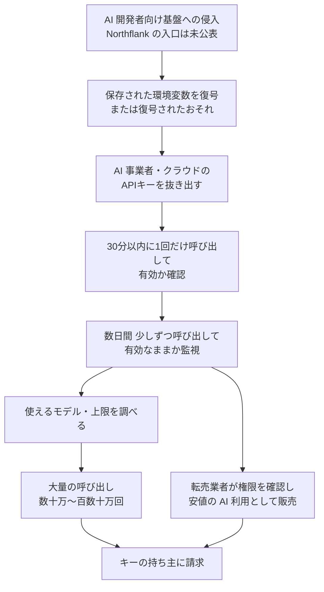

# Northflank ― 侵害を受け顧客のAIキーが不正利用される

## 要点

### 影響を受けたもの

- アプリやコンテナ、データベースをまとめて動かせる開発者向けクラウド基盤 **Northflank** の利用者全体。Northflank は「すべての環境変数が復号されたものと考えること」としている（Northflank）。
- 対象として名前が挙がっているのは、ワークロードに設定した秘密情報、シークレットグループ、グローバルシークレット、そして Northflank 上のデータベースなどのアドオン（Northflank）。
- 製品の脆弱性の公表ではないため、「影響バージョン」はない。侵入経路、影響を受けた顧客数、AI キー以外の秘密情報が実際に使われたかどうかは公表されていない（Northflank、BleepingComputer）。

### 今すぐやること

- **Northflank に秘密情報を置いている利用者**：Northflank の指示どおり、すべての秘密情報を**発行元で失効させてから**作り直し、Northflank 側の値を差し替える。Northflank 上で値を変えるだけでは、漏れた古い値は使えたままになる（Northflank）。
- **AI の API キー**：最初に入れ替える。AI 事業者側の利用量と請求の記録を確認し、身に覚えのない利用があれば Northflank と AI 事業者に報告する（Northflank）。
- **データベースなどのアドオン**：Northflank が用意した資格情報の入れ替え機能（PostgreSQL、MongoDB、MySQL、Redis、MinIO、RabbitMQ）で入れ替え、インターネットへの公開設定をしている場合は外す（Northflank）。
- **監査ログ**：無料プランを含む全利用者で有効になったので、不審な操作がないか確かめ、記録を保存しておく（Northflank）。

## 概要

- 10月30日 11:43（UTC、日本時間20:43）、クラウドセキュリティ企業 Wiz からの脅威アラートで Northflank は異常に気づき、約20分後にネットワークポリシーの修正を入れた。13:40（UTC）に環境変数の入れ替えを呼びかけ、13:58 には「すべての環境変数が復号されたものと考えること」と告知した（Northflank）。
- 同日夜（UTC）までに、複数の利用者から Northflank に預けた AI の API キーが使われたという報告が寄せられた（Northflank）。
- Wiz は同じ10月30日、AI 開発者向けの基盤で10月に少なくとも9件の侵害が公表され、いずれも保存された環境変数、特に AI の利用に使う秘密情報が狙われていたとする報告を出した。盗まれたキーは、他人の費用で AI モデルを使う「LLMjacking」や、安値で利用権を売る転売に回っていた（Wiz）。
- Northflank は自社の告知で、利用者からの報告は Wiz の報告にある攻撃の傾向と一致する可能性があり、似た IP アドレスが Wiz の報告に載っていると書いている（Northflank）。

> この記事では、ベンダー・公的機関・研究者・報道で確認できた内容を「事実」、筆者の推測や意見を「考察」として分けて書いています。

## 何が起きたか（時系列）

時刻は UTC。日本時間は9時間足す。

| 日時 | 出来事 |
| --- | --- |
| 10月30日 11:43 | Wiz から脅威アラート（Northflank） |
| 11:44 | Northflank の技術者がアラートを確認（Northflank） |
| 12:02 | 最初のネットワークポリシー修正（Northflank） |
| 12:50、13:05 | 追加の修正を展開（Northflank） |
| 13:00 | Wiz のインシデント対応チームに支援を依頼（Northflank） |
| 13:40 | ステータスページで「環境変数をすぐに入れ替えること」と告知（Northflank） |
| 13:58 | 「すべての環境変数が復号されたものと考え、すべてのキーを無効化・入れ替えること」（Northflank） |
| 15:12 | PostgreSQL と MongoDB の資格情報入れ替えを全利用者に提供。「複数の利用者が AI キーが使われたと確認している」（Northflank） |
| 23:38 | AI キーの不正利用の報告を正式に告知し、Wiz の報告に言及（Northflank） |
| 10月31日 01:04 | 無料利用者を含む全利用者で監査ログを有効化（Northflank） |
| 13:34 | MySQL と Redis の資格情報入れ替えを提供（Northflank） |
| 22:32、23:31 | MinIO、RabbitMQ の資格情報入れ替えを提供（Northflank） |

## 技術的な問題点（根本原因）

**事実（Northflank、BleepingComputer）**

- Northflank は根本原因を公表していない。最初の対応が「ネットワークポリシーの修正」だったことはわかっているが、それが侵入の入口をふさぐものだったのか、被害の拡大を止めるものだったのかは書かれていない。
- Northflank は利用者に「すべての環境変数が復号されたものと考えること」と指示しており、攻撃者が保存された値を読める状態にまで届いた可能性を否定していない。
- BleepingComputer の問い合わせ（侵入の方法、影響範囲、保存された資格情報が盗まれたか）に、記事の時点で Northflank は答えていない。

**事実（Wiz）：10月の同種の事案**

Wiz が挙げた、10月に侵害を公表した AI 開発者向けの基盤は次の9つ。

| 公表日 | 基盤 | 公表された原因など |
| --- | --- | --- |
| 10月6日 | Fireworks AI | 認証情報への不正アクセス。「エージェントの群れ」による攻撃の兆候 |
| 10月9日 | Andromeda | 「業界全体への攻撃」の一部 |
| 10月14日 | Zeabur | 認証情報への不正アクセス。事業を終了する予定 |
| 10月15日 | Lightning AI | 認証情報への不正アクセス。以前に Mini Shai-Hulud のサプライチェーン攻撃の影響を受けていた |
| 10月16〜17日 | OpenCode | 「古いシステム」。目的は「蒸留」（他社のモデル出力を集めて自社モデルを学習させること）。エージェントの群れの兆候 |
| 10月20日 | Railway | ビルド基盤での権限昇格（[既存記事](/security-notes/notes/2026-10-24-railway-build-infrastructure-env-vars-ai-keys-distillation/)） |
| 10月23日 | Warp | 外部ベンダーの依存部品。エージェントの群れの兆候 |
| 10月28日 | CommandCode | 目的は「蒸留」 |
| 10月30日 | Northflank | 未公表 |

- 共通する単一の脆弱性や部品は見つかっていない。共通しているのは、どの事案でも**保存された環境変数、特に AI の利用に使える秘密情報を探していた**点だと Wiz は書いている。
- Wiz はこの流れを、攻撃の速度と効率を上げる「AI エージェントを使った攻撃」と、盗んだ AI キーをすぐ現金化できる転売市場（LLM ブローカー）の広がりという2つの動きに重なるとしている。

**事実（Wiz）：盗まれたキーがどう使われたか**

Wiz は、9件のうちのどれかの基盤から漏れたと特定できた、企業の Amazon Bedrock（AWS の生成 AI サービス）のキー2本の使われ方を公表した。どちらの基盤かは書いていない。

1. **確認。** 基盤側で資格情報にアクセスされてから30分以内に、住宅用の IP アドレスから `InvokeModel` が1回だけ呼ばれた。複数の組織のキーを1分間でまとめて試す動きの一部だった。その後数日は、同じ小さな Go 製クライアントから1日14〜120回、2本のキーにほぼ1分違いで呼び出しがあり、キーがまだ使えるかを確かめる処理が続いていた。
2. **ケース A（制限の緩いキー）。** 4日後、入れ替わるプロキシ群がモデルを1つずつ試し、`boto3` のスクリプトが Bedrock と EC2 の上限値を調べた。その22秒後から大量の呼び出しが始まり、キーが止められるまでの30時間で約80万回、うち約9割が成功した。キーの権限が `global.*` のリージョン横断の推論プロファイルを許していたため、負荷が各リージョンに分散され、上限で止められたのは約6%だけだった。
3. **ケース B（制限したキー）。** 7日後、転売業者の集まりとみられる送信元から数千回の失敗が続いた。キーの権限が `us.*` のプロファイルしか許していなかったためだ。翌朝、使えるモデル ID が特定されると、13時間で約170万回、うち100万回以上が成功した。こちらは地域ごとの上限に当たり、残りのほとんどが制限で止められた。
4. **規模。** 2本だけで、定価換算で10万ドルを超える利用になったとみられる。1回あたりの入力が少なくキャッシュを多用する呼び出しが多く、転売されたコーディングエージェントの通信によく似ていた。

Wiz は、これらのキーを試していた転売サイト2つ（`llm-routing.com` 周辺の「momo」、`xingjiabiapi.org`）の基盤も特定したが、最初の侵害や大量利用との直接の関係までは確定できていないとしている。「momo」の IP アドレス `23.106.46.239` は、Zeabur が自社の侵害で名指ししたものと同じで、10月8日にはその IP アドレスで AI を使った侵入ツール ARTEX の操作画面とされるページが置かれていた（Wiz）。

**考察**

- 開発者向けの基盤は、顧客のアプリが動くために、顧客の秘密情報を**いつでも復号できる状態**で持っている必要がある。保存時の暗号化は、ディスクやバックアップが単体で盗まれた場合には効くが、基盤の内部に入った攻撃者が「アプリに渡す仕組み」そのものを使えば意味が薄い。Railway が「暗号化して保存していた環境変数の一部が復号された」と説明し、Northflank も「復号された前提」で対応を求めている点は、この構造をよく表している。
- AI のキーは、盗まれてから現金化されるまでが極端に早い。Wiz の例では、確認まで30分、大量利用まで4〜7日だった。クラウドのアクセスキーのように「中に入ってから何かを探す」必要がなく、呼び出すだけで価値になるため、転売市場がそのまま受け皿になっている。

## 攻撃・侵入経路

Northflank の侵入経路は公表されていない。下の図は、Wiz が報告した盗まれたキーの使われ方を示す。

## なぜ防げなかったか・構造的要因の考察

**考察**

- **1社の侵害が、多数の顧客の外部サービスに波及する。** Northflank の顧客がそこに置いていたのは、Northflank 自身の資格情報ではなく、AI 事業者、データベース、クラウドなど**別のサービスの鍵**である。基盤が1か所破られると、被害は Northflank の外に広がり、入れ替えの手間はすべての顧客が負う。
- **「使い放題」の権限が被害額を決めた。** Wiz のケース A と B は同じ攻撃者の同じ道具に狙われたが、`global.*` を許していたキーは上限にほとんど当たらず、`us.*` に絞ったキーは多くが止められた。モデル、リージョン、利用量を絞っておくことが、漏れた後の損害を直接小さくする。
- **月に9件という頻度。** 同じ月に同じ種類の基盤で9件の侵害が公表され、そのうち少なくとも3件は「エージェントの群れ」の兆候を報告している。個々の入口は違っても、AI キーという価値の高い秘密情報を大量に預かる事業者が、まとめて狙われている状況だと考えられる。ただし、9件が同じ攻撃者によるものかは確認されていない（Wiz、BleepingComputer）。
- **Northflank の初動は速かった。** アラートから1分で確認、約20分で最初の修正、約2時間で全利用者に「復号された前提」を告げている。それでも AI キーの悪用が報告されたのは、Wiz の観測どおり、キーの確認が侵害から30分以内に始まることと合っている。

## 運用者向けの具体的な対策と検知ポイント

**事実（Northflank、Wiz、BleepingComputer）**

- Northflank の利用者向けの指示：すべての秘密情報を発行元で失効させて作り直す、アドオンの公開設定を外す、AI 事業者の利用量と請求を確認する（Northflank）。
- Wiz が公表した、盗まれたキーの確認に使われた IP アドレス（いずれも Black October の侵害そのものとの直接の関係は未確認）：`23.106.46.239`（10/26〜10/29）、`38.246.114.118`（10/25〜10/29）、`104.243.32.50`（10/19〜10/30）、`31.57.201.201`（10/18〜10/25）。大量利用には PEG TECH（AS54600、AS398823）、Alibaba（US）（AS45102）、Scloud（AS142002）、Sharktech（AS46844）、Level 3（AS10753）の共用アドレス群が使われた（Wiz）。
- Wiz のケース B では、攻撃者の IP アドレスから `PutAccountDataRetention` の呼び出しも試みられた（Wiz）。

**考察（運用上の工夫）**

- **失効させてから入れ替える。** 新しい値を設定するだけでは、漏れた値は発行元で有効なままになる。AI 事業者、クラウド、データベースなど、発行元の管理画面で古い値を無効にしたことを1つずつ確かめる。
- **AI キーの権限と上限を絞る。** 使うモデル、リージョン（Bedrock なら `global.*` を許すかどうか）、1日の利用量や支出の上限を、キーごとに必要最小限にする。可能なら長期のキーをやめ、短時間で切れる資格情報やロールに切り替える。
- **利用の「形」を監視する。** 普段使わないモデルへの呼び出し、モデルを1つずつ試す動き、`ListFoundationModels` やサービスの上限値の一覧取得、普段と違う送信元（住宅用 IP アドレスやホスティング事業者）からの呼び出しは、悪用の前ぶれとして警告する。CloudTrail などで `InvokeModel` の回数が急に増えたら止める仕組みを用意する。
- **基盤に預ける秘密情報を減らす。** 開発者向けの基盤には、そこで動くアプリに本当に必要な秘密情報だけを置く。AI キーは、可能なら自社が管理する中継（ゲートウェイ）を通し、基盤には中継用の限定的な資格情報だけを渡す。
- **入れ替えの手順を事前に用意する。** どの秘密情報がどこに置かれ、誰が発行元で失効できるかの一覧がないと、今回のような「すべて入れ替えて」という指示にすぐ対応できない。

## 参考リンク

- [Security incident（Northflank Status）](https://status.northflank.com/cmvv0rn5a092f14rutwccodpp)
- [“Black October” for AI Developer Platforms（Wiz、2026年10月30日）](https://www.wiz.io/blog/black-october-for-ai-developer-platforms)
- [Northflank security breach leads to abuse of customers' AI API keys（BleepingComputer、2026年10月31日）](https://www.bleepingcomputer.com/news/security/northflank-security-breach-leads-to-abuse-of-customers-ai-api-keys/)
