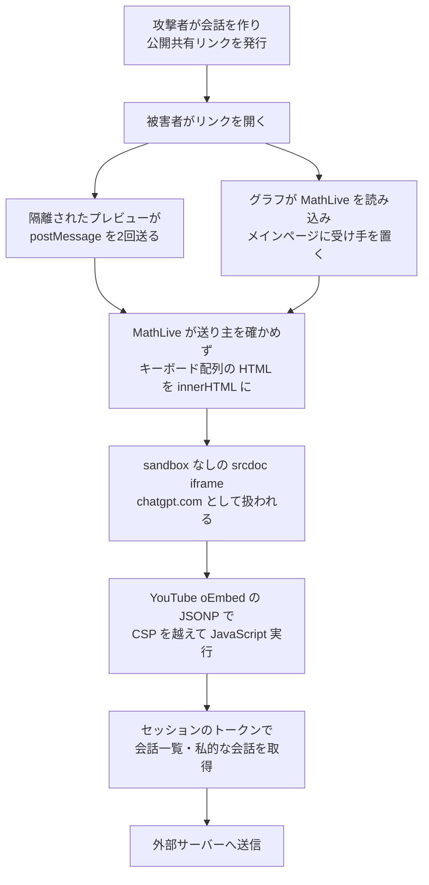

# ChatGPT ― 共有リンクを開くだけで他人のセッションでコード実行

## 要点

### 影響を受けたもの

- ChatGPT の Web 版（chatgpt.com）。OpenAI は2つの Web フロントエンドを修正し、10月26日に両方で問題のメッセージを拒否するようになったと確認した（Parameter）。
- 利用者が入れるアプリのバージョンの問題ではなく、サーバー側で直っているため「影響バージョン」はない。
- 研究者は野外での悪用を確認していない（infosecpwn のまとめ）。
- 部品側では、オープンソースの MathLive 0.111.1（10月9日公開）まで送り元確認の既定値が `none` だった。0.111.2 で既定値が `same-origin` になり、自分の窓以外からのメッセージを捨てる確認も加わった（Severity Daily のコード比較）。

### 今すぐやること

- **ChatGPT の利用者**：修正はサーバー側で済んでおり、利用者がすることはない。
- **MathLive を使っている開発者**：0.111.2 以上（記事時点の最新は 0.111.4）に上げ、`originValidator` を既定値に頼らず明示する（Severity Daily）。
- **自社の Web アプリを作る側**：`postMessage` の受け手で `event.origin` と `event.source` の両方を確かめているか、外部の UI 部品（数式入力、エディタ、グラフなど）がページ全体にメッセージの受け手を置いていないかを確認する（Parameter の教訓）。
- CSP で許可しているドメインに、JSONP のように呼び出し側が中身を決められるエンドポイントがないかを確認する。

## 概要

- セキュリティ企業 Parameter の研究者は、ChatGPT の普通の共有機能で公開した会話のリンクを他人が開くと、その人のログイン中のセッションで攻撃者の JavaScript が `chatgpt.com` として動く連鎖を見つけた（Parameter）。
- 確認したのは、被害者の会話一覧の取得、攻撃者と共有されていない私的な会話の中身の読み出し、その一部の外部サーバーへの送信。コードは ChatGPT の Web 画面と同じ認証で API を呼べるため、研究者は「被害者のアカウントで何でもできた」としている（Parameter）。
- 被害者がすることは、リンクを開くだけ。最も安定した再現では「プレビュー」ボタンを1回押す必要があったが、HTML ブロックを自動でプレビューされるようにした版では、リンクを開く以外の操作は要らなかった（Parameter）。
- 10月18日に OpenAI のバグ報奨金制度に報告され、当初 P2 だった評価は P1 に引き上げられた。報奨金は計5,000ドル（Parameter）。

> この記事では、ベンダー・公的機関・研究者・報道で確認できた内容を「事実」、筆者の推測や意見を「考察」として分けて書いています。

## 何が起きたか（時系列）

| 日付 | 出来事 |
| --- | --- |
| 2026年10月13日 | MathLive のメッセージから HTML に至る経路を本番のコードで確認（Parameter） |
| 10月14日 | 通常の画面操作で再現し、任意の JavaScript の実行に発展（Parameter） |
| 10月16日 | 別アカウント・別ワークスペース間で公開共有リンクからの成立を確認（Parameter） |
| 10月17日 | 共有リンクを開くだけで自動プレビューされる版を確認（Parameter） |
| 10月18日 | OpenAI に報告（Parameter） |
| 10月21日 | OpenAI が再現し、評価を P1 に引き上げ（Parameter） |
| 10月22日・23日 | 片方のフロントエンドを修正。CSP の変更で連鎖の一部がふさがれる（Parameter） |
| 10月26日 | 両方のフロントエンドで修正を確認し、解決（Parameter） |
| 10月28日 | Parameter が詳細を公表（Parameter） |

## 技術的な問題点（根本原因）

**事実（Parameter）：連鎖の各段階**

| 段階 | 内容 |
| --- | --- |
| 1. 隔離されたプレビュー | ChatGPT は HTML のコードブロックを別のドメインの制限付きフレームで動かす。プレビューからは親ページ（`parent.document`）を読めず、ここまでは設計どおりだった |
| 2. グラフが置いた受け手 | 会話中の対話型グラフが数式ライブラリ MathLive を読み込み、ChatGPT のメインページに、画面キーボード用の `postMessage` の受け手を置いた |
| 3. 送り主を確かめない | MathLive の受け手は送り元の確認ポリシーが `none` で、どのドメインからのメッセージも受け付けた。キーボードの配列を変える `update-setting` も、許可した窓からかどうかを確かめなかった |
| 4. HTML がそのまま入る | 配列の中身（`markup`）に HTML を入れられ、キーボード表示時に `innerHTML` でメインページに入った。`createHTML` は無害化せず、そのまま通していた |
| 5. 隔離なしの iframe | `sandbox` 属性のない `srcdoc` の iframe を差し込むと、メインページが作ったフレームとして `chatgpt.com` の扱いになり、親ページにアクセスできた |
| 6. CSP の回避 | ChatGPT の CSP は YouTube のスクリプトを許可していた。YouTube の oEmbed のエンドポイントは、無効なコールバック名でもエラーを返す前に応答の先頭に書き出していたため、`;void` で終わるコールバックを渡すと、その応答がスクリプトとして実行された |
| 7. 共有リンクに載せる | 本物のグラフ（受け手を置く）と、後に続くプレビュー（メッセージを送る）を1つの会話に入れて公開すると、`/share/` のリンクに連鎖全体が残った |

- 実行されたコードは、親ページの `#client-bootstrap` からセッションのアクセストークンとアカウントIDを取り出し、`/backend-api/conversations` で会話の一覧を、`/backend-api/conversations/<id>` で会話の中身を取得した。研究者は検証のため、外部に送るのは小さな値だけにとどめた（Parameter）。
- Parameter は、根本原因は YouTube の応答ではなく、「送り主を確かめない受け手」「画面設定に生の HTML を許す形式」「信頼できないフレームの影響で作られた文書が隔離されない」の3つの設計だとしている。YouTube のエンドポイントは CSP を越える最後の手段にすぎず、それだけをふさいでも HTML の挿入は残ると述べている（Parameter）。

**考察**

- 個々の機能はどれも妥当に見える。プレビューは隔離され、グラフは数式キーボードを読み込み、フレームはメッセージをやり取りし、CSP は大手の動画サイトを許可していた。穴は**機能と機能の継ぎ目**にあり、部品ごとの検査では見つけにくい種類のものだった。
- 外部の UI 部品は、読み込まれるだけでページ全体に受け手を置くことがある。利用する側は、その部品がどんなメッセージを、誰から受け付けるかまで把握していないことが多い。

## 攻撃・侵入経路

## なぜ防げなかったか・構造的要因の考察

**考察**

- **AI の会話は「他人が書いた HTML」を表示する場所になった。** プレビューやグラフのように会話から動く部品が増えるほど、公開共有リンクは攻撃の配達手段になる。メールの添付ファイルと同じく、共有された会話は攻撃者が中身を決められる入力として扱う必要がある。
- **隔離は、境界を越える橋の数だけ弱くなる。** プレビュー自体の隔離は正しく働いていた。しかし、メインページ側に1つでも「誰の言うことでも聞く」受け手があれば、隔離されたフレームからでも指示を通せる。
- **CSP の許可リストは、許可したドメインの全エンドポイントを信頼することになる。** 動画の埋め込みのために YouTube を許可すれば、呼び出し側が中身を変えられる JSONP のような応答も実行できてしまう。CSP は最後の防御であって、HTML の挿入を防ぐ主な手段にはならない。
- **影響は「アラートが出る」ではなく、ログイン中の権限で測るべき。** 同じオリジンで動くコードは、普段の画面と同じ API を呼べる。私的な会話には、業務の資料や個人情報が入っていることも多い。

## 運用者向けの具体的な対策と検知ポイント

**事実（Parameter の提言）**

- メッセージの受け手は、送り主のドメイン（`event.origin`）と、許可した窓かどうか（`event.source`）の両方を確かめる。
- フレーム間でやり取りする設定に、生の HTML を含めない。
- 信頼できないフレームの影響を受ける内容で作る文書は、隔離（`sandbox`）したままにする。
- CSP は多層防御の一部とし、攻撃者の HTML がメインのサイトに届いた後の唯一の壁にしない。

**考察（運用上の工夫）**

- **外部部品の受け手を棚卸しする。** 開発者ツールやテストで、ページに登録されている `message` イベントの受け手と、それぞれが受け付ける `type` を一覧にする。`"*"` や確認なしで状態を変える受け手は、ラッパーで送り主を確かめるようにする。
- **Trusted Types を「通すだけ」のポリシーで使わない。** 今回の `createHTML` のように、文字列をそのまま信頼済みに変えるだけのポリシーは、危険な代入を見えにくくするだけになる。DOMPurify などの無害化を通すポリシーにする。
- **CSP の `script-src` を絞る。** 埋め込みのために許可しているドメインを見直し、JSONP を返すエンドポイントがあるドメインは許可から外すか、`strict-dynamic` と nonce に切り替える。
- **社内で AI の会話を共有する運用を決める。** 修正済みの件ではあるが、他人から届いた共有リンクを、機密を扱うアカウントのまま開かない、という基本は他の AI サービスでも有効と考えられる。

## 参考リンク

- [Do the Math: How We Took Over ChatGPT Accounts（Parameter、2026年10月28日）](https://www.parameter.ai/labs/we-found-a-gap-at-openai)
- [MathLive shipped its postMessage origin check defaulting to “none,” and the release that turns it on carries no CVE（Severity Daily）](https://severitydaily.com/mathlive-0-111-2-originvalidator-none-default-same-origin-chatgpt-share-link-no-cve-421823-weekly-downloads/)
- [1 Nov 2026: Linux TCP, Northflank, Binance, Name.com + 23 more（infosecpwn、2026年11月1日）](https://infosecpwn.com/news/2026-11-01/)
