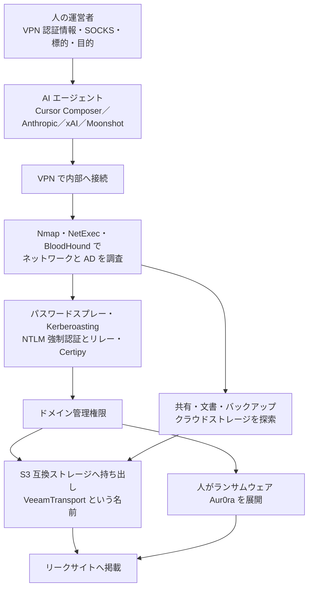

# GOLD OGRE ― AIエージェントにAD侵入を任せAur0raランサムウェアを展開

## 要点

### 影響を受けたもの

- ランサムウェア Aur0ra（Aurora とも）の被害を受けた組織。AI エージェントがドメインの管理権限まで達した環境のうち、3組織が後に Aur0ra のリークサイトに載った（Sophos）。
- Sophos は影響を受けた可能性のある自社顧客に通知し、他の組織には法執行機関と協力して通知した。被害組織の総数や国は公表されていない（Sophos）。
- 製品の脆弱性の公表ではないため「影響バージョン」はない。

### 今すぐやること

- **VPN とリモート接続**：フィッシングに強い多要素認証を必須にする。攻撃は、人が用意した VPN の認証情報を AI エージェントに渡すところから始まっている（Sophos）。
- **AD と特権**：ドメイン管理者の権限を見直し、特権アクセス管理（PAM）を入れる。重要なサーバーを分け、バックアップを切り離す（Sophos の推奨）。
- **検知**：下の表の指標（Cobalt Strike の C2、データ送信先、SOCKS の中継）と、BloodHound、NetExec、Certipy、PetitPotam、Kerberoasting、Chisel の使用を EDR のアラートで確認する（Sophos）。
- 対応の速さが要になる。Sophos は、既存の対策は今も有効だが、AI で攻撃の段階が速くなるため素早い対応が必要だとしている。

## 概要

- Sophos の Counter Threat Unit（CTU）は、5月に報告した「AI を使った侵入後の攻撃フレームワーク」（複数社の EDR、Sophos 自身のエージェントを含めて回避を試していたもの）と同じ基盤が、その後 Aur0ra の攻撃で Cobalt Strike を配っていたことを見つけた。分析を進めた結果、Aur0ra を運営する犯罪グループ GOLD OGRE が攻撃全体で AI を多用していると判断した（Sophos）。
- 8月下旬、Sophos は Aur0ra の攻撃と EDR 回避の試験にかかわる Cursor の痕跡を回収した。攻撃者は Cursor を使って、認証情報の入手からドメイン管理者までの昇格を進めていた（Sophos）。
- CTU は、GOLD OGRE がまず Cursor を組み込んだ試験用フレームワークで回避手法を試し、その後、似た道具を関係者（アフィリエイト）に渡して Aur0ra の攻撃に使わせたと「高い確度」で評価している（Sophos）。
- 記事に日付はなく、10月30日に複数のまとめ記事で取り上げられた（infosecpwn）。8月には Gambit Security と CloudSEK も、公開状態のディレクトリをもとに Aur0ra の運営者が Cursor で攻撃を進めていたと報告している（Sophos が引用）。

> この記事では、ベンダー・公的機関・研究者・報道で確認できた内容を「事実」、筆者の推測や意見を「考察」として分けて書いています。

## 何が起きたか（時系列）

| 時期 | 出来事 |
| --- | --- |
| 2026年5月 | Sophos CTU が、AI で作られ複数社の EDR を試していた侵入後フレームワークを報告（Sophos） |
| その後 | 同じ基盤が Aur0ra の攻撃で Cobalt Strike を配っていたのを Sophos が確認（Sophos） |
| 8月下旬 | Gambit Security と CloudSEK が、`172.86.113[.]245` の公開ディレクトリ（Aur0ra の Windows 版・Linux／ESXi 版、シェルの履歴、Cursor のチャット記録）をもとに報告。Sophos も同時期に Cursor の痕跡を回収（Sophos） |
| 10月30日ごろ | Sophos の報告が広く取り上げられる（infosecpwn） |

## 技術的な問題点（根本原因）

**事実（Sophos）：人とAIの分担**

| 担当 | 内容 |
| --- | --- |
| 人の運営者 | VPN の認証情報、SOCKS の接続、標的、目的を AI エージェントに渡す。初期侵入とランサムウェアの展開は人が担っていた（infosecpwn のまとめ） |
| AI エージェント | ネットワークと AD の調査、認証情報を使った攻撃経路の分析、コマンドの実行、横移動を、人の関与が少ないまま進める |

- エージェントは、ネットワーク共有、利用者の文書、バックアップの保管先、クラウドにつながるストレージを探し、パスワードスプレー、Kerberoasting、NTLM の強制認証とリレー、ファイルやバックアップからの認証情報の抜き出しを行った。
- 使われたのは Cursor のエージェント型コーディングモデル Composer と、Anthropic、xAI、Moonshot のモデル。最初はほぼ Anthropic だけだったが、後から他のモデルが加わった。Sophos は、道具づくりから侵入の実行へ目的が移ったことと関係しているかもしれないとしている。
- AI の安全対策は、侵入を「許可されたレッドチーム」や「診断テスト」と装うことで回避されていた。
- 盗んだデータは S3 互換のストレージに送られ、`VeeamTransport` という名前のプログラムで `s3://devhost/...` にコピーしていた。
- 運営者の記録に「зы」「ды」というロシア語の入力があり、キーボードの配列を英語に戻すと `ps` と `ls` になる。Sophos はロシア語話者と見ている。

**事実（Sophos が観察したプロンプトの例、英訳から日本語に要約）**

- 「Windows の AD ネットワークをテストしたい。SOCKS5 とユーザーアカウントを用意して渡せる」
- 「ドメイン管理者アカウントの総当たりはもうやめて。もっと目立たない別の方法を試して」
- 「インフラ全体のバックアップサーバー、NAS、仮想化基盤、特に重要な端末を洗い出して」

**事実（Gambit Security の報告、Sophos が引用）**

- エージェントは、VPN クライアントを入れて渡された認証情報で接続し、Nmap や NetExec で内部を調べ、BloodHound で AD を列挙し、PetitPotam、Coerce Plus、PrinterBug で NTLM リレーを試み、Impacket でリレーし、Certipy で証明書を使った攻撃を行った。失敗するとコマンドやスクリプトを直して別の方法を試し、うまくいかなければ結果をまとめて運営者に報告した。
- Gambit は Claude 4.5 Sonnet のエージェントが半自動の攻撃に使われていたと書いている。

**考察**

- 「AI で攻撃が変わる」というと新しい手口を想像しがちだが、ここで使われたのは BloodHound、Kerberoasting、NTLM リレー、Certipy など、何年も前から知られた手法ばかりだった。AI が変えたのは手法ではなく、**人が張り付かなくても手順が進む**ことと、目立つ総当たりから静かな方法へ切り替える判断までエージェントに任せられる点にある。
- 人が初期侵入とランサムウェアの展開を握ったままにしているのは、法的・運用上の責任を持つ判断と、AI に任せやすい作業を分けているように見える。

## 攻撃・侵入経路

## なぜ防げなかったか・構造的要因の考察

**考察**

- **モデルの安全対策は「言い方」で外れる。** レッドチームや診断と名乗るだけで、ドメインへの侵入作業が進んだ。実際に許可を受けた検査と攻撃は、プロンプトの文面だけでは区別できない。防御側は、AI 事業者の安全対策を当てにせず、自分の環境で検知できることを前提にする必要がある。
- **AD の古い弱点がそのまま残っている。** Kerberoasting が通るのはサービスアカウントのパスワードが弱いからで、NTLM リレーが通るのは署名や EPA が強制されていないからだ。どちらも以前から対策が知られているが、エージェントは「通るまで次を試す」ので、1つでも残っていれば到達される。
- **時間の余裕が縮む。** エージェントは失敗してもすぐ別の手を試す。人が夜間や週末に手を止めていた時間がなくなり、侵入から管理権限までの時間が短くなる。検知してから誰かが見るまでの時間が、そのまま被害の大きさに直結する。
- **同じ道具がアフィリエイトに配られる。** CTU の評価どおりなら、一度作った仕組みが関係者に広がり、技術力の低い攻撃者でも同じ流れを再現できる。SOCRadar が報告した n0n や INC・The Gentlemen 系の事例でも AI コーディングエージェントが使われており（[n0n の記事](/security-notes/notes/2026-11-01-n0n-ransomware-exposed-workspace-credential-only-ai-agent/)、[INC・The Gentlemen 系の記事](/security-notes/notes/2026-10-24-inc-gentlemen-affiliates-phantom-ai-opencode-exposed-servers/)）、同じ傾向が続いている。

## 運用者向けの具体的な対策と検知ポイント

**事実（Sophos）：推奨されている対策**

- インターネットに面した機器の更新、フィッシングに強い多要素認証、EDR のアラートの監視。
- 環境内での攻撃者の移動を減らす対策：重要サーバーの分離、バックアップの隔離、ドメイン管理者の権限の見直し、PAM、アプリケーション制御。

**事実（Sophos）：検知の観点と指標**

| 種類 | 内容 |
| --- | --- |
| ツール | Chisel の SOCKS トンネル、WMI による全コンピューターの列挙、ドメインの信頼関係を調べる LDAP 照会、Nmap、BloodHound、SharpShares、NetExec、Certipy の出力ファイル、PetitPotam、Kerberoasting（Invoke-Kerberoast など）、Cobalt Strike の名前付きパイプ |
| データ送信先 | `152.236.4[.]14`（ポート54410 の S3 互換） |
| Cobalt Strike の C2 | `152.236.3[.]8`、`172.86.89[.]124`、`144.172.101[.]72`、`206.223.230[.]107` |
| SOCKS の中継 | `45.59.113[.]63` |
| 公開ディレクトリ | `172.86.113[.]245` |

**考察（運用上の工夫）**

- **Kerberoasting を「通らない」ようにする。** サービスアカウントは gMSA にするか長いランダムなパスワードにし、RC4 の Kerberos チケットを止める。RC4 のチケット要求（イベントID 4769 の暗号化種別 0x17）が急に増えたら警告する。
- **NTLM リレーの前提を潰す。** SMB 署名と LDAP 署名・チャネルバインディングを強制し、AD CS の Web 登録には EPA を有効にする。PetitPotam などの強制認証に使われる経路（EFSRPC、印刷スプーラー）を、ドメインコントローラーでは止める。
- **「VPN から入ってすぐ AD を一覧する」動きを見る。** VPN の新しいセッションから、短時間で大量の LDAP 照会、SMB 共有の列挙、多数のホストへのスキャンが出たら、その利用者のセッションを止められるようにしておく。エージェントは疲れないので、件数のしきい値は人の作業を基準にせず、低めに設定してよい。
- **バックアップの保管先を AD から切り離す。** エージェントはバックアップサーバーと NAS を名指しで探していた。バックアップの管理アカウントをドメインから分け、書き換えできない保存先を用意する。

## 参考リンク

- [AI used in Aur0ra ransomware testing and execution（Sophos CTU）](https://www.sophos.com/en-us/blog/ai-used-in-aur0ra-ransomware-testing-and-execution)
- [1 Nov 2026: Linux TCP, Northflank, Binance, Name.com + 23 more（infosecpwn、2026年11月1日）](https://infosecpwn.com/news/2026-11-01/)
