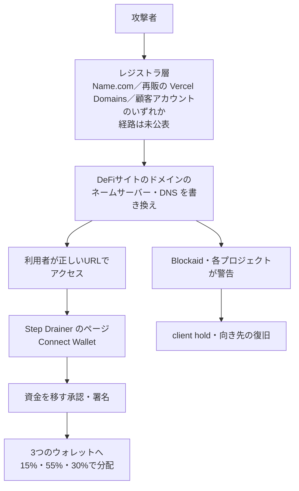

# Name.com ― DeFiサイトのドメインが乗っ取られ資金抜き取りページに

## 要点

### 影響を受けたもの

- Blockaid が警告した少なくとも12のDeFi関連サイト。Flap（flap.sh）、Kintsu（kintsu.xyz）、pickle.finance、origami.finance、fluxbeam.xyz、echelon.market、stonkfun.xyz、stakepoint.app、supswap.xyz、longbow.cash、shprd.finance、apexdefi.xyz（Blockaid の警告を引用した The Block、The Crypto Times）。
- 12ドメインはすべてレジストラ Name.com の登録だった（The Block が登録情報で確認）。Name.com は「15の顧客ドメインが不正に転送された」として、すべて復旧したと説明している（Crypto Briefing、TokenPost）。
- Vercel は、自社に関係する10ドメインが影響を受け、Name.com が復旧したと公表した（Vercel）。Vercel のドメインサービスは上流のレジストラとして Name.com を使っている（code404zero）。
- 被害額は、The Block が EVM チェーン上で追跡できた約13万8,000ドル。Solana と Aptos 上のサイト（FluxBeam、StonkFun、StakePoint、Echelon）の被害は含まない（The Block）。
- 各プロジェクトのスマートコントラクトは侵害されていない（Crypto Briefing、code404zero）。製品の脆弱性の公表ではないため「影響バージョン」はない。

### 今すぐやること

- **対象サイトでウォレットを接続・署名した人**：Kintsu は、10月31日 00:00 UTC（日本時間9時）ごろ以降に接続や署名をした利用者に、Revoke.cash などで承認（トークンの使用許可）を取り消し、資金を移すよう求めている（The Crypto Times）。
- **ドメインを持つ運営者**：レジストラのアカウントで多要素認証を有効にし、DNS の設定に覚えのない変更がないか確認する。Name.com 自身が顧客にこの2点を求めている（Crypto Briefing）。
- レジストラの「レジストリロック」や、ネームサーバー・DNS レコードの変更を外部から監視する仕組みを入れる（infosecpwn のまとめ）。

## 概要

- 10月30日（金）の夜、米東部時間で、複数のDeFiサイトが本物のドメインのまま攻撃者のページを表示し始めた。訪問者が「Connect Wallet」を押すと、資金を移す承認や署名を求める画面が出る仕組みだった（The Block、The Crypto Times）。
- 使われたのは Step Drainer という、販売・貸し出しされている資金抜き取りの道具。LevelBlue SpiderLabs は4月に、全ソースコードが約750ドル、盗んだ額の20%を取る版が150ドルで売られており、20以上のブロックチェーンに対応するとうたっていると報告していた（The Block）。
- 被害サイトの DNS を運用している事業者はばらばらで、Cloudflare、Vercel、Name.com 自身のネームサーバーが混ざっていた（The Block、code404zero）。共通点は登録先のレジストラだけだった。
- 侵入経路は公表されていない。Name.com 本体の問題か、Vercel のような再販事業者側か、個々の顧客アカウントかはわかっていない（code404zero、Crypto Briefing）。

> この記事では、ベンダー・公的機関・研究者・報道で確認できた内容を「事実」、筆者の推測や意見を「考察」として分けて書いています。

## 何が起きたか（時系列）

時刻は出典の表記を UTC に直したもの。10月30日の米東部時間は夏時間（UTC−4）。

| 日時（UTC） | 出来事 |
| --- | --- |
| 10月31日 01:00〜01:42 | BNB Chain 上で、攻撃者側の Safe ウォレットに4つのウォレットから約3.1BNBが入る（The Block） |
| 10月31日 01:10 | X の利用者が Flap のサイトの異常を指摘（The Block） |
| 10月31日 02:13 | Flap が flap.sh の「DNS ハイジャック」を公表し、利用者に注意を呼びかけ（The Crypto Times） |
| 10月31日 02:54 | Blockaid が Flap と Kintsu の攻撃を警告（The Block） |
| 10月31日 03:16 | Blockaid が、さらに10サイトで Step Drainer が動いていると追加で警告（The Crypto Times） |
| 10月31日 04:11 | Kintsu が、Vercel Domains で登録した kintsu.xyz がレジストラの段階で乗っ取られたと説明。04:15 から自社の基盤に向き先が戻る（code404zero） |
| 10月31日 12:32 | 10ドメインがレジストラ側で「client hold」（名前解決を止める状態）にされる（The Block） |
| 10月31日 | Name.com が15ドメインの復旧を説明。Vercel が10ドメインの影響と復旧を公表（Crypto Briefing、Vercel） |

## 技術的な問題点（根本原因）

**事実**

- 攻撃はコントラクトではなく、その手前の「サイトの住所」で起きた。ドメインのネームサーバーや DNS レコードを書き換えれば、利用者が正しいURLを入力しても攻撃者のサーバーにつながる（Crypto Briefing、code404zero）。
- Flap と Kintsu、Blockaid は、乗っ取りがレジストラの段階で起きたと述べている（Crypto Briefing）。複数の DNS 事業者にまたがっていることも、ネームサーバーを決めるレジストラの段階での変更と整合する、と code404zero は指摘している。
- 盗んだ資金は3つのウォレットに 15%・55%・30% の固定比率で分けられていた。同じ3つのウォレットが BNB Chain、Ethereum、Robinhood Chain、Monad で同じ比率の入金を受けていた。Monad では Kintsu のステーキングトークン sMON を引き出し、Robinhood Chain ではトークン化株式（NVDA、AAPL など）を Morpho から引き出して ETH に替えていた（The Block）。
- 根本原因は、10月31日時点で Name.com から公表されていない。Origami は、Vercel と Name.com が原因の分析を出すまでボールトを止めたままにするとしている（The Block を引用した code404zero）。

**考察**

- 同じレジストラの多数の暗号資産関連ドメインが同じ夜に一斉に書き換えられ、DNS 事業者がばらばらだったことから、個々の顧客がそれぞれ偶然パスワードを盗まれたとは考えにくい。レジストラか再販事業者の、複数の顧客をまたいで操作できる仕組み（サポート用の機能、API、管理画面など）が使われた可能性があるが、これは推測で、公式には確認されていない。
- 被害額が「大きなブリッジ攻撃」に比べて小さいのは、発覚から警告までが1〜2時間と早く、ウォレットの警告機能も働いたためと見られる。

## 攻撃・侵入経路

## なぜ防げなかったか・構造的要因の考察

**考察**

- **「コードは監査済み」でも、入口のドメインは監査の外。** DeFi のプロジェクトはコントラクトの監査に力を入れるが、利用者が触れるのは Web サイトで、その住所はレジストラのアカウント1つで決まる。今回、コントラクトは無傷でも利用者は資金を失った。
- **再販の連鎖でレジストラが見えにくい。** Vercel でドメインを取った運営者は、実際の登録先が Name.com だと意識していない場合がある。上流の1社の問題が、使っているホスティングの違いを越えて広がった。
- **DNS のキャッシュで復旧後も被害が続く。** Kintsu は向き先を戻した後も、キャッシュが消えるまで最大1時間ほど古い向き先が表示されうるとして、サイトに近づかないよう求めていた（code404zero）。復旧の作業と、利用者への「もう安全」という告知は分けて考える必要がある。
- **暗号資産の被害は、コードより運用面に偏っている。** TRM Labs は10月30日の集計で、2017年以降に北朝鮮によるとした100件のうち、スマートコントラクトの欠陥を突いたのは13件で、残りは鍵・サーバー・署名の仕組みを狙ったものだったとしている（infosecpwn のまとめによる）。今回は北朝鮮との関係は示されていないが、狙われたのがコードの外側だった点は同じ。

## 運用者向けの具体的な対策と検知ポイント

**事実（Name.com、各プロジェクト、報道）**

- Name.com は顧客に、DNS の設定の確認と二要素認証の有効化を求めている（Crypto Briefing）。
- 一部のプロジェクトは、ネームサーバーを Vercel や Cloudflare に移すことで被害を抑えた（Crypto Briefing）。
- 利用者向けには、対象期間に接続・署名したウォレットの承認の取り消しと資金の移動が呼びかけられている（The Crypto Times）。

**考察（運用上の工夫）**

- **ドメインを鍵と同じ重さで守る。** レジストラのアカウントにはハードウェアキーなどフィッシングに強い多要素認証をかけ、使える人を絞る。レジストリロック（レジストリ側で変更を止める有料サービス）が使える TLD なら有効にする。
- **ネームサーバーと主要レコードを外から監視する。** 自分の権威 DNS ではなく、公開の DNS リゾルバや RDAP で定期的にネームサーバー・A レコードを確かめ、変わったらすぐ通知する。証明書の透明性ログ（Certificate Transparency）で、自分のドメインに知らない証明書が発行されていないかも見る。
- **フロントエンドの「緊急停止」の手順を用意する。** コントラクトの一時停止だけでなく、ドメインが奪われたときの連絡先（レジストラ、再販事業者、ウォレット警告の事業者）と、利用者への告知の文面を前もって決めておく。
- **利用者側は、署名の中身を読む。** 正しいURLでも安全とは限らない。ウォレットの取引シミュレーションや警告を有効にし、無制限の承認や見覚えのない署名要求は断る。

## 参考リンク

- [Name.com domain takeover notice（Vercel）](https://vercel.com/kb/bulletin/name-com-domain-takeover-notice)
- [Hackers hijack a dozen DeFi websites, all registered with Name.com, and steal about $138,000（The Block、2026年10月31日）](https://www.theblock.co/news/defi/2026-10-31-hackers-hijack-a-dozen-defi-websites-all-registered-with-name-com-and-steal-about-138000-432251)
- [Name.com restores hijacked domains after attack hit at least 12 DeFi front ends（Crypto Briefing、2026年10月31日）](https://cryptobriefing.com/name-com-restores-hijacked-defi-domains/)
- [Flap, Kintsu Websites Hijacked as StepDrainer Wallet Drainer Hits 10 More DeFi Sites（The Crypto Times、2026年10月31日）](https://www.cryptotimes.io/2026/10/31/flap-kintsu-websites-hijacked-as-stepdrainer-wallet-drainer-hits-10-more-defi-sites/)
- [DNS Hijacking: 12 DeFi Sites Served a Wallet Drainer（code404zero）](https://code404zero.com/en/dns-hijacking-defi-sites-name-com-wallet-drainer/)
- [Name.com Restores 15 Domains After DeFi Website Redirects（TokenPost）](https://www.tokenpost.com/news/technology/45601)
