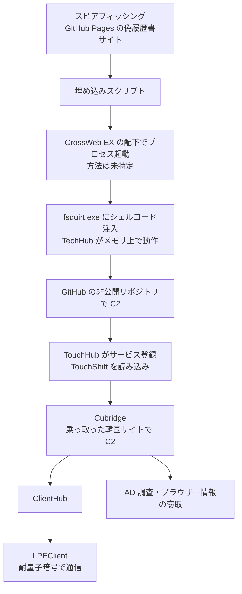

# Lazarus ― 韓国の必須セキュリティソフト配下でマルウェアを実行

## 要点

### 影響を受けたもの

- 韓国の企業少なくとも3社（ソフトウェア開発、建設、有線通信機器の製造）。Kaspersky は、実際の被害はこれよりずっと多いとみている（Securelist）。
- 悪用された可能性が高いのは INISAFE CrossWeb EX V3 3.4.1.2。KrCERT の注意喚起を受けて2023年に出た版だが、どう悪用されたかは特定されていない（Securelist）。新しい脆弱性や修正版は公表されていないため、この記事では「影響バージョン」を書けない。

### 今すぐやること

- **韓国の拠点・取引先を持つ組織**：CrossWeb EX などの「必須セキュリティソフト」がまだ入っている端末を洗い出し、使っていなければ削除する。残す場合は最新版にする。
- **検知**：`INISAFECrossWebEXSvc.exe` から `fsquirt.exe` などが子プロセスとして起動していないか、`C:\Windows\System32\RasConv\`、`C:\ProgramData\RasConv\mscoree.dll`、`C:\Windows\System32\DrvConh\` があるか、EDR とファイルの棚卸しで確認する。
- **通信の確認**：下の「検知ポイント」の C2 ドメインと、業務で使っていない GitHub API への通信を確認する。

## 概要

- Kaspersky は10月21日、北朝鮮の Lazarus による「Operation FlashHole」を Securelist で公表した。以前報告された「Operation SyncHole」に続く活動と位置づけている（Securelist）。
- 被害者は GitHub Pages の偽の履歴書サイトなどに誘導されたとみられ、その後 CrossWeb EX のプロセスの配下で、正規の `fsquirt.exe` にシェルコードが注入された（Securelist）。
- TechHub、TouchHub、Cubridge、ClientHub、LPEClient が連鎖して動き、C2 には GitHub の非公開リポジトリと、乗っ取られた韓国のウェブサイトが使われた（Securelist）。

> この記事では、ベンダー・研究者で確認できた内容を「事実」、筆者の推測や意見を「考察」として分けて書いています。

## 何が起きたか（時系列）

| 時期 | 出来事 |
| --- | --- |
| 2021〜2023年 | Lazarus が CrossWeb EX を悪用した事例が続く（Securelist） |
| 2023年 | KrCERT の注意喚起を受けて INISAFE CrossWeb EX V3 3.4.1.2 が公開（Securelist） |
| 2025年7月 | このころまでに活動開始（Securelist） |
| 2025年9月 | 偽の履歴書サイトに使われた GitHub アカウントが作られる。AI で作った顔写真と、ネットワーク機器の上級開発者を名乗る履歴書が載っていた（Securelist） |
| 2025年10月 | 韓国政府が、2026年から必須セキュリティソフトを段階的にやめる方針を発表（Securelist） |
| 2026年1月 | Kaspersky が被害企業の対応を始める。同じころ偽の履歴書サイトはインテリア業者のサイトに差し替えられる（Securelist） |
| 2026年7月 | 韓国政府と関係ベンダーが Lazarus の手口について共同で注意喚起（Securelist） |
| 2026年10月21日 | Kaspersky が報告を公開し、セキュリティアナリストサミット（SAS）で発表（Securelist、Kaspersky） |

## 技術的な問題点（根本原因）

**事実（Securelist）：入口**

- 被害者は GitHub Pages のサイトに誘導されたとみられる（Kaspersky の確度は中〜高）。サイトには `hxxps://javadevhouse.co[.]kr/ajax/libs/jquery/1.7.3/jquery.min.js` と `hxxps://pythonapischool[.]com/api/detach` のスクリプトが埋め込まれていた。
- 攻撃の始まりは CrossWeb EX のサービス `INISAFECrossWebEXSvc.exe` で、そこから高い整合性レベルでプロセスが起動していた。CrossWeb EX は韓国の銀行や行政のサイトで導入を求められる金融セキュリティソフトで、Kaspersky は悪用された可能性が高いとするが、方法は特定できていない。
- 正規の `fsquirt.exe`（Bluetooth のファイル転送ツール）にシェルコードが注入され、TechHub がメモリ上だけで動いた。

**事実（Securelist）：マルウェアの連鎖**

| 名前 | 役割 |
| --- | --- |
| TechHub（CLOUDBURST、NickelLoader） | 最初のローダー。GitHub の個人アクセストークン（PAT）で非公開リポジトリにアクセスし、Issue を使って C2 とやり取りする |
| TouchHub（新種） | 常駐の仕組みを作る。`printfilterpipelinesvc.exe` を `C:\Windows\System32\RasConv\ImeBroker.exe` に複製し、`netsvcs` のサービス名に2文字足した名前で説明「Microsoft Service」のサービスを登録する。ファイルの日時は `monitor.sys` に合わせる |
| TouchShift | サイドロードされる `mscoree.dll`。AES-CBC-128 で次の段を復号する |
| Cubridge（SIDESHOW、LightlessCan） | 中心となる遠隔操作の本体。RSA と RC6 で通信し、乗っ取られた韓国のサイトを C2 にする。AD の調査やブラウザーの情報を盗むプラグインを持つ |
| ClientHub（新種） | CookiePlus の発展形。Lazarus として初めて SNOW 1.0 という暗号を使い、ブラウザーの `Sec-CH-UA` ヘッダーをまねる。Dropbox を使う版もある |
| LPEClient | 自分では C2 の接続先を持たず、ClientHub を経由する。GOST（Magma）、ML-KEM-1024 を4回使う鍵交換、Threefish を組み合わせて通信する。Windows の更新番号、入っているウイルス対策製品、KVA シャドウや CET の状態を集める |

- LPEClient は、`jscript9` の `HeapPageAllocator::ProtectPages` を使って、ユーザーモードのシステムコール監視のフックを無効にしていた。
- C2 用の GitHub リポジトリは少なくとも3つと予備が1つあり、Kaspersky はアカウントが乗っ取ったメールアドレスで作られたとみている。

## 攻撃・侵入経路

## なぜ防げなかったか・構造的要因の考察

**考察**

- **導入を強制されたソフトが攻撃の足場になる。** CrossWeb EX は利用者が自分で選んだものではなく、銀行や行政のサイトを使うために入れさせられるものだ。高い権限で常に動いているうえ、Lazarus は2021年から何度もこの種のソフトを狙っている。韓国は2026年から廃止を進めているが、すでに入っている端末からは自動では消えない。
- **よく使われる正規サービスの中に C2 が紛れる。** GitHub の API、Dropbox、乗っ取られた国内企業のサイトは、どれも企業の通信で普通に見かける。宛先だけを見る遮断では止めにくい。
- **ディスクに痕跡が少ない。** 最初の段はメモリ上だけで動き、常駐の仕組みは正規の Windows のファイル名やサービス名、日時に似せてある。ファイルを調べるだけの対策では見つけにくい。
- **暗号の強化は解析を遅らせる狙いとみられる。** ML-KEM-1024 や SNOW 1.0 を使うのは、通信を後から復号されないようにするためと考えられる。防御側としては、中身を読めない前提で、通信の相手と頻度から異常を探すことになる。

## 運用者向けの具体的な対策と検知ポイント

**事実（Securelist）：検知に使える指標**

| 種類 | 内容 |
| --- | --- |
| プロセス | `INISAFECrossWebEXSvc.exe` から起動した高い整合性レベルのプロセス、シェルコードが注入された `fsquirt.exe` |
| ファイル | `C:\ProgramData\RasConv\mscoree.dll`、`C:\Windows\System32\RasConv\`、`C:\Windows\System32\DrvConh\`、`C:\Program Files\Common Files\System\msadc\msadc.inc`、`ActivationStore.dat` |
| サービス | `netsvcs` の正規名に2文字足した名前で、説明が「Microsoft Service」 |
| スクリプトの読み込み元 | `javadevhouse.co[.]kr`、`pythonapischool[.]com` |
| C2（Cubridge、ClientHub） | `cubedesign.co[.]kr`、`k-wbc.co[.]kr`、`rcsh.co[.]kr`、`www.ksog[.]org`、`fp-news.co[.]kr` |

**考察（運用上の工夫）**

- **必須セキュリティソフトを棚卸しする。** 韓国の銀行や行政のサイトを使う端末に入っているソフトを一覧にし、不要なものを消す。残すものは版を管理し、外からの接続を受けるローカルのポートを確認する。
- **正規ツールの親子関係を見る。** `fsquirt.exe` は手動で使うツールで、サービスから起動するのは不自然だ。セキュリティソフトのサービスを親にした `cmd.exe`、`powershell.exe`、`rundll32.exe` などの起動も警告の対象にする。
- **GitHub API の利用を把握する。** 開発者以外の端末から `api.github.com` に定期的にアクセスしていたら調べる。組織で GitHub を使っているなら、許可した組織以外へのアクセスを検知できるようにする。
- **採用担当や開発者向けの注意。** 偽の履歴書や求人のサイトへの誘導は、Lazarus がよく使う手だ。採用の連絡に添えられたリンクは、業務用の端末で開かないようにする。

## 参考リンク

- [Lazarus Operation FlashHole（Securelist、2026年10月21日）](https://securelist.com/lazarus-operation-flashhole/121541/)
- [Kaspersky identifies new Lazarus APT campaign utilizing AI and post-quantum encryption（Kaspersky プレスリリース）](https://www.kaspersky.com/about/press-releases/kaspersky-identifies-new-lazarus-apt-campaign-utilizing-ai-and-post-quantum-encryption)
