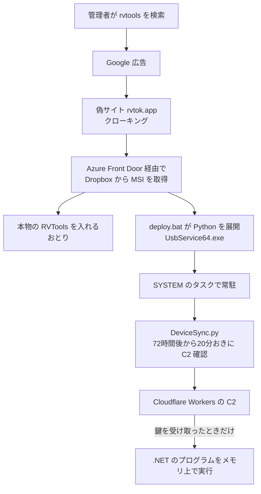

# RVTools ― 検索広告経由で改ざん版インストーラーが配布された

## 要点

### 影響を受けたもの

- 2026年10月に Google 広告から偽サイト `rvtok[.]app` に誘導され、`rvtools4.8.1.msi` や `rvtools4.7.1.msi` を入れた端末（Vega）。RVTools 自体の脆弱性や、正規の配布元の改ざんではない。
- 配布の基盤は2026年5月25日から確認されていた（Vega が ReversingLabs のデータとして紹介）。被害の件数は公表されていない。

### 今すぐやること

- **RVTools を最近入れた管理者**：インストーラーの入手元を確認する。下の SHA-256 に一致する MSI や、`C:\ProgramData\Microsoft\DiskCleanup\python\UsbService64.exe` があれば感染を前提に調べる（Vega）。
- **さかのぼって調べる**：Vega は、5月下旬までさかのぼってログを調べるよう勧めている。
- **感染端末が vCenter／ESXi の管理用だった場合**：その端末から使った vCenter・ESXi の認証情報を変更し、アクセスの記録を確認する（Vega）。
- **入手経路を決める**：ツールは社内の承認済みの配布元から入れ、検索広告からはダウンロードしない。

## 概要

- Vega は11月2日、RVTools を装った MSI が `DeviceSync.py` という Python 製の常駐プログラムを入れると報告した。MSI は本物の RVTools も入れるため、利用者は異常に気づきにくい（Vega）。
- `DeviceSync.py` は端末の情報を Cloudflare Workers 上の C2 に登録し、72時間待ってから20分おきに命令を確認する。C2 が鍵を渡したときだけ、暗号化された .NET のプログラムをメモリ上で読み込む（Vega）。
- 別の検体に SmokedHam に似たドロッパーとロシア語のコメントがあり、Vega は UNC2465（Storm-0241）との関連を中程度の確度で評価している（Vega）。

> この記事では、ベンダー・研究者で確認できた内容を「事実」、筆者の推測や意見を「考察」として分けて書いています。

## 何が起きたか（時系列）

| 時期 | 出来事 |
| --- | --- |
| 2026年5月25日 | 配布に使われた基盤を ReversingLabs が初めて確認（Vega） |
| 2026年10月 | 「rvtools」の検索に Google 広告が表示され、偽サイト `rvtok[.]app` に誘導される（Vega） |
| 2026年11月2日 | Vega が分析を公開（Vega） |

## 技術的な問題点（根本原因）

**事実（Vega）：配布の流れ**

- 偽サイト `rvtok[.]app` はクローキング（調査者や検索エンジンには別の内容を見せる手口）を使い、`rvtooks[.]com` に問い合わせていた。
- ダウンロードは Azure Front Door（`web-app-server-gqdmgecbb2e6czg3.z03.azurefd[.]net`）を経由して Dropbox から配られた。

**事実（Vega）：インストーラー**

- MSI には署名がなく、製品名は `TeamsUpdater_A28`、製造元は `UpdateSoft_U3E3AX` で、ファイル名と合っていない。
- Dell の署名がある本物の RVTools をおとりとして入れる。
- `deploy.bat` が `tar` で CPython 3.12（pycryptodome、pythonnet 入り）を `C:\ProgramData\Microsoft\DiskCleanup\python\` に展開し、`pythonw.exe` を `UsbService64.exe` に名前を変える。
- SYSTEM 権限のタスク `LanguagePack`（5分後に1回）と `SecurityHealth`（ログオン時）を登録する。Run キー `OfficeHelper` も作るが、こちらは動かない。

**事実（Vega）：DeviceSync.py**

- 端末の情報を集め、Cloudflare Workers の C2（`red-fire-92b4.redis-3a9.workers[.]dev`、`rough-base-bddc.web-static-4jf.workers[.]dev`）に登録する。
- 通信は AES-CBC と HMAC-SHA256 で守られているが、TLS の証明書は検証しない。
- 既定では72時間眠り、その後20分ごとに C2 を確認する。C2 が 403・404・410 を返すと終了する。
- 暗号化された .NET のプログラムを持ち、C2 から鍵を受け取ったときだけ `Assembly.Load` でメモリ上に読み込む。中身は Vega も確認できていない。

**事実（Vega）：UNC2465 と結びつけた根拠**

- 2つ目の検体（`rvtools4.7.1.msi`）には、SmokedHam に似たドロッパー（MSDTC の `OracleOciLibPath` を使う、タスク名 `CollectTask`）が入っていた。
- 起動用のスクリプトに「`_c.bat` をまねて書いた」という意味のロシア語のコメントがあった。
- UNC2465（Storm-0241）は、これまで DarkSide、LockBit、Hunters International、Qilin のランサムウェアとの関係が指摘されてきた集団だ。今回の件でランサムウェアが使われたとは報告されていない。

## 攻撃・侵入経路

## なぜ防げなかったか・構造的要因の考察

**考察**

- **狙われているのは管理者の端末だ。** RVTools を使うのは vSphere の管理者で、その端末には vCenter や ESXi の認証情報がある。ランサムウェアの集団にとっては、仮想化基盤をまとめて暗号化するための近道になる。UNC2465 との関連が正しければ、この端末を足場にした次の段階が想定される。
- **本物が一緒に入るので気づかない。** インストールが終わると RVTools は普通に動く。利用者から見れば正常にインストールできたことになる。
- **72時間の待ち時間で、インストールと通信が結びつかない。** サンドボックスでの短時間の解析や、「入れた直後に変な通信がないか」という確認では見つからない。
- **正規のクラウドの名前が並ぶ。** 配布は Azure Front Door と Dropbox、C2 は Cloudflare Workers で、どれも企業の通信によくある宛先だ。ドメインの評判だけでは止めにくい。
- **検索広告は以前から管理者向けツールの偽装に使われている。** 管理者は「公式サイトを検索してダウンロードする」ことに慣れており、広告と検索結果の区別が甘くなりやすい。

## 運用者向けの具体的な対策と検知ポイント

**事実（Vega）：推奨されている対策**

- 5月下旬までさかのぼってテレメトリを調べる。
- MSI の製品名とファイル名が合っているか確認する。Windows Installer のイベント 1033 と 11707 が手がかりになる。
- 承認済みの配布元からだけソフトを入れ、アプリケーション制御を使う。
- 感染した端末が vCenter／ESXi の管理用なら、そのアクセスを見直し、認証情報を変更する。

**事実（Vega）：検知に使える指標**

| 種類 | 内容 |
| --- | --- |
| ドメイン | `rvtok[.]app`、`rvtooks[.]com`、`web-app-server-gqdmgecbb2e6czg3.z03.azurefd[.]net`、`red-fire-92b4.redis-3a9.workers[.]dev`、`rough-base-bddc.web-static-4jf.workers[.]dev` |
| ファイル | `C:\ProgramData\Microsoft\DiskCleanup\python\UsbService64.exe`、`deploy.bat`、`DeviceSync.py` |
| タスク・レジストリ | タスク `LanguagePack`・`SecurityHealth`・`CollectTask`、Run キー `OfficeHelper`、MSDTC の `OracleOciLibPath` |
| MSI の属性 | 製品名 `TeamsUpdater_A28`、製造元 `UpdateSoft_U3E3AX`、署名なし |
| SHA-256 | `rvtools4.8.1.msi`：`4d5b1eadb300d4e0f1a8d54795866221f0036dafd780b61e558ff8658ce34ee5` `rvtools4.7.1.msi`：`c3986133652628cbdf89c6b594401672f24430d77c2918d4381e0e80ff605677` `DeviceSync.py`：`2552e2af5dd85791ae773c40bff51302f3095628e51fc9ef4342edf3d5583575` |

**考察（運用上の工夫）**

- **管理者の端末にだけ厳しいルールを課す。** vCenter や ESXi にアクセスできる端末では、署名のない MSI のインストールを止め、ツールは社内の配布サイトから入れる。
- **`pythonw.exe` の改名を探す。** 署名やハッシュが Python のものなのに、ファイル名が違うプロセスを探す。`C:\ProgramData\Microsoft\` の下に Python の実行環境がある端末も調べる。
- **`*.workers.dev` への定期的な通信を見る。** 業務で使っていないなら、20分おきの一定間隔の通信は分かりやすい手がかりになる。
- **広告を経由したダウンロードを減らす。** 管理者向けに主要なツールの公式 URL をブックマークで配るか、DNS のフィルタで新しく登録されたドメインを止める。

## 参考リンク

- [Trojanized RVTools: Python Stager Linked to UNC2465（Vega、2026年11月2日）](https://vega.io/blog/trojanized-rvtools-python-stager-linked-to-unc2465)
