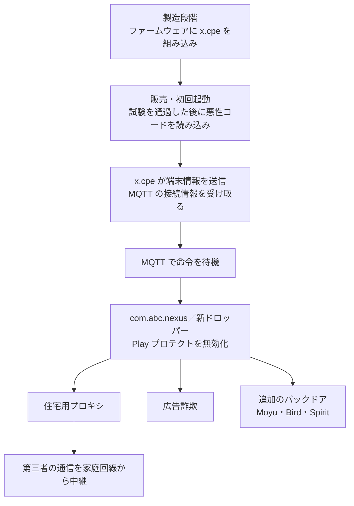

# XCPEボットネット ― 製造元がTV端末に仕込んだバックドアをGoogleが解体

## 要点

### 影響を受けたもの

- Videostrong Technology Co. が製造した Android TV のセットトップボックスなど。GTIG は、複数年にわたる組織的な運用だったとしている。感染端末の大半はセットトップボックスで、遠隔医療機器、カラオケ機、デジタルサイネージも含まれていた（GTIG）。
- Synthient は、2025年末に購入した MECOOL KM9PRO Max にバックドアが最初から入っていたのを確認している（BleepingComputer が Synthient の報告を紹介）。
- 脆弱性の公表ではないため「影響バージョン」はない。対象の機種の一覧は、この記事で確認した資料には見当たらなかった。

### 今すぐやること

- **利用者**：メーカーのわからない格安の Android TV ボックスは、ネットから外すか使うのをやめる。C2 は止められたが、端末からマルウェアは消えておらず、消しても `/oem/` 領域から再インストールされる。取り除くには正規のファームウェアを入れ直すしかない（BleepingComputer）。
- **購入時**：Google の Android TV のパートナー一覧に載っているメーカーの製品を選ぶ。Google Play プロテクトが有効になっているか確認する（GTIG）。
- **企業・家庭のネットワーク管理者**：下の「検知ポイント」にあるドメインへの通信がないか、DNS とプロキシのログを確認する。会議室や店頭のサイネージに格安の Android 端末を使っていないか棚卸しする。

## 概要

- GTIG は11月2日、Videostrong が `x.cpe`（一部では `com.oemservice`）というバックドアをファームウェアに組み込み、130万台超のセットトップボックスをボットネットにしていたと「高い確度」で評価した。内部の一人の不正や開発上のミスではないとしている（GTIG）。
- Videostrong はボットネットへのアクセスを犯罪者（アフィリエイト）に売り、住宅用プロキシ、広告詐欺、追加のバックドアのモジュールを端末に入れていた（GTIG）。
- Google は警察庁、Lumen、HUMAN Security、Plume、Synthient、TrendAI と協力し、法的措置で C2 を停止した。Videostrong とその関連会社を、認証済み Android 機器の製造とソフト供給から締め出した（GTIG）。

> この記事では、ベンダー・公的機関・研究者・報道で確認できた内容を「事実」、筆者の推測や意見を「考察」として分けて書いています。

## 何が起きたか（時系列）

| 時期 | 出来事 |
| --- | --- |
| 2024年後半より前 | 単純なドロッパーとして端末に組み込まれ、収益化モジュールも `x.cpe` に直接入っていた（GTIG） |
| 2024年後半 | 収益化モジュールを `x.cpe` から外し、別の読み込み役 `com.abc.nexus` に移す。GTIG は、BadBox に対する Google の措置への対応だった可能性があるとしている（GTIG） |
| 2025年末 | Synthient が購入した MECOOL KM9PRO Max でバックドアを発見（BleepingComputer） |
| 2026年8月以降 | `com.abc.nexus` がボットネット全体で一斉に削除され、Android のシステムアプリを装う小さなドロッパーに置き換わる（GTIG） |
| 10月下旬（GTIG の「先週」） | Google と協力機関が XCPE の C2 を停止（GTIG） |
| 11月2日 | GTIG と Synthient が報告を公開（GTIG、BleepingComputer） |

## 技術的な問題点（根本原因）

**事実（GTIG）：3段の構成**

| 段 | 名前 | 役割 |
| --- | --- | --- |
| 1 | `x.cpe`（`com.oemservice`） | `android.uid.system` の権限で動く本体。ファームウェアに入っていて利用者は消せず、`/data/app/` から消しても再起動時に `/oem/` から戻る。C2 との通信を受け持つ |
| 2 | `com.abc.nexus` | 読み込みと実行の担当。サンドボックスを見分ける仕組みと `libseccomp_guard.so`（スレッドの停止や外部からの調査を妨げる）を持ち、収益化モジュールを起動する |
| 3 | 収益化モジュール | アフィリエイトが作ったもの。ネイティブの ELF、組み込みの SDK、後から取ってくる APK の3形態 |

**事実（GTIG）：C2 と遠隔操作**

- 起動すると、端末のシリアル番号、MAC アドレス、機種、ファームウェアの版を AES で暗号化して HTTP POST で送り、MQTT ブローカーの接続先と認証情報、モジュールの設定を受け取る。その後は MQTT の常時接続で命令を待つ。
- 命令でできること：アプリの無断インストール、Google Play プロテクトの無効化（`package_verifier_user_consent` を `-1` にする）、システム権限でのシェルコマンド実行、画面の取得、キー入力の注入、アカウントや端末の情報の収集、ネットワークの調査、リバースシェル（BleepingComputer も同じ内容を報じている）。
- C2 のドメインは `anyevonline[.]com` の各サブドメイン、MQTT ブローカーは `mqtt.szbboys[.]com` にあった（BleepingComputer）。

**事実（GTIG）：載っていたモジュール**

- 住宅用プロキシ・帯域共有：Linkfog、AppSalt／Honeygain、GaGaNode、NetNut（Popanet）、Traffmonetizer、EarnFM。1台に3つの住宅用プロキシ SDK が入っていた例もある。
- 広告詐欺：Fission、CBOXTV、Jaguar、HiddenView（透明な画面を重ねて隠れた WebView でページを開き、スクロール・クリック・入力をまねる）など。
- 追加のバックドア：Moyu、Bird（いずれも以前 BadBox で見つかったもの）、Spirit。HiddenView は攻撃者の GitHub から `com.ota.service` として取ってこられていた。

**事実（GTIG）：2026年8月以降の新しいドロッパー**

- `com.android.system.ntp` や `com.android.sso.auth.handler` のようなシステムアプリ風の名前で、1つの収益化モジュールだけを入れる。
- 多くの版が `libexploit.so` を展開し、`adbd` を root で再起動して ADB シェルにつなぎ、`/system/priv-app/` に自分を複製する。`/system/etc/permissions/` に XML を置き、`INSTALL_PACKAGES` と `REBOOT` の権限を自分に与える。
- インストール日時を他のシステムアプリに合わせて書き換える設定もある。

**事実：Videostrong と結びつけた根拠（BleepingComputer が Synthient の報告を紹介）**

- `file.anyevonline[.]com` の公開状態のディレクトリに、Videostrong の研究開発部門の責任者の名前が入った PDF があった。
- `videostrong[.]cn` が、端末の一覧や命令の送信に使う `mqtt.anyevonline[.]com` と同じ IP アドレスを指していた。
- バックドアの署名に、Videostrong の社員のメールアドレスが多数使われていた。

**事実（GTIG）：Google の試験をすり抜けた方法**

- Google は OEM に互換性とセキュリティの試験を課しているが、Videostrong は難読化で試験の隙を突き、初回起動の後で悪性のコードを読み込んでいた。Google はこれを受けて審査を変えた。

## 攻撃・侵入経路

## なぜ防げなかったか・構造的要因の考察

**考察**

- **攻撃者が製造元そのものだった。** 脆弱性もフィッシングもなく、買った時点で感染していた。利用者は「アプリを入れない」「更新する」といったふだんの対策では防げない。消しても戻るので、ファームウェアごと入れ替えるか、使うのをやめるしかない。
- **認証は出荷時点の検査でしかない。** Google の試験は、初回起動後に悪性のコードを取ってくる作りを見抜けなかった。出荷後にネット経由で中身が変わる機器では、出荷時に一度調べただけでは安全を保証できない。
- **収益の仕組みが分業になっている。** 製造元はバックドアと配布の場を持ち、プロキシ業者や広告詐欺の業者が「入居者」としてモジュールを載せる。GTIG が書くとおり、一つが止まっても別の読み込み役や別の SDK に乗り換えられる。2024年後半と2026年8月に構成を変えているのも、取り締まりに合わせて形を変える動きに見える。
- **被害は持ち主の外に出る。** 住宅用プロキシは、第三者の不正な通信を家庭や店舗の回線から出す。持ち主に自覚がないまま、自分の IP アドレスが攻撃やアカウント乗っ取りの中継元として記録される。日本の警察庁が協力しているのは、国内にも感染端末や被害があることを示しているのかもしれないが、国内の台数は公表されていない。

## 運用者向けの具体的な対策と検知ポイント

**事実（GTIG）：推奨されていること**

- 利用者は、信頼できるメーカーの機器だけを買い、「使っていない帯域を共有するとお金がもらえる」アプリを避け、Google Play プロテクトを有効にしておく。
- 小売・流通は、ODM に独立したセキュリティ監査を求め、供給網の悪用にかかわったメーカーを速やかに取り扱いから外す。

**事実：検知に使える指標（GTIG、BleepingComputer）**

| 種類 | 内容 |
| --- | --- |
| ドメイン | `anyevonline[.]com` とそのサブドメイン（`mqtt.anyevonline[.]com`、`file.anyevonline[.]com`）、`mqtt.szbboys[.]com` |
| パッケージ名 | `x.cpe`、`com.oemservice`、`com.abc.nexus`、`com.vs.grass`、`com.android.system.ntp`、`com.android.sso.auth.handler`、`com.ota.service` |
| ファイル | `libseccomp_guard.so`、`libexploit.so`、`lw_android_agent` |
| 端末の設定 | `package_verifier_user_consent` が `-1`、`persist.networkstack.*` というシステムプロパティ |

**考察（運用上の工夫）**

- **家庭用の機器を業務の回線に置かない。** 店頭や会議室で格安の Android 端末を使っているなら、別の VLAN や来客用の回線に分け、外向きの通信先を絞る。MQTT（TCP 1883・8883）が外に出ていく端末があれば調べる。
- **自社の IP アドレスが住宅用プロキシの出口になっていないか確かめる。** 外部の脅威情報サービスで、自社の回線の IP がプロキシの出口として載っていないかを確認できる。
- **ADB を確認する。** 新しいドロッパーは `adbd` を root で動かす。社内で見つかった Android 端末で ADB が有効になっていれば、その端末は信用しない。

## 参考リンク

- [Shutting the Door on the XCPE Botnet（Google Threat Intelligence Group、2026年11月2日）](https://cloud.google.com/blog/topics/threat-intelligence/shutting-the-door-on-the-xcpe-botnet/)
- [Google disrupts million-device XCPE Android malware botnet, bans TV box maker（BleepingComputer、2026年11月2日）](https://www.bleepingcomputer.com/news/security/google-disrupts-million-device-xcpe-android-malware-botnet-bans-tv-box-maker/)
- [Google shuts down global botnet running on certified Android devices（CyberScoop）](https://cyberscoop.com/google-disrupts-xcpe-botnet-videostrong-android-devices/)
