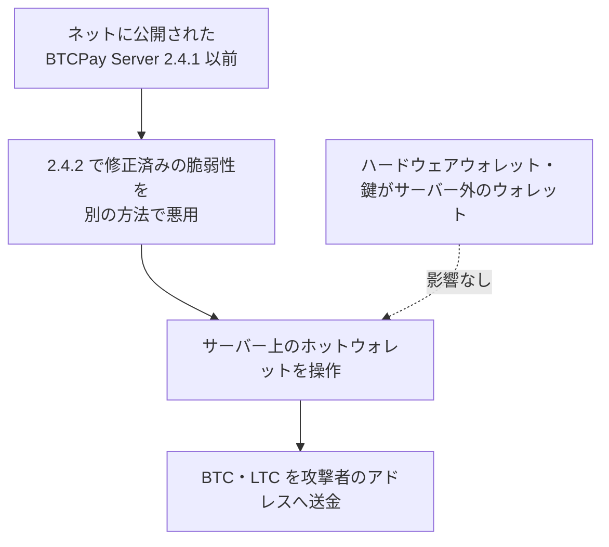

# BTCPay Server ― 古い版のサーバーでホットウォレットの資金が抜かれた

## 要点

### 影響バージョン

- BTCPay Server 2.4.1（2026年7月23日公開）以前。警告の時点で 2.4.2（8月7日公開）以降に上げていたサーバーには影響がなかった（BTCPay Server）。
- 被害はサーバー上に鍵を置くホットウォレット。ハードウェアウォレットや、鍵をサーバーの外に置くウォレットには影響がない（BTCPay Server）。

### 今すぐやること

- 2.4.1 以前を動かしていたなら、被害に気づいていなくても、警告のあとで更新していても、ホットウォレットの資金を移し、新しいウォレットと新しいシードで新しいサーバーを立てる（BTCPay Server）。
- 古いサーバーはログを残したうえでネットから外す。丸ごと復元して使い続けない（BTCPay Server）。
- 信頼できる端末から、ホスティング、SSH、アプリ、API、Lightning の認証情報を取り消して作り直す（BTCPay Server）。
- 動いているサーバーは最新の 2.4.7 に上げる（BTCPay Server）。

## 概要

- 11月1日、BTCPay Server を動かす複数のサーバーで、ホットウォレットの BTC と LTC が攻撃者に抜かれた。BTCPay は同日 22:25（UTC）に X で利用者へサーバーを止めるよう呼びかけた（BTCPay Server）。
- 狙われたのは 2.4.1 以前。BTCPay は、攻撃者が「2.4.2 で直した脆弱性を、別の方法で悪用した」と説明している。2.4.2 の脆弱性は8月の時点ですでに悪用され、資金が盗まれていた（BTCPay Server）。
- 資金の送り先として、BTC と LTC のアドレスを1つずつ公開した。ただし、報告された盗難より前の動きもあるので、残高をそのまま被害額とは見なせないとしている（BTCPay Server）。

> この記事では、プロジェクトの発表と報道で確認できた内容を「事実」、筆者の推測や意見を「考察」として分けて書いています。

## 何が起きたか（時系列）

| 日時（UTC） | 出来事 |
| --- | --- |
| 2026年7月23日 | 2.4.1 公開（BTCPay Server） |
| 8月7日 | 2.4.2 公開。認証なしで LND の資格情報（macaroon）を取られる脆弱性を修正。すでに悪用されていた（BTCPay Server） |
| 8月10日 | 8月の事件への対応を公表。資金を取り戻した人への報奨金（10%、上限3 BTC）、コードの検査の強化など（BTCPay Server） |
| 10月29日 | 2.4.7 を緊急リリース。Anthropic の OSS スキャナーが見つけた問題を修正（BTCPay Server） |
| 11月1日 13:46 | ウォレットからの引き出しが起きる（BTCPay Server） |
| 11月1日 20:56 | 盗難を知らせる最初のメールが届く（BTCPay Server） |
| 11月1日 | LunaNode などの VPS 事業者に、インスタンスを止めるよう依頼（BTCPay Server） |
| 11月1日 22:25 | X で警告。サーバーを止めるよう呼びかけ（BTCPay Server） |
| 11月2日 04:07 | 調査の結果、狙われたのは 2.4.1 以前と X で発表（BTCPay Server） |
| 11月2日 | ブログで詳しい状況と対応を公表（BTCPay Server） |

## 技術的な問題点（根本原因）

**事実（BTCPay Server）：8月に直した脆弱性**

- 2.4.2 より前のすべての版（RC 版を含む）で、認証のない遠隔の攻撃者が LND（Lightning のノードソフト）の `.macaroon` 資格情報ファイルを取れた。取った攻撃者は LND ノードを操り、資金を動かせた。
- 修正は 2.4.2。あわせて LND 0.21.1 に上げると macaroon が作り直される。2.4.2 では、Docker で動かす構成の LND API の外部公開を一時的にやめた（Zeus などのアプリからつながらなくなる）。
- 8月の時点では、この脆弱性はオンチェーンのホットウォレットには影響しないと説明していた。
- 技術的な詳細は公開していない。報告者として Craig Raw 氏と Team Red を挙げている。

**事実（BTCPay Server）：11月の攻撃**

- 攻撃者は 2.4.2 で直した脆弱性を「別の方法」で悪用した。今回はホットウォレットの資金が抜かれた。具体的な方法は公開されていない。
- 2.4.2 のリリースノートには、ほかに Greenfield API の Basic 認証で TOTP の二段階認証を回避できた問題の修正もある。今回の攻撃に使われたかどうかは説明されていない。

**事実（BTCPay Server）：2.4.7**

- 2.4.7（10月29日）は Anthropic の OSS スキャナーが見つけた85件を直した。元の評価で Critical 1件、High 13件、Medium 52件、Low 19件。
- BTCPay は、2.4.7 でホットウォレットが抜かれたという信頼できる報告はないとしている。

**考察**

- 8月の説明は「LND の資金が危ない、ホットウォレットは無事」だった。そのため、Lightning を使っていない利用者は、更新を急がなかった可能性がある。同じ脆弱性を別の経路で突かれ、ホットウォレットにまで被害が広がった。
- 技術的な詳細を伏せたまま3か月たち、2.4.1 以前のサーバーが残っていた。詳細がなくても、パッチの差分から攻撃方法をたどることはできる。

## 攻撃・侵入経路

## なぜ防げなかったか・構造的要因の考察

**考察**

- **自分で立てるサーバーは、更新が利用者任せになる。** BTCPay Server は店舗や個人が VPS に自分で立てて使う。更新しない限り古い版が残り、プロジェクトの側から止める手段は限られる。今回 BTCPay が VPS 事業者に止めてもらうよう頼んだのも、そのためだと考えられる。
- **ホットウォレットは、サーバーを取られれば資金も取られる。** 鍵をサーバーに置く以上、サーバーの脆弱性がそのまま資金の流出になる。BTCPay も、ホットウォレットに置く額は最小限にするよう勧めている。
- **攻撃の自動化で、修正から悪用までが短くなっている。** BTCPay は「AI を使った自動化された攻撃が増えている」として、すぐの更新を求めている。8月の対応の記事でも、AI が攻撃側と守る側の釣り合いを変えたと書いている。古い版を少しの間でも放置すると狙われやすくなっている。

## 運用者向けの具体的な対策と検知ポイント

**事実（BTCPay Server）：示されている対応**

- 2.4.1 以前を動かしていたなら、要点の「今すぐやること」に沿って新しいサーバーへ移る。古いサーバーを丸ごと戻さない。
- 被害を受けた場合は、詳しい情報とログを `security@btcpayserver.org` に送る。
- ホスティング型のインスタンスは、事業者によって自動で止められている場合がある（The Hacker News）。

**事実（BTCPay Server）：公開された送り先**

| 通貨 | アドレス |
| --- | --- |
| BTC | `bc1p0f7wmcnesrapznymf9ljdn04pudgmh96sqtrm9vmgqxdh666fh8qvn63r7` |
| LTC | `ltc1qp49tmfdueyaqrmgrx0uyx4uegyygt8yt02whee` |

**考察（運用上の工夫）**

- **自分のウォレットの履歴を送り先と照らし合わせる。** 上のアドレスへの送金がないか、11月1日前後の出金を確認する。
- **今の版を確かめる。** サーバーの管理画面などで版を確認し、2.4.1 以前のまま残っているサーバーがないかを棚卸しする。テスト用や使っていないサーバーも対象にする。
- **管理画面と API を外に開けない。** 決済画面は公開が必要でも、管理画面、Greenfield API、LND の API は、VPN や接続元の制限で守れるならそうする。
- **受け取った資金は早めに外へ移す。** ホットウォレットには必要な額だけ置き、定期的にハードウェアウォレットなどへ移す。

## 参考リンク

- [Security Incident Affecting BTCPay Server 2.4.1 and Earlier（BTCPay Server、2026年11月2日）](https://blog.btcpayserver.org/btcpay-server-security-incident-2-4-1-and-earlier/)
- [Security Advisory: Update BTCPay Server to 2.4.2 Immediately（BTCPay Server、2026年8月7日）](https://blog.btcpayserver.org/security-advisory-btcpay-server-2-4-2/)
- [BTCPay Server Security Incident: Our Response and Next Steps（BTCPay Server、2026年8月10日）](https://blog.btcpayserver.org/btcpay-server-security-incident-response-and-next-steps/)
- [BTCPay Server v2.4.7 リリースノート（GitHub）](https://github.com/btcpayserver/btcpayserver/releases/tag/v2.4.7)
- [BTCPay Server v2.4.2 リリースノート（GitHub）](https://github.com/btcpayserver/btcpayserver/releases/tag/v2.4.2)
- [BTCPay Server の警告（X、2026年11月1日）](https://x.com/i/status/2117020340815819262)
- [Hackers Exploit BTCPay Server Flaw to Steal Bitcoin and Litecoin From Hot Wallets（The Hacker News）](https://thehackernews.com/2026/11/hackers-exploit-btcpay-server-flaw-to.html)
