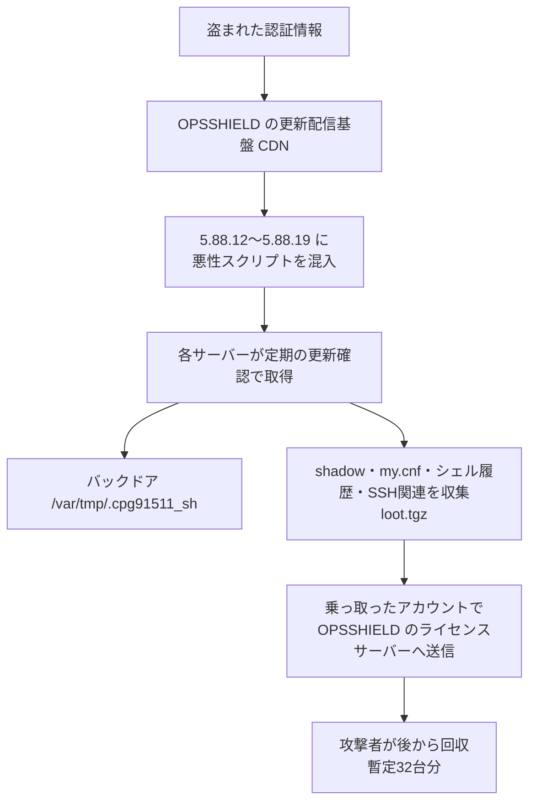

# cPGuard ― 更新配信基盤が乗っ取られ、悪性スクリプトが配られた

## 要点

### 影響バージョン

- cPGuard 5.88.12〜5.88.19（両端を含む）の更新を入れたサーバー。5.88.25 以降でバックドアと収集用のファイルは削除される（OPSSHIELD）。
- 5.88.25 に更新しても、スクリプトがすでに持ち出した認証情報は有効なまま残る（OPSSHIELD）。

### 今すぐやること

- すべての cPGuard サーバーで `cpgcli update --start` を実行し、`cpgcli --version` が 5.88.25 以降か確かめる（OPSSHIELD）。
- `grep 'Successfully updated' /opt/cpguard/logs/install_log` で 5.88.12〜5.88.19 を入れた記録がないか調べる。記録があれば侵害されたものとして扱う。記録がない、またはログが欠けている場合も安全とは言えない（OPSSHIELD）。
- 該当しうるサーバーでは、信頼できる復旧環境から root とパスワードを持つ全ローカルアカウントのパスワードを変え、DB のパスワード、S3 のアクセスキー、DigitalOcean のトークン、root のシェル履歴に残った秘密情報を作り直す。`/root/.ssh` の秘密鍵は作り直し、古い公開鍵を信頼しているすべてのシステムから消す（OPSSHIELD）。

## 概要

- 11月2日 02:06（UTC）、正体不明の攻撃者が盗んだ認証情報で OPSSHIELD の更新配信基盤（CDN）に入り、cPGuard の更新経路で悪性スクリプトを配った。OPSSHIELD は配信開始から12時間以内に気づいた（OPSSHIELD）。
- スクリプトはバックドアを置き、`/etc/shadow` などを集めて、OPSSHIELD 自身のライセンスサーバーに乗っ取ったアカウントで上げた。攻撃者は後からそれを回収した（OPSSHIELD）。
- 11月3日時点の暫定の推定では、回収されたのは32台分のファイル。これは確認できた回収の件数で、影響を受けうるサーバーの総数ではない（OPSSHIELD）。

> この記事では、ベンダーの発表と報道で確認できた内容を「事実」、筆者の推測や意見を「考察」として分けて書いています。

## 何が起きたか（時系列）

| 日時（UTC） | 出来事 |
| --- | --- |
| 2026年11月2日 02:06 | 攻撃者が盗んだ認証情報で更新配信基盤に侵入（OPSSHIELD） |
| 11月2日（ログ例では 02:46〜12:46） | 5.88.12〜5.88.19 が配信される。OPSSHIELD が示したログの例では、02:46 に 5.88.12、12:46 に 5.88.19 が入っている。時刻はサーバーによって異なる（OPSSHIELD） |
| 配信開始から12時間以内 | OPSSHIELD が検知。基盤の認証情報を消し、配信を止め、ライセンスサーバーのアカウントを保護（OPSSHIELD） |
| 11月2日 21:12ごろ（11月3日 2:42 IST） | 攻撃者が回収したのは32台分のファイルと暫定で推定（OPSSHIELD） |
| 11月2日 21:47ごろ（11月3日 3:17 IST） | 予防措置として、サポート用アクセス鍵を各サーバーから消す更新を出すと発表（OPSSHIELD） |

## 技術的な問題点（根本原因）

**事実（OPSSHIELD）：入られた場所**

- 侵入されたのは cPGuard 本体ではなく、更新を配る CDN。攻撃者は盗んだ認証情報でログインしており、認証情報をどう手に入れたかは調査中。
- 配られたスクリプトは `cpguard-v58812-i91511.sh`。

**事実（OPSSHIELD）：スクリプトがしたこと**

- バックドアのシェル `/var/tmp/.cpg91511_sh` を置いた。
- `/var/tmp/.cpg91511` にファイルを集め、`/var/tmp/.cpg91511/loot.tgz` にまとめた。集めたのは次のファイル。すべてのサーバーから全部が集められたとは限らない。
  - `/etc/shadow` と `/etc/passwd`
  - root の MariaDB／MySQL の設定（`my.cnf`）
  - root のシェル履歴
  - root の SSH の `authorized_keys` と `known_hosts`
- 集めたデータは、乗っ取ったアカウントを使って OPSSHIELD のライセンスサーバーに上げた。攻撃者はそこから後で取り出した。
- データ収集とバックドア以外の悪性の動きは、今のところ見つかっていない。ただし暫定の結果としている。

**事実（OPSSHIELD）：サポート用アクセス鍵**

- cPGuard には、トラブル対応のために OPSSHIELD の担当者をサーバーに入れる「サポートアクセス」機能がある。有効にすると、OPSSHIELD の SSH 公開鍵が root の `authorized_keys` に加わる（OPSSHIELD のドキュメント、The Hacker News が紹介）。
- OPSSHIELD は予防措置としてこの鍵を消す更新を出す。対応する秘密鍵が今回の攻撃で漏れたかどうかは明らかにしていない（The Hacker News）。

**考察**

- `/etc/shadow` はハッシュなのでまだ時間を稼げるが、`my.cnf` とシェル履歴には平文の秘密情報がそのまま入っていることが多い。ホスティング用のサーバーなら、DB の root パスワードやクラウドの API キーが含まれている可能性が高い。
- `known_hosts` と `authorized_keys` は、そのサーバーがどこに接続し、どこから接続されているかの一覧になる。攻撃者が次にどこを狙うかを決める材料になる。

## 攻撃・侵入経路

## なぜ防げなかったか・構造的要因の考察

**考察**

- **セキュリティ製品の更新は root で動き、誰も中身を見ない。** cPGuard はサーバーを守るために root で動き、自動で更新される。更新経路を握れば、配布先のすべてのサーバーで root のコードを動かせる。守るための仕組みが、そのまま一番強い侵入経路になる。
- **配信基盤の認証情報だけで配布できた。** 報告からは、更新パッケージへの署名や、配信前の検証があったかは分からない。少なくとも、CDN に入れる認証情報だけで悪性の更新を配れた。ビルドと配信を分け、署名を端末側で確かめる仕組みがあれば、CDN を乗っ取られても止められた可能性がある。
- **送り先がベンダー自身のサーバーだった。** 集めたデータは OPSSHIELD のライセンスサーバーに送られた。顧客から見れば、いつも通信している正規の宛先なので、外向きの通信の監視では目立たない。
- **短時間に版を重ねて配った。** 検知までの12時間足らずで 5.88.12 から 5.88.19 まで版が上がり続けた。更新確認は一定の間隔で行われるので、配信が長く続くほど多くのサーバーが取り込む。

## 運用者向けの具体的な対策と検知ポイント

**事実（OPSSHIELD）：示されている対応**

- 5.88.25 以降へ更新し、版を確認する。更新できない場合はサポートに連絡する。
- 該当しうるサーバーでは、パスワード、DB、クラウドのキー、SSH の鍵を作り直す（要点の「今すぐやること」を参照）。
- OS の作り直しは、今の情報では標準の対応としては勧めていない。ほかの侵害の兆候がある、またはサーバーが無事だと確かめられない場合は、個別に相談するよう求めている。この判断は調査に応じて変わりうる。

**事実（OPSSHIELD）：検知に使える指標**

| 種類 | 内容 |
| --- | --- |
| 更新ログ | `/opt/cpguard/logs/install_log` の `Successfully updated to 5.88.12`〜`5.88.19` |
| スクリプト | `cpguard-v58812-i91511.sh` |
| バックドア | `/var/tmp/.cpg91511_sh` |
| 収集先 | `/var/tmp/.cpg91511`、`/var/tmp/.cpg91511/loot.tgz` |

5.88.25 以降はこれらのファイルを消すので、更新後に見つからなくても、スクリプトが動かなかった証拠にはならない。

**考察（運用上の工夫）**

- **更新前のバックアップやスナップショットを調べる。** 更新でファイルが消えるので、11月2日のスナップショットやバックアップに `/var/tmp/.cpg91511*` が残っていないか確認すると、動いたかどうかの判断材料になる。
- **流出した鍵の「使われ方」を見る。** パスワードと鍵を作り直す前に、11月2日以降の SSH・DB・クラウドのログインを確認する。`known_hosts` に載っている接続先のサーバーも、その鍵で入られていないか見る。
- **サポートアクセスを使っていたなら root の `authorized_keys` を自分で確かめる。** ベンダーの更新で消えるのを待たず、見覚えのない鍵がないかを確認する。
- **root で自動更新するエージェントを棚卸しする。** cPGuard に限らず、セキュリティ製品や監視エージェントの更新が署名で守られているか、更新を段階的に入れられるかを確認しておく。

## 参考リンク

- [cPGuard security advisory: Update channel compromise（OPSSHIELD、2026年11月3日）](https://opsshield.com/notice/cpguard-update-channel-compromise.html)
- [cPGuard Update Channel Hijacked to Backdoor Linux Servers and Collect Password Hashes（The Hacker News、2026年11月3日）](https://thehackernews.com/2026/11/cpguard-update-channel-hijacked-to.html)
