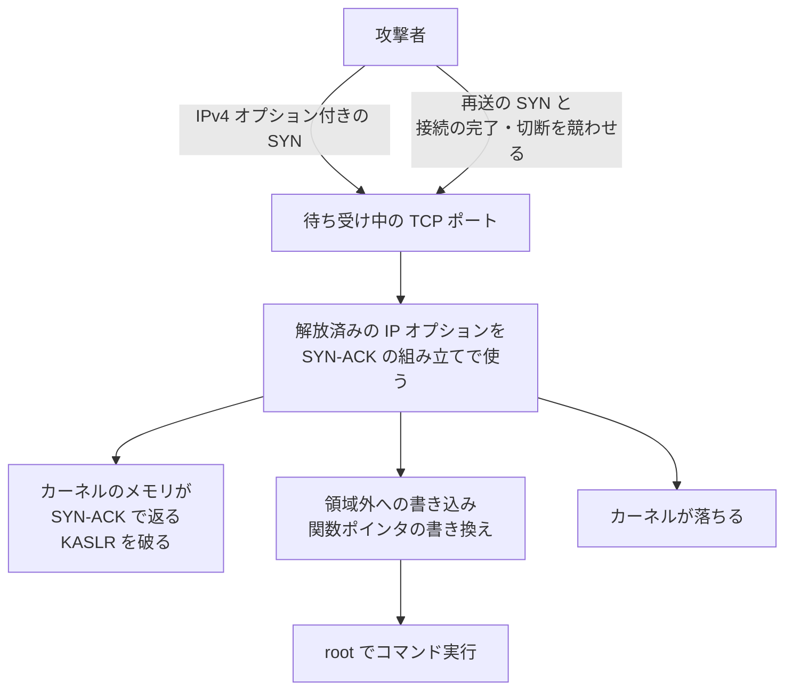

# Linuxカーネル CVE-2026-98432 ― TCP接続処理の競合でRCEのおそれ

## 要点

### 影響バージョン

- Linux 4.4 以降で、IPv4 の TCP を使うカーネル。安定版では 5.10.272、5.15.223、6.1.190、6.6.159、6.12.113、6.18.56、7.2.10 以降と 7.3 で直っている（CVE レコード）。
- 待ち受けている TCP ポートがあれば影響を受ける。MPTCP（マルチパス TCP）を無効にしていても影響は残る（Red Hat、Canonical）。

### 今すぐやること

- ディストリビューションの修正版カーネルを入れて再起動する。RHEL は 8.10、9.8、10.2 向けの修正が11月1日に出ている。Amazon Linux、Debian、Oracle Linux、SUSE も10月に修正を出している（Red Hat、Amazon、The Hacker News）。
- Ubuntu 22.04／24.04／26.04 は、正式な更新ではなく検証中の `-proposed` に修正がある。自分で検証してから入れるか、正式な更新を待つかを決める（Canonical）。
- すぐ更新できない RHEL などのホストでは、Red Hat の nftables ルールで IP オプション付きの IPv4 TCP パケットを落とす。完全な対策ではなく、再起動で消える（Red Hat）。

## 概要

- IPv4 の TCP の接続処理で、接続要求に付いた IP オプションのデータが、別の CPU がまだ読んでいる間に解放される。攻撃者は IP オプション付きの SYN を送り、再送の SYN と競わせることで、解放済みのメモリを読ませたり書かせたりできる（CVE レコード）。
- Anthropic は10月27日、自社の Claude で、MPTCP で待ち受ける Linux サーバーに認証なしで root でコマンドを実行させるエクスプロイトを作ったと発表した。コードは公開していない（Anthropic）。
- 攻撃に使われたという報告はない。11月3日時点で CISA の KEV（悪用が確認された脆弱性の一覧）には入っていない（The Hacker News、CISA）。

> この記事では、ベンダー・研究者で確認できた内容を「事実」、筆者の推測や意見を「考察」として分けて書いています。

## 何が起きたか（時系列）

| 日付（2026年） | 出来事 |
| --- | --- |
| 10月15日 | カーネルの CVE チームが CVE-2026-98432 を公開（CVE レコード） |
| 10月24〜30日 | Amazon Linux が各カーネルパッケージで修正（Amazon） |
| 10月 | Debian、Oracle Linux、SUSE が修正を出す（The Hacker News） |
| 10月27日 | Anthropic が、遠隔で root を取るエクスプロイトを Claude で作ったと発表（Anthropic） |
| 10月30日 | Red Hat がセキュリティ速報 RHSB-2026-016 と nftables の暫定ルールを公開（Red Hat） |
| 11月1日 | Red Hat が RHEL 8.10／9.8／10.2 の修正版を公開。評価を Moderate（5.9）から Critical（9.8）に上げる（Red Hat、The Hacker News） |
| 11月2日 | Canonical が Ubuntu 22.04 以降の修正を `-proposed` で公開（Canonical） |
| 11月3日 | Red Hat が速報を更新。調査は継続中（Red Hat） |

## 技術的な問題点（根本原因）

**事実（CVE レコード）：何が起きるか**

- サーバーが接続を受け入れて子のソケットを作るとき、`tcp_v4_syn_recv_sock()` は接続要求（リクエストソケット）が持つ IP オプション `ireq_opt` を、コピーせずに子のソケットへ渡す。
- 同じ接続要求に対して再送の SYN が届くと、別の CPU が `tcp_check_req()` から SYN-ACK を送る。そのとき `ireq_opt` を読むが、守りは `rcu_read_lock()` だけで、`opt->optlen` を2回読む。
- 子のソケットは RCU を待たずに `kfree()` で解放される。そのため SYN-ACK を組み立てている最中にオプションが解放され、`ip_options_build()` が解放済みのメモリを使う。
- 接続要求のソケットを移す機能（`net.ipv4.tcp_migrate_req=1` か、BPF の `BPF_SK_REUSEPORT_SELECT_OR_MIGRATE`）を使っている場合にも、似た競合がある。
- 修正は、`inet_sock_destruct()` と `tcp_v4_reqsk_destructor()` での解放を `kfree_rcu()` にして、読んでいる側が終わるまで待つというもの。
- IPv6 では最初の問題は起きない。オプションをコピーしているため。移す機能での問題は CALIPSO を使う場合に限られ、別の修正で対応する。

**事実（CVE レコード）：攻撃の流れと影響**

- 攻撃者は Record Route か Timestamp の IPv4 オプションを付けた SYN を送り、その再送と、接続の完了や切断を競わせる。アプリの認証より前の段階なので、認証はいらない。
- 解放済みの領域が別のデータで埋まると、古い長さでカーネルのヒープの中身が SYN-ACK に入って相手に返る。古いオフセットを使った書き込みで、領域外への書き込みや制御の乗っ取りにつながる。カーネルが落ちることもある。

**事実（Anthropic）：作られたエクスプロイト**

- 1段目で、競合を使ってカーネルに余分なバイトを返させ、その中のカーネルのアドレスから KASLR（アドレスの配置をランダムにする仕組み）を破る。
- 2段目で、同じバグでバッファを溢れさせ、関数ポインタを書き換えて、あらかじめカーネルのメモリに置いた処理を動かす。最後に root で任意のコマンドを実行する。
- 競合に負けても接続が失敗するだけでシステムは落ちないので、何度でもやり直せる。Anthropic の実験では、アドレスの漏えいまで48分、コマンドの実行までさらに5分かかった。

**事実（評価の違い）**

| 評価元 | スコア | 説明 |
| --- | --- | --- |
| カーネル CVE チーム | 9.8（Critical） | 攻撃条件の複雑さは「低」とする |
| Red Hat | Critical（当初 Moderate 5.9） | 遠隔の認証なしの攻撃者がコード実行に至るおそれ |
| Amazon Linux | 8.1（Important） | 主な結果はクラッシュ、メモリ破壊の可能性もある。攻撃条件の複雑さは「高」とする |
| Canonical | 9.8（Critical） | |

**考察**

- スコアの差は、タイミングを合わせる難しさをどう見るかの違い。Anthropic が示したように、失敗してもやり直せるので、時間をかければ攻撃者は条件をそろえられる。9.8 を前提に扱うのが安全だと考える。

## 攻撃・侵入経路



## なぜ防げなかったか・構造的要因の考察

**考察**

- **10年近く残ったのは、まれな使い方の組み合わせだったから。** IP オプション付きの SYN は普通の通信ではまず使われず、再送との競合も通常は起きにくい。ふだんのテストや運用でこの組み合わせが試されることはほとんどない。
- **「MPTCP を切ればいい」という話が広まった。** Anthropic の説明が MPTCP の待ち受けを例にしたため、MPTCP を無効にする対策がいくつかの所で勧められた。Red Hat と Canonical はどちらも、MPTCP は必要な条件ではないと否定している。RHEL は最初から MPTCP を無効にしているが、それでも影響を受ける。
- **修正の配布に差がある。** 上流と多くのディストリビューションは10月に直したが、Ubuntu は2,000台以上の認定機器での検証が終わるまで正式な更新に出していない。同じ脆弱性でも、使っているディストリビューションによって修正を入れられる時期が違う。
- **AI で作られたエクスプロイトが先に存在する。** コードは公開されていないが、作れることは示された。GitHub には競合を起こしてメモリが返るかを確かめるコードも出ている。ほかの人が同じものを作るまでの時間は短いと見ておくべきだと考える。

## 運用者向けの具体的な対策と検知ポイント

**事実：修正版**

| ディストリビューション | 修正 |
| --- | --- |
| RHEL 8.10 | RHSA-2026:93414（`4.18.0-553.182.1.el8_10`）、再起動が必要 |
| RHEL 9.8 | RHSA-2026:93412（`5.14.0-687.64.1.el9_8`）、再起動が必要 |
| RHEL 10.2 | RHSA-2026:93413（`6.12.0-211.72.1.el10_2`）、再起動が必要 |
| Ubuntu 22.04／24.04／26.04 | `-proposed` に `5.15.0-203.213`／`6.8.0-149.149`／`7.0.0-43.43`。正式な更新の時期は未定 |
| Ubuntu 26.10 | `7.3.0-10.10` で修正済み |
| Ubuntu 20.04／18.04／16.04 | 修正待ち（ESM の対象） |
| Amazon Linux 2／2023 | 10月24〜30日に各カーネルパッケージで修正（ALAS2-2026-4065、ALAS2023-2026-3365 など） |

Red Hat OpenShift もノードの RHEL CoreOS が影響を受け、Red Hat が対応方法を準備している（Red Hat）。

**事実（Red Hat）：暫定の nftables ルール**

IP オプション付き（IP ヘッダーが20バイトを超える）の IPv4 TCP パケットを、入口で落とす。

```
table inet cve_2026_98432 {
  chain input {
    type filter hook input priority -310; policy accept;
    ip protocol tcp ip hdrlength > 5 counter drop
  }
}
```

- `sudo nft --check --file cve-2026-98432.nft` で確かめてから `sudo nft --file cve-2026-98432.nft` で入れる。カーネルを更新したら `sudo nft delete table inet cve_2026_98432` で消す。
- ふつうの TCP オプションは TCP ヘッダーに入るので、通常の通信は通る。ただし IPv4 オプションに頼る仕組みは止まりうるので、先に試してから入れる。
- 再起動で消える。ルールはそのホストを通る通信にしか効かない。OpenShift では Pod 同士の通信は対象外で、同じホストのコンテナ同士の通信も避けて通れる（Red Hat、The Hacker News が紹介した oss-security への投稿）。
- `ss -Mlnp` で MPTCP の待ち受けがないと分かっても、影響がないことにはならない（Red Hat）。

**考察（運用上の工夫）**

- **ネットワークの境界でも IP オプション付きのパケットを落とす。** ホストのルールが届かないコンテナやクラスターの中の通信を守るには、手前のファイアウォールやロードバランサーで落とすほうが確実。Red Hat も、クラスター手前の境界での遮断はホストのルールの制限を受けないとしている。
- **インターネットに TCP を公開しているホストから先に更新する。** 認証の前に届く経路なので、公開しているサービスの種類は関係ない。SSH だけを開けているホストも対象になる。
- **`uname -r` で動いているカーネルを確かめる。** パッケージを入れても、再起動するまでは古いカーネルのまま動いている。
- **カーネルの異常終了を見張る。** 失敗した攻撃はふつう接続が切れるだけだが、`skb_under_panic` などのカーネルの異常終了や oops がログに出たら、狙われている兆候として調べる。

## 参考リンク

- [CVE-2026-98432（CVE レコード）](https://www.cve.org/CVERecord?id=CVE-2026-98432)
- [RHSB-2026-016 CVE-2026-98432（Red Hat）](https://access.redhat.com/security/vulnerabilities/RHSB-2026-016)
- [RHSA-2026:93414（RHEL 8.10）](https://access.redhat.com/errata/RHSA-2026:93414)
- [RHSA-2026:93412（RHEL 9.8）](https://access.redhat.com/errata/RHSA-2026:93412)
- [RHSA-2026:93413（RHEL 10.2）](https://access.redhat.com/errata/RHSA-2026:93413)
- [Fixes available in -proposed pocket for CVE-2026-98432（Canonical、2026年11月2日）](https://ubuntu.com/blog/fixes-available-in-proposed-pocket-for-cve-2026-98432)
- [CVE-2026-98432（Ubuntu）](https://ubuntu.com/security/CVE-2026-98432)
- [CVE-2026-98432（Amazon Linux）](https://explore.alas.aws.amazon.com/CVE-2026-98432.html)
- [Discovering vulnerabilities with Claude（Anthropic、2026年10月27日）](https://www.anthropic.com/research/discovering-vulnerabilities-with-claude)
- [Red Hat Patches 9.8-Rated Linux TCP RCE Flaw While Ubuntu Releases Fixes for Testing（The Hacker News）](https://thehackernews.com/2026/11/red-hat-patches-98-rated-linux-tcp-rce.html)
