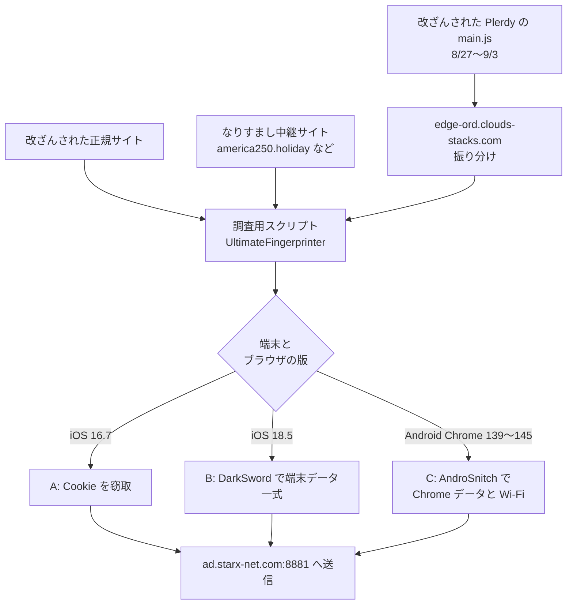

# Poisoned Source ― 解析タグ改ざんなどでスマホに既知脆弱性を攻撃

## 要点

### 狙われる端末

- 使われたのはすべて修正済みの脆弱性で、最新の状態の端末は影響を受けない（Sekoia）。
- iOS：配信側が狙っていたのは iOS 16.7 と iOS 18.5。16.7 向けの攻撃は 16.0〜17.4 で動く作り（Sekoia）。
- Android：Chrome 139〜145（143 を除く）（Sekoia）。

### 今すぐやること

- iPhone・Android の OS と Chrome を最新にする。組織の端末管理で、古い iOS（16・17 系、18.5 前後）や古い Chrome が残っていないかを洗い出す。
- Web サイトの運営者は、`a.plerdy.com/public/js/click/main.js` を読み込んでいたなら、8月27日〜9月3日に自サイトの訪問者が攻撃を受けた可能性がある。Plerdy 以外も含め、自サイトのテンプレートと JavaScript ファイルに見覚えのない外部スクリプトの読み込みがないか確かめる。
- 下の「検知に使える指標」のドメインへの通信がないか、DNS とプロキシのログを調べる。

## 概要

- フランスの Sekoia が10月中旬に見つけ、11月4日に「Poisoned Source」として公表した水飲み場攻撃。訪問者の端末を調べ、iOS か Android かに合わせた攻撃を、利用者の操作なしで配っていた（Sekoia）。
- 経路は3つ。正規サイトの改ざん、有名サイトになりすまして中身を中継しながらスクリプトを足すサイト、ウクライナの Web 解析サービス Plerdy の追跡スクリプトの改ざん（Sekoia）。
- 盗むのはブラウザの Cookie、場合によっては Wi-Fi のパスワードや端末内のデータ一式。端末に居座る仕組みはない（Sekoia）。
- Sekoia は、技術的な重なり、手口、被害者、インフラから、中〜高の確度でロシアの APT29 によるものと評価している。これは Sekoia の評価で、確定した事実ではない（Sekoia）。

> この記事では、研究者の分析と報道で確認できた内容を「事実」、筆者の推測や意見を「考察」として分けて書いています。

## 何が起きたか

**事実（Sekoia）：3つの入口**

| 経路 | 内容 |
| --- | --- |
| 正規サイトの改ざん | ウクライナのガス生産会社のサイトのテンプレートに、外部スクリプトを読み込むコードが足されていた。米国の化学業界団体、欧州の極右政党、ブルガリアの軍事関連サイトなども改ざんされた。テンプレートではなく既存の JavaScript ライブラリに追記した例もある |
| なりすましの中継サイト | `america250[.]holiday`（米独立250周年の公式サイト america250.org の中継）と `theowo[.]club`（ロンドンの高級ホテル Raffles London at The OWO の中継、現在停止）。本物のサイトの中身をその場で書き換え、ページ末尾にスクリプトを足す |
| Plerdy の改ざん | 2026年8月27日〜9月3日、Plerdy の `a.plerdy[.]com/public/js/click/main.js` にコードが足され、読み込んだ数千のサイト（大半はウクライナ）の訪問者が攻撃用スクリプトを読み込んだ。軍や特殊部隊、弾道兵器・UAV などの軍事装備、軍の採用に関わるサイトも含まれる |

Plerdy がどのように改ざんされたかは、Sekoia の報告には書かれていない。

## 技術的な問題点（根本原因）

**事実（Sekoia）：配信の仕組み**

- どの経路でも、まず `static.flux-telemetry[.]com` などから同じ名前の調査用スクリプト（攻撃者は UltimateFingerprinter と呼ぶ）を読み込む。Plerdy 経由では `edge-ord.clouds-stacks[.]com` が負荷分散役となり、ほかの配信サーバーへ振り分けていた。
- 調査用スクリプトは 2.3MB あり、98% は AngularJS の縮小版を丸ごと付けた無意味なコード。Sekoia は、LLM による自動解析の文脈長を超えさせるか、よく知られたライブラリに見せかけるためとみている。
- 61の収集項目から394のフィールドを集めて送るが、配信の判断に使われていたのは、画面サイズが携帯端末らしいか、タッチ点数が0でないか程度だった。

**事実（Sekoia）：3つの攻撃の組み合わせ**

| 種類 | 対象 | 使う脆弱性 | 盗むもの |
| --- | --- | --- | --- |
| A | iOS 16.7 | CVE-2025-43529、CVE-2024-27834（PAC 回避） | アプリの Cookie |
| B | iOS 18.5 | CVE-2025-43529、CVE-2026-20700、CVE-2025-14174、CVE-2025-43510、CVE-2025-43520（DarkSword） | SMS・iMessage、メール索引、留守電、WhatsApp・Telegram、キーチェーン、Wi-Fi パスワード、連絡先、通話履歴、Safari の履歴と Cookie、写真、ヘルスケア、iCloud Drive など |
| C | Android の Chrome 139〜145（143 を除く） | CVE-2026-3910（Chrome レンダラー）、CVE-2025-27038（Adreno ドライバー） | Chrome の Cookie・保存パスワード・履歴、Wi-Fi 設定（AndroSnitch） |

- B は、商用監視ツールの業者が作ったとみられる iOS 攻撃キット DarkSword そのもの。A も DarkSword と同じ脆弱性を作り直して使っている。
- C には、Samsung Galaxy S25 Ultra（SM-S938B）なら攻撃をやめる判定がある。理由は分かっていない。
- 盗んだデータはすべて `ad.starx-net[.]com:8881/telemetry/v12` に送られる。
- A と B は同じ端末への2回目の攻撃を防ぐ Cookie を置くが、有効期限の計算を誤っており、1日ではなく1分で切れる。

**事実（Sekoia）：APT29 と評価した理由**

- 改ざんされたあるサイトに、2025年に APT29 によるとされた水飲み場攻撃の痕跡が残っていた（協力した CERT の情報）。
- Google TAG が、2024年にモンゴル政府サイトで APT29 が行った水飲み場攻撃の仕組みと似ていると確認した。2024年は特定サイトの Cookie に絞っていたが、今回は絞り込みがない。
- 被害がウクライナと米国に集中し、欧州の政党も狙われている。

**考察**

- 新しい脆弱性を一つも使っていない。攻撃する側は、商用の攻撃キットを再利用して開発の手間を省き、守る側の「更新の遅れ」だけを突いている。端末の更新が遅れる組織では、ゼロデイよりこちらのほうが現実の脅威になる。

## 攻撃・侵入経路

## なぜ防げなかったか・構造的要因の考察

**考察**

- **サードパーティのタグは、読み込むサイトの数だけ入口になる。** Plerdy のような解析タグは、各サイトが自分で中身を確かめずに、毎回提供元から最新版を読み込む。提供元が1週間改ざんされただけで、数千のサイトの訪問者が攻撃にさらされた。サイト側に落ち度がなくても、訪問者から見れば攻撃元は自分の閲覧したサイトになる。
- **狙いの絞り込みは、サイトの選び方でしている。** 配信条件は端末の種類と版だけで、誰に配るかの判断はほとんどしていない。誰が来るかで選んだサイト（軍や防衛産業、政党、Sekoia が外交団などを狙った可能性を挙げるホテル）を入口にすることで、狙いを絞っている。
- **盗むのは Cookie で、パスワードより先にセッションが奪われる。** Sekoia も、盗んだ Cookie で Web メールなどにログインする目的とみている。多要素認証を済ませたあとのセッションをそのまま使われると、認証の強さは関係なくなる。
- **端末に居座らないので、痕跡が残りにくい。** 再起動すれば攻撃コードは消え、もう一度サイトを開かせる必要がある。その分、後から端末を調べても見つけにくい。

## 運用者向けの具体的な対策と検知ポイント

**事実（Sekoia）：検知に使える指標**

| 種類 | 値 |
| --- | --- |
| なりすましサイト | `america250[.]holiday`、`theowo[.]club` |
| 配信 | `static.flux-telemetry[.]com`、`edge-ord.clouds-stacks[.]com`、`ads-it-assets[.]com`、`cdn.adv-static[.]com`、`wpvortex-mod[.]com`、`assets-int[.]com`、`adsprism-stat[.]com` |
| 送信先 | `ad.starx-net[.]com`（ポート8881、パス `/telemetry/v12`） |
| スクリプト名 | `5b4c8fea5cbcee273e8d830f52-temfp.js` |

このほかの配信先、送信先、被害サイトの情報は公開されておらず、Sekoia は各国の CERT や捜査機関に限って共有するとしている。

**考察（運用上の工夫）**

- **モバイル端末の版を下限で管理する。** MDM で iOS と Chrome の最低バージョンを決め、満たさない端末は社内のメールや SaaS につなげないようにする。
- **Cookie が盗まれた前提でセッションを切る。** 指標のドメインへの通信があった端末の利用者は、Web メールや SaaS のセッションをすべて失効させる。IP や端末の変化でセッションを見直す条件付きアクセスも有効。
- **サイト運営者は外部スクリプトを固定する。** 解析タグを自サーバーにコピーして配信する、Subresource Integrity（SRI）で中身のハッシュを固定する、Content Security Policy で読み込み先を絞る。どれも、提供元が改ざんされたときに自サイトの訪問者を守る。
- **自サイトの改ざんも定期的に見る。** テンプレートや既存の JavaScript ライブラリへの追記という手口なので、公開ファイルのハッシュを定期的に比べると見つけやすい。

## 参考リンク

- [Poisoned Source: APT29 watering holes target mobile devices with n-day exploits（Sekoia、2026年11月4日）](https://www.sekoia.com/blog/poisoned-source-apt29-watering-holes-targets-mobile-devices-with-n-day-exploits)
- [APT29-Linked Hackers Hijack Web Analytics Script to Deliver iOS and Android Exploits（The Hacker News、2026年11月4日）](https://thehackernews.com/2026/11/apt29-linked-hackers-hijack-web.html)
