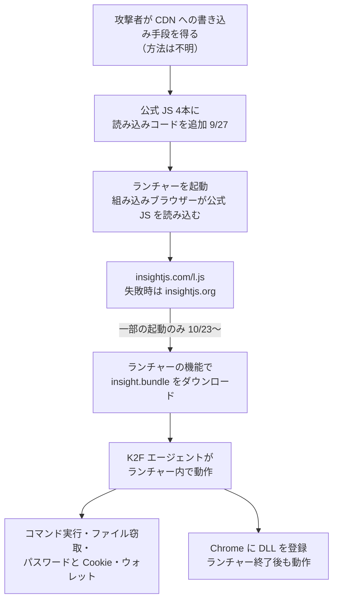

# NIKKE PCランチャー ― 公式CDNのスクリプトが改ざんされ不正コードを配信

## 要点

### 影響を受ける利用者

- 2026年9月27日から修正（11月4日 2時30分ごろ JST）までに、Windows で NIKKE の PC ランチャーを開いた人。Linux や Steam Deck で Proton 経由で動かしている人、Google Play Games 版も含まれる（研究者 MotherSphere の報告）。
- 遠隔操作エージェントが送り込まれたのは、遅くとも10月23日以降の一部の起動だけ。ある端末では約19回の起動のうち3回だった（同）。
- Level Infinite は「サードパーティによりスクリプトが改ざんされた可能性がある」と認めたが、影響範囲は調査中としている（Level Infinite）。

### 今すぐやること

- ランチャーを開く前に、`Launcher/intl_service/debug.log` に `k2f_chan registered` という行がないかを確かめる。研究者の確認ツール [NIKKE Launcher Check](https://github.com/MotherSphere/NIKKE-Launcher-Check) でも調べられる。
- 確かめたあと、ランチャーのキャッシュ `%APPDATA%\nikke_launcher\tbs_cache`（HMT 版は `nikke_launcher_hmt`、Google Play Games 版は `nikke_launcher_google`）を消してからランチャーを開く。改ざんされたファイルがキャッシュに残っている可能性がある。
- 痕跡があった場合は、別の安全な端末からパスワードを変え、Web サービスのセッションを切り、開発用のトークンや SSH 鍵を作り直す。暗号資産は新しいウォレットに移す（下の「対策と検知」）。

## 概要

- NIKKE は韓国の Shift Up が開発し、Level Infinite が配信するスマートフォン・PC 向けゲーム。PC ランチャーは、お知らせなどの画面を Level Infinite の CDN（`playerinfinite.com`、Tencent COS）から読み込み、組み込みのブラウザーで表示する。
- 研究者 MotherSphere は11月3日、この CDN 上の公式の JavaScript 4本に外部スクリプトを読み込むコードが足されていると公表した。読み込まれたスクリプトはランチャーの機能を使って遠隔操作エージェントをダウンロードさせ、実行していた（MotherSphere）。
- BleepingComputer は、改ざんされたファイルのうち2本で難読化された読み込みコードを確認した（BleepingComputer）。
- Level Infinite は11月4日、X で、PC ランチャーのスクリプトファイルがサードパーティに改ざんされた可能性があり、11月4日2時30分ごろ（JST）に修正とアップデートを配信したと発表した。影響は調査中で、今後の対応は別途知らせるとしている（Level Infinite）。
- 攻撃者がどうやって CDN に書き込めたかは分かっていない。

> この記事では、ベンダーの発表・研究者の分析・報道で確認できた内容を「事実」、筆者の推測や意見を「考察」として分けて書いています。技術的な詳細の多くは MotherSphere の1台の感染端末と、ほかの被害者の報告に基づく分析で、Level Infinite は確認していません。

## 何が起きたか（時系列）

時刻は MotherSphere の報告の GMT を JST（+9時間）に直した。

| 日時（2026年、JST） | 出来事 |
| --- | --- |
| 9月27日 10:59 | 攻撃に使われた `insightjs.com` が登録される |
| 9月27日 15:41〜15:42 | CDN 上の公式ファイル4本が改ざんされる |
| 10月23日 | 遅くともこの日から、一部の起動で遠隔操作エージェントが送り込まれ始める |
| 10月29日 0:46 | 4本のうち `FeedList.feb647c9.js` が配信元で元に戻される。ただし一部の CDN サーバーは改ざん版を配り続ける |
| 11月4日 1:11 | NIKKE のコミュニティ Discord に最初の公開警告 |
| 11月4日 2:04〜2:23 | 残る3本が元に戻される |
| 11月4日 3:31 | 攻撃者のサーバー（`89.127.233.127`）が応答しなくなる |
| 11月4日 12:13 | Level Infinite が X で改ざんの可能性と修正を発表 |
| 11月4日 12:12〜12:21 | 改ざん版を残していた CDN サーバーも元のファイルに切り替わる |
| 11月4日 20:20 | 研究者が調べた CDN サーバーで4本ともに元に戻ったことを確認 |

## 技術的な問題点（根本原因）

**事実（MotherSphere、BleepingComputer が一部を確認）**

- 改ざんされたのは `aegis-fix.min.js`、`vue-bucket.min.js`、`images.7fec4c32.js`、`FeedList.feb647c9.js`。いずれもランチャーが読み込むもので、足されたコードは `insightjs.com/l.js` を読み込み、つながらなければ `insightjs.org` を試す。URL は数値の配列に隠されていた。
- `l.js` は、ランチャーが画面の表示用に持つ JavaScript とアプリ本体の連携機能（ファイルのダウンロード）を使い、`analytics.insightjs.com/comm/assets/insight.bundle` を取り込ませた。
- 中身は LuaJIT のバイトコードで難読化された遠隔操作エージェント（内部名 K2F）。ランチャーの中で動き、攻撃者のサーバーからの指示で、任意のコマンドの実行、ファイルの閲覧とダウンロード、画面の撮影、ブラウザーの保存パスワードと Cookie、ランチャーに保存された NIKKE のアカウント情報、Chrome の暗号資産ウォレット拡張機能のデータ、SSH 鍵や各種クラウド・開発ツールの認証情報ファイルの読み取りなどができる。
- 読み取る対象には、AWS や GitHub CLI、npm、Docker などの設定ファイルや、Claude、Codex、Gemini CLI などの AI 開発ツールの認証情報も含まれていた。
- Windows では、Chrome が読み込む DLL をユーザーのレジストリに登録する機能があり、ランチャーを閉じたあとも動き続ける。この DLL を実際に置いたかはサーバーからの指示次第で、置かれた件数は分かっていない。
- BleepingComputer は、VirusTotal に上がった DLL の文字列を調べ、MetaMask、Phantom、Coinbase Wallet などのブラウザー拡張機能からリカバリーフレーズや秘密鍵を盗む機能を示すコードを見つけた。
- Proton 環境でも、Wine が Linux のホームフォルダーをドライブとして見せるため、コマンド実行やファイル読み取りで `~/.ssh` などが読める（MotherSphere）。

**考察**

- ランチャーは CDN から取り込んだスクリプトを、ファイルをダウンロードして実行できる強い権限の画面で動かしていた。Web ページとしてなら影響が限られる改ざんが、配信元の画面と同じ扱いでアプリ本体の機能まで届いてしまった。ランチャーの設定はさらに管理者権限での実行を求めていたと被害者が報告しており、事実なら影響はさらに大きい。

## 攻撃・侵入経路

## なぜ防げなかったか・構造的要因の考察

**考察**

- **改ざんの検知が利用者頼みになった。** 改ざんから最初の公開警告まで5週間以上かかり、見つけたのは利用者だった。CDN 上の配信ファイルを、ビルド結果のハッシュと定期的に比べていれば、もっと早く気づけたはずだ。
- **CDN の各サーバーに古いファイルが残った。** 配信元で `FeedList.feb647c9.js` を戻したあとも、一部のサーバーは1週間近く改ざん版を配っていた。修正の確認は、配信元だけでなく CDN の各サーバーで行う必要がある。
- **ファイル名を変えない配信と長いキャッシュ。** `FeedList.feb647c9.js` は修正後も同じ URL のままで、ランチャー側にも改ざん版が長期間キャッシュされうる。研究者が「開く前にキャッシュを消す」よう勧めるのはこのためだ。
- **公式の告知が利用者に何をすればよいかを示していない。** Level Infinite の発表は改ざんの可能性と修正の配信を伝えたが、確認方法や対処の手順は書かれていない。被害の確認は研究者のツールとコミュニティの報告に頼る状態になっている。
- **ゲームの PC に開発者の秘密が置かれている。** 読み取り対象の多くがクラウドや開発ツール、AI ツールの認証情報だった。ゲーム用の PC で仕事の開発作業もしていると、ゲームの配信経路の侵害がそのまま組織の認証情報の漏えいにつながる。

## 運用者向けの具体的な対策と検知ポイント

**事実（MotherSphere の推奨、BleepingComputer）**

- 感染の確認：`debug.log` の `k2f_chan registered`、`tbs_cache\Local Storage\leveldb\` の `k2f.agent`、`Launcher\log\tinyget\` の `insight.bundle` のダウンロード成功の記録。
- 遮断：`insightjs.com`、`analytics.insightjs.com`、`insightjs.org`、`89.127.233.127`、`89.126.250.172`。CDN に書き込めた手段が分かっていないため、攻撃者が別のドメインで再び試す可能性がある。
- 感染していた場合（Windows）：`HKCU\Software\Classes\CLSID\{E77CC89B-7401-4C04-8CED-149DB35ADD04}` を消して再起動し、`%LOCALAPPDATA%\Google\Chrome\User Data\PlatformExperienceHelper\` の下の、64文字の16進数の名前で `platform_experience_helper.dll` を含むフォルダーを消す。`PlatformExperienceHelper` フォルダー自体は Chrome の正規のもので、消さない。研究者は Windows の再インストールがもっとも安全としている。BleepingComputer も、侵害があれば Windows を再インストールし、安全な端末からパスワードなどを変えるよう勧めている。
- 認証情報：別の安全な端末から、NIKKE、メール、Discord、銀行などのパスワードを変えて多要素認証を有効にし、すべてのセッションをログアウトする。API トークン、SSH 鍵、開発ツールの認証情報を作り直す。暗号資産は新しいシードの新しいウォレットに移す。

**考察（企業の担当者向け）**

- 業務 PC や開発者の私物 PC でゲームのランチャーが動いていないか、EDR の資産情報で確かめる。上のドメインへの DNS 問い合わせがあった端末は、その端末から使われたクラウドや Git のトークンを失効させる。

## 参考リンク

- [NIKKE PC launcher compromise (Nov 2026): Level Infinite CDN files modified, remote-control agent, indicators（MotherSphere、GitHub Gist）](https://gist.github.com/MotherSphere/d6c049a09ba8ac3085c51ee9df24a4e5)
- [NIKKE-Launcher-Check: incident write-up（MotherSphere、GitHub）](https://github.com/MotherSphere/NIKKE-Launcher-Check/blob/main/docs/incident.md)
- [NIKKE PC game launcher hacked to spread remote access, data-stealing malware（BleepingComputer、2026年11月4日）](https://www.bleepingcomputer.com/news/security/nikke-pc-game-launcher-hacked-to-spread-remote-access-data-stealing-malware/)
- [GODDESS OF VICTORY: NIKKE 公式 X アカウント（@NIKKE_en）](https://x.com/NIKKE_en)
