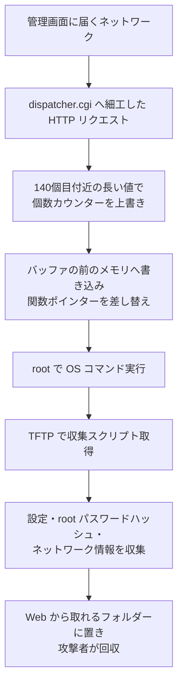

# Zyxel GS1900 ― 6月の修正をすり抜けるゼロデイでスイッチが侵害

## 要点

### 影響バージョン

- GS1900-8、-8HP、-10HP、-16、-24、-24E、-24EP、-24HPv2、-48、-48HPv2 の 2.90(…2)C0 以前。修正版は各機種の 2.90(…3)C0（例：GS1900-24 は 2.90(AAHL.3)C0、GS1900-48HPv2 は 2.90(ABTQ.3)C0）（Zyxel）。
- 6月に CVE-2026-7273 の修正として出た 2.90(…2)C0 も影響を受ける。Binarly は、攻撃に使われたエクスプロイトが 7273 修正済みの10の版すべてで動くことを確かめた（BleepingComputer、Binarly）。

### 今すぐやること

- すべての GS1900 で稼働中のファームウェアを確かめ、末尾が `.3)C0` の版に上げる。「7273 は修正済み」という管理台帳や脆弱性スキャナーの結果は当てにしない。
- 管理画面（Web UI）を、管理用の VLAN など限られた端末からしか届かない場所に置く。Zyxel は回避策を示していない。
- 8月以降に管理画面が利用者や来客のネットワークから届いていた機器は、侵害を前提に設定・root パスワード・機器に入れた認証情報を見直す（下の「対策と検知」）。

## 概要

- GS1900 の Web 管理画面を処理する CGI に境界外書き込みの脆弱性があり、認証なしで細工した HTTP リクエストを送ると OS コマンドを実行できる。Zyxel の評価は CVSS 8.8（攻撃元は同じ LAN）、Binarly は 9.8 と評価している（Zyxel、CERT Santé、報道）。
- GreyNoise は8月17日ごろから、Kapibala と呼ぶ中国語圏とみられる攻撃者が GS1900 を攻撃し、48か国の996台を侵害したと9月21日に公表した。当初は6月に修正済みの CVE-2026-7273 の悪用とされ、CISA も同日 7273 を KEV に載せた（BleepingComputer）。
- その後 Binarly が攻撃者のサーバーでエクスプロイト本体を見つけ、7273 の修正版でも動く別の脆弱性だと突き止めた。これが CVE-2026-107441 で、10月22日に修正版が出て、11月3日に Zyxel がアドバイザリを出した（BleepingComputer、Zyxel）。

> この記事では、ベンダーのアドバイザリ・研究者の分析・報道で確認できた内容を「事実」、筆者の推測や意見を「考察」として分けて書いています。

## 何が起きたか（時系列）

| 日付（2026年） | 出来事 |
| --- | --- |
| 6月16日 | Zyxel が GS1900 の認証前バッファオーバーフロー CVE-2026-7273 を修正（BleepingComputer） |
| 8月17日ごろ〜 | GreyNoise が Kapibala による GS1900 への攻撃を観測。48か国の996台が侵害（BleepingComputer） |
| 9月21日 | GreyNoise が攻撃を公表し、CVE-2026-7273 の悪用と説明。同日 CISA が 7273 を KEV に追加（BleepingComputer） |
| 9月28日 | Binarly が、回収したエクスプロイトが 7273 修正済みの10の版すべてで動くことを確認（BleepingComputer） |
| 9月29日 | Binarly が Zyxel に報告（BleepingComputer） |
| 10月11日 | Zyxel が新しい脆弱性と認め、CVE-2026-107441 を割り当て（BleepingComputer） |
| 10月22日 | 修正版ファームウェア 2.90(…3)C0 を公開（BleepingComputer、Zyxel Community） |
| 11月3日 | Zyxel がアドバイザリを公開（Zyxel） |

この記事の執筆時点で筆者が確認した範囲では、CISA の KEV に載っているのは当初この攻撃に結びつけられた CVE-2026-7273 で、CVE-2026-107441 の追加は確認できていない。

## 技術的な問題点（根本原因）

**事実（Zyxel）**

- GS1900 のファームウェアの CGI プログラムにある境界外書き込み。同じ LAN にいる認証されていない攻撃者が、細工した HTTP リクエストで OS コマンドを実行できる可能性がある。

**事実（Binarly の分析、報道経由）**

- 問題の場所は Web 管理画面の要求を処理する `dispatcher.cgi`。同じ弱いコードが `httprestorecfg.cgi` と `httpupload.cgi` にもある。
- 要求パラメーターを、1,024バイト×140個の固定長のグローバルなバッファにコピーする。コピーしてから個数を確かめるため、139番目に長い値を入れるとパラメーターの個数を数えるカウンター自体を上書きできる。カウンターを負の値にすると、バッファより前のメモリに書き込め、保存されている関数ポインターを差し替えて任意のコマンドを root で実行できる。
- 6月の 7273 の修正は長さのチェックを足したが、チェックがコピーより後にあるため、この手順は止まらなかった。
- Binarly は、Zyxel の説明には誤りがあり（バッファはスタックではなくグローバル領域にあり、HTTPS も必要ない）、深刻度は Zyxel の 8.8 より高い 9.8 だとしている。
- Zyxel は、7273 は個数チェックの欠落で、今回は HTTP パラメーターの長さの検証の欠落も突いているため別の脆弱性だと説明した。10月22日の版では、メモリにコピーする前にパラメーターの大きさを制限し、個数を確かめるようにした。
- 回収したエクスプロイトが最初から 7273 の修正をすり抜けるために作られたのか、修正が足りなかった関連の欠陥を突いただけなのかははっきりしていない（BleepingComputer）。

**考察**

- 「コピーしてから検証する」順序のままチェックだけを足した修正は、境界の外に書けるという根本の問題を残す。修正の差分が小さいときほど、攻撃者は同じ入口から別の値の組み合わせを試しやすい。

## 攻撃・侵入経路

**事実（GreyNoise・Binarly の報告、報道経由）**

- 攻撃はリモートでコマンドを実行したあと、TFTP で攻撃者のサーバーから収集スクリプトを取り込み、機器の設定、root のパスワードハッシュ、ネットワーク情報を集めて、Web から取れるフォルダーに置いた。
- エクスプロイトは PyArmor で難読化された Python のツールで、攻撃者のサーバーの公開ディレクトリに置かれていた。Binarly は、これが大規模言語モデルで作られたとみている。
- 報道（Five Nines、Cyber Security News）によれば、侵害された996台のうち564台は工場出荷時の認証情報のままだった。被害はイタリア、米国、台湾に多い。
- GreyNoise は、インフラとマルウェアの重なりから、Kapibala を Acronis が Red Heron と呼ぶ Gitea 攻撃と同じ攻撃者とみている。Red Heron では、バックドア JITTERLY とルートキット SIXZUT が使われた。

## なぜ防げなかったか・構造的要因の考察

**考察**

- **CVE 番号で「修正済み」を判定していた。** 6月の版を入れた組織は、台帳でもスキャナーでも 7273 は対応済みと表示されていた。KEV に載ったのも 7273 で、利用者の対応はそこで止まりやすい。実際には10月22日まで、修正済みとされた機器も攻撃できる状態だった。
- **攻撃の観測と脆弱性の特定がずれた。** 攻撃を見た GreyNoise は既知の番号に結びつけ、エクスプロイトそのものを解析した Binarly が別の欠陥だと気づいた。観測した攻撃の CVE への割り当ては、エクスプロイトを解析するまで仮のものとして扱う必要がある。
- **小型スイッチの管理画面は分けられていないことが多い。** GS1900 は小規模なネットワーク向けで、管理画面が利用者と同じセグメントから届く構成や、初期パスワードのままの運用が残りやすい。報道ベースで半数以上が初期認証情報のままだったことは、それを裏づける。
- **「LAN からの攻撃」は安心材料にならない。** 世界で約1,000台が侵害されたことから、管理画面がインターネットや広いネットワークから届く機器が相当数あったとみられる。

## 運用者向けの具体的な対策と検知ポイント

**事実（Zyxel、報道）**

- 各機種の 2.90(…3)C0 を入れる。回避策はない。
- Binarly は最小化した PoC を公開する予定としており、公開後は悪用が広がりやすくなる。

**考察（運用上の工夫）**

- **版を機器から直接読む。** 台帳ではなく各機器の管理画面や SNMP で実際の版を集め、`.2)C0` 以前が残っていないかを確かめる。
- **管理画面の届く範囲を絞る。** 管理用 VLAN か、ACL で管理端末だけに限る。インターネットから管理画面が届いていないか、外から確認する。
- **侵害の痕跡を見る。** 管理画面への POST が異常に多い、スイッチから外部への TFTP 通信、管理画面から取れる場所に見覚えのないファイルが置かれていないかを確かめる。
- **侵害されていたら作り直す前提で動く。** 設定ファイルと root のハッシュが持ち出されているので、パスワードを変え、設定に含まれる SNMP コミュニティや RADIUS／TACACS の共有鍵も作り直す。初期パスワードのままの機器は、まずそこを変える。

## 参考リンク

- [Zyxel security advisory for out-of-bounds write vulnerability in GS1900 series switches（Zyxel、2026年11月3日）](https://www.zyxel.com/global/en/support/security-advisories/zyxel-security-advisory-for-out-of-bounds-write-vulnerability-in-gs1900-series-switches-11-03-2026)
- [Switch GS1900 Series - V2.90 Patch 3 Firmware Release（Zyxel Community）](https://community.zyxel.com/en/discussion/34420/switch-gs1900-series-v2-90-patch-3-firmware-release)
- [BRLY-2026-057: Out-of-bounds write vulnerability in Zyxel GS1900 switches（Binarly）](https://www.binarly.io/advisories/brly-2026-057)
- [Zyxel fixes zero-day exploited to hack nearly 1,000 network switches（BleepingComputer、2026年11月4日）](https://www.bleepingcomputer.com/news/security/zyxel-fixes-zero-day-exploited-to-hack-nearly-1-000-network-switches/)
- [Attackers exploit new Zyxel GS1900 flaw that bypassed earlier fix（Five Nines）](https://www.thefivenines.com/security/attackers-exploit-new-zyxel-gs1900-flaw-that-bypassed-earlier-fix)
- [Zyxel - CVE-2026-107441（CERT Santé、2026年11月3日）](https://cyberveille.esante.gouv.fr/alertes/zyxel-cve-2026-107441-2026-11-03)
- [Hackers Exploit Zyxel GS1900 Zero-Day in the Wild to Hijack Network Switches（Cyber Security News）](https://cybersecuritynews.com/zyxel-gs1900-zero-day-exploited/amp/)
