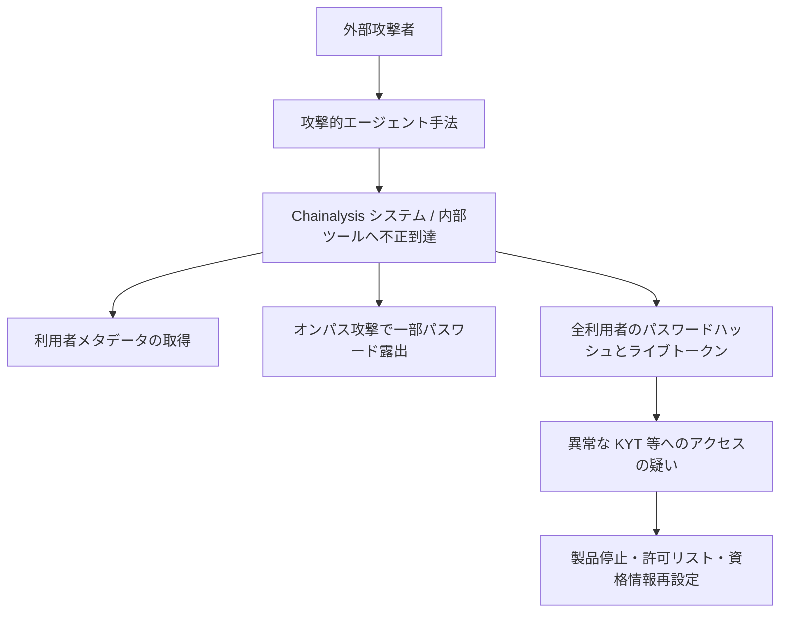

# Chainalysis ― 全利用者のパスワードハッシュとトークンが漏えい

## 要点

### 今すぐやること

- Chainalysis 利用者は、案内どおり信頼できる送信元 IP を support@chainalysis.com または担当チームへ送り、許可リスト登録後にパスワード再設定と API キーのローテーションを行う（Chainalysis、2026年11月6日更新）。
- Chainalysis と同じパスワードを他サービスで使っていた場合は、そちらも直ちに変更する（Chainalysis）。
- パスワード再設定メールのリンクは使わず、公式のログイン手順に従う。想定外の再設定要求や認証プロンプトに注意する（Chainalysis）。
- 未設定なら多要素認証を有効化する（Chainalysis の初期案内）。

## 概要

- Chainalysis は 2026年10月、外部の攻撃者が攻撃的エージェント（offensive agentic）手法で社内システムと内部ツールに不正到達したと顧客へ通知した。当初は調査用グラフ等への到達は確認されず、取得されたのはユーザー ID・氏名・メール・組織内ロール表示などの非機微なメタデータ、と説明していた（Chainalysis、10月30日）。
- その後の調査で、オンパス攻撃により一部顧客のパスワードが露出し、さらに 11月3日（米国時間の月曜）には全利用者の氏名・ユーザー名・パスワードハッシュ・有効なトークンが攻撃者に渡っていたと判明した（Chainalysis、11月4日更新）。調査データへの到達や帰属データの改ざんは、発表時点で確認されていない。
- 異常な活動を受け、Reactor / Data Solutions に加え KYT（UI と API）やアドレス・スクリーニング、ログインページも止めた。11月6日時点では KYT と Address Screening の段階的復旧を始め、Reactor 等は外部専門家と並行して復旧作業中としている（Chainalysis）。

> この記事では、事業者の発表・報道で確認できた内容を「事実」、筆者の推測や意見を「考察」として分けて書いています。

## 何が起きたか（時系列）

| 日付（2026年・米国時間） | 出来事 |
| --- | --- |
| 10月（月内） | 攻撃的エージェント手法による不正アクセスを検知。調査開始（Chainalysis） |
| 10月30日 | 顧客通知。調査内容・平文パスワード・MFA 秘密・セッショントークンへの不正到達は確認されず。一部の氏名・メール等は取得された、と説明（Chainalysis） |
| 11月2日 | Reactor / Data Solutions を予防的に停止。取引モニタリング系は監視強化のうえで継続（Chainalysis） |
| 11月4日 午前 | オンパス攻撃で一部顧客のパスワードが露出したと通知。アカウントをロックし再設定を要求（Chainalysis） |
| 11月4日 | 異常活動を受け KYT・アドレス・スクリーニング・ログインを停止（Chainalysis） |
| 11月4日 夜 | 全利用者の氏名・ユーザー名・パスワードハッシュ・有効トークンの露出を公表。調査データ改ざんは未確認（Chainalysis） |
| 11月6日 早朝 | KYT / Address Screening の段階復旧を開始。信頼 IP 登録と資格情報再設定を案内（Chainalysis） |

## 技術的な問題点（根本原因）

**事実（Chainalysis）**

- 侵入の入口について、公表されているのは「攻撃的エージェント手法でシステムと内部ツールへ不正到達した」こと、およびその後の「オンパス攻撃」で一部パスワードが露出したことまで。具体的な脆弱性番号や、エージェントが突いた設定不備の詳細は出ていない。
- 影響が段階的に広がって見えた点は事実として追える。
  - 初期: 非機微な利用者メタデータ。
  - 中盤: オンパスによる一部パスワード。
  - その後: 全利用者のパスワードハッシュとライブトークン。
- 調査用のグラフ・ノート・ケース、取引／クエリ結果、平文パスワード、MFA 秘密、初期時点のセッショントークンについては、10月30日時点で不正到達の証拠はないとされていた。11月4日以降も、調査データや帰属データの改ざん・到達は確認されていないとしている。

**事実（周辺の報道コンテキスト）**

- 同時期、Microsoft などは GitHub 上の秘密情報をエージェントが高速に探し、Azure Key Vault 等へ数分で進む攻撃を観測している、と The Hacker News などが関連づけて報じている。Chainalysis 自身は自社事案をこれらのキャンペーンと同一とは断定していない。
- Chainalysis は「ここ数週間の他のテック・プラットフォームと同様」と表現し、Binance の資金流出事案とは無関係と明記している（Chainalysis）。

**考察**

- 「エージェントが内部ツールまで到達できる」状態は、人間の手作業による偵察より、秘密情報の発見から横展開までの時間を短くする。初報でメタデータに見えた侵害が、数日で認証情報全体の露出に更新された経緯は、調査が追いつくまでの見通しの悪さを示している。
- ライブトークンまで渡っている場合、パスワード再設定だけでは足りず、API キーとセッショントークンの失効が必須になる。許可リスト付きの段階復旧は、その失効を終えるまでの晒しを抑えるための運用判断と読める。

## 攻撃・侵入経路

**事実（Chainalysis の発表範囲）**

- 外部攻撃者がエージェント手法で社内システム／内部ツールへ到達。
- 別経路としてオンパス攻撃により一部パスワードが露出（当該ベクトルは封じ込め・修正済みと説明）。
- 全利用者分のパスワードハッシュと有効トークンが攻撃者の手に渡った。KYT などへの不正ログインの疑いがある顧客には個別通知。

※各矢印の技術的詳細（どの脆弱性・どの内部ツールか）は未公表。

## なぜ防げなかったか・構造的要因の考察

**考察**

- **エージェント時代の「発見から横展開」の圧縮。** 秘密情報スキャンと後続攻撃の判断をエージェントに任せると、従来の SOC 想定より短い窓で認証情報ストアやトークンに届く。初報の影響範囲が後日大きく更新されるパターンと相性が悪い。
- **コンプライアンス製品を止めにくい圧力。** マネーロンダリング検知など社会インフラに近い機能を抱えると、侵入調査中でもサービス継続の判断が入り、監視強化と停止のあいだで揺れる（11月2日時点の Chainalysis の説明）。
- **顧客側のパスワード再利用。** 事業者側のハッシュ漏えいでも、再利用されていれば他サービスへのクレデンシャル・スタッフィングに直結する。案内が「他システムでも再設定を」と繰り返す理由でもある。

## 運用者向けの具体的な対策と検知ポイント

**Chainalysis 利用者（事実に基づく）**

- 信頼 IP を提出し、復旧後にパスワード再設定と API キーローテーションを完了してから取引登録を再開する。
- 公式以外の再設定リンクを踏まない。同パスワードの他サービスを変更する。
- MFA を有効化し、想定外の認証プロンプトを記録する。

**同様の SaaS／分析基盤を持つ運用者への示唆（考察）**

- 内部ツールと顧客向け API のトークン寿命・束縛（IP／デバイス）を見直し、漏えい時に一括失効できるか確認する。
- エージェントや CI が触れる秘密情報の範囲を最小化し、GitHub 等の公開面に顧客テナントへ届く鍵が乗っていないかを定期的に洗う（同時期に報じられている汎用 TTP）。
- 「非機微メタデータのみ」という初期評価を、認証ストアとトークン発行基盤の監査が終わるまで暫定扱いする。

## 参考リンク

- [Updated Nov 6: Chainalysis Security Incident Information（Chainalysis）](https://www.chainalysis.com/blog/security-incident-october-30/)
- [Chainalysis says breach exposed credentials for all customers（BleepingComputer、2026年11月6日）](https://www.bleepingcomputer.com/news/security/chainalysis-says-breach-exposed-credentials-for-all-customers/)
- [Chainalysis Breach Exposes All Users' Credentials, Forces Shutdown of Key Services（The Hacker News、2026年11月6日）](https://thehackernews.com/2026/11/chainalysis-breach-exposes-all-users.html)
