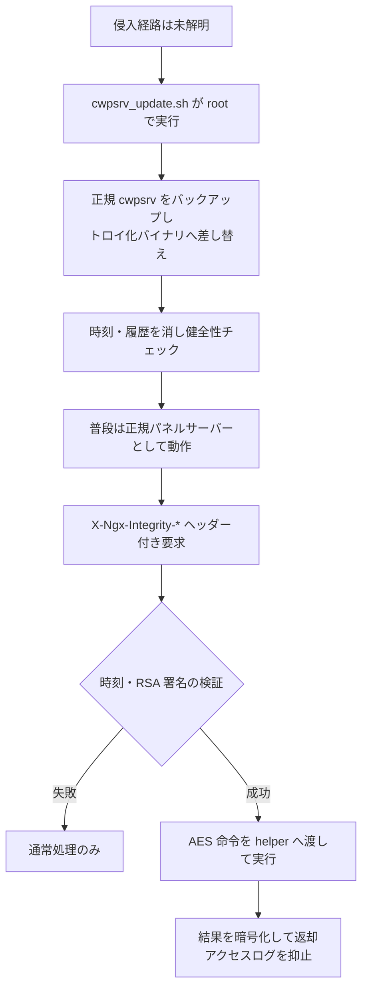

# CWPdoor ― 管理パネル用サーバーに潜伏する受動型バックドア

## 要点

### 影響バージョン

- 観測された差し替え対象は cwpsrv 1.15.10 と 1.24.0（いずれも CWP の管理パネル向け、nginx 系の独自サーバー）（XLab）。
- Control Web Panel（CWP）本体のどの版が最初に侵入されるかは未公表。Hunter 上では直近1か月でインターネット公開の CWP が34万超（XLab）。

### 今すぐやること

- `ss -axp | grep integrity` で Unix ソケット `ngx_http_integrity_helper` の有無を見る。`strings /usr/local/cwpsrv/bin/cwpsrv | grep X-Ngx-Integrity` と、`ps` 上の不審な helper 子プロセスも確認する（XLab）。
- 感染が分かったら、攻撃者が残した `cwpsrv.prev-YYYYMMDD-HHMMSS` 形式のバックアップから正規バイナリへ戻し、最新版へ上げ、パネルの認証情報をすべて作り直す。ホストは侵害済みとして扱う（XLab）。

## 概要

- 2026年11月5日、QiAnXin の XLab が CWPdoor を公表した。CWP の管理画面を出す `cwpsrv` を、ソースにバックドアを埋め込んで再コンパイルしたバイナリへ差し替える（XLab）。
- 普段は正規の cwpsrv と同じ振る舞いをし、攻撃者だけが知る HTTP ヘッダーと RSA 署名が揃った要求でのみ命令を実行する。その要求はアクセスログから外す（XLab）。
- 6月29日に更新を装うスクリプトを捕捉し、9月30日にはブラジルから VirusTotal へ上がった書庫に、検知ゼロの `cwpsrv.suspeito` と Ebury が入っていた。実被害はあるが、Ebury との関係は不明。初期感染経路も分かっていない（XLab）。

> この記事では、ベンダーのアドバイザリ・研究者の分析・報道で確認できた内容を「事実」、筆者の推測や意見を「考察」として分けて書いています。

## 何が起きたか（時系列）

| 日付（2026年） | 出来事 |
| --- | --- |
| 6月29日 | XLab の CTIA が `cwpsrv_update.sh` を捕捉。`136.0.141.71` から `cwpsrv` を取り、正規ファイルを差し替える（XLab） |
| 9月30日 | ブラジルから VirusTotal へ `evidencia.tgz` が投稿。中に Ebury（`libkeyutils.so.1.5.2`）と検知ゼロの `cwpsrv.suspeito`（CWPdoor）（XLab） |
| 11月5日 | XLab が分析記事を公開。同日前後に報道（XLab、BleepingComputer） |

## 技術的な問題点（根本原因）

**事実（XLab）**

- CWPdoor は単体のマルウェアではなく、正規 cwpsrv のソースへ悪性コードを足して再ビルドしたバイナリである。cwpsrv は CWP が管理パネル用に nginx を基に作ったサーバーである。
- 感染スクリプト（MD5 `e505d4ffa21cf494a5dc2d7c8f4f1236`）は root で動き、ローカルの cwpsrv 版を確かめて 1.15.10 / 1.24.0 向けのバイナリを取り、バックアップのあと差し替え、master / worker / helper の健全性を見る。失敗時はロールバックする。
- 成功・失敗どちらでも、新しいバイナリと親ディレクトリの atime / mtime を元に戻し、`history -d` で履歴を消す。見た目は「更新されていない」ように見える。結果は `136.0.141.71` へ報告する。
- バックドアは `ngx_http_integrity_init`（設定解析時に helper と Unix ソケットを用意）と `ngx_http_integrity_check`（要求入口でトリガー）で実装されている。

**事実（サンプル）**

- cwpsrv 1.15.10 向け: MD5 `965aea67fb40de1bab5169ada993349f`
- cwpsrv 1.24.0 向け: MD5 `d3f4e95113d49ab3991b45e457bda75b`

## 攻撃・侵入経路

**事実（XLab）**

1. 攻撃者は次のヘッダーを付けた HTTP/HTTPS 要求を送る。
   - `X-Ngx-Integrity-Time` … タイムスタンプ（±300 秒の窓）
   - `X-Ngx-Integrity-Data` … AES-256-CBC で暗号化した命令（先頭16バイトが IV、残りが暗号文。鍵は埋め込み RSA 公開鍵文字列の SHA-256）
   - `X-Ngx-Integrity-Sig` … RSA 署名（時刻と暗号文を結合したもの。埋め込み公開鍵で検証。公開鍵自体はバイトごとに `0x55` で XOR）
2. 検証に失敗した要求は通常トラフィックとして処理し、バックドアは動かない。
3. 成功すると master が命令を復号し、Unix ドメインソケット `ngx_http_integrity_helper` 経由で helper 子プロセスに渡して実行する。
4. 実行結果は AES で暗号化し、`Content-Type: application/octet-stream` の HTTP 200 で返す。当該要求のログモジュール文脈を差し替え、アクセスログに残さない。

**事実（感染経路・併存マルウェア）**

- どの脆弱性や経路で最初にスクリプトが載るかは、XLab も把握していない。
- `evidencia.tgz` 内の Ebury と CWPdoor の関係は不明。別攻撃者が同じサーバーに入れた可能性もある、と XLab は注記している。

## なぜ防げなかったか・構造的要因の考察

**考察**

- **正規バイナリの差し替えは、シグネチャ検知と運用監視の両方をすり抜けやすい。** プロセス名もパスも本物のままなので、「見慣れない実行ファイル」という手がかりが薄い。時刻の復元と履歴削除が、その薄さをさらに強めている。
- **受動型であること自体が防御を遅らせる。** 外向きの C2 ビーコンがなければ、ネットワーク側の異常通信検知にも載りにくい。署名付きヘッダーだけが鍵なので、スキャナーが偶然踏むことも少ない。
- **管理パネル用の公開面が大きい。** 34万超の公開インスタンスという数字は、初期侵入さえできれば横展開や量産の余地があることを示す。経路が不明なままでは、パッチだけでは足りない。

## 運用者向けの具体的な対策と検知ポイント

**事実（XLab）**

- 感染確認: `ss -axp | grep integrity`、`ps aux | grep cwpsrv` で helper、`strings ... | grep X-Ngx-Integrity`。
- 復旧: `/usr/local/cwpsrv/bin` 内の `cwpsrv.prev-*` から戻す → 最新へアップグレード → `integrity` ソケットが消えたことを確認 → パネル認証情報をすべてローテーション。任意コマンド実行ができるため、ホスト全体を侵害前提で調べる。
- IOC: 上記 MD5、配布元 `136.0.141.71`（`/static/cwpsrv_update.sh`、`cwpsrv_1.15.10`、`cwpsrv_1.24.0`）。

**考察（運用上の工夫）**

- バイナリのハッシュやパッケージ改ざん監視を、パネル用サーバーにも広げる。`stat` の時刻だけ見ても足りないので、既知良品ハッシュとの比較が有効。
- 管理パネルをインターネット全体へ晒しているホストは、到達範囲の見直しと、上記 IOC の一斉点検を優先する。

## 参考リンク

- [CWPdoor: The Invisible Backdoor Living Inside Control Web Panel（XLab / QiAnXin、2026年11月5日）](https://blog.xlab.qianxin.com/cwpdoor-the-invisible-backdoor-living-inside-control-web-panel/)
- [Hackers backdoor Linux servers using trojanized CWP web server（BleepingComputer）](https://www.bleepingcomputer.com/news/security/hackers-backdoor-linux-servers-using-trojanized-cwp-web-server/)
