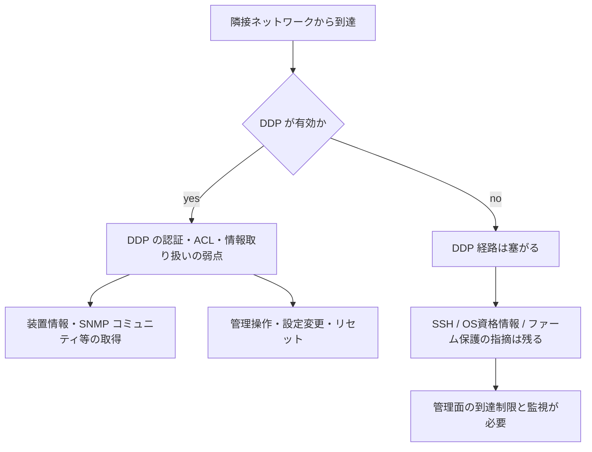

# D-Link DGS-3130 ― DDPなどに未修正の複数ゼロデイ

## 要点

### 影響バージョン

- 確認済みの検証対象は DGS-3130-30TS ハードウェア改訂 B1。調査されたファームウェアは 2.00.B014、2.00.B034、2.04.000、2.04.001（個々の指摘は版の部分集合にかかる可能性がある）（D-Link SAP10523）。
- 他の DGS-3130 モデルや D-Link スイッチ製品族への影響は調査中で、確認されていない（D-Link）。
- 本稿時点で修正ファームウェアはなく、公開 CVE 番号もない（予約／申請中）（D-Link）。

### 今すぐやること

- DDP をグローバルおよび対象インターフェースで無効化する（CLI: `no ddp`）。研究者の検証では、これでテストした DDP 攻撃経路が処理されなくなったと報告されている（D-Link）。
- 不要な／既定の SNMP コミュニティ（特に `public` / `private`）を削除する。必要なら SNMPv3 と送信元制限へ移す（D-Link）。
- SSH・Web UI・SNMP を管理用セグメントと許可ホストだけに閉じ、設定バックアップを取り、想定外の再起動・設定変更・工場出荷リセットがないか監視する（D-Link）。DDP 無効化はファームウェア側の別指摘を直さない。

## 概要

- D-Link は 2026年11月6日、暫定セキュリティ発表 SAP10523 を出した。対象はマネージド Gigabit スタッカブルスイッチ DGS-3130-30TS（H/W Rev. B1）で、Spectrum Community Solutions の Giresh Kumar Enugu 氏が 11月2日に報告した複数の欠陥を扱う（D-Link、BleepingComputer）。
- 指摘の中心は D-Link Discovery Protocol（DDP）の認証・アクセス制御・情報取り扱いと、SSH 設定・OS 資格情報保護・ファームウェア暗号化／埋め込み鍵などファームウェア保護まわり。隣接ネットワーク上の攻撃者が、機微な装置情報の取得、不正な管理操作、設定変更、サービス妨害や装置リセット、SNMP コミュニティ露出などを引き起こしうる、と研究者は説明している（D-Link）。
- 修正版の日程は未定。D-Link は修正が出る前に顧客が晒しを減らせるよう、暫定アドバイザリを先に出した（D-Link）。

> この記事では、ベンダーのアドバイザリ・報道で確認できた内容を「事実」、筆者の推測や意見を「考察」として分けて書いています。

## 何が起きたか（時系列）

| 日付（2026年） | 出来事 |
| --- | --- |
| 11月2日 | D-Link が DGS-3130-30TS に関する複数の脆弱性報告を受領（D-Link） |
| 11月6日 12:16 GMT | 暫定アドバイザリ SAP10523 を公開。修正版なしのまま緩和策を案内（D-Link） |
| 同日 | BleepingComputer などが SMB／メトロ向けスイッチの未修正ゼロデイとして報道 |

## 技術的な問題点（根本原因）

**事実（D-Link SAP10523）**

1. **DDP**
   - 認証・アクセス制御・情報取り扱いの弱点。
   - 想定される影響: DDP 管理機能への不正到達、装置・ネットワーク設定情報の開示、管理資格情報の無断変更、装置リセットやサービス妨害、設定喪失、追加の装置管理を助ける SNMP コミュニティ情報の露出。
   - 研究者は対象ハードウェア上で複数条件の再現に成功したと報告。

2. **ファームウェア保護まわり（DDP とは別系統）**
   - SSH サービスのセキュリティ設定。
   - OS 資格情報の保護。
   - ファームウェア暗号化と埋め込み暗号材料の保護。
   - DDP を無効にしても、これらの指摘は直らない、と D-Link は明記している。

3. **識別子**
   - 複数件が CVE 割当の申請中、または予約済み。公開レコードはまだない。技術分類と確定した影響は、調整が進み次第アドバイザリを更新するとしている。

**考察**

- ディスカバリ／近傍管理用のプロトコルは「同じ LAN なら信頼できる」前提で認証が薄いことが多い。スタック可能なエッジ／メトロスイッチでは、利用者 VLAN や来客セグメントから DDP が見えると、その前提がそのまま侵入面になる。
- 「管理 ACL や VLAN 分離だけに頼らないでほしい」と D-Link 自身が書いている点は重い。プロトコル側の検査が弱いと、L3 の管理面クローズだけでは足りない、という整理になる。

## 攻撃・侵入経路

**事実（D-Link）**

- 前提は「影響を受けるネットワークへのアクセス」。インターネット越しの未認証 RCE としては説明されていない。
- DDP 経路では、隣接から管理機能や設定・資格情報・SNMP 情報に触れ、設定変更やリセットへ進みうる。
- ファームウェア保護まわりの詳細な侵入手順は未公開。D-Link は調査中としている。

## なぜ防げなかったか・構造的要因の考察

**考察**

- **近傍プロトコルの「便利さ」が既定で残る。** DDP のような発見用機能は導入時に有効のまま置かれやすく、本番では誰も使っていないことが多い。攻撃面だけが残る。
- **暫定緩和と根本修正の時間差。** ファームウェアの暗号・資格情報保護に手を入れると検証が長くなり、その間は運用側の設定変更で晒しを削るしかない。未修正ゼロデイの典型的なギャップ。
- **「スイッチは内側」という境界感覚。** SMB／メトロ向けでも、配線ミスやフラットな VLAN 設計があると、エンドポイントと同じセグメントから管理プロトコルに届く。

## 運用者向けの具体的な対策と検知ポイント

**事実（D-Link の推奨）**

1. **DDP を止める（最優先）**
   - グローバルおよび対象物理インターフェースで `no ddp`。
   - `show ddp` 系で結果を確認し、保存して再起動後も残ることを確かめる。
   - DDP に依存する発見・管理ワークフローがある場合は影響を見積もる。

2. **SNMP コミュニティを整理する**
   - `no snmp-server community public` / `private` など、版に合った構文で削除。
   - 必要な場合は SNMPv3（認証・暗号化）とホスト制限。

3. **管理到達を閉じる**
   - SSH / Web / SNMP をインターネットに出さない。
   - 管理 VLAN と許可ホストに限定し、不要な管理サービスは止める。
   - ただし DDP 指摘への唯一の対策にはしない。

4. **監視**
   - 設定の正規バックアップを保持。
   - 想定外の再起動、設定変更、インターフェースダウン、工場出荷リセット、説明のつかない管理アクセスを追う。
   - 疑わしい変化があれば組織のインシデント手順へ。

5. **修正版の追跡**
   - [D-Link Security Announcements](https://supportannouncement.us.dlink.com/) を監視。修正版が出ても、モデルとハードウェア改訂が一致するファームだけを入れる。

## 参考リンク

- [D-Link SAP10523 ― DGS-3130-30TS H/W Rev. B1 Multiple DDP Protocol and Firmware Security Vulnerabilities（2026年11月6日）](https://supportannouncement.us.dlink.com/security/publication.aspx?name=SAP10523)
- [D-Link warns of multiple zero-days in DGS-3130 Series switches（BleepingComputer、2026年11月6日）](https://www.bleepingcomputer.com/news/security/d-link-warns-of-multiple-zero-days-in-dgs-3130-series-switches/)
