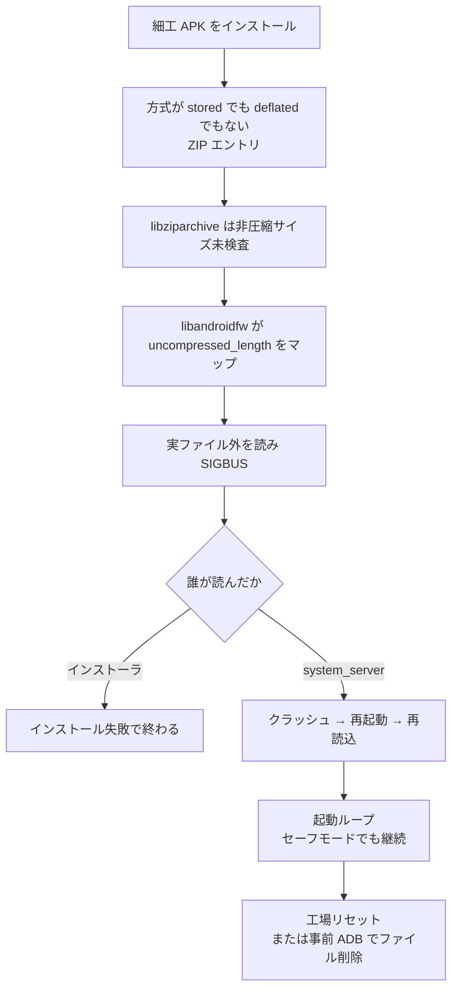

# GhostMap ― インストールするだけで端末が起動ループする

## 要点

### 影響バージョン

- Android 10 以降。Pixel 10（Android 17、2026年8月5日セキュリティパッチ）でも再現（Bitdefender）。
- 執筆時点で、Google はセキュリティ更新としての修正対象外としている。将来の機能更新への回付のみ（Bitdefender）。

### 今すぐやること

- 出典不明の APK をサイドロードしない。インストール時だけが実質の阻止機会である（Bitdefender）。
- 既にループに入った端末は、工場出荷状態へのリセット、または（事前に USB デバッグが有効なら）クラッシュの合間に ADB で該当ファイルを消す。セーフモードでは直らない（Bitdefender）。
- Bitdefender は `Android.Riskware.Ghostmap.rA` として検知し警告できるが、サードパーティアプリはインストール自体を止められない（Bitdefender）。

## 概要

- 2026年11月5日ごろ、Bitdefender Labs が GhostMap を公表した。細工した APK を入れるだけで、アプリを開かず権限も要らずに、端末が起動ループに陥る（Bitdefender）。
- 原因は ZIP の圧縮方式と非圧縮サイズの扱いが、`libziparchive` と `libandroidfw` で食い違うパーサー差である。過大なメモリマップの先を読むと SIGBUS でプロセスが落ちる（Bitdefender）。
- 発見のきっかけは、解析用エミュレータを落とすバンキング系ドロッパーだった。持続する system_server のループは Bitdefender が示した PoC で、野外での悪用は確認されていない（Bitdefender）。

> この記事では、ベンダーのアドバイザリ・研究者の分析・報道で確認できた内容を「事実」、筆者の推測や意見を「考察」として分けて書いています。

## 何が起きたか（時系列）

| 日付（2026年） | 出来事 |
| --- | --- |
| 8月12日 | 野外で得たバンキング系ドロッパーの APK が、Bitdefender の解析エミュレータをインストール時にクラッシュさせる。調査開始（Bitdefender） |
| 8月20日 | Google の Android & Devices VRP へ第1報。まもなく Won’t Fix（Not Reproducible）／プログラム対象外（Bitdefender） |
| （続報調査） | インストール後に system_server が資源を読む経路で、持続するクラッシュループを確認（Bitdefender） |
| 8月25日 | PoC 付きの第2報。Google はセキュリティ更新の対象外とし、将来の版での検討のため機能チームへ回付（Bitdefender） |
| 11月5日ごろ | Bitdefender がブログで公開。報道が追随（Bitdefender、BleepingComputer） |

## 技術的な問題点（根本原因）

**事実（Bitdefender）**

- APK は ZIP であり、各エントリに圧縮方式と「圧縮後サイズ／非圧縮サイズ」が書かれる。Android が使う方式は実質 stored と deflated の2つだが、方式フィールド自体は 16 ビットで他の値も取りうる。
- `libziparchive` は、非圧縮サイズがファイル実体を超えていないかの検査を **stored（`kCompressStored`）のときだけ** 行う。
- `libandroidfw` は、deflated（`kCompressDeflated`）かどうかで分岐し、**deflated 以外はすべて stored 扱い**で `uncompressed_length` 分をそのままマップする。ここには上記の境界検査がない。
- stored でも deflated でもない方式を付けると、検査のすき間に落ちる。カーネルは実ファイルより大きいマップを許すが、実データの外側を読むと SIGBUS になる。tombstone では `__memcpy_aarch64_simd` → `_FileAsset::read` など、数 KB の APK が十数 MB 相当にマップされた例が示されている。
- ストリーム読みと、整列用に宣言サイズぶんコピーする経路の両方で落ちる。後者は XML 資源やアイコン読み込みでも使われる。
- どのプロセスが落ちるかは、どのファイルを誰が読むかで変わる。マニフェストを壊せばインストーラが落ちてインストール自体が失敗する（最初の野外サンプルはこの系統）。インストール後に system サービスが読む資源を壊すと、`system_server` が落ち→再起動→同じ資源を再読込、のループになる。

**事実（歴史的な並列）**

- 2016年11月の CVE-2016-6724（Input Manager の DoS。工場リセットが必要）は当時 Moderate。Bitdefender は、現行の深刻度指針なら工場リセットが必要な持続 DoS は High 相当だと述べている（Bitdefender）。

**考察**

- 同じバイト列を複数のライブラリが別の規則で読む古典的なパーサー差で、Master Key・Janus・BadPack と同じ系統の問題である。今回は「すり抜け」ではなく「読む側のクラッシュ」に振れている。

## 攻撃・侵入経路

**事実（Bitdefender）**

- PoC APK は実行コードも権限要求もなく、起動する必要もない。インストール後、system_server が資源を読むと約1秒で最初のクラッシュが起きる。
- 測定例: 通常起動でクラッシュ約110回、セーフモードでも約72回。セーフモードフラグが立ったあとも、それが効く前に同じ経路で落ちる。
- 復旧は工場リセット、または USB デバッグが既に有効な場合に限り、クラッシュの合間に ADB で該当の不正ファイルを消す。カーネルが一度完全再起動したあとは、クラッシュが起動の早い段階で起きるため ADB 経路も使えなくなる、と Bitdefender は説明している。
- 最初の野外サンプルはパッカーが ZIP 構造を書き換えた結果インストーラを落としたもので、作者がクラッシュを意図した痕跡はない。持続ループは Bitdefender の検証・PoC であり、野外では観測されていない。

**事実（仮説上の悪用。観測はなし）**

- Bitdefender が挙げる可能性（いずれも未観測）: 端末を使えなくして恐喝する、アイコンを壊してアンインストール UI を落とす、スキャナーをクラッシュさせる、更新配信で後から仕込む。

## なぜ防げなかったか・構造的要因の考察

**考察**

- **「インストールできた＝安全」ではない。** 署名検証や権限モデルを通過したあとに、資源読み込みという別パーサーが動く。ここまで含めた一貫した検査がないと、入れるだけで壊せる隙間が残る。
- **セキュリティ更新の枠から外れた。** 再現困難／対象外とされ、機能チームへの回付にとどまっているため、利用者側にパッチ待ちという選択肢がない。サイドロードの自制と、インストール前検知が実質の防御になる。
- **サードパーティは止められない。** 検知できても、Android のモデル上は警告まで。ユーザーが入れる前に消せるかどうかの競争になる。

## 運用者向けの具体的な対策と検知ポイント

**事実（Bitdefender）**

- 修正パッチは（セキュリティ更新としては）出ていない。防御は「入れる前に構造を見て弾く」こと。
- 検知名の例: `Android.Riskware.Ghostmap.rA`。ダウンロード時点や導入済みアプリとして警告できるが、インストール阻止や他アプリの自動削除はできない。
- 組織端末では、未知の APK のサイドロードを MDM で制限する。開発者向けオプション（USB デバッグ）を常時オンにする運用は、復旧手段にはなるが攻撃面にもなる点に注意する。

**考察（運用上の工夫）**

- 解析・検疫パイプライン自体が同じ native API で APK を開くと、スキャナー側が SIGBUS で落ちうる。Java の例外では捕まらないため、隔離されたパーサーやタイムアウト付きの別プロセスで読む必要がある。

## 参考リンク

- [GhostMap: The Android flaw that crashes your phone before you open the app（Bitdefender Labs、2026年11月5日）](https://www.bitdefender.com/en-us/blog/labs/ghostmap-android)
- [GhostMap Android flaw lets malicious app trigger persistent boot loop（BleepingComputer）](https://www.bleepingcomputer.com/news/security/ghostmap-android-flaw-lets-malicious-app-trigger-persistent-boot-loop/)
