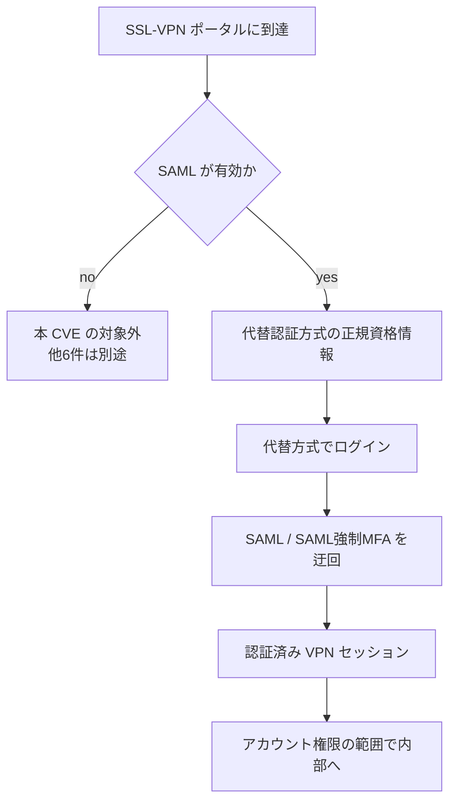

# SonicWall SonicOS CVE-2026-19868 ― SSL-VPNのSAMLを迂回

## 要点

### 影響バージョン

- SonicOS Gen7（TZ / NSa / NSsp / NSv）7.3.3-7015 以前、Gen8（TZ / NSa / NSv）8.2.2-8015 以前。修正は Gen7 7.3.4-7013 以降、Gen8 8.2.3-8015 以降（BleepingComputer、Zero Hunt が伝える SonicWall SNWLID-2026-0014）。
- 本 CVE が効くのは、SSL-VPN ログインに SAML を有効にしている構成に限る（OpenCVE / CVE 説明、報道）。
- 回避策は示されていない（BleepingComputer）。

### 今すぐやること

- Gen7 を 7.3.4-7013 以降、Gen8 を 8.2.3-8015 以降へ上げる。同じアドバイザリには未認証で管理面に届く CVSS 8.8 の欠陥など計7件が含まれるため、SAML 未使用でも更新する（BleepingComputer）。
- すぐ更新できない場合は、SSL-VPN ポータルの到達元を既知の送信元に絞る。SAML を切って MFA を外すのは回避にならない（Zero Hunt の整理）。
- SSL-VPN の認証成功ログを見直し、想定外の送信元や代替方式での成功がないか確認する。疑わしいセッションがあれば、代替方式で届くアカウントの資格情報をまとめて回し、アクティブな VPN セッションを切る。

## 概要

- SonicWall は 2026年11月6日、SonicOS の7件の脆弱性を修正するアドバイザリ SNWLID-2026-0014 を出した。うち CVE-2026-19868 は SSL-VPN の認証強制の欠陥で、代替認証方式の正規資格情報を持つ利用者が SAML 制御を迂回でき、SAML で強制している MFA も迂回しうる（CVE 説明、BleepingComputer）。
- SonicWall PSIRT は「本脆弱性の悪用を示す報告を調査した」とし、利用者に最新版への更新を強く求めた。同日 CISA が KEV に追加し、連邦文民行政機関への適用期限を 2026年11月20日とした（CISA、BleepingComputer）。
- SonicWall 側の CVSS は 7.1、CISA が NVD に付けた評価は 7.5。分類は CWE-308（単要素認証の利用）（OpenCVE、Zero Hunt）。発見・報告は The Electronic Office の Ryan Harris 氏（BleepingComputer）。

> この記事では、ベンダーのアドバイザリ・公的機関の注意喚起・研究者の分析・報道で確認できた内容を「事実」、筆者の推測や意見を「考察」として分けて書いています。

## 何が起きたか（時系列）

| 日付（2026年） | 出来事 |
| --- | --- |
| （背景） | SonicWall のリモートアクセス製品は、2025年後半以降も SSL-VPN / SMA1000 を狙った攻撃が続いていた（BleepingComputer） |
| 11月6日 | SonicWall が SNWLID-2026-0014 を公開。CVE-2026-19868 を含む7件を修正し、悪用報告の調査を記載（BleepingComputer） |
| 同日 | CISA が CVE-2026-19868 を KEV に追加。BOD 26-04 に基づく連邦機関の期限は 11月20日（CISA） |
| 同日〜11月7日 | カナダサイバーセンターが注意喚起。NVD は Undergoing Analysis、CISA の CVSS 7.5 が付与されたと報じられた（カナダサイバーセンター、Zero Hunt） |

## 技術的な問題点（根本原因）

**事実（CVE 説明、OpenCVE、BleepingComputer）**

- CVE-2026-19868 の説明は次のとおり。「SonicOS SSLVPN サービスの認証強制の脆弱性により、代替認証方式の正規資格情報を持つ利用者が SAML 認証制御を迂回できる可能性がある。成功すれば、SAML で強制している多要素認証（MFA）も迂回しうる」。
- CWE は 308（Use of Single-factor Authentication）。「SAML が設定されている」ことと「SAML が唯一の入り口である」ことが一致していない、という構図になる。
- 影響は SSL-VPN インターフェース／サービスに限られ、かつ SSL-VPN ログインに SAML が有効な場合に限る、とベンダーは説明している（報道が伝える SonicWall の文言）。
- 同じアドバイザリには、特定条件下で未認証の攻撃者が不正操作できる管理インターフェースの欠陥（CVSS 8.8 が2件）、SSL-VPN / TACACS+ の認証前バッファオーバーフローによる DoS、仮想アプライアンスの弱いパスワードハッシュなども含まれる（BleepingComputer）。

**考察**

- 「IdP 側で MFA を掛けている」状態でも、装置側に代替ログイン経路が残っていれば、その経路は単要素に戻る。VPN の認証ポリシーは「どの方式が有効か」ではなく「どの方式だけが許されるか」で設計しないと、設定のつもりが側道になる。
- SonicWall 製品では、2024年の MFA 迂回（CVE-2024-12802 など）でも「ログイン方式ごとに MFA 設定が分かれる」ことが問題になった、と報道・分析で触れられている。方式の分岐そのものが、強制の抜け穴になりやすい。

## 攻撃・侵入経路

**事実（CVE 説明、CISA、BleepingComputer）**

- 前提は、(1) 対象装置の SSL-VPN がインターネット等から届く、(2) SSL-VPN に SAML が有効、(3) 攻撃者が代替認証方式向けの正規資格情報を持っている、こと。
- その資格情報で代替方式から認証すると、SAML チャレンジ（およびそれに紐づく MFA）を経ずに VPN セッションが得られる、というのが公表されている影響範囲。
- SonicWall は悪用の詳細・IoC・攻撃者の帰属を公表していない。CISA は KEV 掲載により実環境での悪用を確認した立場を取っている。

## なぜ防げなかったか・構造的要因の考察

**考察**

- **「追加の認証」と「唯一の認証」の取り違え。** SAML＋MFA を足しても、古い／別系統の資格情報が生きていれば、足した側は通らない道になる。設定画面では「SAML を使っている」に見えても、強制ではない。
- **VPN は入口の単一障害点であり続ける。** Akira などが SonicWall SSL-VPN 経由で短時間にランサムウェアへ進んだ事例が報じられており、MFA 迂回は「設定ミス」ではなく侵入の最初の55分になりうる（Zero Hunt が引用する過去の観測）。
- **バンドル修正の中に KEV が埋もれやすい。** 7件同時公開のうち悪用確認は1件でも、運用側が「低めの CVSS だから後回し」にすると、側道が残る。

## 運用者向けの具体的な対策と検知ポイント

**事実に基づく手順**

- ファームウェアを修正版へ上げる。回避策は公式に示されていない（BleepingComputer）。
- SAML 未使用でも、同じアドバイザリの他 CVE（特に未認証の管理面欠陥）のため更新する。
- 更新前の暫定策として、SSL-VPN の送信元制限を検討する。SAML の無効化は MFA を外すことになり、推奨されない（Zero Hunt）。

**検知・事後対応（公表 IoC がない前提の運用観点）**

- SSL-VPN 成功ログで、VPS／ホスティング ASN からの成功、短時間での内部スキャン開始、想定外アカウントの成功を洗う。
- 関連する過去の SonicWall MFA 迂回では、スクリプト的認証を示すログパターンが研究者から指摘された例があるが、本 CVE 専用の IoC は本稿時点でベンダーから出ていない（Zero Hunt）。
- 侵害が疑われたら、代替方式で届く全アカウントの資格情報をローテーションし、VPN セッションを切断したうえで、修正版適用後に「代替方式では入れない」ことを確認する。

## 参考リンク

- [SonicWall PSIRT ― SNWLID-2026-0014](https://psirt.global.sonicwall.com/vuln-detail/SNWLID-2026-0014)
- [CISA ― Adds One Known Exploited Vulnerability to Catalog（2026年11月6日）](https://www.cisa.gov/news-events/alerts/2026/11/06/cisa-adds-one-known-exploited-vulnerability-catalog)
- [CVE-2026-19868（OpenCVE）](https://app.opencve.io/cve/CVE-2026-19868)
- [SonicWall warns of new SSL-VPN MFA bypass flaw exploited in attacks（BleepingComputer、2026年11月6日）](https://www.bleepingcomputer.com/news/security/sonicwall-warns-of-new-ssl-vpn-mfa-bypass-flaw-exploited-in-attacks/)
- [SonicWall security advisory AV26-1133（カナダサイバーセンター、2026年11月6日）](https://www.cyber.gc.ca/en/alerts-advisories/sonicwall-security-advisory-av26-1133)
