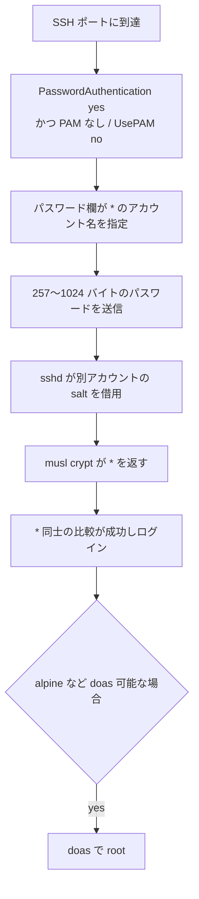

# sshole ― 長いパスワードで鍵専用アカウントに入れる

## 要点

### 影響バージョン

- musl libc を使い、PAM なし（または `UsePAM no`）で動く OpenSSH の `sshd`。Alpine の `openssh-server`（既定で PAM なし）、OpenWrt、Buildroot、Yocto など（Alpine、BleepingComputer）。
- Alpine では 3.21〜3.24・edge と、更新が終わった 3.16〜3.20 も対象。修正入りは 3.21.10、3.22.8、3.23.8、3.24.4（および古いブランチ向けの個別パッケージ）（Alpine）。
- OpenSSH 本体の回避は 10.6p2（2026年11月5日）（OpenSSH）。
- glibc 系（Debian / Ubuntu / Fedora など）や、`openssh-server-pam` で `UsePAM yes` の構成、`PasswordAuthentication no` の構成は対象外（Alpine、BleepingComputer）。

### 今すぐやること

- Alpine なら `apk upgrade -U -a` のあと、必ず `sshd` を再起動する。パッケージを上げただけでは動いているデーモンは置き換わらない（Alpine）。
- すぐ更新できない場合は `PasswordAuthentication no` にして `sshd` を再起動する。鍵ログインが使えることを先に確かめる（Alpine）。
- ログに、パスワードを持たないはずのアカウント（`alpine`・`root`・鍵専用ユーザーなど）への `Accepted password for` がないか見る（Alpine）。

## 概要

- OpenSSH と musl の組み合わせで、パスワード認証を意図的に閉じたアカウントへ、極端に長いパスワードを1回送るだけで入れる欠陥が公表された。研究者の呼称は sshole（Alpine、sshhole.com、報道）。
- 条件は `PasswordAuthentication yes`、パスワード欄が `*` のアカウント、同じマシンに `$5$` か `$6$` のハッシュを持つ別アカウントがあること。攻撃は1接続で再現する（Alpine）。
- OpenSSH は 10.6p2 で sshd 側の回避を出し、Alpine は各ブランチ向けの修正パッケージを出した。執筆時点の Alpine 告知では CVE は未割当だった（Alpine、OpenSSH）。

> この記事では、ベンダーのアドバイザリ・研究者の分析・報道で確認できた内容を「事実」、筆者の推測や意見を「考察」として分けて書いています。

## 何が起きたか（時系列）

| 日付（2026年） | 出来事 |
| --- | --- |
| （背景） | 2016年のユーザー名列挙対策 CVE-2016-6210 以降、sshd（PAM なし）は短いパスワード欄のアカウントにも別アカウントの salt を借りて `crypt()` を回すようになった（BleepingComputer、報道） |
| 11月5日 | OpenSSH 10.6p2 を公開。musl かつ PAM 無効時のパスワード認証回避への critical な回避策を含む（OpenSSH） |
| 同日 | Alpine がアドバイザリを公開。修正パッケージと回避策を案内（Alpine） |
| 同日 | Özgün Kültekin（Wakefield）の報告として sshhole.com・oss-security・報道で詳細が広がる（Alpine、oss-security、BleepingComputer） |

## 技術的な問題点（根本原因）

**事実（Alpine、OpenSSH）**

- PAM なしの sshd は、提示されたパスワードを `crypt()` でハッシュし、`/etc/shadow` の保存値と比較する。
- 保存欄が salt を含むには短すぎるアカウント（典型は `*`）では、別アカウントの salt を借りてハッシュする。これは CVE-2016-6210 のタイミング差を埋めるための挙動である。
- musl の `crypt()` は、鍵（パスワード）が 256 バイトを超えるとエラー表示として文字列 `*` を返す。
- 借りた salt で長いパスワードをハッシュした結果が `*` になり、鍵専用アカウントの保存値 `*` と一致して認証が通る。
- OpenSSH は「根本原因は sshd の外にある」としつつ、sshd 側で回避できるとしている。

**事実（Alpine、BleepingComputer）**

- 攻撃者が送るパスワードの長さは 257〜1024 バイト（Alpine）。BleepingComputer は 257 文字超と要約している。
- パスワードハッシュが正しく入っているアカウントそのものを、この手順で破るものではない。
- 発見者は AI エージェントで約 17,600 通りの認証試験を回して見つけたと説明している（BleepingComputer）。

**考察**

- 「エラー値」と「パスワードなしを表す印」が同じ `*` だったことが、比較の成功条件そのものになっている。ライブラリのエラー規約と、アカウント状態の表現が偶然重なると、呼び出し側の「失敗なら不一致」という前提が崩れる。

## 攻撃・侵入経路

**事実（Alpine）**

- SSH ポートに届く攻撃者が、パスワード欄が `*` のアカウント名を知り、257〜1024 バイトのパスワードを送る。マシン上に `$5$` または `$6$` のハッシュを持つ別アカウントが1つあれば足りる。
- `root` は base イメージで `root:*` だが、既定の `PermitRootLogin prohibit-password` ではパスワードでは入れない。ただし別のログイン可能なアカウントが `doas` などで root になれる場合は、そこ経由で昇格できる。
- 公式 tiny-cloud イメージ（3.18.11〜3.24.3）は、`alpine` ユーザーが `*` でパスワードなし `doas` を持つ。初回起動直後は安全だが、管理者がコンソール用パスワードを付ける、user-data で `hashed_passwd` を入れるなどして `$6$` ハッシュが1つでもできると、`alpine` へのこの経路が開き、`doas` で root になれる。

## なぜ防げなかったか・構造的要因の考察

**考察**

- **タイミング攻撃対策が別の比較経路を作った。** パスワードなしアカウントでも必ず `crypt()` を回すようにしたことで、ライブラリのエラー戻り値と保存値が衝突する余地が生まれた。
- **「鍵専用」運用と PasswordAuthentication の既定が同居している。** Alpine の `openssh-server` は PAM なしで、OpenSSH の既定ではパスワード認証が有効なままになりやすい。鍵だけ使うつもりでも、設定を閉じなければ条件がそろう。
- **クラウドイメージの便利さが被害を大きくする。** `alpine` + パスワードなし `doas` は運用を楽にする一方、`$6$` が1つ載った瞬間に「鍵専用に見えるアカウント」から root までの道ができる。

## 運用者向けの具体的な対策と検知ポイント

**事実（Alpine）**

- 修正パッケージへ上げて `sshd` を再起動する。または `PasswordAuthentication no`。
- 検知は `/var/log/messages` などで、パスワードを持たないはずのアカウントへの `Accepted password for` を探す。`doas` の利用、最近作られたユーザー・ファイル・`authorized_keys` も見直す。説明がつかないログインがあれば侵害前提で扱う。
- ロックアカウント（shadow の `!`）や、`$` 系ハッシュが1つもないマシン、cloud-init で `PasswordAuthentication no` になっているイメージは対象外。

**考察（運用上の工夫）**

- Alpine 以外の musl 系（OpenWrt や組み込みの Yocto / Buildroot）も、同じ「PAM なし + PasswordAuthentication yes」になっていないかを先に洗い出す。
- tiny-cloud 由来のインスタンスは、修正入りイメージ（3.21.10 / 3.22.8 / 3.23.8 / 3.24.4 以降）への載せ替えか、稼働中の `openssh` 更新／パスワード認証無効化をまとめて確認する。

## 参考リンク

- [Security advisory: openssh-server password authentication bypass（Alpine Linux、2026年11月5日）](https://alpinelinux.org/posts/2026-11-05-openssh-password-authentication-bypass/)
- [OpenSSH Release Notes ― 10.6p2（2026年11月5日）](https://www.openssh.org/releasenotes.html)
- [sshole（発見者サイト）](https://sshhole.com/)
- [OpenSSH flaw lets attackers log into password-disabled Linux accounts（BleepingComputer、2026年11月5日）](https://www.bleepingcomputer.com/news/security/openssh-flaw-lets-attackers-log-into-password-disabled-linux-accounts/)
- [oss-security: "sshole": password authentication bypass: OpenSSH + musl libc（2026年11月5日）](https://www.openwall.com/lists/oss-security/2026/11/05/3)
