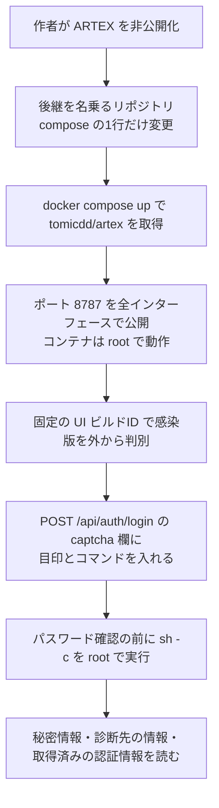

# ARTEXのDockerイメージ ― ログイン処理にバックドア

## 要点

### 影響を受けるもの

- Docker Hubのイメージ **`tomicdd/artex:latest`** と、同じダイジェストの再配布 **`congdonglinux/artex`** から動かしたARTEXのコンテナ。起動した日付は関係ない（BadByte、Ostorlab）。
- `docker-compose.yml` などで上の2つを指しているリポジトリのコピー。BadByteは11月5日時点で637のGitHubリポジトリを数えた。イメージ名を変えたフォークや、ミラー経由で取得する構成は今も影響を受けうる（BadByte）。
- GitHub上のソースコードにはバックドアは入っておらず、ビルド済みのイメージだけに入っている（BadByte）。CVEは割り当てられていない（Ostorlab）。

### 今すぐやること

- `docker compose config` やイメージのダイジェストで、`tomicdd/artex` か `congdonglinux/artex` を使っていないか確かめる。
- 使っていたら、ボリュームとログを保全してからコンテナを止め、レビュー済みのソースから作り直す。更新では直らない。
- コンテナが読めた秘密情報（DBのパスワード、LLMのAPIキー、検索APIキー、通知用のトークン、JWTの署名鍵など）をすべて交換し、コンソールに保存していた診断先の情報も読まれた前提で扱う。

## 概要

- ARTEXは中国語のオープンソースのAIペネトレーションテスト用コンソールで、韓国の銀行への攻撃などに使われた後、作者が10月8日に非公開化を告知し、リポジトリを削除した（BadByte）。
- 同じ日の夜、Docker Hubに `tomicdd` アカウントが作られて `tomicdd/artex` が公開され、GitHubの `trhhubsd/ARTEX` がソースのコピーを、composeファイルの1行だけ変えてそのイメージを指す形で公開した（BadByte）。
- イメージの中のバイナリには、ログイン要求の `captcha` 欄に特定の目印がある場合、続く文字列を `sh -c` でrootとして実行し、結果を返す処理が加えられていた。ユーザー名とパスワードは確認されない（BadByte）。

> この記事では、研究者の分析と報道で確認できた内容を「事実」、筆者の推測や意見を「考察」として分けて書いています。

## 何が起きたか（時系列）

時刻はUTC（BadByte）。

| 日時（2026年） | 出来事 |
| --- | --- |
| 9月下旬〜10月初め | ARTEXとClaude Codeを使った韓国の銀行への攻撃（CrowdStrike、[既存記事](/security-notes/notes/2026-10-11-artex-ai-pentest-tool-south-korea-financial-breaches/)） |
| 10月8日 10:50 | 作者（`Autumn-27`）が悪用を理由に非公開化を告知し、リポジトリを削除 |
| 10月8日 18:50〜19:41 | Docker Hubアカウント `tomicdd` 作成、`tomicdd/artex` に唯一のタグ `latest` を公開 |
| 10月8日 20:33 | `trhhubsd` のコピーで、composeのイメージを `autumn27/artex` から `tomicdd/artex` に変えるコミット |
| 10月12〜13日 | `trhhubsd/ARTEX` に48時間で1,098件のスターが付く。その後約1,100件が消えた |
| 10月20日 | `congdonglinux/artex` に同じイメージが登録される。公開コンソールで最初の感染版を確認 |
| 10月23〜24日 | GitHubで「バックドアの疑い」というissueが立ち、リポジトリの持ち主が閉じる |
| 11月2日 | Dan Tentler氏がMastodonで、GitHubのコードではなくイメージにバックドアがあり、captchaの仕組みにあると指摘 |
| 11月4日 | BadByteが分析を公開。62台中46台が感染版を配信中 |
| 11月5日 | Docker Hubが2つのイメージを削除し、`tomicdd` アカウントも削除 |

## 技術的な問題点（根本原因）

**事実（BadByte）**

- イメージ内の `/app/artex`（SHA-256 `d5070f52…8d1573`）は、ビルド情報に `vcs.modified=true` と `+dirty` を含み、最後の公開コミット `5c0dbd4` に未公開の変更を加えてビルドされていた。公開されているどのソースにもその変更はない。
- 公式のv0.3.15と比べると31,054の関数が一致し、違いは3点だけだった。新しい160バイトの関数 `server.verifyCaptcha`、大きくなったログイン処理 `server.(*Server).authLogin`、ログイン要求の構造体に加わった `Captcha` 欄。
- `verifyCaptcha` は `exec.Command("sh", "-c", cmdline)` で受け取った文字列を実行し、出力を返す。呼び出し元はログイン処理だけで、JSONを読んだ直後、ユーザー名の照合・パスワードハッシュの検索・bcryptの確認より前に置かれている。
- 外への通信はしない。要求が来るのを待つだけである。
- バイナリは版番号を持たず `dev` と名乗るため、ARTEXの「ワンクリック更新」は動かない。動く更新手順 `update.sh` は、同じイメージを `docker compose pull` し直すだけである。

**考察**

- ソースを読んでも見つからない、という点がこの手口の要だ。リポジトリは本物のソースのコピーで、変えたのはイメージ名の1行だけだった。「コードを確認した」という安心が、ビルド済みのイメージを信用する理由になってしまった。

## 攻撃・侵入経路

**事実（BadByte、Ostorlab）**

- 利用者はREADMEに従い `docker compose up -d` を実行する。composeファイルはポート8787をすべてのインターフェースで公開するため、VPSではすぐにインターネットから届く。
- 感染版は全ページで固定のUIビルドID `3aC1db3gGU08O4UHbAt4J` を出すため、インターネット検索で感染版を見分けられる。
- 発動は認証なしの1回の要求で足り、ネットワークからは失敗したログインに見える。
- コンテナからは、環境変数のDBパスワード、平文で保存されたLLMや検索のAPIキー、診断先の範囲と見つかった脆弱性、診断先から取得した認証情報、中間者プロキシで記録した通信とそのCAの秘密鍵、7日間有効な管理者トークンを作れるJWT署名鍵、MCPサーバーの設定とトークン、通知用のトークンなどが読める。
- `./data`、`./skills`、DBのボリュームに書いたものはイメージを取り直しても残る。エージェントのプロンプトやツールを書き換えれば、その後の診断にも影響する。

**事実（被害の広がり、BadByte）**

- pull数は11月3日までに7,946回（`tomicdd/artex` 7,913、`congdonglinux/artex` 33）。最終的に9,131回と45回。
- 11月2〜4日に感染版を配信する公開コンソールを62台確認し、11月4日時点で46台が配信を続けていた。これは下限で、NATやVPNの内側は数えられていない。
- 11月4日時点でインターネット上のARTEXコンソールは1,645台。約34のDocker Hub名前空間が `artex` という名前のイメージを出しているが、バックドアが見つかったのは上の2つだけ。
- ColoCrossing上の15台は同じSSHホスト鍵を共有し、11月2日に数分おきに感染版が立ち上がった。BadByteは1人の持ち主の機材群とみているが、その持ち主がバックドアの作者かどうかはわからないとしている。

## なぜ防げなかったか・構造的要因の考察

**考察**

- **原本が消えると、偽物が「後継」になる**: 作者がリポジトリを消した後、利用者は「いちばんスターの多いコピー」を探した。スターは買える（BadByteは不自然なスターの増減を示している）。正規の配布元が消えた道具は、それだけで乗っ取りやすくなる。
- **攻撃ツールの利用者は、狙う価値の高い標的**: コンソールには診断先の弱点と認証情報が集まる。バックドアの持ち主は、利用者本人だけでなく、その利用者が診断していた組織にも届く。
- **「既定のcompose」がそのまま公開設定**: 全インターフェースでの公開とrootでの実行は、試しに動かす人にとっては手軽だが、VPSでは即座に外から届く構成になる。
- **Docker Hubの削除は、取得済みのコピーを消さない**: 削除後も、すでに動いているコンテナ、ローカルに残ったイメージ、サードパーティのミラーは感染版のままである。

## 運用者向けの具体的な対策と検知ポイント

1. 使っているイメージを確かめる：`docker compose config | grep -nE 'image: *(tomicdd|congdonglinux)/artex'`、`docker image inspect` でダイジェストを確認する。コンテナ内の `/app/artex` のSHA-256が `d5070f52262effe216b840711343bff8f2787f39208d887d8dfd9c673f8d1573` なら感染版（BadByte）。
2. 自分のコンソールのページに `3aC1db3gGU08O4UHbAt4J` が含まれていないか確かめる（BadByte）。
3. ログで、`POST /api/auth/login` のうちJSONに `captcha` キーを含むものを探す。公式のクライアントは `username` と `password` しか送らない。Goのデコーダーはキーの大文字小文字を区別せず、Unicodeエスケープも受け付けるので、その形も含めて探す。応答にシェルの出力（`uid=` など）が含まれていれば発動の確証になる（BadByte）。
4. ホスト側で、`/app/artex` から起動された `sh -c` を検知する（BadByte）。BadByteはYARAルールも公開している。
5. 感染版を使っていた場合は、Ostorlabの手順に沿って、保全、停止、レビュー済みソースからの再構築、コンテナの作り直し、秘密情報の全交換、JWT署名鍵の交換、診断先の記録の見直しを行う。コンソールに認証情報が保存されていた診断先の持ち主には連絡する。コンテナの外（ホスト）に手が加えられていないかも調べる（Ostorlab）。
6. 一般論として、攻撃用・診断用の道具は、読んだソースから自分でビルドし、インターネットに公開しない場所で動かす（BadByte）。

## 参考リンク

- [BadByte: ARTEX Backdoor: 7,946 Pulls of a Trojanized Docker Image Handing Out Root Shells（2026年11月4日、11月5日更新）](https://badbyte.io/artex-backdoor-docker-image/)
- [Ostorlab: Malicious ARTEX Docker Image Hands Out Root Shells（2026年11月5日）](https://blog.ostorlab.co/artex-backdoored-docker-image-root-shell.html)
- [関連記事：WorkOS ― 検証環境を抜け出したAIエージェントが社内ツールに侵入](/security-notes/notes/2026-11-08-workos-artex-agent-sandbox-escape-internal-sales-tool/)
