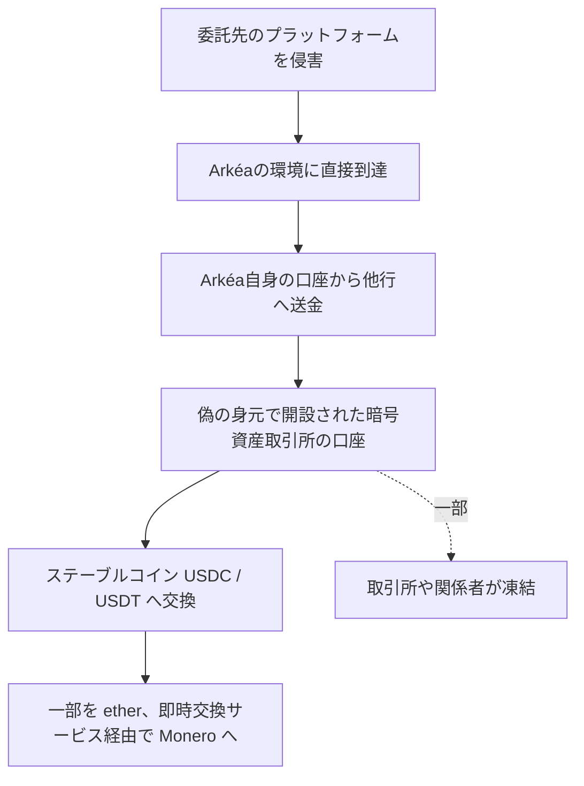

# Crédit Mutuel Arkéa ― 委託先経由で銀行自身の口座から不正送金

## 要点

### わかったこと

- 攻撃者は「委託先の1社のプラットフォーム」を経由してArkéaに直接到達した。子会社のネット銀行Fortuneoは入口ではない（Arkéa FAQ）。
- 送金に使われたのは顧客の口座ではなく、Arkéa自身の口座。送金先は他の銀行で、そこから暗号資産に換えられた可能性がある（Arkéa FAQ）。
- 被害額はZachXBTが示した約1億1800万ユーロについて「確認しないが、桁は認める」。一部の資金は凍結できた（Arkéa FAQ）。
- パリ検察のサイバー犯罪部門が「組織的な自動データ処理システムへの侵害」で捜査を始めた（AFP経由の01net）。

### わかっていないこと

- 委託先の名前と、その委託先がどう侵害されたか。
- 委託先のプラットフォームから、銀行自身の口座で送金を指示できた仕組み。
- 不正な送金が数日にわたって続いたとされる間、送金の監視で止まらなかった理由。

### 今すぐやること（銀行・決済事業者）

- 委託先のプラットフォームから自社の勘定系・送金系へ届く経路を洗い出し、その経路で出せる送金の上限と承認の手順を確かめる。
- 顧客口座だけでなく、自社名義の口座（決済用・資金繰り用）の送金も監視の対象に入れる。

## 概要

- フランスの協同組合銀行グループCrédit Mutuel Arkéaが、11月4日にサイバー攻撃で「不正な取引」が実行されたと公表した（BleepingComputer、01net）。
- 銀行は、攻撃者が委託先のプラットフォームを経由して侵入し、銀行自身の口座から他行へ送金したと説明した。顧客の資産への影響はなく、一部の送金の実行が遅れただけだという（Arkéa FAQ）。
- 資金は暗号資産の取引所でステーブルコインに換えられ、一部はMoneroに換えられたと報じられている（01net、BleepingComputer）。

> この記事では、銀行の発表・報道・ブロックチェーン調査者の指摘で確認できた内容を「事実」、筆者の推測や意見を「考察」として分けて書いています。

## 何が起きたか（時系列）

| 日付（2026年） | 出来事 |
| --- | --- |
| 11月1日 | 複数の中央集権型取引所のアカウントから大規模な不正な引き出しがあった、とZachXBTが翌日に警告（BleepingComputer） |
| 11月1日夜〜2日 | 盗まれた資金の一部がether（イーサリアム）に換えられた（01netが伝えたBitqueryの分析） |
| 11月2日 | ZachXBTが被害組織の名前を出さずに警告。被害額は最大1億1800万ユーロ（1億3300万ドル）とした（BleepingComputer） |
| 11月3日 | ZachXBTは、公表がないために3,000万ドルがこの日までに資金洗浄されたと指摘（BleepingComputer） |
| 11月4日 | Arkéaがサイバー攻撃を公表。予防のため一部の取引を一時停止し、スマホアプリも日中の多くの時間使えなかった（01net）。「事態は収束し管理下にある」とした（BleepingComputer） |
| 11月4日以降 | パリ検察が捜査を開始し、Office anti-cybercriminalité（OFAC）に委ねた。Banque de Franceにも報告（01net） |
| 11月4日以降 | Arkéaが追加情報（FAQ）を公表。委託先経由の侵入、銀行自身の口座の利用、Fortuneoの否定、被害額の桁を説明（Arkéa FAQ） |

## 技術的な問題点（根本原因）

**事実（Arkéa FAQ）**

- 侵入の入口は「委託先の1社のプラットフォーム」で、そこからArkéaに直接到達した。委託先の名前、使われた脆弱性や認証情報は公表されていない。
- Arkéaは「人為的なミスが原因ではない」「外部からの高度な攻撃」と説明している。
- 疑わしい活動は「とても早く」特定できたとしている。

**事実（01net）**

- 01netは、独立した調査（ZachXBTなど）では盗難が数日にわたったことが示されており、大口の送金がなぜ数日間アラートをすり抜けたのかが捜査の焦点になると書いている。

**考察**

- 根本原因は公表されていない。ただ、攻撃者が「委託先のプラットフォーム」から「銀行自身の口座で他行への送金」まで到達した以上、委託先の環境に、送金を指示できる（または送金系に命令を渡せる）権限が置かれていたと考えるのが自然だ。
- 顧客口座の不正送金は、本人確認や不正検知の仕組みが厚く作られている。一方、銀行が自社名義で動かす資金は、業務として大口・高頻度になりやすい。そこが監視の「死角」になった可能性がある。

## 攻撃・侵入経路

**事実（Arkéa FAQ、01net、BleepingComputer）**

- 01netによると、送金先は偽の身元で開設された暗号資産取引所（Kraken、OKX、Crypto.comなど）の口座だった（記者Grégory Raymondが複数の情報源の話として伝えたもの）。
- Bitqueryの分析では1億800万ドルを超えるUSDCが、主にKrakenから引き出された（01net）。
- ZachXBTによると、一部は即時交換サービスを経てMoneroに換えられた。CoinDeskはCrypto.comが関連する資金を凍結したと報じた（01net）。
- ZachXBTは北朝鮮のグループの犯行ではないとの見方を示している（01net）。

## なぜ防げなかったか・構造的要因の考察

**考察**

- **委託先の侵害が、そのまま送金権限になった**: 委託先の環境は銀行の境界の外にあるのに、銀行内部の重要な機能に届いていた。委託先との接続を「信頼された内部」として扱うと、委託先を侵害した攻撃者も同じ扱いを受ける。
- **自社口座の送金は「顧客を守る」仕組みの外に置かれやすい**: Arkéaが強調したのは「顧客に影響がない」ことだった。顧客保護の仕組みが働いたことと、銀行自身の資金が守られたことは別の話だ。
- **送金から暗号資産への換金が早い**: 公表は11月4日で、ZachXBTの指摘によれば、それまでに一部は資金洗浄された。被害の最小化は、送金を止める速さと、取引所・送金先の銀行との連絡の速さに左右される。
- **公表の遅れが回収を難しくする**: ZachXBTは、公表がなかったために3,000万ドルが洗浄されたと指摘している（BleepingComputer）。事実の確定を待つことと、凍結に必要な情報を早く関係者へ渡すことは分けて考えるべきだ。

## 運用者向けの具体的な対策と検知ポイント

1. 委託先から勘定系・送金系・SWIFTなどの決済ネットワークへ届く経路を一覧にし、その経路で使える権限を最小にする。送金の指示は委託先の側では完結させず、銀行側の承認を必ず挟む。
2. 自社名義の口座から出る送金について、相手先（初めての送金先銀行、暗号資産取引所に関係する口座）・金額・回数のしきい値を決め、超えたら止めて確認する。
3. 委託先のアカウントや接続元からの操作が、いつもと違う時間帯・量・宛先になっていないかを監視する。
4. 不正送金が見つかったとき、送金先の銀行・暗号資産取引所・当局へ連絡する手順と連絡先を、あらかじめ決めておく。
5. 委託先と、侵害が疑われたときの報告の期限、ログの提供、接続の遮断の手順を契約で決めておく。

## 参考リンク

- [Crédit Mutuel Arkéa: Informations complémentaires suite à l'attaque dont le Crédit Mutuel Arkéa a été victime（FAQ）](https://www.cm-arkea.com/arkea/banque/assurances/pa_38386/fr/informations-complementaires-suite-a-l-attaque-dont-le-credit-mutuel-arkea-a-ete-victime)
- [Crédit Mutuel Arkéa: Additional Information Following the Cyberattack on Crédit Mutuel Arkéa（英語版PDF）](https://www.cm-arkea.com/arkea/banque/upload/docs/application/pdf/2026-11/press_release_-_additional_information_following_the_cyberattack_on_credit_mutuel_arkea.docx.pdf)
- [BleepingComputer: Hackers pull off $133 million French bank heist via service provider（2026年11月7日）](https://www.bleepingcomputer.com/news/security/hackers-pull-off-133-million-french-bank-heist-via-service-provider/)
- [01net: Cyberattaque du Crédit Mutuel Arkéa : un prestataire piraté, des millions blanchis en crypto…（2026年11月5日）](https://www.01net.com/actualites/cyberattaque-du-credit-mutuel-arkea-un-prestataire-pirate-des-millions-blanchis-en-crypto-tout-ce-que-lon-sait-sur-lenquete-en-cours.html)
