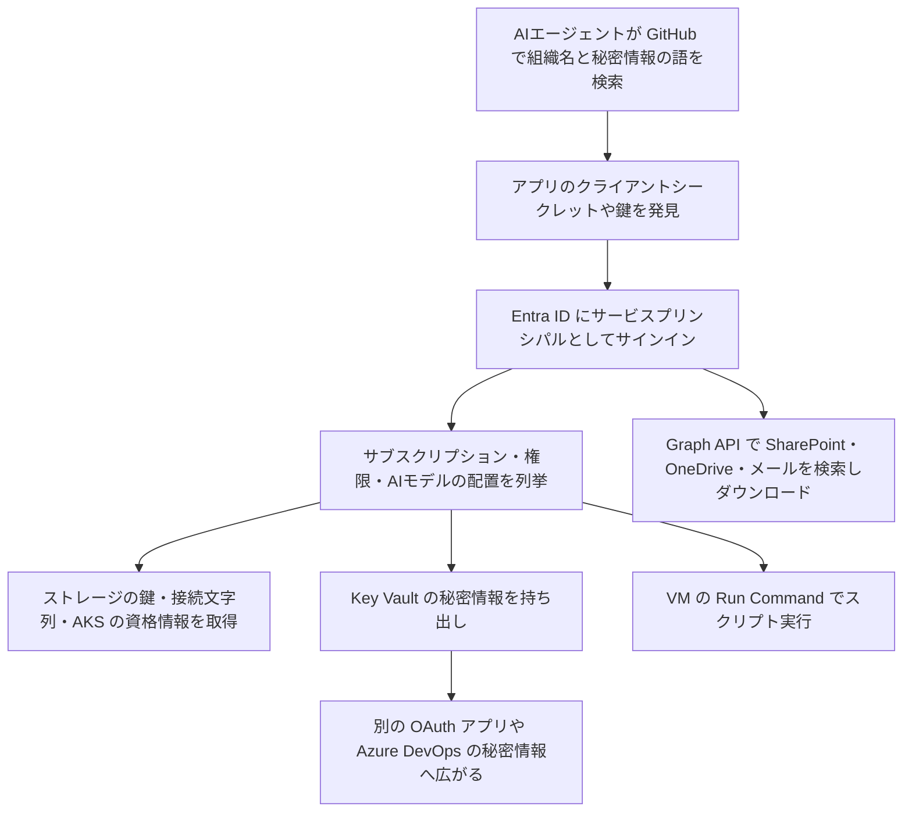

# ARTEXを使う攻撃者 ― GitHubで漏れたアプリの鍵でAzureに侵入

## 要点

### 影響を受けるもの

- 公開GitHubリポジトリに、Entra IDのアプリの資格情報（クライアントシークレット）、ストレージの鍵、接続文字列、AIサービスのAPIキーなどが残っている組織（Microsoft）。
- 自社のアプリの資格情報が自社で漏れていなくても、利用しているベンダーのマルチテナントアプリの資格情報が漏れれば、そのアプリを入れている各テナントに入られる（Microsoft）。
- 製品の脆弱性ではないため、修正版はない。

### 今すぐやること

- Entra IDのサービスプリンシパルと非対話型サインインのログで、`199.19.77[.]84` と `199.19.77[.]18` を検索する。失敗も含める。
- サインインエラー `AADSTS7000215`（シークレットが不正）や `AADSTS7000222`（シークレットが期限切れ）は、誰かが自社アプリの資格情報を持っている兆候。失敗の後に成功があれば緊急で対応する（Microsoft）。
- GitHubで公開されたことのある資格情報は、消したかどうかに関係なく交換する。

## 概要

- Microsoft Threat Intelligenceは11月5日、エージェント型のAI攻撃フレームワーク（ARTEXなど）を使う攻撃者が、公開GitHubリポジトリで秘密情報を探し、その後の攻撃までエージェントに任せていると公表した（Microsoft）。
- 10月28日以降、`199.19.77[.]84` からのサービスプリンシパルのサインイン成功が複数の顧客で確認された。ベンダーのマルチテナントアプリの資格情報が元の組織で漏れ、複数の下流テナントへの侵入に使われた例もあった（Microsoft）。
- MicrosoftはARTEXについて、翌11月6日にも金融機関を狙うStorm-3358の活動を報告している（Microsoft）。

> この記事では、Microsoftのブログで確認できた内容を「事実」、筆者の推測や意見を「考察」として分けて書いています。

## 何が起きたか

| 日付（2026年） | 出来事 |
| --- | --- |
| 8月〜 | AI攻撃フレームワークによるGitHubへの大量の秘密情報検索が始まる（Microsoft） |
| 10月28日〜 | `199.19.77[.]84` からのサービスプリンシパルのサインイン成功が、複数の顧客で確認される（Microsoft） |
| 11月5日 | Microsoftが公表（Microsoft） |

**事実（Microsoft）**

- 検索には、標的の組織名、秘密情報を表す語、クラウドサービスに関する語、他のAIサービス事業者に関する語が組み合わされていた。
- エージェントは、複数のテナントにまたがる数十のアプリについてサービスプリンシパルとしてのサインインに成功した。主な送信元は `199.19.77[.]84` と `199.19.77[.]18`（後者はTorの出口ノードで、無関係の通信も含みうる）。
- 同じIPアドレスを使う似たキャンペーンは、Todylも報告している。
- ほかに、`65.87.223[.]26` から User-Agent にシェルコマンドを埋め込んだ脆弱性悪用の兆候やApp Serviceの認証トークンの取得の試み、`157.22.126[.]128` からAzure AIのワークロードの偵察も見つかった。

## 技術的な問題点（根本原因）

**事実（Microsoft）**

- 秘密情報が公開リポジトリに入るのは、秘密情報を含むコードがGitHubにコミットされるとき。OAuthアプリをすぐ動かすため、あるいは新しい認証方式の設定を避けるために、開発者が設定ファイルやスクリプトに書くことがある。
- 公開された資格情報は、取り消すか交換するまで使える。元の公開場所から消しても、編集履歴、キャッシュ、アーカイブ、ログに残ったコピーは消えない。
- サービスプリンシパルは、アプリが認証に使うIDで、アプリに許された範囲に直接プログラムからアクセスできる。

**考察**

- 根本にあるのは「長く有効な秘密情報を、人が扱うファイルに置く」ことだ。マネージドID（Azureが鍵を管理し、コードに秘密情報を置かない認証方式）に移せば、漏れる秘密情報そのものがなくなる。
- 漏れた鍵を探す手口は昔からあるが、これまでは「見つける・読む・使う」に人手がかかることが歯止めになっていた。Microsoftの報告は、その歯止めがなくなったことを示している。

## 攻撃・侵入経路

**事実（Microsoft）**

- 狙われたのは、資格情報を返す操作だった。ストレージアカウントの鍵、App Serviceの設定、接続文字列と発行用の資格情報、AI・機械学習の接続とデータストア、AKS（Azure Kubernetes Service）の利用者の資格情報。
- 侵害されたアプリはSharePointとOneDriveにアクセスし、ファイルのダウンロードやメールボックスの項目へのアクセスがあった。Graph APIでは主に検索をしていた。
- 同じ組織の単一テナントのOAuthアプリのトークンを取り、それを使ってさらにクラウドの資源を列挙し、Key Vaultから秘密情報を持ち出した例が複数あった。Azure DevOpsでも秘密情報を探した。ある例では、GitHubでクライアントシークレットを探し始めてからKey Vaultのデータを持ち出すまで5分だった。
- VMでスクリプトを実行するRun Commandも使われた。
- エージェントは、主要なAIサービスのAPIキーや、Foundry Tools（旧Azure Cognitive Services）にアクセスできるOAuthアプリに特に関心を示した。
- 失敗した要求をすぐ直して再試行していた。Key Vaultのデータ用のAPIバージョンを管理用（ARM）のAPIに指定して400エラーになった約28秒後に、正しいAPIバージョンで同じパスに再実行して成功した。SQLサーバーのファイアウォール規則の取得では約60秒後、Application Insightsの問い合わせでは約80秒後に、APIバージョンだけを変えて成功させていた。

**考察**

- 数十秒でAPIバージョンを直す動きは、人間の操作より速く、決まった手順を繰り返すスクリプトより柔軟だ。「エラーの直後に、少しだけ違う同じ要求が来る」という形は、エージェントを見分ける手がかりになる。

## なぜ防げなかったか・構造的要因の考察

**考察**

- **ワークロードIDは人の目が届きにくい**: 人のアカウントには多要素認証や条件付きアクセスがかかっていても、アプリのサービスプリンシパルは「シークレットを知っていれば入れる」ことが多い。Microsoftによれば、ワークロードID向けの条件付きアクセスには追加のライセンスが要り、対象は自テナントに登録した単一テナントのアプリに限られる。
- **ベンダーの漏えいが自社の侵入になる**: マルチテナントアプリの資格情報がベンダー側で漏れると、そのアプリに同意した各組織に入られる。自社のコードをいくら調べても見つからない。
- **IPやUser-Agentでは止まらない**: Microsoftも、攻撃者は送信元IPやUser-Agentを簡単に変えるので、遮断ではなく気付くきっかけとして使うべきだとしている。

## 運用者向けの具体的な対策と検知ポイント

1. 自社のGitHub（組織外の公開リポジトリも含む）で秘密情報を探す。GitHubの公開リポジトリの監視、プッシュ保護、GitHub Advanced Securityなどを使う（Microsoft）。
2. 公開されたことのある資格情報は侵害済みとして扱い、すぐに交換し、過去にどう使われたかを調べる。
3. 影響を受けたアプリは、攻撃者が追加したものも含めてクライアントシークレット、証明書、フェデレーション資格情報をすべて消し、必要ならサービスプリンシパルを無効にする。発行済みのトークンは期限まで有効な点に注意する（Microsoft）。
4. 影響を受けたアプリが読めたKey Vaultの中身を、すべて交換する（Microsoft）。
5. `199.19.77[.]84` をワークロードID向けの条件付きアクセスで遮断する（ASN全体ではなくこのIPだけ）。利用者向けの遮断ポリシーにも入れ、再利用されたセッションに備える（Microsoft）。
6. Azure Activity、Key VaultとStorageの診断ログ、Entraの監査ログ、Azure DevOpsの監査ログ、Microsoft 365の統合監査ログで、上記のIPからの秘密情報の読み取り、ファイルのダウンロード、アプリ・権限・パイプラインの変更を探す。
7. IP以外の振る舞いも見る。1つのアドレスが3つ以上のサービスプリンシパルに成功と失敗を混ぜて認証する、1つのアプリが短時間にARM、Key Vault、Storage、Graphのトークンをまとめて要求する、といった動き（Microsoft）。
8. 長く有効なクライアントシークレットをやめ、マネージドIDに移す。サービスプリンシパルの権限を最小にし、アプリを登録できる利用者を絞る。
9. MSPは、Partner Centerのアクセス、GDAP（委任管理権限）の関係、顧客のテナントを確認する（Microsoft）。

## 参考リンク

- [Microsoft Security Blog: Threat actors use agentic AI tooling to find and abuse exposed secrets（2026年11月5日）](https://www.microsoft.com/en-us/security/blog/2026/11/05/threat-actors-use-agentic-ai-tooling-to-find-and-abuse-exposed-secrets/)
- [Microsoft Security Blog: ARTEX abuse expands as cybercriminals target financial sector（2026年11月6日）](https://www.microsoft.com/en-us/security/blog/2026/11/06/artex-abuse-expands-as-cybercriminals-target-financial-sector/)
- [関連記事：韓国の金融機関に連続侵入 ― AI自動ペネトレーションツールを悪用](/security-notes/notes/2026-10-11-artex-ai-pentest-tool-south-korea-financial-breaches/)
- [関連記事：WorkOS ― 検証環境を抜け出したAIエージェントが社内ツールに侵入](/security-notes/notes/2026-11-08-workos-artex-agent-sandbox-escape-internal-sales-tool/)
- [関連記事：Claude Code ― 承認したコマンドの秘密情報が公開リポジトリに残る](/security-notes/notes/2026-11-09-claude-code-settings-local-json-secrets-github-exposure/)
