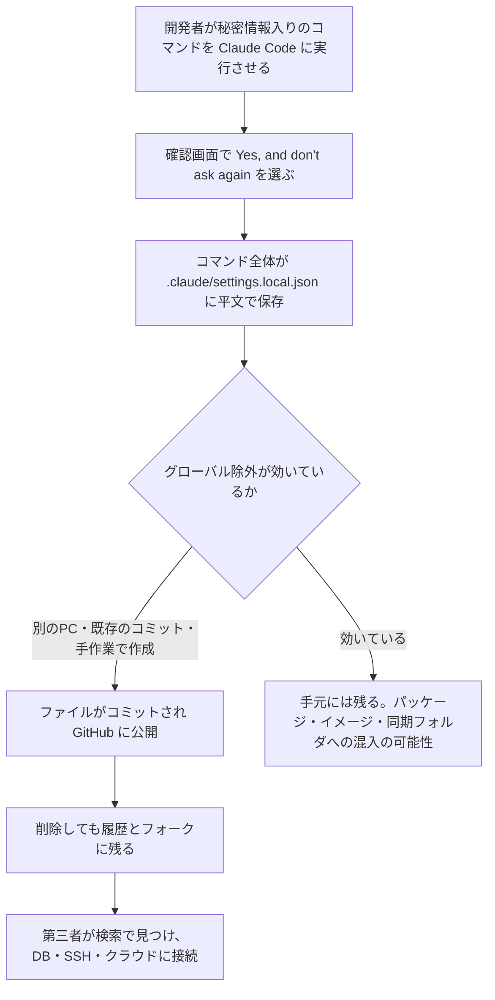

# Claude Code ― 承認したコマンドの秘密情報が公開リポジトリに残る

## 要点

### 影響を受けるもの

- Claude Code（AnthropicのAIコーディングエージェント）を使っているプロジェクトの `.claude/settings.local.json`。Bashコマンドの確認で「Yes, and don't ask again」を選ぶと、ここに `allow` ルールが書き込まれる（Claude Code公式ドキュメント）。
- 確認画面がパターン（例：`npm test *`）ではなく1つのコマンドそのものを提示した場合、コマンドに含まれるパスワードやトークンも平文で保存される（The Hacker News が報じたApiiroの調査）。
- 特定のバージョンで直る脆弱性ではなく、現時点の仕様に近い動作。Apiiroは最新のモデルでも再現したとしている（The Hacker News）。

### 今すぐやること

- 自組織のリポジトリと git の履歴（削除済みのものも含む）から `.claude/settings.local.json` と `.claude/settings.json` を探す。
- 見つかったファイルに一度でも入っていたパスワード・トークン・鍵は、掃除より先に**すべて交換（ローテーション）**する。
- 手元のPCの `.claude/settings.local.json` も開き、秘密情報を含むルールを消す。コミットしていなくても、npmパッケージやDockerイメージ、zip、同期フォルダに紛れ込むことがある。

## 概要

- セキュリティ企業Apiiroは11月6日、Claude Codeが承認済みのコマンドを保存するファイルを通じて、パスワードやAPIキーが公開GitHubリポジトリに大量に残っていると発表した（The Hacker News、11月7日）。
- Claude Codeはこのファイルを自動でgitの除外対象にするが、その設定は開発者1人の、1台のPCのgit設定にしか効かない。プロジェクト自身の `.gitignore` には追加されない（Claude Code公式ドキュメント、The Hacker News）。
- 同じ動作は2025年8月にGitHubのissueで報告されていたが、Anthropicの返答がないまま、ボットが「not planned」として自動で閉じていた（GitHub issue #5544）。

> この記事では、Claude Codeの公式ドキュメント、GitHubのissue、The Hacker NewsによるApiiroの調査の報道で確認できた内容を「事実」、筆者の推測や意見を「考察」として分けて書いています。Apiiroの調査記事そのものは取得できなかったため、数値はThe Hacker Newsの記事に基づいています。

## 何が起きたか

| 日付 | 出来事 |
| --- | --- |
| 2025年8月11日 | 「承認したBashコマンドが資格情報を含んだまま settings.local.json に平文で保存される」というissue #5544が登録される（GitHub） |
| 2026年1月3日 | 60日間動きがないとして、ボットがissueを自動で閉じる（GitHub） |
| 2026年11月6日 | Apiiroが調査結果を公表（The Hacker News） |
| 2026年11月7日 | The Hacker Newsが報道。Apiiroが事前に連絡した企業の1社が、鍵が有効だったことを認めた（The Hacker News） |
| 2026年11月9日 | SANS ISCは、週末に同ISCのWebハニーポットで `.claude` ディレクトリへの新しいリクエストを観測したと伝えた（SANS Stormcast） |

**事実（The Hacker News が報じたApiiroの調査）**

- 公開GitHubで `.claude/settings.local.json` を10万4185個（10万3617リポジトリ）見つけ、うち約1.1%の1,122個に少なくとも1件の秘密情報があった。異なる秘密情報は計1,379件。
- 3分の1以上はデータベースに直接つながるもので、データベースのパスワードが379件。ほかに公開サーバーのSSHログイン43件、GitHub・GitLab・npmのトークン42件、AWSの鍵23件。
- 所有者には63の組織が含まれ、データベース製品企業の管理者権限のクラウド鍵や、医療記録データベースの所有者パスワードもあった。
- 秘密情報を含むファイルはすべて既定のブランチに残っており、半数のリポジトリでは少なくとも217日間置かれていた。
- 過去の版にだけ残る秘密情報が509リポジトリで734件、フォーク211件（元は74リポジトリ）にも同じ秘密情報があった。共有用の `.claude/settings.json` や保存されたチャットの記録も含めると、1,994リポジトリで2,539件になる。
- 追跡できた1,105リポジトリのうち539では、Claudeを共同作成者とするコミットがこのファイルを変更していた。Apiiroは、Claude自身がファイルをコミットすることが多いと見ている。
- 有効かどうかの検証はしておらず、悪用されたかどうかは分かっていない。

## 技術的な問題点（根本原因）

**事実（Claude Code公式ドキュメント）**

- `.claude/settings.local.json` は「この1つのプロジェクトだけの個人設定」で、確認画面で「Yes, and don't ask again」を選ぶと、Claude Codeが承認を `allow` ルールとしてここに保存する。
- Claude Codeは、gitリポジトリでこのファイルを初めて書くとき、`**/.claude/settings.local.json` をユーザーのグローバルなgit除外ファイル（`core.excludesFile` など）に追加する。

**事実（The Hacker News、GitHub issue #5544）**

- 保存されるのは、確認画面が提示したものそのもの。パターンのこともあるが、1つのコマンドの場合は、引数に書いたパスワードやトークンもそのまま残る。
- グローバルな除外は、その開発者のそのPCのgitにしか効かない。別のPCや別の開発者、CIの環境、すでにコミット済みのファイルには効かない。
- Apiiroが比べた16のコーディングエージェントのうち、承認したコマンド全体を既定でプロジェクト内のファイルに保存すると確認できたのはClaude Codeだけだった。

**考察**

- 問題は2つ重なっている。1つは「承認の記録」という設定ファイルに、秘密情報が入りうる生のコマンドを書くこと。もう1つは、その設定ファイルを守る仕組みがプロジェクトではなく個人の環境に置かれていること。どちらか一方だけなら被害は小さかった。
- 「開発者が気を付ければよい」で済ませにくいのは、秘密情報を入力した時点では、それがファイルに保存されると気付きにくいからだ。確認画面で承認するのは「このコマンドを実行してよいか」であって、「このコマンドを保存してよいか」ではない。

## 攻撃・侵入経路

**事実（The Hacker News）**

- 秘密情報を探すマルウェアは以前からある。2025年9月のShai-Huludワームは、感染したPCでTruffleHogを実行して秘密情報を集めていた。
- よく使われるスキャナーは多くを見逃した。秘密情報のある1,122ファイルに対し、検証なしの設定でgitleaksは564件、TruffleHogは643件を検出し、215件はどちらも検出しなかった。見逃しの多くは、`PGPASSWORD=`、`sshpass -p `、`mysql -p` の後に書かれたパスワードで、既知の鍵の形式に当てはまらないためだった。

**考察**

- Microsoftは11月5日、AIエージェントを使う攻撃者がGitHub上の秘密情報を大量に検索し、見つけた鍵で数分のうちにクラウドに入り込んでいると報告している（[関連記事](/security-notes/notes/2026-11-09-artex-github-secret-search-entra-service-principal-key-vault/)）。Apiiroの数字と合わせると、公開リポジトリに残った認証情報は「いつか誰かに見られる」ではなく「すでに探されている」と考えるべきだ。

## なぜ防げなかったか・構造的要因の考察

**考察**

- **エージェントの設定ディレクトリが「秘密情報の置き場所」になった**: `.env` は多くの組織で「秘密が入るファイル」と認識され、`.gitignore` のテンプレートにも入っている。`.claude/` のようなエージェント用のディレクトリは新しく、まだその扱いになっていない。
- **既存のスキャナーの前提とずれている**: スキャナーは「鍵らしい文字列」を探すように作られているが、コマンドラインに埋め込まれた普通の単語のようなパスワードは見つけにくい。
- **報告が自動で閉じられた**: 2025年8月の時点で再現手順つきの報告があったが、無活動を理由にボットが閉じた。セキュリティに関わる報告が、他の報告と同じ自動整理の対象になっていたことになる。利用者の側でも「既知の問題として報告済みだから、そのうち直る」とは期待しにくい。

## 運用者向けの具体的な対策と検知ポイント

1. 組織のGitHubで `.claude/settings.local.json` と `.claude/settings.json` を検索し、各リポジトリの git の履歴も調べる。フォークも確認する。
2. 見つかった秘密情報は、ファイルを消す前に交換する。公開サーバーのアドレスと組になっているもの（データベース、SSH）を優先する。
3. `git rm --cached .claude/settings.local.json` で追跡をやめ、リポジトリ自身の `.gitignore` と、組織の `.gitignore` テンプレートに追加する。
4. 秘密情報はコマンドに直接書かず、シークレット管理から読み込んだ環境変数（例：`$DB_URL`）で参照する。保存されるルールには変数名だけが残る。
5. 承認は1つのコマンドではなく、`Bash(npm run:*)` のようなパターンで与える。
6. `.claude/`、`.cursor/`、`.gemini/`、`.specstory/` などエージェント用のディレクトリとメモリファイルを、`.env` と同じく秘密情報が入りうる場所として、pre-commit と CI の秘密情報スキャンの対象に入れる。履歴も含め、コマンドの中のパスワードも見つけられる設定にする。
7. Webサーバーのログで `/.claude/` へのリクエストを確認する。公開ディレクトリに置かれていないかも確かめる。

## 参考リンク

- [The Hacker News: Claude Code's "Don't Ask Again" File Exposes Passwords and Keys in 1,122 Public Copies on GitHub（2026年11月7日）](https://thehackernews.com/2026/11/claude-codes-dont-ask-again-file.html)
- [Apiiro: Coding agents leaking secrets on GitHub（Don't ask again）](https://apiiro.com/blog/coding-agents-leaking-secrets-github-dont-ask-again)
- [GitHub anthropics/claude-code issue #5544](https://github.com/anthropics/claude-code/issues/5544)
- [Claude Code Docs: Settings files and precedence](https://code.claude.com/docs/en/settings)
- [SANS Stormcast Monday, November 9th, 2026](https://isc.sans.edu/podcastdetail/10095)
