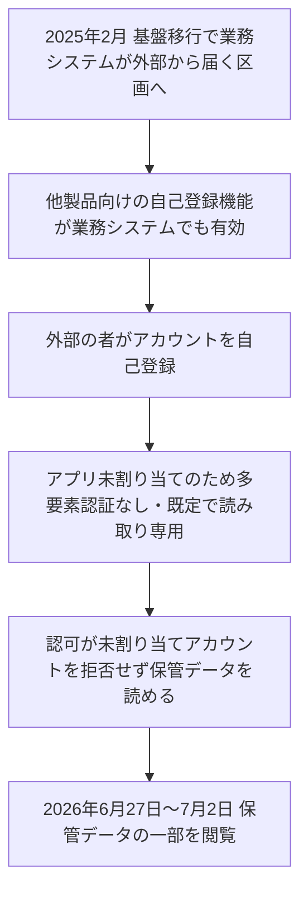

# DigiCert ― 外部公開された社内システムから顧客情報が閲覧された

## 要点

### 影響を受けたもの

- DigiCertの社内の業務システム。顧客が提出した情報を保管（アーカイブ）するもの（DigiCert、Bugzilla）。
- 閲覧されたのは保管データの一部。大半は顧客担当者の氏名、業務用のメールアドレス、電話番号、業務用の住所。少数の顧客アカウントでは、運転免許証、パスポート、公共料金の請求書など氏名と住所が載った書類も含まれた（DigiCert）。
- 認証局（CA）のサービス、CertCentral、DigiCert ONE、顧客のログイン情報、発行済みの証明書は影響を受けていない。アクセスは読み取りだけで、記録の書き込み、検証の承認、証明書の発行はできなかった（DigiCert）。
- 影響を受けた人数は公表されていない。Bugzillaで件数を尋ねられたが、DigiCertは答えていない（Bugzilla、The Record）。

### 今すぐやること

- DigiCertの利用企業は、通知メールが届いていないか確認する。届いた場合、担当者の連絡先と提出書類を使ったなりすましやフィッシングに注意する。
- 自社でも、社内向けシステムの置き場所を変える作業（クラウド移行、ネットワークの組み替え）が、セキュリティの審査なしで行われていないか確かめる。

## 概要

- DigiCertは10月20日にMozillaのBugzillaで速報を出し、11月上旬に詳しい報告書を公開した。CAの事故報告として、Mozilla、Chrome、Microsoft、Appleのルート証明書プログラムの規則に基づく報告になる（Bugzilla、The Record）。
- 社内システムを2025年2月に別の場所に移したとき、外から届くようになった。そこで、他の用途向けの自己登録機能が使え、多要素認証のないアカウントが作られて保管データが読まれた（DigiCert）。
- DigiCertは7月にアカウント作成の穴をふさいだが、データが読まれたと気付いたのは10月だった（DigiCert）。

> この記事では、DigiCertがBugzillaに出した報告書と報道で確認できた内容を「事実」、筆者の推測や意見を「考察」として分けて書いています。

## 何が起きたか（時系列）

**事実（DigiCert、Bugzilla）**

| 日付 | 出来事 |
| --- | --- |
| 2025年2月4日 | 基盤移行で、業務システムをVPNで制限された区画から、外部から届く区画に移す |
| 2026年6月18日 | 社員が業務システム上に社外のアカウントを見つける。アプリが割り当てられていないため、データには触れられないと判断。システムをWAFの後ろに置き、外からのアカウント作成を止める |
| 2026年6月21日 | 参加しているセキュリティ研究プログラム（managed security research program）から、外部からアカウントを作れる可能性の報告を受ける |
| 2026年6月24日 | アカウントが作れることを確認 |
| 2026年6月27日 | データへのアクセスが始まる（後の調査で判明） |
| 2026年7月2日 | 割り当てのないアカウントを拒否する修正を本番に入れる。アクセス期間の終わり |
| 2026年7月9日 | WAFで、承認した一部を除きVPN経由の通信だけに制限 |
| 2026年10月12日 | 保管データへの不正アクセスを初めて疑い、調査を始める |
| 2026年10月19日 | 保管データの一部への不正アクセスを確認し、報告対象と判断。アクセス期間を6月27日〜7月2日と特定 |
| 2026年10月20日 | Bugzillaに速報 |
| 2026年10月24日 | 自己登録機能をすべての業務システムで無効にし、残っていた外部公開の入口を内部のロードバランサーに移す |

DigiCertは法執行機関に届け出ており、情報が悪用された証拠はないとしている（The Record）。

## 技術的な問題点（根本原因）

**事実（DigiCert、Bugzilla）**

- 業務システムは、DigiCertが顧客向け製品でも使うアカウント管理の仕組みの、別のインスタンスで動いていた。社員は多要素認証でサインインする。
- このアカウント管理には、他の製品で顧客が自分で登録するための自己登録機能があり、それが業務システムでも使える状態になっていた。
- 多要素認証は、そのアカウントに多要素認証を求めるアプリが割り当てられているときだけ有効になる。自己登録したアカウントにはアプリが割り当てられないため多要素認証がかからず、既定で読み取り専用になった。ところが、業務システムの認可はこうしたアカウントを想定しておらず、割り当てのないアカウントでも保管データを読めた。

DigiCertは原因を3つ挙げている。

1. **ネットワークの公開範囲が変わったのに、セキュリティの審査をしなかった**: 移行は「インフラの変更」として扱われ、詳しい審査と承認が要る「セキュリティの変更」とされなかった。
2. **監視と通知が足りなかった**: 移行後に監視の要件を見直しておらず、外から届く入口でのアカウント作成や、内部の入口への要求量に対する通知がなかった。
3. **認可の設計が自己登録を想定していなかった**: 6月の時点で、アプリが割り当てられていないことから「データには触れられない」と誤って結論した。

DigiCertは教訓として「業務システムの認可を、ネットワーク上の位置に任せてはいけない」と書いている。

**考察**

- 3つの原因は、「VPNの内側にある」ことを前提に、それぞれが手を抜いた形になっている。多要素認証はアプリの割り当てに、認可はネットワークの位置に、監視は「外からは来ない」ことに頼っていた。前提が1つ崩れると、全部が同時に崩れる。
- 6月18日に社外のアカウントを見つけた時点で、「このアカウントで何ができるか」を実際に試していれば、データへのアクセスが始まる前に止められた可能性がある。設計上の想定（割り当てがなければ触れない）を、確認せずに事実として扱ったことになる。

## 攻撃・侵入経路

**事実（DigiCert）**

- 誰がアカウントを作ったかは公表されていない。DigiCertの広報は、攻撃者から連絡があったかどうかについて答えなかった（The Record）。
- ログと監査テーブルが残っていたため、アクセスの一覧、期間、アカウントと操作の対応を後から再構成できた。CAのシステムにアクセスがなく、検証記録も変更されていないことも、ログで確かめた。

## なぜ防げなかったか・構造的要因の考察

**考察**

- **CAが持つ「本人確認の書類」は、それ自体が狙われる**: CAは証明書を発行するために、申請者の身元や組織を確認する書類を集める。証明書の発行の仕組みが守られていても、確認のために集めた書類は別のシステムに残る。Bugzillaでは、閲覧された情報が証明書の利用者の検証に使われたものかどうかを問う質問が出ており、DigiCertは明確に答えていない。
- **同じ時期に他のCAでも似た報告がある**: DigiCertは関連する事故として、TWCAのRA（登録局）サーバーへの不正アクセス、D-TrustでのRA記録の喪失を挙げている。CAの監査は証明書の発行に集中しがちで、その周りの業務システムの守りは見えにくい。
- **移行は「設定の変更」として流される**: 移行で変わるのはネットワークの位置だけ、と考えると、セキュリティの審査は不要に見える。しかし、届く範囲が変わることは、攻撃できる人の範囲が変わることでもある。

## 運用者向けの具体的な対策と検知ポイント

1. 社内向けシステムの移行やネットワークの組み替えを、セキュリティの審査と資産台帳の更新が必要な変更として扱う。DigiCertも事後にこの方針を加えた。
2. 社内向けシステムが外から届かないことを、外部からのスキャンで定期的に確かめる。
3. 共通のアカウント管理基盤を複数のシステムで使う場合、自己登録などの機能がどのインスタンスで有効になっているかを一覧にし、不要なものは無効にする。
4. 認可は各エンドポイントで「アプリの割り当て」と「役割」を確かめる。多要素認証が条件付きでしかかからない構成なら、かからないアカウントで何ができるかを試験する。
5. 想定外のアカウント作成、権限の変更、ファイルへのアクセス量と要求量に通知を付け、SOCに届くようにする。
6. 見慣れないアカウントを見つけたら、「何ができるはずか」ではなく「何をしたか」をログで確かめる。データへのアクセスの有無を確かめるまでは、アカウント作成の問題ではなく、データ漏えいの可能性がある事案として扱う。

## 参考リンク

- [Mozilla Bugzilla 2084460: DigiCert: Unauthorized access to business system](https://bugzilla.mozilla.org/show_bug.cgi?id=2084460)
- [The Record: Certificate authority DigiCert reports data breach involving business customer info（2026年11月6日）](https://therecord.media/digicert-certificate-authority-reports-data-breach)
- [SecurityWeek: DigiCert Data Breach Impacts Business Customer Information](https://www.securityweek.com/digicert-data-breach-impacts-business-customer-information/)
