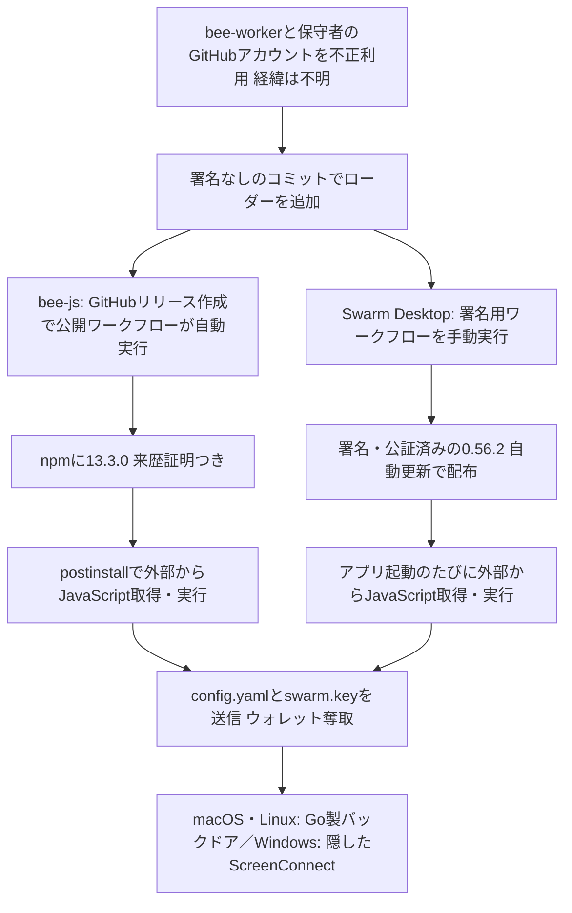

# Ethersphere ― リリース自動化を乗っ取られ、bee-jsなどに不正版

## 要点

### 影響を受けるバージョン

- **`@ethersphere/bee-js` 13.3.0**（npm）。2026年11月9日 00:09:50〜01:24:58 UTCに `latest` として公開されていた。最後の正常版は13.2.0（Socket、SafeDep）。
- **Swarm Desktop 0.56.2**（GitHubのリリース）。00:36 UTCごろから約8時間半公開され、Windows x64とApple Silicon Macの自動更新で配られた。Intel Macには配られず、Linux版は自動更新しない。正常版の0.56.3が出ている（Socket、The Hacker News）。
- 13.3.0を許す範囲（`^13` など）でbee-jsに依存するパッケージ（`@ethersphere/swarm-cli`、`@ethersphere/bee-dashboard` など）を、その時間に新しくインストールした環境も含まれる（Socket）。

### 今すぐやること

- ロックファイル、パッケージのキャッシュ、社内レジストリ、CIのログで `@ethersphere/bee-js@13.3.0` を探し、見つかったら13.2.0に固定してキャッシュを消す（Socket、The Hacker News）。
- 13.3.0をインストールスクリプトを有効にして入れた端末やCIは、乗っ取られたものとして扱い、そこから読めたパスワード、トークン、鍵を、別の安全な端末から交換する。インストールがエラーで終わっていても、通信はすでに出ている（Socket）。
- Swarm Desktopを使っている場合は、ログ `bee-desktop.log` に `Bee Desktop version: 0.56.2 (production)` がないか確かめる。あれば0.56.3を入れ、ノードの鍵とパスワードは盗まれた前提で、別の安全な端末から資金、チェックブック、ステークを新しい鍵に移す（Socket、The Hacker News）。
- `~/.solidity/`、systemdのユーザーユニット `solidity-langsupport-runner.service`、LaunchAgent `com.solidity.langsupport.runner`、Windowsのサービス `ScreenConnect Client (5cbe79c9c25524df)` を探して取り除く。アプリやパッケージを入れ直しても消えない。可能なら端末を作り直す（The Hacker News）。

## 概要

- Swarmは分散ストレージのネットワークで、bee-jsはそのノード（Bee）を使うためのJavaScriptライブラリ、Swarm Desktopは自分のPCでノードとそのイーサリアムのウォレットを動かすElectronアプリ（Socket）。
- 攻撃者は、リリース用ボットの `bee-worker` と、長く関わる保守者のGitHubアカウントを使い、プロジェクト自身のGitHub Actionsで不正なリリースを出した。npmへの公開は正規のワークフローが行ったため、来歴証明（provenance）も本物だった。macOS版はプロジェクトのDeveloper IDで署名され、Appleの公証も通っていた（Socket）。
- 盗み出しと遠隔操作の部分は、9月にOpen VSXで偽のSolidity拡張を配った「EtherDuck」と同じイーサリアムのコントラクト、ファイル、中継先を使っていた（Socket、The Hacker News）。
- 保守者は、0.56.2は「盗まれたCIの認証情報を使って攻撃者が公開した」と書いた。認証情報が盗まれた経緯は分かっていない（The Hacker News）。資金の盗難は報告時点で確認されていない。

> この記事では、Socket・SafeDep・StepSecurityの分析と報道で確認できた内容を「事実」、筆者の推測や意見を「考察」として分けて書いています。

## 何が起きたか（時系列）

時刻はUTC（Socket）。

| 日時（2026年） | 出来事 |
| --- | --- |
| 11月6日 15:08 | 不正なコードの取得先ドメイン `frameworkmetrics[.]xyz` が登録される |
| 11月6日 17:06〜19:55 | 攻撃者がswarm-desktopとswarm-cliで、Actionsの `secrets` を外部に送るワークフローを何度も試す。Socketは何も持ち出せなかったとみている |
| 11月8日 23:30 | 遠隔操作の中継先を指すイーサリアムのコントラクトの値が書き換えられる |
| 11月8日 23:59（コミットの記録上） | `bee-worker` 名義の署名なしのコミットで、bee-jsのスクリプトを不正なものに変える |
| 11月9日 00:06 | `bee-worker` がv13.3.0のGitHubリリースを作り、npm公開のワークフローが自動で動く |
| 11月9日 00:09 | npmに13.3.0が `latest` として公開される |
| 11月9日 00:36ごろ | Swarm Desktop 0.56.2を「緊急修正」として公開。00:41〜00:44に署名・公証済みの配布物ができる |
| 11月9日 01:24 | npmが13.3.0を削除。01:25にGitHubが勧告GHSA-hh7j-5m3j-23pfを出す |
| 11月9日 09:04〜09:14 | 保守者が0.56.2のタグを消し、リリースが非公開になる |
| 11月9日 | 正常版の0.56.3を公開。署名ジョブは承認制にし、main ブランチからしか動かないようにした（The Hacker News） |

## 技術的な問題点（根本原因）

**事実（Socket）**

- **リリースイベントでテストなしに公開できた**: bee-jsの公開ワークフローは、push時にはテストを通った場合だけ公開するが、GitHubのリリースイベントではテストを飛ばして公開する作りだった。リリースされたコミットが保護されたブランチにあるかを確かめず、公開用の環境（environment）にも承認者やタグの制限がなかった。リリース作成から公開完了まで73秒だった。
- **来歴証明は「どこでビルドしたか」しか示さない**: npmへの公開はトークンを使わないtrusted publishing（OIDC）で、13.3.0の来歴証明は正規のワークフロー、タグ、コミットを正しく示していた。正常な13.2.0と同じ形で、来歴証明だけでは区別できなかった。
- **署名用の秘密を渡す手動ワークフロー**: Swarm Desktopの `pre-release.yml` は、任意のブランチを入力に取り、承認なしで動き、AppleとWindowsの署名証明書とパスワード、公証用のApple IDをビルドに渡していた。3月から壊れていたが、攻撃者が修正のコミットを足して動かした。
- **インストール時に動くスクリプト**: bee-jsでは、バージョン情報を作るスクリプトの先頭に、外部からJavaScriptを取ってきて `new Function` で実行する処理が足され、`postinstall` として登録された。npmの履歴でインストール時のフックを持つ版はこれが初めてだった。このスクリプトは公開ワークフローの中でも3回実行された。

**考察**

- 「ボットのアカウント」と「保守者のアカウント」という正規の身元が使われたため、来歴証明、コード署名、Appleの公証という、利用者が頼りにする仕組みがすべて「正しい」と答えている。守りが働かなかったのは、それぞれが「誰がビルドしたか」を確かめる仕組みで、「何をビルドしたか（レビューされたか）」を確かめていないからだと考えられる。
- Electronアプリの自動更新は、正式リリースになった時点で全利用者に配る。今回はプレリリースではなく正式リリースとして出されたことで、配布が自動化された。

## 攻撃・侵入経路

**事実（Socket、SafeDep、StepSecurity、The Hacker News）**

- 第2段階のコードは、Swarm Desktopのデータフォルダの `config.yaml` と `data-dir/keys/swarm.key` を `/v1/swarm/report` に送る。`swarm.key` は暗号化されたイーサリアムのキーストアだが、`config.yaml` にそのパスワードが平文で入っているため、2つそろうとノードのウォレットを動かせる。
- 取得先のサーバーは、`X-Ethersphere: 1` というヘッダーがない要求には無害なおとりを返す。
- macOSとLinuxでは、Go製のリモートシェル（`evjawbreaker`）を `~/.solidity/` に置き、ユーザーサービスかLaunchAgentとして常駐させる。中継先のアドレスはイーサリアムのコントラクトから読むため、攻撃者はいつでも変えられる。デバッガや仮想マシンを検知すると接続しない。
- Windowsでは、ConnectWiseの正規の署名がある遠隔操作ソフトScreenConnectを、トレイアイコンと接続表示を隠してSYSTEMのサービスとして入れる。利用者が管理者なら、既知のUAC回避で確認画面なしに昇格し、そうでなければUACの確認を出し続ける。
- 被害の規模について、Socketは13.3.0の取得を、スキャナーやミラーを含めて10回程度と見積もっている。0.56.2のダウンロード数は08:27 UTC時点で65（研究者を含む上限値）。
- Huawei Cloudのnpmミラーは、10:30 UTC時点でまだ13.3.0を配っていた（Socket）。

## なぜ防げなかったか・構造的要因の考察

**考察**

- **ボットのトークンは公開用の鍵そのもの**: リリースを自動化するボットは、リリースを作るだけで公開ワークフローを起動できる。人の承認が挟まらない設計では、ボットの認証情報が漏れた時点で、正規の配布経路が攻撃者のものになる。
- **「テストを飛ばす経路」が残っていた**: 通常の経路にはテストがあっても、例外の経路（リリースイベント）ではテストもブランチの確認もなかった。CIの守りは、一番弱い経路で決まる。
- **秘密を持つワークフローを誰でも動かせた**: 署名証明書のような強い秘密を、手動起動で任意のブランチを受け付けるワークフローに渡していた。壊れたまま放置されていたことも、見直しの対象から外れていた理由だと考えられる。
- **開発者向けの攻撃が、拡張機能から本物のプロジェクトへ**: 同じ攻撃者は、9月には利用者に偽の拡張機能を探して入れさせる必要があった。今回は本物のプロジェクトの配布経路を使い、来歴証明とAppleの公証まで付いた形で届けた（Socketの分析に基づく）。
- **ウォレットのパスワードを平文で保存していた**: Swarm Desktopはノードのパスワードを `config.yaml` に平文で置く。暗号化した鍵と、その解読に要るパスワードが同じ場所にあるため、ファイルを読めれば資金を動かせる。

## 運用者向けの具体的な対策と検知ポイント

### パッケージを使う側

1. 依存パッケージのインストールスクリプトは、既定で動かさない設定にする（npm 12、pnpm 10以降、Yarn Berry 4.14.0以降、Bun、Denoは既定で動かさない）。必要なものだけを許可する（Socket）。
2. CIでは、ロックファイルどおりにインストールし、範囲指定で最新版を自動で取りに行かないようにする。公開直後の版を一定期間使わない設定も検討する。
3. DNSやプロキシのログで `api[.]frameworkmetrics[.]xyz` への通信を探す。端末の通信が見える場合は、`~/.solidity/` 配下のバイナリからイーサリアムのRPC（`eth_call`）への通信も手がかりになる（Socket）。

### パッケージを公開する側

1. 公開ワークフローの中で、リリースされたコミットが保護されたブランチにあるか、マージ済みのリリース用プルリクエストから来たかを確かめる。trusted publishingと来歴証明は、ワークフローがビルドしたものを何でも署名する（Socket）。
2. 公開用の環境に承認者を置き、デプロイできるタグを制限する。タグとリリースの作成もルールセットで制限する。
3. 署名証明書や公証用の認証情報を、任意のブランチを受け付ける手動起動のワークフローに渡さない。使っていないワークフローは消す。
4. リリース用ボットのトークンは公開用の認証情報として扱い、権限を絞って定期的に交換し、普段のリリースの流れ（release-pleaseなど）を通らないリリースに通知を付ける。

## 参考リンク

- [Socket: Malicious bee-js npm Release and Swarm Desktop Releases Deliver SleepyDuck Ethereum C2 Backdoor（2026年11月9日）](https://socket.dev/blog/bee-js-compromise)
- [SafeDep: Compromised bee-js and Swarm Desktop Steal Swarm Wallet Keys](https://safedep.io/blog/ethersphere-bee-js-npm-compromise)
- [StepSecurity: @ethersphere/bee-js 13.3.0 Compromised](https://www.stepsecurity.io/blog/ethersphere-bee-js-13-3-0-compromise)
- [The Hacker News: Hackers Compromise Ethersphere's bee-js and Swarm Desktop to Deliver Wallet-Stealing Malware（2026年11月9日）](https://thehackernews.com/2026/11/hackers-compromise-etherspheres-bee-js.html)
