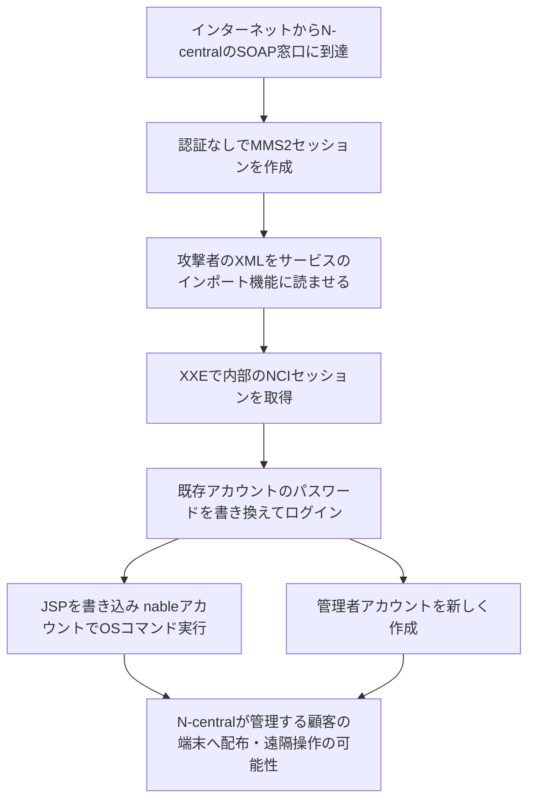

# N-able N-central ― 未修正の脆弱性群が公開され、クラウド版を停止

## 要点

### 影響を受けるもの

- N-ableのリモート監視・管理（RMM）製品 **N-central** のサーバー。研究者は **N-central Appliance 2026.4.0.31** で試したとしており、それより前の版も影響を受ける可能性が高いとされる（Huntress）。
- 研究者は「最新のプレリリース版で試した」とも書いている（GovInfoSecurityが引用）。修正版は11月10日時点でまだ出ていない（BleepingComputer、Huntress）。
- このうち少なくとも1つの連鎖は、認証なしでOSコマンドの実行（`nable` サービスアカウントの権限）と管理者アカウントの作成まで進む（Previdian）。CVEはまだ割り当てられていない（Previdian）。

### 今すぐやること

- オンプレミスでN-centralを動かしている場合は、N-ableの指示どおりサーバーをネットワークから外し、N-ableが安全と言うまで戻さない（N-able、Huntress）。
- クラウド版（Hosted N-central）は止まっている。N-ableのステータスページで復旧の案内を待つ。
- 11月8日以降のログイン、パスワード変更、管理者アカウントの作成、スクリプトの配布、リモート接続の記録を確認し、ログを保全する（Huntress、Previdian）。
- 修正版が出たら当て、N-ableが復旧してよいと案内してから戻す。

## 概要

- 研究者が11月8日（日）の夜、N-centralの未修正の脆弱性33件の説明と攻撃コードを、GitHubのリポジトリ「Able2Shell」で公開した。脆弱性は少なくとも4つの攻撃の連鎖につながり、3つはリモートでのコード実行、1つはrootへの権限昇格になる（Huntress）。
- N-ableはこれを「責任ある形でない公開」と呼び、11月9日に米州・欧州・アジア太平洋のクラウド版を止め、オンプレミスの利用者にもサーバーを止めるよう案内した。修正版を開発・検証中で、悪用や不正なデータアクセスは確認していないとしている（BleepingComputer、TechTarget）。
- 公開から1日たたないうちに、おとりサーバーで同じ入口（サービスのインポート機能）を狙う探索が観測された。ただし、連鎖のすべてが成功した例は確認されていない（Previdian）。

> この記事では、セキュリティ企業の分析と報道で確認できた内容を「事実」、筆者の推測や意見を「考察」として分けて書いています。N-ableのアドバイザリとステータスページは本文を取得できなかったため、各報道が引用したN-ableの声明を使っています。

## 何が起きたか（時系列）

**事実**

| 日時（2026年） | 出来事 |
| --- | --- |
| 8月 | N-ableがCVE-2026-18556（認証なしで管理画面を操作できる）の修正を出す。続いて不完全な修正としてCVE-2026-18577が公開される（Huntress） |
| 9月 | 悪用が確認された認証前RCEのCVE-2026-86218（CVSS 10.0）を修正。翌日、Huntressが別の連鎖（CVE-2026-86206・86207）の実証コードを作る（Huntress） |
| 11月8日 夜 | 研究者がGitHubで「Able2Shell」を公開（BleepingComputer、TechTarget） |
| 11月9日 | N-ableがクラウド版を止め、オンプレミスの利用者にもサーバーの停止を求める。15:15 UTCに障害として告知（Huntress、GovInfoSecurity） |
| 11月9日 22:00 UTCごろ | Previdianのおとりサーバーに、サービスのインポート機能を狙うSOAP要求が届き始める（Previdian） |
| 11月10日時点 | 修正版は開発・検証中で、公開されていない（BleepingComputer、Huntress） |

公開者の名前は報道によって書き方が違う。BleepingComputerは研究者をSean Balesとし、TechTargetは公開したGitHubアカウントを「Oracle-Security」、持ち主のハンドルを「BinaryNinja」としている。

## 技術的な問題点（根本原因）

**事実（Previdian、BleepingComputer、Huntress）**

公開された連鎖のうち、もっとも深刻とされるものは次のように進む。

1. 認証なしで、N-centralの内部通信用（MMS2）のセッションを作る。
2. 攻撃者の用意したXMLをサーバーに置く。
3. サービスのインポート機能にそのXMLを読ませ、XML外部実体参照（XXE）を起こす。
4. XXEで、サーバー内部の別のセッション（NCI）を手に入れる。
5. 既存アカウントのパスワードを書き換え、そのパスワードでログインする。
6. JSPファイルを書き込んで実行し、`nable` アカウントとしてOSコマンドを動かす。管理者アカウントを新しく作ることもできる。

ほかにも、管理者がパッチ情報を表示したときにrootでコマンドが動く蓄積型XSSや、`nable` アカウントからrootへの権限昇格が含まれている（BleepingComputer）。BleepingComputerは33件すべてを確かめたわけではないとしているが、N-ableが修正版を作っていることから、少なくとも一部は本物の未修正の脆弱性とみている。

**考察**

- 根本にあるのは、外から届く入口で「誰からの要求か」を確かめる前に、XMLの解析やインポートのような重い処理を動かしている点だと考えられる。XXEは外部実体を無効にすれば防げる種類の欠陥で、2026年8月以降の一連の修正が個別の穴をふさぐ形にとどまっていたことがうかがえる。
- 内部向けのセッションや機能が外からの入口と同じ処理系でつながっているため、1つの読み取り系の欠陥（XXE）が、パスワード変更とコード実行まで広がっている。

## 攻撃・侵入経路

最後の段（顧客の端末への波及）は、Able2Shellの公開内容ではなく、過去のN-centralの悪用例から想定されるものとして書いている。

**事実（Previdian）**

- 11月9日22:00 UTCごろから、1つの送信元（`5.231.45[.]175`）が `/dms/services/ServerUI` と `/dms/services/ServerMMS` などにSOAP要求を送った。
- `FilePath` に `/etc/passwd`、`/etc/shadow`、`/proc/self/environ` などを指定する要求、`../../../../etc/passwd` のようなパストラバーサル、外部のDTDを読ませるXMLが含まれていた。
- 公開された連鎖に特有の `SessionHello → ApplianceLogSubmit → service import` の順番や、JSPの設置、パスワード変更は観測されていない。Previdianは「同じ入口への探索で、連鎖の成功は未確認」と評価している。

**事実（Huntress）**

- 9月のCVE-2026-86218の悪用では、攻撃者が管理下の顧客環境に不正なスクリプトやツールを一斉に配っていた。

## なぜ防げなかったか・構造的要因の考察

**考察**

- **RMMは1台で多数の顧客を動かせる**: N-centralはMSPが顧客の端末を監視・パッチ適用・遠隔操作するための製品で、サーバーを乗っ取られると、その先の顧客の端末すべてに手が届く。N-ableが修正前にクラウド版ごと止めたのは、この波及を重く見た判断だと読める。
- **修正の前に攻撃コードが出た**: ベンダーへの事前連絡なしに、そのまま動く攻撃コードまで公開された。利用者には「止める」以外の選択肢がほとんど残らない。Previdianは公開の同じ日のうちに探索を観測している。
- **短期間に重大な欠陥が続いている**: 8月以降、今回が5回目の緊急修正になるとGovInfoSecurityは報じている。一つひとつの修正では、入口の設計（認証前に到達できる処理の多さ）が変わっていないと考えられる。
- **クラウド版も同じ欠陥を抱える**: クラウド版はベンダーが運用するため利用者は手を出せないが、N-ableが止めたことで、クラウド版を使うMSPも監視・管理の手段を一時的に失った。RMMが止まったときの代わりの手順（手作業でのパッチ適用、別経路での遠隔サポート）を持っているかどうかで影響が変わる。

## 運用者向けの具体的な対策と検知ポイント

1. N-centralのサーバーはインターネットから直接届かないようにし、管理画面とエージェント通信の入口を許可した送信元だけに絞る。修正版が出た後もこの制限は続ける。
2. N-centralのWebとSOAPのログを保全し、次のような要求を探す（Previdian）。
   - `/dms/services/` 配下への、`DOCTYPE` や外部URLを含むXML
   - `FilePath` に `/etc/passwd` などのローカルファイルや `../` を含む要求
   - 想定外の `ImportServiceFromFile` などのサービスのインポート呼び出し、`ApplianceLogSubmit` の呼び出し
3. その後に、想定外のログイン、パスワード変更、管理者アカウントの作成、JSPへのアクセスが続いていないか確かめる。単独の一致は調査のきっかけで、侵入の証明ではない（Previdian）。
4. N-centralから顧客の端末に配られたスクリプトやソフト、リモート接続の記録を見直す。過去の悪用では顧客環境への一斉配布があった（Huntress）。
5. RMMが使えない期間の代わりの運用（緊急のパッチ適用、遠隔サポートの手段）を決めておく。

## 参考リンク

- [Huntress: N-able Disables Cloud Services Following Disclosure of "Able2Shell" Exploit Chains（2026年11月9日）](https://www.huntress.com/blog/n-able-disables-cloud-services-following-disclosure-of-able2shell-exploit-chains)
- [Previdian: N-able N-central Critical Vulnerabilities: What We Know So Far（2026年11月9日）](https://blog.previdian.com/n-able-n-central-critical-vulnerabilities-what-we-know-so-far/)
- [BleepingComputer: N-able takes cloud platform offline after 30+ "zero-days" published](https://www.bleepingcomputer.com/news/security/n-able-takes-cloud-platform-offline-after-30-plus-zero-days-published/)
- [TechTarget: N-able takes N-central platform offline after zero-day dump（2026年11月9日）](https://www.techtarget.com/news/n-able-takes-n-central-platform-offline-after-zero-day-dump/874195/)
- [GovInfoSecurity: N-able Takes Platform Offline After 33 Zero-Days Drop](https://www.govinfosecurity.com/n-able-takes-platform-offline-after-33-zero-days-drop-a-33337)
- [eSentire: N-able N-Central Vulnerabilities Publicly Disclosed](https://www.esentire.com/security-advisories/n-able-n-central-vulnerabilities-publicly-disclosed)
- [N-able ステータスページ（N-central の障害告知）](https://uptime.n-able.com/event/202561/)
