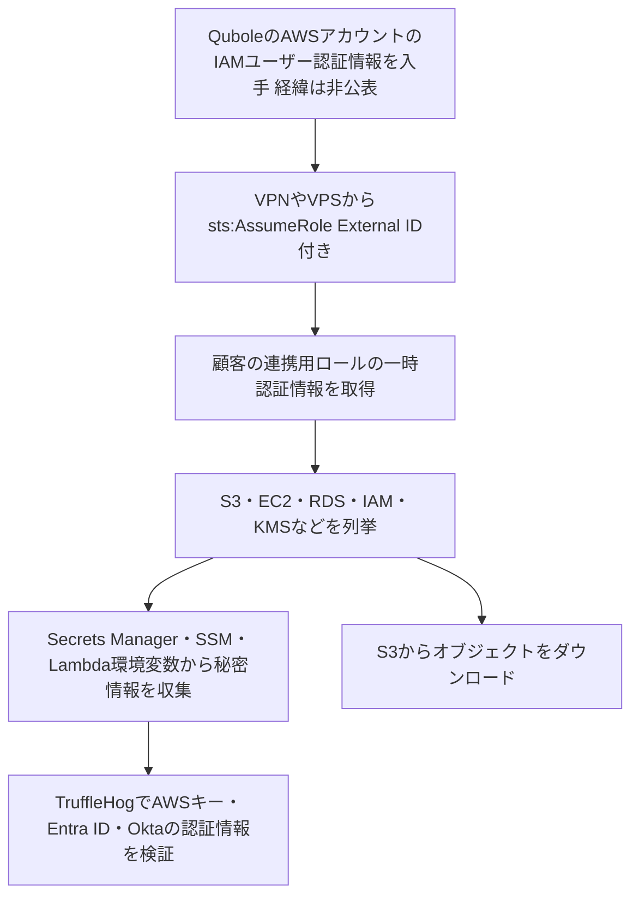

# Qubole ― 自社AWSアカウントの認証情報で顧客環境に侵入された

## 要点

### 影響を受けたもの

- Quboleと連携するために、顧客が自分のAWSアカウントに作ったIAMロール（Quboleのアカウントを信頼するロール）。攻撃者はこれを使って複数の顧客環境に入った（Wiz）。
- 持ち出されたのは、ロールが読める範囲の秘密情報（Secrets Manager、SSMパラメータストア、Lambdaの環境変数）とS3のデータ。バケットを丸ごとダウンロードした例もある（Wiz）。
- 被害を受けた組織の数は公表されていない。Quboleは、Idera傘下のデータレイク基盤（The Hacker News）。

### 今すぐやること

- Quboleと連携したことがあるAWSアカウントで、2026年10月1日以降のCloudTrailを調べる（Wiz）。
  - `userIdentity.accountId` が `805246085872` で、送信元がAWS以外のIPアドレスの `AssumeRole`
  - `userIdentity.principalId` が `AIDA3W7DIFLYOLTK63SFS` のイベント（攻撃者だけが使っていたIAMユーザー）
  - `AIDAJYRRH5Y3A7AAJM2HW` からの、送信元がAWS以外のイベント
  - `quiam-` で始まるロールのセッション名
- 当てはまるセッションがあれば、そのロールが読めた秘密情報、パラメータ、Lambdaの環境変数をすべて交換し、ロールの有効なセッションを無効にする。認証情報を交換しても、すでに発行された一時的なセッションは切れない（Wiz）。
- 使っていない連携用ロールは削除するか、信頼ポリシーからQuboleのアカウントを外す。

## 概要

- Sentraが複数の顧客環境で不審な動きを見つけ、Wizに共有した。WizはSentra、Mandiantと協力して調べ、11月9日に公表した（Wiz）。
- 攻撃者は、Quboleのプラットフォームが顧客環境に入るときに使うAWSアカウントのIAMユーザーの認証情報で、顧客の連携用ロールを引き受けた。要求にはすべて正しいExternal IDが付いていて、すべて成功した（Wiz）。
- 攻撃者が引き受けたロールの多くは、普段は使われていなかった。多くの環境では、10月にQuboleのアカウントから来た `AssumeRole` は攻撃者のものだけだった（Wiz）。

> この記事では、Wizの調査報告と報道で確認できた内容を「事実」、筆者の推測や意見を「考察」として分けて書いています。Qubole（Idera）自身の発表は確認できませんでした。

## 何が起きたか（時系列）

**事実（Wiz）**

| 日付（2026年） | 出来事 |
| --- | --- |
| 10月8〜11日 | 別件として、Quboleとの連携用に作られたとみられる顧客のアクセスキーが使われる。8日には1時間のうちに全部のキーが試された。今回の攻撃との関係は確認されていない |
| 10月14日 | Mullvad VPNのアドレスから、IAMユーザー `AIDA3W7DIFLYOLTK63SFS` で顧客の連携用ロールの `AssumeRole` が始まる |
| 10月15日〜 | 主な活動がOVHのVPS（`57.129.54[.]120`）に移る |
| 10月16〜19日 | 見つけた認証情報をTruffleHogで試す |
| 10月18日 | 同じアカウントの2つ目のIAMユーザー `AIDAJYRRH5Y3A7AAJM2HW` も使い始める。別のMullvadのアドレスから複数の環境のロールを短時間に次々と引き受ける |
| 10月26日 | 観測された活動の最後 |
| 11月9日 | Wizが調査結果を公表 |

## 技術的な問題点（根本原因）

**事実（Wiz）**

- Quboleのように顧客のAWSアカウントの中で動くSaaSは、アカウントをまたぐIAMロールを使う。顧客は自分のアカウントにロールを作り、信頼ポリシーで「ベンダーのアカウント（`:root`）が、決められたExternal IDを付ければ引き受けてよい」と書く。
- この形では、ベンダーのアカウントの中の認証情報を持つ者は、External IDさえ分かれば、どの顧客のロールでも引き受けられる。今回はベンダーのアカウントのIAMユーザーの認証情報が使われ、External IDも正しかった。
- External IDはCloudTrailに平文で記録され、ベンダーやIaCのコードにも保存されていることが多い。Wizは「秘密として扱うべきではない」と書いている。
- 送信元IPアドレスの条件（`aws:SourceIp`）が信頼ポリシーにあれば、観測されたロールの引き受けはすべて防げた、とWizは書いている。
- 攻撃者がIAMユーザーの認証情報をどう手に入れたかは公表されていない（The Hacker News）。

**考察**

- ベンダーのアカウントにある1組の長期的な認証情報（IAMユーザーのアクセスキー）が、全顧客の環境への鍵になっていた。顧客側の設定は推奨どおり（External ID付き）でも、ベンダー側の鍵が漏れれば止められない構造になっている。
- 「使っていない連携」が狙われやすい点も重要だと考える。使っていないロールには正規の通信がないので、見張る人もおらず、権限も見直されない。

## 攻撃・侵入経路

**事実（Wiz）**

- ロールを引き受けた後、攻撃者は `ListBuckets`、`DescribeInstances`、`DescribeDBInstances`、`ListRoles`、`ListKeys` などで環境を広く調べた。
- 秘密情報は、Lambdaの `GetFunctionConfiguration`（環境変数が返る）、Secrets Managerの `GetSecretValue`、SSMの `GetParameter` で集めた。
- 見つけた認証情報は被害組織自身のもので、TruffleHogでAWSの `GetCallerIdentity`、Entra IDのサービスプリンシパルのサインイン、OktaのOAuthトークン要求を試し、使えるかどうかを確かめた。
- S3では `ListObjects`、`HeadObject` の後に `GetObject` で取得した。特定のデータを探すのではなく、ロールが読めるバケットから手当たり次第に読んでいた。
- 攻撃者が使っていたIPアドレスでは、起動すると90分間、外部から送られたシェルスクリプトを実行し、その後に強制再起動する起動用のLinuxイメージ（`sso_agent.iso`）も配られていた。Wizは、これが使われた例は確認していない。
- 攻撃者の動機や、ほかの攻撃との関係は分かっていない。狙い方は機会的で、国家系の典型とは合わないとWizはみている。

## なぜ防げなかったか・構造的要因の考察

**考察**

- **「信頼したベンダーのアカウント」は、まとめて1つの鍵になる**: 信頼ポリシーの主体をベンダーのアカウント全体（`:root`）にすると、そのアカウントの中のどの認証情報でも入れる。ベンダー側の1つの漏えいが、全顧客に同時に届く。WizもSaaS事業者に対し「顧客が信頼する主体は、全顧客環境への認証情報そのもの」と書いている。
- **使われていない連携が消えずに残る**: 一度試しただけ、または解約したSaaSのロールが、権限を持ったまま残る。今回、多くの環境で攻撃者の要求だけがQuboleのアカウントからの通信だった。
- **連携ロールの権限が広い**: Lambdaの設定、Secrets Manager、SSM、S3全体の読み取りが「便利だから」付けられていることが多い、とWizは書いている。データ処理のための連携ロールから、別システムの秘密情報まで読めてしまう。
- **S3の読み取りが記録されていない**: CloudTrailの管理イベントはロールの引き受けとバケットの一覧は残すが、オブジェクトの読み取りは残さない。いくつかの環境ではデータイベントが有効でなく、どのファイルが読まれたか分からなかった（Wiz）。

## 運用者向けの具体的な対策と検知ポイント

1. 外部のAWSアカウントを信頼しているIAMロールを洗い出し、使っていないものは削除する。
2. ベンダーが対応していれば、信頼する主体を `:root` から特定のIAMロールに絞り、`aws:SourceIp` または `aws:SourceVpce` の条件でベンダーの公開しているネットワークに限定する。
3. External IDは秘密ではないものとして扱い、ロールごとに別の値にする。事案の後はベンダーと調整して変更する。
4. 連携用ロールの権限から、Secrets Manager、SSMパラメータ、Lambdaの設定、不要なS3の読み取りを外す。
5. ベンダーのアカウントからの `AssumeRole` が、いつもと違うネットワーク（VPNやホスティング事業者）から来たときに通知する。
6. 組織全体のCloudTrailを全リージョンで有効にし、機密データのあるバケットではS3のデータイベントかサーバーアクセスログを有効にする。
7. SaaSを提供する側は、顧客のロールを引き受ける主体を長期のアクセスキーではなく短期の認証情報を使うワークロード用ロールにし、送信元を限定し、自社の送信元アドレスを公開する。

## 参考リンク

- [Wiz: Trusted by Default: Qubole Cross-Account Access Abused in the Wild（2026年11月9日）](https://www.wiz.io/blog/qubole-cross-account-access-abused-in-the-wild)
- [The Hacker News: Hackers Exploit Qubole's Trusted AWS Access to Breach Customer Accounts and Steal Data（2026年11月9日）](https://thehackernews.com/2026/11/hackers-exploit-quboles-trusted-aws.html)
- [The Register: Attackers backdoor trusted AWS integrations to steal secrets（2026年11月9日）](https://www.theregister.com/security/2026/11/09/attackers-backdoor-trusted-aws-integrations-to-steal-secrets/5308553)
- [Sentra: Inside the Qubole Supply Chain Attack](https://sentra.io/blog/breaches/inside-the-qubole-supply-chain-attack)
