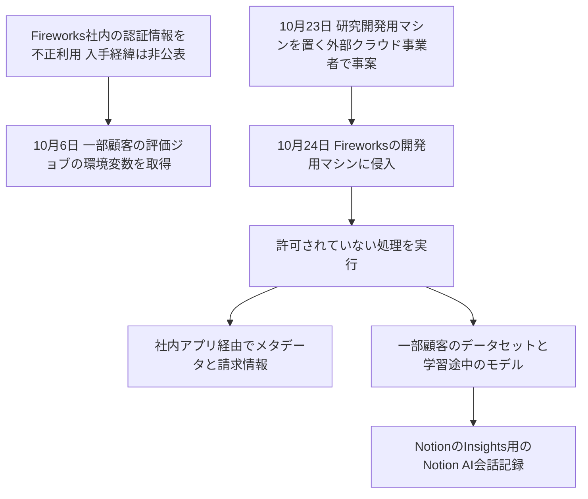

# Fireworks AI ― 侵害の範囲が顧客データとモデルに広がった

## 要点

### 影響を受けたもの

- 10月6日の侵害：一部の顧客アカウントで、評価ジョブに渡される環境変数（秘密として保存したAPIキーやトークン）（Fireworks、10月10日）。
- 10月24日の侵害で触れられたもの（Fireworks、11月9日更新）
  - リソースのメタデータ（ID、表示名、説明、作成日時など）
  - 請求情報（請求先・配送先住所、請求書と支払いの履歴、残高、クレジットの使用量）。カード番号はFireworksが保存しておらず、影響はない
  - 一部の顧客の、学習途中のモデルの重みとデータセットの一部
- 推論、Training SDK、Nexus への影響は見つかっていない（いずれも既定でデータを保存しない）（Fireworks）。
- Notionでは、Insights機能のためにFireworksに送っていたNotion AIの会話記録が含まれていた。影響を受けたのは全ワークスペースの1%未満。大半は誰が書いたか・どのワークスペースかの情報が付いておらず、ツールの実行結果も含まない（Notion）。

### 今すぐやること

- Fireworksから通知を受けた顧客は、通知にある第三者の認証情報を発行元で交換・無効化し、その認証情報で読めたデータへのアクセス記録を確かめる。Fireworksに保存した秘密を消すだけでは、元の認証情報は無効にならない（Fireworks）。
- 自分のFireworksアカウントに、見覚えのないAPIキー、利用者、評価器、学習ジョブ、データセットがないか確かめる（Fireworks）。
- 影響を受けたNotionのワークスペースでは、事案の期間にNotion AIにパスワードやAPIキーを貼り付けていたら交換する（Notion）。

## 概要

- Fireworks AIは、オープンウェイトのモデルの推論や学習を提供するAI基盤。The Recordによると顧客は1万社を超える。
- 10月6日に社内の認証情報の不正利用を見つけ、10月10日の公表では「漏れたのは評価ジョブの環境変数だけで、モデル、データセット、個人情報への不正アクセスは見つかっていない」としていた（Fireworks）。
- 11月9日の更新で、アカウントと請求の情報、一部の顧客の秘密情報、データセット、学習途中のモデルにも影響があったと公表した。調査はPalo Alto Networks Unit 42が支援している（Fireworks）。
- Fireworksは、LLMへの不正なアクセスを売る金銭目的の犯罪グループ（LLMジャッキング）とのつながりを示す証拠があるとしている（Fireworks）。

> この記事では、Fireworks AIとNotionの発表と報道で確認できた内容を「事実」、筆者の推測や意見を「考察」として分けて書いています。10月に相次いだAI開発者向け基盤の侵害は[Northflankの記事](/security-notes/notes/2026-11-01-northflank-env-vars-breach-ai-key-llmjacking-black-october/)でまとめています。

## 何が起きたか（時系列）

**事実（Fireworks、Notion。日付は2026年、Fireworksの時刻は米国太平洋時間）**

| 日付 | 出来事 |
| --- | --- |
| 10月6日 9時 | Fireworksが社内の認証情報の不正利用を見つけ、封じ込めを始める |
| 10月9日 | 社員のAPIキーを交換し、影響を受けた顧客に通知。夜に公表 |
| 10月10日 | 追加の利用者APIキーを無効にし、サービスアカウントのトークンを交換 |
| 10月23日 | Fireworksの研究開発用マシンを置いていた外部のクラウド事業者で事案が起きる |
| 10月24日 | 攻撃者がそこからFireworksの開発用マシンに入り、許可されていない処理を動かして顧客データに影響が出る。Fireworksは同日に検知 |
| 10月25日 | これ以降、顧客が使う基盤への不正アクセスの成功は見つかっていない |
| 11月2日 | FireworksがNotionに、一部のデータが取られたと通知。この時点ではNotion AIの試験用の合成データとされた |
| 11月3日 | NotionがFireworksとの接続を切り、Fireworks上のデータを削除 |
| 11月6日 | FireworksがNotionに、顧客データの可能性があるものも取られたと通知 |
| 11月8日 | Fireworksが影響を受けたデータの最終版をNotionに示す |
| 11月9日 | Fireworksが更新を公表。Notionが影響を受けた顧客に連絡 |

## 技術的な問題点（根本原因）

**事実（Fireworks）**

- 最初の侵入は、Fireworks社内の認証情報の不正利用。どの認証情報がどう盗まれたかは公表されていない。
- 2回目は、研究開発用マシンを預けていた外部のクラウド事業者の事案を足がかりに、開発用マシンに入られた。事業者の名前は公表されていない。
- 影響を受けた社内アプリケーションから、上のメタデータ、請求情報、モデルの重みとデータセットに届いた。
- 対策として、認証情報とサービスアカウントの交換、不要な高い権限の削除、新しい認証情報を勝手に作られないための制御、ネットワークの分離、データ保存先とアナリティクスへのアクセスの見直し、ログと監視の強化を行った。調査中は、バッチ推論とデータセットを使う学習のためのデータセットのアップロードとダウンロードを止めている。

**考察**

- 1回目の公表で「影響なし」とされた範囲が、1か月後に広がった。最初の公表は、その時点で分かった範囲の説明に過ぎない。利用者は、最初の通知で対応を終わりにせず、続報を前提に動く必要がある。
- 研究開発用のマシンが、顧客データに届く社内アプリケーションと同じ信頼の範囲にあったことがうかがえる。開発環境が本番の顧客データに届く経路を持っていたことが、被害を広げた要因だと考える。

## 攻撃・侵入経路

## なぜ防げなかったか・構造的要因の考察

**考察**

- **AI基盤は秘密情報とデータの集積地**: 評価ジョブには、顧客が外部サービスを呼ぶためのAPIキーが環境変数として渡される。学習用のデータセットやモデルの重みも同じ基盤に集まる。LLMジャッキングを狙う攻撃者にとって、1社を破れば多くの顧客のキーが手に入る。10月に同じような事案が相次いだのもこの構造による。
- **委託先の委託先までが攻撃面になる**: Notionから見ると、Fireworksは推論の委託先で、そのFireworksがさらに外部のクラウド事業者に開発用マシンを預けていた。Notionは「自社のシステムの侵害ではない」と書いているが、利用者のデータは委託の連鎖のどこからでも漏れる。
- **「試験用データ」と思われていたものに本物が混じる**: Notionへの最初の通知では合成データとされたが、後に実際の会話記録が含まれていた。委託先に渡したデータが何か、委託元自身が正確に把握しておく必要がある。

## 運用者向けの具体的な対策と検知ポイント

1. AI基盤（推論・学習・評価）に保存した秘密情報は、漏れたものとして棚卸しし、発行元で交換する。基盤側で消すだけでは無効にならない。
2. AI基盤に渡すAPIキーは、用途ごとに分け、権限と利用上限を最小にする。LLMのAPIキーには使用量の上限と急増時の通知を設定する。
3. 推論や分類を外部のAI基盤に委託する場合、送るデータの種類（利用者の会話か、合成データか）を記録し、委託先の保持期間と削除の方法を契約と設定で確かめる。
4. 開発環境と、顧客データに届く社内アプリケーションの間を、ネットワークと認証情報の両面で分ける。
5. 委託先から事案の通知を受けたら、最初の通知の範囲で判断を止めず、続報の確認を対応の手順に入れる。

## 参考リンク

- [Fireworks AI: Update on October 2026 security incident（2026年11月9日更新）](https://fireworks.ai/security/bulletins/october-2026-security-incident-update)
- [Fireworks AI: Fireworks October 2026 security incident（2026年10月10日更新）](https://fireworks.ai/security/bulletins/october-2026-security-incident)
- [Notion: Fireworks AI incident（2026年11月10日更新）](https://www.notion.com/en-us/security/advisories/security-incident-involving-a-third-party-ai-vendor)
- [The Record: AI company Fireworks says hackers stole data, billing info during October breaches（2026年11月10日）](https://therecord.media/ai-company-fireworks-says-hackers-stole-data-in-oct-attacks)
- [The Hacker News: Fireworks AI Confirms Wider Breach Affecting Customer Datasets, Model Weights and Notion AI Chats（2026年11月10日）](https://thehackernews.com/2026/11/fireworks-ai-breach-widens-to-expose.html)
- [Google Cloud（GTIG・Mandiant）: LLMjacking](https://cloud.google.com/blog/topics/threat-intelligence/llmjacking-monetizing-compromised-cloud-models)
