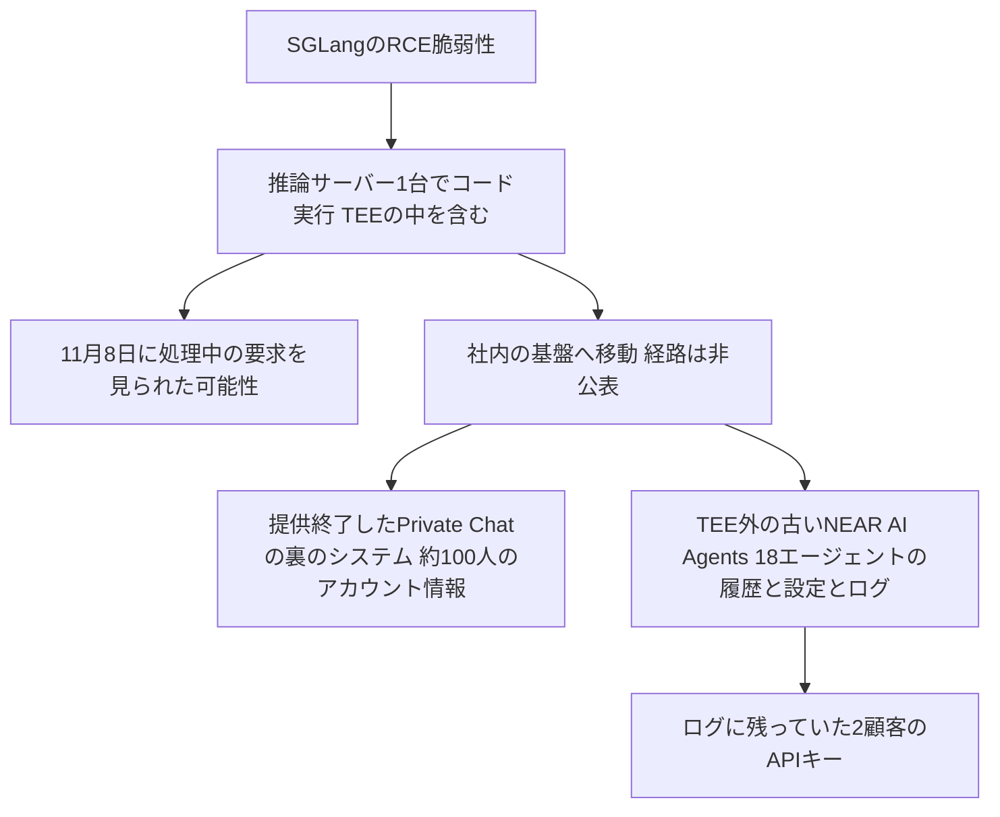

# NEAR AI ― SGLangの脆弱性を突かれ推論サーバーに侵入された

## 要点

### 影響を受けたもの

- NEAR AIの推論サーバー1台。攻撃者はここでコードを実行し、2026年11月8日にこのサーバーで処理されていた利用者の要求を見られた可能性がある。TEE（機密計算環境）の中で処理する「confidential mode」の要求も含む（NEAR AI）。
- 提供を終えていた「Private Chat」の裏の社内システム。約100人のメールアドレスと名前、一部はプランと残高の情報がダウンロードされた。保存された会話やアップロードされたファイルが読まれた形跡はない（NEAR AI）。
- TEEの外で動いていた古い「NEAR AI Agents」の18のエージェント。会話履歴、設定、ログが取られた。2つの顧客のNEAR AI CloudのAPIキーがログに含まれていて、どちらも無効にした（NEAR AI）。
- SGLangの脆弱性のCVE番号、影響するバージョン、SGLangプロジェクトが修正を出したかどうかは公表されていない（NEAR AI、The Hacker News）。

### 今すぐやること

- SGLangで推論サーバーを動かしている場合は、SGLangプロジェクトのアドバイザリとリリースを確認し、修正が出たらすぐに入れる。それまでは、SGLangのサーバーに届く経路を信頼できる呼び出し元だけに絞る。
- NEAR AIから `security@near.ai` で連絡を受けた利用者は、案内の手順に従う。頼んでいないアカウントや残高に関する連絡には注意する（NEAR AI）。
- NEAR AIのエージェントやCloudを使っていて連絡がない場合、NEAR AIは「対応は不要」としている（The Hacker News）。

## 概要

- NEAR AIは、TEEで推論を行う「機密推論」を売りにするAI基盤。2026年11月9日に事案の報告を公表した（NEAR AI）。
- 攻撃者はSGLangのRCE脆弱性を突いて推論サーバー1台でコードを実行し、そこから社内の基盤に入った（NEAR AI）。
- NEAR AIは、TEEは運用者やホストからデータを守るものの、環境の中で動くソフトウェアの脆弱性からは守らないと説明している。SGLangはTEEの中で動いていたため、攻撃者はTEEの中で処理中の要求に届いた（NEAR AI）。
- Braveは10月15日の技術解説で、ブラウザのAIアシスタント「Leo」のGLM 5.3 Flashの会話をNEAR AIが運用するTEEで処理していると書いている。今回のサーバーがLeoの会話を処理していたかどうか、NEAR AIは明らかにしていない（The Hacker News）。

> この記事では、NEAR AIの事案報告と報道で確認できた内容を「事実」、筆者の推測や意見を「考察」として分けて書いています。

## 何が起きたか（時系列）

**事実（NEAR AI、The Hacker News）**

| 日付（2026年） | 出来事 |
| --- | --- |
| 11月8日（日） | 攻撃者がSGLangの脆弱性で推論サーバー1台のコードを実行。この日、そのサーバーで処理中の要求を見られた可能性がある |
| 検知後 | すべてのセッションと管理者の認証情報を無効にし、エージェントのトークンを交換、Private Chatを停止、全推論サーバーにSGLangの修正を適用 |
| 11月9日 | 事案の報告を公表。残りの認証情報の交換とフォレンジック調査を終え、NEAR AI Cloudを再開したと説明 |
| 11月9日 | Xへの追加の投稿で、連絡のない利用者は対応不要と説明（The Hacker News） |

## 技術的な問題点（根本原因）

**事実（NEAR AI）**

- 入口は、推論サーバーで動くオープンソースの推論エンジンSGLangのRCE脆弱性。脆弱性の詳しい内容は公表されていない。
- 推論サーバーから社内の基盤に届き、提供を終えたPrivate Chatの裏のシステムと、TEEの外で動く古いエージェントの基盤にも入られた。
- NEAR AIは今後、推論ソフトウェアとTEEの周りのサービスも、TEEそのものと同じ厳しさで安全性を分析するとしている。機密推論の基盤のコード、依存関係、配備の設定は公開を続ける。

**考察**

- TEEが守るのは「ホストや運用者から中身を見られないこと」で、「中で動くプログラムが乗っ取られないこと」ではない。TEEの中で外からの要求を受ける推論エンジンが乗っ取られれば、要求は平文で読める。NEAR AI自身がこの限界をはっきり書いた点は重要だと考える。
- 推論サーバー1台から、提供終了したサービスの裏のシステムや古いエージェント基盤まで届いた。推論サーバーと社内の管理系の間が、ネットワークや認証情報の面で十分に分かれていなかった可能性がある。ただし、どの経路で横に広がったかは公表されていない。
- 「提供終了したが動いていたシステム」と「TEEに移していない古い配備」が被害の中心になった。新しい仕組みに移したあとの古い環境が残ることの危うさを示している。

## 攻撃・侵入経路

## なぜ防げなかったか・構造的要因の考察

**考察**

- **TEEの信頼は中のソフトウェアに依存する**: 機密推論は「運用者でさえ見られない」と説明されることが多いが、守られるのはTEEの外からの覗き見だけ。推論エンジン、トークナイザー、通信を受ける部分など、要求を処理するソフトウェアに脆弱性があれば中身は漏れる。利用者は「TEEで動いている」ことと「推論ソフトウェアが安全である」ことを分けて評価する必要がある。
- **推論エンジンは外部入力を大量に受ける**: SGLangのような推論エンジンは、性能を優先して高速に開発されており、外からの要求を直接受ける。AI基盤の運用者は、推論エンジンを「インターネットに面したサーバーソフトウェア」として扱い、脆弱性の情報を追う必要がある。
- **ログに秘密情報が残る**: 顧客のAPIキーがエージェントのログに含まれていた。ログは秘密情報の保管場所として見落とされやすい。
- **古い環境の後片付け**: 提供を終えたサービスと古い配備が攻撃の届く範囲に残っていた。

## 運用者向けの具体的な対策と検知ポイント

1. SGLangを使っている場合は、プロジェクトのアドバイザリを追い、修正が出たらすぐに適用する。SGLangのAPIや管理用のエンドポイントを、インターネットや信頼できないネットワークに直接出さない。
2. 推論サーバーを、社内の管理系やデータベースと別のネットワークに分け、推論サーバーが持つ認証情報を最小にする。
3. TEEを使う場合も、中で動くソフトウェアの脆弱性管理と、乗っ取られたときの影響範囲（そのサーバーで同時に処理される要求）を前提に設計する。
4. 推論サーバーからの想定外の外向き通信、新しいプロセスの起動、社内システムへの接続を監視する。
5. 提供を終えたサービスと古い配備は、データとともに削除するか、少なくとも認証情報と通信経路を切る。
6. ログにAPIキーやトークンが書かれないよう、出力前に秘密情報を伏せる処理を入れる。

## 参考リンク

- [NEAR AI: Security Incident Report: SGLang Vulnerability（2026年11月9日）](https://near.ai/blog/security-incident-report-sglang-vulnerability)
- [The Hacker News: SGLang RCE Exploit Breaches NEAR AI, Steals Data From 18 Agents and About 100 Users（2026年11月10日）](https://thehackernews.com/2026/11/sglang-rce-exploit-breaches-near-ai.html)
- [NEAR AI（X）の追加の投稿](https://x.com/near_ai/status/2120043366444601458)
- [Brave: Leoの機密推論に関する技術解説（2026年10月15日）](https://brave.com/blog/browser-ai-e2ee/)
