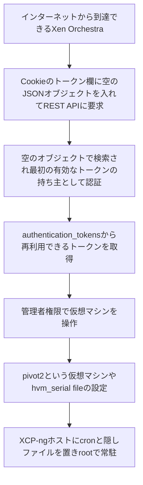

# Xen Orchestra ― 空のトークンで認証を回避する脆弱性が悪用された

## 要点

### 影響バージョン

- Xen Orchestra 6.9.2（stable）より前と6.10.1（latest）より前、およびXen Orchestra Appliance（XOA）（Vates VSA-2026-062）。
- 修正パッケージは `xo-server` 5.211.2（stable）と5.213.1（latest）。ソースからインストールしている場合は最新の `master` に更新する（Vates）。
- CVE番号とCVSSは、公表時点（2026年11月10日）でまだ付いていない（Vates）。

### 今すぐやること

- Xen Orchestraを6.9.2（stable）または6.10.1（latest）以降に上げる（Vates）。
- すぐに上げられない場合は、インターネットから到達できないようにし、管理専用ネットワークに置く。WAFやリバースプロキシで `authenticationToken=j:{}` と `authenticationToken=j:%7B%7D` を含む要求を止める。ただし別の書き方で回避される可能性があるとVatesは注意している。
- Vatesが示した攻撃元のIPアドレスとTorの接続先を、入りと出の両方で止める（一覧は下の「対策と検知」）。
- 侵害の痕跡を調べる。見つかったら、Xen Orchestraに登録したパスワードと秘密情報（バックアップ先の認証情報、ホストのroot、プールの秘密情報、利用者のOTPなど）をすべて交換し、再インストールする（Vates）。

## 概要

- Xen Orchestra（XO）は、XCP-ng／XenServerの仮想化基盤をWebから管理するツール。開発元はフランスのVates。
- Vatesは2026年11月10日、XOのREST APIの認証に欠陥があり、認証なしで管理者（Admin）権限の操作ができると公表した。XOが乗っ取られると、管理下のプールで任意のコードが実行でき、XCP-ngホストがrootで乗っ取られうる（Vates）。
- Vatesは、この欠陥が攻撃者に悪用されていると書いている。いつから悪用されていたか、修正前のゼロデイとして使われたかは分かっていない（The Hacker News）。
- 発見したのはTDC NET SecurityのFilip Magic氏とChristoffer Olsen氏（Vates）。

> この記事では、Vatesのアドバイザリ、修正のプルリクエスト、報道で確認できた内容を「事実」、筆者の推測や意見を「考察」として分けて書いています。

## 何が起きたか（時系列）

**事実**

| 日付 | 出来事 |
| --- | --- |
| 2022年6月7日 | 認証トークンに説明文を付けられるようにする変更がXOに入る。修正のプルリクエストは、この変更で欠陥が入ったとしている（GitHub） |
| 2026年11月10日（UTC 08:29） | 修正のプルリクエスト #10748「fix(xo-server): validate authentication token IDs」がマージされる（GitHub） |
| 2026年11月10日 | VatesがVSA-2026-062を公表。6.9.2と6.10.1で修正、悪用を確認と記載（Vates） |

## 技術的な問題点（根本原因）

**事実（Vates、GitHub）**

- XOのREST APIは、Cookieの `authenticationToken` でログイン状態を確かめる。Cookieの解析では、`j:` で始まる値はJSONとして読まれる（Expressの `cookie-parser` の仕様）。そのため `authenticationToken=j:%7B%7D` は文字列ではなく空のオブジェクト `{}` になる。
- REST APIの認証は、この値が文字列かどうかを確かめずにトークンの検証処理に渡していた。
- トークンの保存先は `{}` を「条件なしの検索」として扱い、保存されている最初のトークンを返す。そのトークンの期限が切れていなければ、攻撃者はそのトークンの持ち主として認証される。
- 認証された後は `/rest/v0/users/me/authentication_tokens` から、繰り返し使えるログイントークンのIDが取れる。
- 修正では、文字列でないトークンIDや空のトークンIDを、検索の前に拒否するようにした。呼び出し元が渡したオブジェクトの余分なキーが検索条件に入らないよう、確かめた項目だけで条件を組み立てる。REST APIのほか、`/signin` とJSON-RPCの `session.signIn` でも拒否されることを試験している（GitHub #10748）。

**考察**

- 「IDで1件探す」関数に任意のオブジェクトが渡ると「条件なしで1件探す」に変わる、という型の混同が根本にある。NoSQLインジェクションでよく見る形で、入口（Cookieの解析）、中間（認証）、出口（保存先の検索）のどこかで型を確かめていれば止まった。
- 最初のトークンの持ち主は、多くの場合、最初に設定した管理者だと考えられる。普通にログインして使っている環境ほど、有効なトークンが残っていて攻撃が成り立ちやすい。これは筆者の推測で、Vatesはどの利用者として認証されるかの傾向を示していない。

## 攻撃・侵入経路

**事実（Vates）**

- 攻撃者は最初、`91.211.251.112:8001` とTorの `ustar3rqxgnskzgnwkgpofgtvxevm6cx3lxdbwt4mndtveqyaohid.onion:3333` から活動していた。The Hacker Newsによると、このIPアドレスはVirusTotalでRedLine StealerのC2サーバーとして扱われている。
- 侵害された環境で見つかる痕跡として、Vatesは次を挙げている。
  - 起動中の `pivot2` という名前の仮想マシン
  - `hvm_serial: file` が設定された仮想マシン
  - ホスト上の `/etc/cron.d/zz-ustar2`、`/etc/cron.d/zz-ustar`、`/.ustar5`、`/.ustar6`
- 認証を経ないアクセスなので、悪用が成功してもXOのログには残らない。検知するには、HTTP要求を通信の記録（tcpdumpなど）から探す必要がある。
- これらの痕跡は今回の攻撃者のものだけで、別の攻撃者は別の手口を使う可能性がある。痕跡が見つからないことだけでは、侵害されていないとは言えない。

**考察**

- 仮想マシンのシリアルコンソールをホスト上のファイルに出す設定（`hvm_serial: file`）が痕跡に挙がっていることから、仮想マシンの設定を通じてホストのファイルに書き込み、cronで足場を作った可能性がある。ただし、Vatesは具体的な手順を公表しておらず、これは筆者の推測。

## なぜ防げなかったか・構造的要因の考察

**考察**

- **管理ツールは基盤全体の鍵になる**: XOはプールのrootの認証情報、バックアップ先（NFS、S3、Azure、SMB）の認証情報を持っている。XOの認証が1か所破られるだけで、すべての仮想マシンとバックアップに届く。Vatesが侵害時に「すべてのパスワードと秘密情報の交換」と「再インストール」を求めているのはこのため。
- **管理画面がインターネットに出ている**: Vatesの最初の緩和策は「インターネットに公開しない」。外から操作したいという理由で、管理画面がそのまま公開されている例は多いと考えられる。
- **4年以上残っていた**: 修正のプルリクエストが原因とした変更は2022年6月のもの。トークン検索の関数が文字列以外も受け付ける作りになったまま、REST APIからそこに届く経路ができていた。
- **ログに残らない**: 認証回避は、正規のログイン処理を通らない。認証のログだけを見張っていても見つからない。

## 運用者向けの具体的な対策と検知ポイント

1. Xen Orchestraを6.9.2（stable）または6.10.1（latest）以降に上げる。`xo-server` が5.211.2（stable）または5.213.1（latest）以降になっていることを確かめる。
2. XOを管理専用のネットワークに移し、インターネットから到達できないようにする。外から使う場合はVPNなどを通す。
3. 次のIPアドレスとの通信を入りと出の両方で止め、Torの通信も止める（Vates）：`91.211.251.112`、`193.148.56.72`、`37.221.208.216`、`45.66.35.11`、`64.65.0.120`、`64.65.62.160`、`89.47.51.90`、`92.60.37.247`。
4. 過去の通信記録やプロキシのログに `authenticationToken=j:` を含む要求がないか探す。
5. XCP-ngホストで次を実行する（Vates）。
   - `xe vm-list params=name-label,platform | grep -B1 'hvm_serial: file'`
   - `zgrep -- '-serial file:' /var/log/xensource.log*`
   - `ls -la /etc/ld.so.preload /.ustar* /etc/cron.d/zz-ustar*`
6. 侵害が見つかったら、XOに登録したパスワードと秘密情報（プロキシ、バックアップ先、root、プールの秘密情報、利用者アカウント、OTPの秘密、メールサーバーの設定など）をすべて交換し、XOとホストを再インストールする（Vates）。
7. 有効期限の長いログイントークンを減らし、使っていないトークンは削除する。

## 参考リンク

- [Vates: VSA-2026-062: Empty-object login token（2026年11月10日）](https://docs.vates.tech/security-advisories/advisories/2026/vates-sa-2026-062/)
- [GitHub vatesfr/xen-orchestra: fix(xo-server): validate authentication token IDs（#10748）](https://github.com/vatesfr/xen-orchestra/pull/10748)
- [The Hacker News: Hackers Exploit Critical Xen Orchestra Auth Bypass Flaw to Gain Admin Access（2026年11月10日）](https://thehackernews.com/2026/11/hackers-exploit-critical-xen-orchestra.html)
- [cookie-parser（JSONクッキーの仕様）](https://github.com/expressjs/cookie-parser#cookieparserjsoncookiestr)
