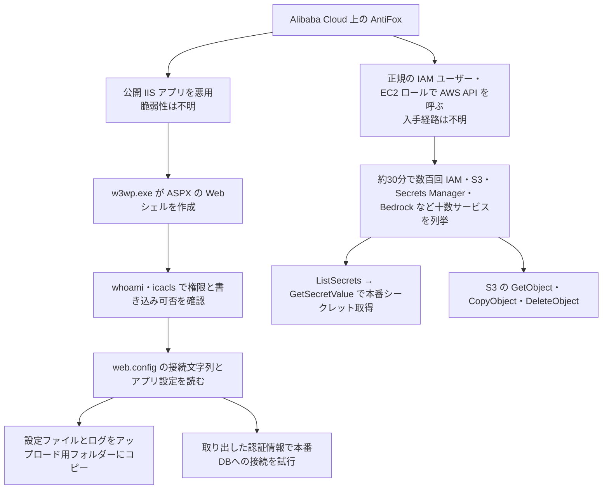

# AntiFox ― AIペンテスト基盤の稼働拠点からAWSの秘密情報が読まれた

## 要点

### 影響を受けるもの

- インターネットに公開したWebアプリ（観測例はIIS上のアプリ）で、`web.config` やアプリ設定にデータベースやクラウドの認証情報を置いている組織（Arctic Wolf）。
- 何らかの経路でAWSのアクセスキーやEC2のロールの認証情報が漏れている組織。漏れた経路はArctic Wolfも特定していない（Arctic Wolf）。
- 特定の製品の脆弱性ではないため、修正版はない。

### 今すぐやること

- CloudTrailで、`47.79.4[.]33` と `8.208.101[.]210` からのAPI呼び出しを探す。User-Agent `Boto3/1.43.125`・`Botocore/1.43.125` も手がかりになる（Arctic Wolf）。
- `AccessDenied` が大量に並ぶ中に、成功した `GetSecretValue` や `GetObject` が混じっていないか確かめる。ほとんど拒否されていても「失敗した攻撃」と判断しない（Arctic Wolf）。
- IISの `w3wp.exe` が `cmd.exe` や `powershell.exe` を起動していないか、アップロード用のフォルダーに新しい `.aspx` が作られていないかを調べる（Arctic Wolf）。
- 侵入の痕跡があれば、`web.config`、アプリ設定、デバッグログ、環境変数、設定のバックアップに入っていた認証情報をすべて交換する（Arctic Wolf）。

## 概要

- AntiFoxは、GitHubで公開されている中国語のAI自動ペネトレーションテスト基盤。計画・作業・統括の複数のAIエージェントが、偵察から脆弱性の悪用、報告書の作成までを進める（AntiFox README、BleepingComputer）。もとはARTEX 0.1.1のフォークだった（BleepingComputer）。
- Arctic Wolf Labsは、AntiFoxの管理画面を載せたAlibaba Cloudのサーバーが、公開Webサービスと、それにつながるAWS環境への攻撃に関わっていたと報告した（Arctic Wolf、2026年11月10日付）。
- 観測された攻撃は、Webの脆弱性の悪用、Webシェルの設置、設定ファイルの探索、認証情報の検証、AWSサービスの列挙、シークレットの取得、S3の操作をつないだものだった（Arctic Wolf）。

> この記事では、Arctic Wolfの報告と報道で確認できた内容を「事実」、筆者の推測や意見を「考察」として分けて書いています。

## 何が起きたか

| 日付（2026年） | 出来事 |
| --- | --- |
| 時期不明 | AntiFoxの管理画面を載せたAlibaba Cloudのサーバーから、IISアプリとAWS環境への攻撃が複数回観測される（Arctic Wolf） |
| 11月10日 | Arctic Wolfが分析と検知の手引きを公開（Arctic Wolf） |
| 11月11日 | The Hacker NewsとBleepingComputerが報道 |

**事実**

- 攻撃がいつ始まったか、何組織が被害を受けたか、どの組織かは公表されていない。
- AntiFoxはGitHubで公開が続いており、バージョン2.0に更新されている。公開者は実在のシステムへの使用や違法な使用を禁じているが、それを技術的に止める仕組みは書かれていない（BleepingComputer）。

## 技術的な問題点（根本原因）

**事実（Arctic Wolf）**

- IISへの侵入に使われた脆弱性は特定されていない。`w3wp.exe`（IISの作業プロセス）がASPXのWebシェルを作り、同じプロセスからコマンドを実行していたことから、Webアプリ経由の侵害とみられる。
- 別の攻撃は、入手経路の分からない正規のAWS認証情報から始まっていた。
- PowerShellから.NETの設定クラスを使って `web.config` の接続文字列とアプリ設定を読み、そこで得た認証情報で社内の本番データベースへの接続を試みていた。

**考察**

- 根本原因は2つの層に分かれる。入口はWebアプリの脆弱性や漏れた鍵という昔からの問題で、被害を広げたのは、Webサーバーの設定ファイルやワークロードのIDが「アカウント全体を一覧できる」広い権限の認証情報を持っていたことだ。後者はAIの有無に関係なく、侵入されたときの被害の大きさを決める。

## 攻撃・侵入経路

**事実（Arctic Wolf）**

- AWSでは、正規のIAMユーザーと、場合によっては引き受けたEC2ロールが使われた。`GetCallerIdentity`、`GetUser`、`ListUsers`、`ListRoles`、`ListPolicies`、`ListKeys` で自分の権限を確かめ、ECRの `GetAuthorizationToken` も試していた。
- ある侵入では、1つの送信元が複数のAWSのIDを切り替えながら、約30分で数百回のサービス横断のAPI要求を出した。大半は拒否されたが、同じ流れの中に成功した探索とシークレットの取得が混じっていた。
- 列挙の対象は、IAM、EC2、S3、Lambda、Secrets Manager、KMS、RDS、ECS、EKS、Redshift、Athena、Glue、Systems Manager、API Gateway、CloudWatch、CloudFormation、DynamoDB、Amazon Bedrock。拒否されると別のサービスに移り、アクセスできた資源に集中した。
- 本番のシークレットへの `GetSecretValue` が成功した例と、S3でオブジェクトを読み、コピーし、削除した例があった。
- 盗んだ設定ファイルやログは、`pwn*.aspx`、`cfg*.txt`、`wc*.txt`、`el*.txt` といった名前でアップロード用のフォルダーに置かれた。

**考察**

- 「拒否されたら次のサービスへ」という動きは、権限の境界をAIエージェントが機械的に探っていることをよく表している。人間なら途中で諦めるような数百回の試行も、エージェントには負担にならない。拒否が多いことは安心材料ではなく、むしろ探索の量が多い証拠と読むべきだ。

## なぜ防げなかったか・構造的要因の考察

**考察**

- **公開ツールで攻撃の手間が下がった**: Arctic Wolfは、こうしたエージェント型の基盤がペネトレーションテストの技術を攻撃者に使いやすくし、実際の攻撃の速さと一貫性を上げると書いている。ARTEXが非公開になったあとも、そのフォークや似た基盤が公開されている。The Hacker Newsによれば、GitGuardianは同種のオープンソースの攻撃フレームワークを約45種数えている。ツールを止めることで防ぐのは難しい。
- **広い列挙権限が残りやすい**: 本番のアプリ用IDに `List*` や `Describe*` が広く付いていると、侵入者は自分に何ができるかを短時間で地図にできる。開発時の「とりあえず読み取りは全部許可」が残っていることは珍しくない。
- **Webサーバーとクラウドのログがつながっていない**: IISでのWebシェルとAWSの異常なAPI呼び出しは、別々のチームが別々の画面で見ていることが多い。Arctic Wolfが両者の相関を勧めているのは、この分断を突かれると一連の攻撃として見えないからだと考える。

## 運用者向けの具体的な対策と検知ポイント

1. あるIDが、これまで使ったことのないホスティング事業者やASNからAWS APIを呼んでいないか調べる。1つのIPが短時間に複数のアクセスキーやロールを使う動きは、集めた認証情報を試している兆候（Arctic Wolf）。
2. 関係のない複数のサービスにまたがる `List`・`Get`・`Describe` の連続を探す。新しいASNからで、Boto3などのSDKを使っていれば疑いが強まる（Arctic Wolf）。
3. 新しい送信元からの `GetSecretValue` の成功、特に広い列挙や拒否の連続の後の成功に警告を出す。GuardDutyの異常なIAM利用や認証情報アクセスの検出結果も確認する（Arctic Wolf）。
4. 重要なS3バケットでS3データイベントを記録し、バージョニングと、必要に応じてObject Lockを有効にして、削除の被害を抑える（Arctic Wolf）。
5. IISで、`w3wp.exe` から `cmd.exe`、`powershell.exe`、`whoami.exe`、`icacls.exe` などが起動したら警告する。PowerShellで `WebConfigurationManager` や `ConnectionStrings.ConnectionStrings` を参照する動きも探す（Arctic Wolf）。
6. 侵害が分かったら、Webサーバーを隔離し、Webルート、IISのログ、端末のログ、メモリを保全してから再構築する。他のWebシェルや改変されたファイルがないか、書き込めるフォルダーをすべて調べる（Arctic Wolf）。
7. 影響を受けたIDのAWSセッションとアクセスキーを無効にし、CloudTrailでそのIDの過去の操作を確かめてから新しい認証情報を発行する（Arctic Wolf）。
8. EC2ではIMDSv2を必須にし、メタデータ応答のホップ数を絞る。アプリのIDには、アカウント全体を一覧できるような権限を与えない（Arctic Wolf）。
9. AntiFoxの管理画面の目印（タイトル `AntiFox — 自主渗透测试控制台`、TCP 8787）は、自社のネットワーク内で無許可に動いていないかの確認にも使える。ただし公開ツールで、クラウドのIPは使い回されるため、IPやツールの痕跡だけで判断しない（Arctic Wolf）。

## 参考リンク

- [Arctic Wolf Labs: Antifox Agentic Pentesting Platform Used to Steal AWS Credentials and Move Laterally in Compromised Environments（2026年11月10日）](https://github.com/rtkwlf/wolf-tools/tree/main/pack_alerts/202611-antifox-alibaba-hosted-platforms-facilitate-web-cloud-intrusions)
- [AntiFox README（GitHub）](https://github.com/AntiFox-AI/antifox/blob/main/README.en.md)
- [The Hacker News: AntiFox AI Pentesting Platform Linked to Attacks That Accessed AWS Production Secrets（2026年11月11日）](https://thehackernews.com/2026/11/antifox-ai-pentesting-platform-linked.html)
- [BleepingComputer: Hackers use AntiFox AI agents in AWS credential-theft attacks（2026年11月11日）](https://www.bleepingcomputer.com/news/security/hackers-use-antifox-ai-agents-in-aws-credential-theft-attacks/)
- [関連記事：韓国の金融機関に連続侵入 ― AI自動ペネトレーションツールを悪用](/security-notes/notes/2026-10-11-artex-ai-pentest-tool-south-korea-financial-breaches/)
- [関連記事：ARTEXを使う攻撃者 ― GitHubで漏れたアプリの鍵でAzureに侵入](/security-notes/notes/2026-11-09-artex-github-secret-search-entra-service-principal-key-vault/)
