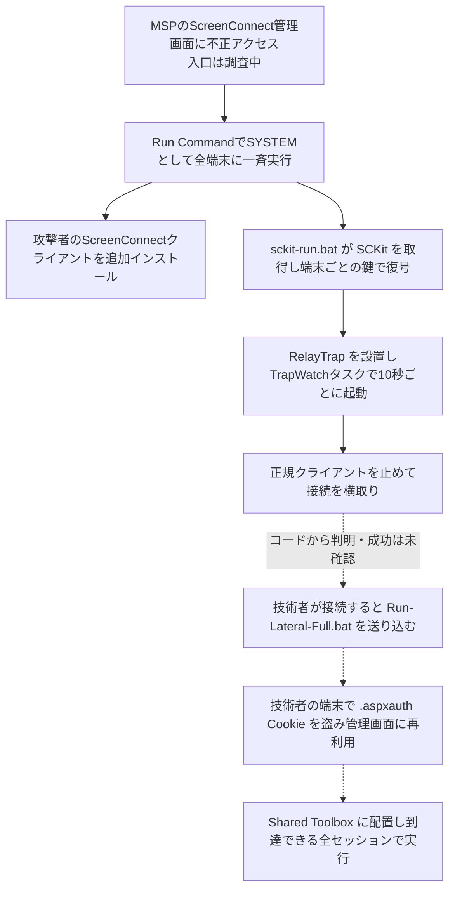

# ScreenConnect ― 侵害されたMSPの環境から攻撃用クライアントを配布

## 要点

### 影響を受けるもの

- ScreenConnect（ConnectWiseのリモートサポート製品）を使うMSPと、その顧客の端末。Huntressが確認したのはクラウド版のScreenConnectだった（Huntress）。
- ConnectWiseが関係を疑っているのは、他社が作った拡張機能「RMM+」系の5種（`Labtech Plus`、`RMM Plus`、`RMM+`、`RMM Plus Password Link`、`RMM+ Password Link`）。これらはリモートでコマンドを実行できるAPIを持ち、そのAPIは導入時にパートナーが設定するパスフレーズで守られている（ConnectWise）。
- ConnectWiseは、自社の基盤の侵害やScreenConnect本体の脆弱性は見つかっていないとしている。修正版はない（ConnectWise、11月12日 02:45 UTC時点）。

### 今すぐやること

- 上の5種の拡張機能が無効になっているか確かめる。オンプレミス版はConnectWiseが止められないので、自分で無効にする。追加の案内があるまで再び有効にしたり入れ直したりしない（ConnectWise）。
- 警告を受けていなくても、Run CommandとToolboxの履歴に覚えのない一斉実行がないか、端末に2つ目のScreenConnectクライアントが入っていないかを確かめる（Huntress）。
- 怪しい端末にはScreenConnectで接続しない。EDRのライブレスポンスやWinRMなど別の経路で調べる。すでに接続した技術者の端末も侵害を疑う（Huntress、ConnectWise）。
- 信頼できる端末から、ScreenConnectとIDプロバイダーのセッションを無効にし、パスワードを変え、多要素認証を必須にする（ConnectWise）。

## 概要

- 2026年11月11日 17:47（UTC、日本時間12日 2:47）ごろから、複数のクラウド版ScreenConnectの管理画面からRun Commandが顧客の端末に送られ、攻撃者のScreenConnectクライアントと「SCKit」と呼ばれるツールキットが入れられた（Huntress）。
- Huntressの顧客では、6社のMSPを通じて48組織の288台が影響を受けた。288台はすべて90分のうちに感染し、約3分の1は最初の10分だった（Huntress、BleepingComputer）。
- ConnectWiseは11月11日 22:45（UTC）に注意喚起を出し、RMM+系の拡張機能5種を約400のパートナー環境で予防的に無効にした。侵入の入口と全体の範囲はまだ分かっていない（ConnectWise）。

> この記事では、ConnectWiseの注意喚起、Huntressの分析と報道で確認できた内容を「事実」、筆者の推測や意見を「考察」として分けて書いています。

## 何が起きたか

| 日時（2026年、UTC） | 出来事 |
| --- | --- |
| 7月25日 | 社会保障局（SSA）の明細を装ったバッチファイルがVirusTotalに初めて登録される。今回の攻撃用クライアントIDの1つ `ed630cc2c873b091` を参照していた（BleepingComputer） |
| 9月 | Huntressが、攻撃用のScreenConnectクライアントがワームのように広がる似た事例に対応。その後ConnectWiseはファイル転送の脆弱性CVE-2026-84869（CVSS 9.9）を修正した（Huntress） |
| 11月11日 17:47ごろ | 複数のScreenConnect環境の端末で不審な動きが始まる（Huntress） |
| 11月11日 | HuntressがRedditのMSP向け掲示板で、6社のMSPと286台以上が影響を受けていると報告（BleepingComputer） |
| 11月11日 22:45 | ConnectWiseが注意喚起を公開し、拡張機能5種を約400の環境で無効化（ConnectWise） |
| 11月12日 02:45 | ConnectWiseが更新。自社基盤の侵害や製品の脆弱性は見つかっていないと説明（ConnectWise） |

**事実**

- 7月のバッチファイルと今回の攻撃の関係は分かっていない（BleepingComputer）。9月の事例と今回が同じ攻撃者かどうかも、Huntressは書いていない。

## 技術的な問題点（根本原因）

**事実**

- ConnectWiseの初期の見立ては、攻撃者がパートナー環境に入っていた他社製の拡張機能を悪用した、というもの。まだ検証中としている（ConnectWise）。
- Huntressは侵入の入口をまだ特定していないが、手元のデータからは、盗まれた認証情報か乗っ取られた操作者のセッションが疑われるとした（BleepingComputer）。
- HuntressのBrandt氏は、ソフトウェアの脆弱性ではなく正規の機能の悪用に見えると述べた（BleepingComputer）。

**考察**

- ScreenConnectの管理画面は、MSPが管理する全顧客の端末にSYSTEM権限でコマンドを送れる。この権限を、パスフレーズで守られた拡張機能のAPIや、技術者のブラウザーのセッションCookieといった「本体の外側の入口」が共有している。本体に穴がなくても、入口が1つ破られれば管理画面と同じことができる、という構造が根本にあると考える。

## 攻撃・侵入経路

**事実（Huntress）**

- Run Commandのコマンドは、既存のScreenConnectクライアントを確認したあと、攻撃者のインストーラーを `C:\Windows\TEMP\sc.msi` に落として黙ってインストールし、base64でエンコードしたドロッパー `C:\Windows\Temp\sckit-run.bat` を書き込んだ。
- SCKitは16個のファイル（PowerShell、バッチ、設定データなど）からなる。取得時にWindowsのUUIDを送ると、サーバーが応答ヘッダーで鍵・IV・ソルトを返し、その端末でしか復号できない形で `%temp%` に展開される。
- 罠の部分は `C:\ProgramData\RelayTrap` に置かれ、`TrapWatch.ps1` がSYSTEMで `RelayTrap.cs` を端末ごとにコンパイルし、10秒ごとに動くスケジュールタスク `TrapWatch` を作る。正規のScreenConnectクライアントは止められて手動起動にされ、攻撃者の複製がその接続の枠を奪う。Defenderの除外設定も追加される。
- `RelayTrap.cs` のソースコードは、細かい参照や説明のコメントから、LLMが書いたものとみられる。
- ここまでは実際に観測された動き。技術者の端末へ広がり、そこから他の端末へ広がる仕組みはコードの解析から再現したもので、成功は観測されていない。管理画面の乗っ取りの試みは、回収したログでは毎回失敗していた。
- コード上の仕組みでは、技術者が接続して2.5秒後に感染端末から `Run-Lateral-Full.bat` が実行の指定付きで技術者側へ送られる。`Panel-Lateral.ps1` は技術者のブラウザーから `.aspxauth` セッションCookieを盗んで管理画面に再生し、`ToolboxRelayUploader.exe` が共有ツールボックスにペイロードを上げて、届くすべてのセッションで実行させる。約60秒後にツールボックスの項目を消して痕跡を隠す。Cookieの読み出しにはSQLiteのコマンドラインツールが使われる。

## なぜ防げなかったか・構造的要因の考察

**考察**

- **MSPは一度に多くの組織へ届く**: 侵害されたMSPは6社だが、影響は48組織に及んだ。288台の3分の1が最初の10分で感染した速さは、管理画面の一斉実行がそのまま攻撃の配布網になったことを示している。
- **「接続して確かめる」がそのまま感染経路になる**: 障害対応の基本は端末に入って見ることだが、SCKitはまさにその接続を待ち構える作りだ。ConnectWiseとHuntressの両方が「ScreenConnectで接続するな」と書いているのはこのためで、普段の手順を逆に使われると現場は判断を誤りやすい。
- **拡張機能は本体の管理の外にある**: 問題とされた拡張機能はマーケットプレイスから入れる他社製のもので、ConnectWiseは「本体に脆弱性はない」としている。一方で、その拡張機能はリモートでコマンドを実行するAPIを持っていた。製品本体を最新にしていても、拡張機能のAPIの守りがパスフレーズ1つなら、全体の強さはそこで決まる。
- **正規ツールは検知で見逃されやすい**: 2つ目のScreenConnectクライアントは正規の署名付きソフトウェアで、Huntressによれば2026年は正規のRMM（リモート監視・管理）ソフトを最初の足場に使う攻撃が大きく増えている。ファイルのハッシュも端末ごとに変わるため、Huntressもハッシュは弱い指標だとしている。

## 運用者向けの具体的な対策と検知ポイント

1. RMM+系の拡張機能5種を無効のままにする。オンプレミス版は自分で止める（ConnectWise）。
2. 認証、拡張機能のインストール、管理操作、Run Command、Toolboxの記録を消さずに保全し、覚えのないアカウント、権限変更、コマンド、リモートアクセスソフトのインストールを調べる（ConnectWise）。
3. 端末で、別のScreenConnectクライアント（自社のインスタンスにつながらないもの）を探す。攻撃用のクライアントIDは `2588ef5c15954b10` と `ed630cc2c873b091`。参加者名 `Addmin` と、インストーラーURLの `&c=Exploited` も手がかりになる（Huntress）。
4. 罠の痕跡を探して取り除く。スケジュールタスク `TrapWatch`、フォルダー `C:\ProgramData\RelayTrap\`、`%TEMP%` の `sckit-*` などのファイル、`HKLM\SOFTWARE\Microsoft\Windows\CurrentVersion\Run` の `RelayTrapLiteAlert`。正規のクライアントは別に確かめてから消す（Huntress）。
5. 隔離だけでは消えない。隔離を解いた直後に再感染した例があるので、除去と再感染の確認が済むまで戻さない（Huntress）。
6. 次の通信先をファイアウォールとDNSで止める：`185.99.255[.]28`、`155.94.150[.]39`、`newnewnew.gotdns[.]org`、`soxnewwork.homedns[.]org`、`sc.payproofkit[.]com`、`ns.mo7sen[.]dev`、`cdn007-digitaldownloads[.]com`（Huntress、ConnectWise）。
7. 盗まれうるのはブラウザーのセッションなので、パスワード変更だけでなく、ScreenConnectとIDプロバイダーのセッションを無効にする。感染端末で使われた、または保存されていたドメイン管理者、サービス、バックアップ、ハイパーバイザーのアカウントやブラウザー保存の認証情報も変える（Huntress）。
8. 平常時の備えとして、管理画面のアカウントに多要素認証を必須にし、不要な管理者権限を外す。Run Commandの一斉実行や新しい拡張機能の追加をSIEMで警告する。

## 参考リンク

- [ConnectWise Trust Center: ScreenConnect security advisory: Precautionary extension disabling and partner guidance（2026年11月11日、12日更新）](https://www.connectwise.com/company/trust/advisories)
- [Huntress: SCKit Worm Installs Rogue ScreenConnect Clients and Session Cookie Relays Across Hundreds of Endpoints（2026年11月11日）](https://www.huntress.com/blog/sckit-worm-rogue-screenconnect)
- [Huntress Support: 2026 - November - ScreenConnect](https://support.huntress.io/hc/en-us/articles/57422935234195-2026-November-ScreenConnect)
- [BleepingComputer: Active ScreenConnect attacks breach MSPs, impact dozens of organizations（2026年11月11日）](https://www.bleepingcomputer.com/news/security/active-screenconnect-attacks-breach-msps-impact-dozens-of-organizations/)
- [関連記事：ConnectWise Cloud Backup ― アプリの鍵でM365テナントに侵入](/security-notes/notes/2026-10-18-connectwise-cloud-backup-skykick-m365-app-credential-abuse/)
