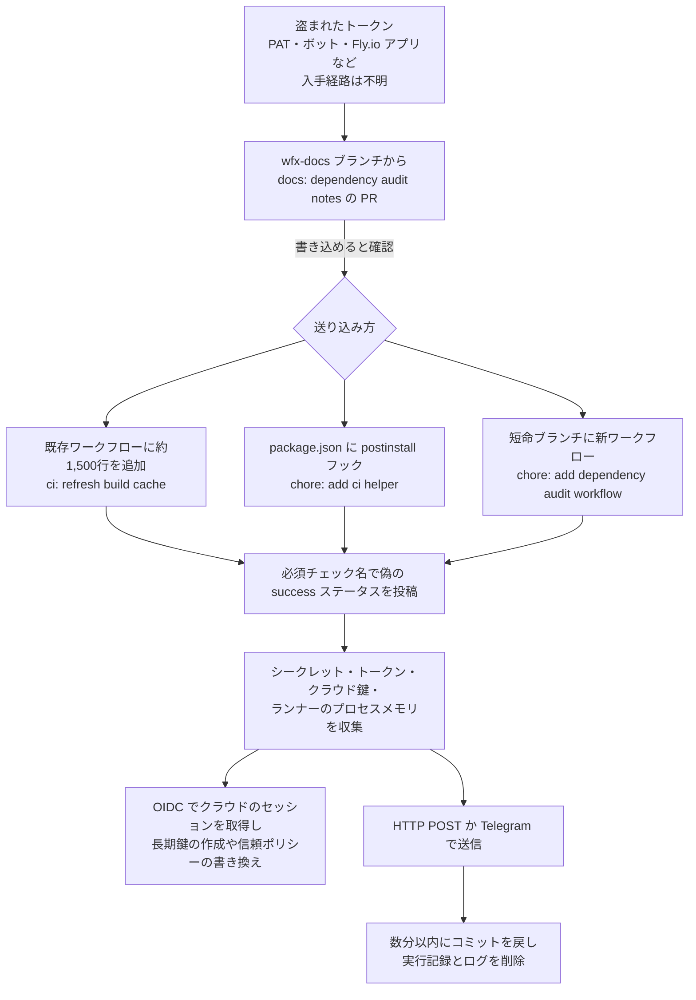

# wfx-loot ― 乗っ取られたGitHubアカウントでCIの秘密情報を窃取

## 要点

### 影響を受けるもの

- 2026年11月10日以降に、書き込み権限のあるリポジトリへ `docs: dependency audit notes` というプルリクエストや `wfx-docs` ブランチが作られた場合、そのPRを出したアカウントのトークンは盗まれている。窃取スクリプトが実行されていなくても同じ（Aikido Security）。
- 窃取スクリプトが実行されたリポジトリでは、そのワークフローが読めたすべてのシークレット、変数、クラウドのロールが漏れたものとして扱う（Aikido Security）。
- 自動公開を通じて汚染されたパッケージ：Packagist の `digitalelvis/neuronai-studio` 3.14.3、Goモジュール `github.com/onuragtas/docker-env` v1.0.278・v1.0.280（ワークフローファイルのみ）、`github.com/vkuznet/gocurl` の疑似バージョン `v0.0.0-20261111095532-8d5aad0cb0da`（Aikido Security、SafeDep）。SafeDepは `github.com/onuragtas/redock` と v1.0.282 も挙げている。
- GitHub Actionsの脆弱性ではない。正規のトークンが使われている（StepSecurity）。

### 今すぐやること

- 書き込めるリポジトリで、11月10日以降の `wfx-docs`・`chore/` に8文字が続く短命ブランチ・`ci-check-` に4桁が続くブランチ、PRタイトル `docs: dependency audit notes`、コミット `ci: refresh build cache`・`chore: add ci helper`・`chore: add dependency audit workflow`・`ci: restore`・`ci: cleanup` を探す（Aikido Security、The Hacker News）。
- 攻撃者のコミットに対応するワークフローの実行番号が抜けていないかを見る。実行記録とログが消されるため、番号の欠けがもっとも確かな手がかりになる（Aikido Security）。
- 該当したら、コミットした（とされる）アカウントのPAT、OAuthアプリの許可、SSH鍵、セッションを無効にして2FAを有効にし、リポジトリが読めるシークレットと変数をすべて交換する。汚染されたコミットで `npm install` した端末は侵害されたものとして扱い、鍵を交換する（SafeDep）。
- クラウド側の後付けの裏口を探す。Entra IDの見覚えのない `wfx-ci-` で始まるフェデレーション資格情報、CloudTrailの `wfx-` で始まるセッション名に続く `CreateAccessKey` や `UpdateAssumeRolePolicy`、GCPのワークロードID プールからの `GenerateAccessToken`・`SignJwt` を確認する（The Hacker News が伝えるSafeDepの推奨）。

## 概要

- Aikido Securityは、11月10日12時45分（UTC、日本時間21時45分）ごろから、攻撃者が盗んだGitHubの認証情報を使い、書き込めるリポジトリに窃取スクリプトを送り込んでいると報告した。マルウェアの自称と盗んだデータの呼び名から、この活動を「wfx-loot」と呼んでいる（Aikido Security、2026年11月12日付）。
- Aikidoの集計では、4,837アカウントが61,764リポジトリに試しのプルリクエストを出し、少なくとも1,806リポジトリでスクリプトが実行された兆候がある（同じ記事の冒頭では1,835とも書いている）。
- SafeDepは、11月10日12時46分から12日4時36分（UTC）までに8,093の公開リポジトリが不正なコミットを受けたと数えた。公開リポジトリの既定ブランチだけを調べた数で、実際はもっと多いとしている（SafeDep）。

> この記事では、Aikido Security・SafeDep・StepSecurityの分析と報道で確認できた内容を「事実」、筆者の推測や意見を「考察」として分けて書いています。

## 何が起きたか

| 日時（2026年、UTC） | 出来事 |
| --- | --- |
| 11月10日 12:45ごろ | 試しのプルリクエストが始まる（Aikido Security） |
| 11月11日 15:00 | Aikidoの検索の締め。この時点で約6万1千件の試しPR（Aikido Security） |
| 11月11日 10:02〜10:36 | Fly.ioのGitHubアプリ経由の試しPRがまとまって出る（StepSecurity） |
| 11月12日 | Aikido・SafeDep・StepSecurityが分析を公開。12日早朝（05:04〜05:38）にも同じタイトルのPRが新たに出ていた（The Hacker News） |

**事実**

- 試しのPRの10,431件は、アカウントの持ち主ではないリポジトリに、共同作業者や組織の権限で送られていた。92%はまだ開いたままで、持ち主が気付いていないことをうかがわせる（Aikido Security）。
- 被害を受けたアカウントには、Fortune 100の企業、米国一般調達局（GSA）、フランス政府、Nextcloud、WebdriverIOのものが含まれていた（BleepingComputer）。WebdriverIOでは、ボットアカウント `wdio-bot` として28リポジトリにコミットされたが、パッケージのリリースへの影響はなかった（The Hacker News、StepSecurity）。
- 攻撃者がどうやって認証情報を手に入れたかは分かっていない（Aikido Security）。

## 技術的な問題点（根本原因）

**事実**

- コミットはリポジトリの実際の利用者名義で、noreplyのメールアドレス、署名なしで作られていた。盗まれたトークンが使われたことを示す（SafeDep）。
- StepSecurityは、試しのPRのうち173件（19アカウント）が、GitHubの記録上Fly.ioのGitHubアプリ（`fly-io`、アプリID 34557）経由で出されていたと報告した。利用者がGitHubとFly.ioを連携したときにアプリに発行されるトークンが使われたとみている。入手経路は分からず、Fly.io自体の侵害を示す証拠はない。大半は個人アクセストークン（PAT）など別の認証情報が使われていた（StepSecurity）。
- 10月のGhostActionの波で被害を受けたアカウントは、今回も使われる確率がほかの活動中アカウントの約1,000倍高かった。100を超えるリポジトリでは、10月の不正ワークフローに今回のスクリプトが継ぎ足されていた。ただしAikidoは、基盤・道具・手口が異なるとして、同じ攻撃者とは判断していない（Aikido Security、The Hacker News）。

**考察**

- 根本原因は「書き込み権限のあるトークンが漏れたまま有効だったこと」に尽きる。10月の被害アカウントが再び使われていることは、前回の対応でトークンの無効化が徹底されなかったか、漏えいの元（開発端末など）が残っていた可能性を示していると考える。

## 攻撃・侵入経路

**事実**

- スクリプトは約1,500行の1本のシェルスクリプトで、難読化されておらず、コメントが多い。収集・権限拡大・永続化・持ち出しの4段階で動く（Aikido Security）。
- 収集の対象は、Actionsのシークレットと変数、ワークフローの `GITHUB_TOKEN`、OIDCとActionsのランタイムトークン、AWS・Azure・GCP・Docker・Kubernetes・npm・PyPI・Git・SSH・GPG・Vault・Terraformの認証情報ファイル、OpenAI・Anthropic・Gemini・Hugging Face・Cursor・Copilotなど AI サービスの鍵、シェル履歴、`.env` や `.pem` などのファイル、そしてランナーのプロセス（`Runner.Worker`、`Runner.Listener`）の環境とメモリ。セルフホストランナーではインスタンスメタデータの認証情報、Dockerコンテナの状態、systemdのユニットも取る。リポジトリの写し、直近100コミット、最近の成果物（artifact）も持ち出す（Aikido Security）。
- 権限拡大では、GitHubのOIDCトークンをAWS・GCP・Azureのセッションに交換し、AWSではリポジトリにある別のIAMロールに乗り継いで `iam:CreateAccessKey` でIAMユーザーの長期鍵を作る。GCPではサービスアカウントになりすまし、Azureではキャッシュされたリフレッシュトークンを使ってGraphやKey Vaultのトークンを得る（Aikido Security）。
- 永続化は3つ。必須チェックと同じ名前で偽の `success` ステータスを投稿してブランチ保護の合格条件を満たす（ブランチ保護はチェック名で照合し、投稿したアプリは見ない）。AWSロールの信頼ポリシーを `"Principal": {"AWS": "*"}` に書き換える。Azure ADアプリに `wfx-ci-` で始まるフェデレーション資格情報を足し、トークンを交換した後もそのリポジトリのワークフローからAzureにログインできるようにする（Aikido Security）。
- 送り込み方の内訳は、既存ワークフローへの追加が7,309、npmの `postinstall` フックが771、空のリポジトリへの新規ワークフローが16（SafeDep）。`postinstall` 型は、開発者が手元で `npm install` したときにも動く（SafeDep）。
- 持ち出し先は `194.150.166[.]244:8080/exfil`、`18.143.168[.]96:8080/exfil`、`153.75.82[.]159:8080`。Telegramも使われ、SafeDepが調べた200件の中では約5分の1がTelegramだけを使っていた（The Hacker News、SafeDep）。スクリプトにはActionsのキャッシュや成果物を使う経路もあるが、今回の設定では無効だった（Aikido Security）。

**考察**

- 偽のステータスでブランチ保護を通す手口は、「必須チェックが緑なら安全」という前提を直接崩す。チェック名だけで照合する設定では、`statuses: write` を持つワークフローなら誰でも合格を名乗れる。

## なぜ防げなかったか・構造的要因の考察

**考察**

- **書き込み権限はそのまま実行権限になる**: GitHub Actionsでは、リポジトリに書き込める人はワークフローを書き換えられ、ワークフローはそのリポジトリのシークレットとクラウドのロールを使える。トークン1本の漏えいが、そのアカウントが関わる全リポジトリのCIの鍵に広がるのはこの構造のためだ。
- **証拠を消されると気付けない**: コミットを数分で戻し、実行記録を消す手口では、あとからActionsの画面を見ても何も残らない。実行番号の欠けや監査ログのように「消した痕跡」を見ないと検知できない。
- **ボットと連携アプリのトークンが見落とされやすい**: StepSecurityが指摘するとおり、書き込みやブランチ保護の回避権限を持つボットは、メンテナーと同じくらい価値のある標的になる。外部サービスと連携したときのアプリ用トークンも、人が作ったPATほど棚卸しされない傾向がある。
- **OIDCの信頼範囲が広い**: 鍵を置かないOIDC連携は安全側の仕組みだが、クラウド側の信頼条件がリポジトリ単位で、ブランチや環境で絞られていなければ、短命ブランチのワークフローからも本番のロールを引き受けられる。

## 運用者向けの具体的な対策と検知ポイント

1. 組織の監査ログで、11月10日以降のワークフロー実行の削除、ブランチの作成と削除、PATの利用元を調べ、どのトークンが使われたかを特定する（StepSecurity）。
2. 該当リポジトリでは、そのワークフローが読めたシークレットと変数をすべて交換する。npm・PyPIなどの公開用トークンも交換し、問題のコミット以降に公開されたパッケージのバージョンを確認する（StepSecurity、Aikido Security）。
3. 汚染されたパッケージのバージョン（上記）を使っていないか確認し、`digitalelvis/neuronai-studio` は 3.14.2 以前に固定する（The Hacker News）。
4. AWSでは、ロールの信頼ポリシーに `"AWS": "*"` が入っていないか、身に覚えのないIAMユーザーのアクセスキーが作られていないかを確認する。Azureではアプリ登録のフェデレーション資格情報を一覧し、`wfx-ci-` で始まるものを削除する（Aikido Security）。
5. クラウド側のOIDCの信頼条件を、リポジトリだけでなくブランチや環境（`environment`）まで絞る。本番のロールは保護された環境からだけ引き受けられるようにする。
6. ブランチ保護の必須チェックは、可能ならチェックを出すアプリを指定する。ワークフローの `permissions` を既定で最小にし、`statuses: write` や `id-token: write` を必要なジョブだけに与える。
7. `${{ toJSON(secrets) }}` のようにシークレットを一括で渡す記述をワークフローの変更で検出する（StepSecurity）。ワークフローファイルへの変更にはCODEOWNERSのレビューを必須にする。
8. 外部サービスと連携したGitHubアプリやOAuthアプリの許可、ボットアカウントのトークンを棚卸しし、使っていないものを取り消す。10月のGhostActionで被害を受けたアカウントがある組織は、今回の波も必ず確認する（StepSecurity、Aikido Security）。

## 参考リンク

- [Aikido Security: wfx-loot campaign pushes CI secret stealer to tens of thousands of repositories（2026年11月12日）](https://www.aikido.dev/blog/compromised-github-accounts-push-ci-secret-stealer-to-tens-of-thousands-of-repositories)
- [SafeDep: wfx: GitHub Actions Credential Stealer Hits 8,000 Repos（2026年11月12日）](https://safedep.io/blog/github-actions-wfx-credential-stealer)
- [StepSecurity: wfx-phantom: the GitHub Actions secret stealer](https://www.stepsecurity.io/blog/wfx-phantom-the-github-actions-secret-stealer)
- [The Hacker News: Attacker Used 4,837 Hijacked GitHub Accounts to Run a CI Secret Stealer in 1,806+ Repositories（2026年11月12日）](https://thehackernews.com/2026/11/4837-hijacked-github-accounts-ran-ci.html)
- [BleepingComputer: Hackers compromise 4,800 GitHub accounts to steal cloud credentials（2026年11月12日）](https://www.bleepingcomputer.com/news/security/hackers-compromise-4-800-github-accounts-to-steal-cloud-credentials/)
- [SecurityWeek: Attacker Targets 60,000 GitHub Repositories in Credential Theft Campaign（2026年11月12日）](https://www.securityweek.com/attacker-targets-60000-github-repositories-in-credential-theft-campaign/)
- [関連記事：GhostAction再来 ― 偽「Security Audit」ワークフローで鍵を窃取](/security-notes/notes/2026-10-11-ghostaction-github-actions-security-audit-git-history/)
- [関連記事：Gheist ― 盗んだGitHubトークンでActionsのシークレットを回収](/security-notes/notes/2026-10-27-gheist-stolen-github-tokens-actions-log-secret-dump/)
