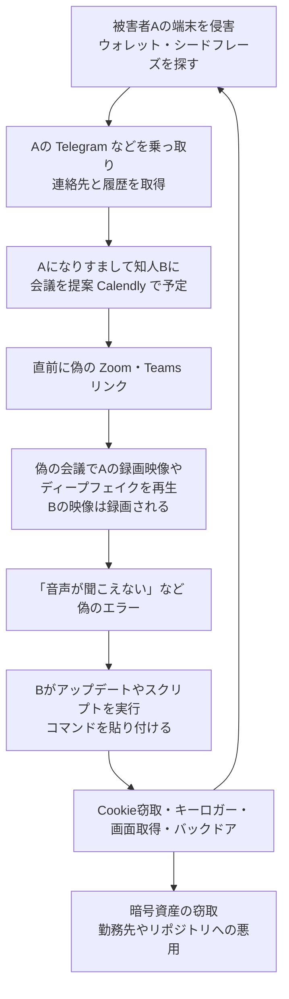

# FaceStealer ― 偽のビデオ会議で暗号資産を窃取、FBIが基盤を押収

## 要点

### 影響を受けるもの

- 脆弱性ではなく、人をだまして自分でマルウェアを実行させる手口。暗号資産・Web3業界の人と、オープンソースソフトウェアの開発者・メンテナーが主な標的（FBI）。
- 知っている相手のTelegram、LinkedIn、Slack、Discordのアカウントから届いた会議の誘いでも、そのアカウントが乗っ取られている可能性がある（FBI）。
- 偽の会議に入った時点で、自分のWebカメラの映像が録画され、次の標的をだます材料にされる（FBI）。
- 盗まれたシードフレーズを使って、侵害から数か月〜1年以上たってから暗号資産が盗まれた例がある（FBI）。

### 今すぐやること

- ビデオ会議には、リンクからWeb版に入るのではなく、公式アプリと招待コードで参加する。会議中に「音声が聞こえない」などと言われても、スクリプトの実行やコマンドの貼り付けはしない（FBI）。
- 誘ってきた相手と会話できるまでカメラをオンにしない。予定は、誘いが来たのとは別の手段（電話やSMSなど）で本人に確かめる（FBI）。
- 通信アプリに多要素認証とログイン通知を設定し、消えるメッセージを使う（FBI）。
- 侵害が疑われるときは、関わっていない端末で新しいウォレット（新しいシードフレーズ）を作って資産を移し、通信アプリと開発者アカウントのパスワード変更・全セッションのログアウト・多要素認証の追加を行い、知人と勤務先に知らせる（FBI）。

## 概要

- 米連邦捜査局（FBI）は2026年11月12日、北朝鮮の国家支援の攻撃者による「FaceStealer」と呼ぶソーシャルエンジニアリングについて、注意喚起（FLASH AC-111226-MS）を出した。過去18か月で4億ドルを超える暗号資産が盗まれたとしている（FBI）。
- 同日、米司法省は、FaceStealerに使われたクラウド基盤を押収したと発表した。FBIは令状に基づき、被害者のWebカメラ映像900本超を差し押さえた（米司法省）。
- 司法省は同じ発表で、10月29日ごろのBinanceからの60億ドル超の窃取（TraderTraitor）について、27億ドル超が凍結され、うち12億ドル超の押収・保全を裁判所に認められたことも明らかにした（米司法省）。

> この記事では、FBIの注意喚起、米司法省の発表、Arctic Wolfの分析と報道で確認できた内容を「事実」、筆者の推測や意見を「考察」として分けて書いています。

## 何が起きたか（時系列）

| 日付（2026年） | 出来事 |
| --- | --- |
| 4月 | Arctic Wolfが、BlueNoroffによる偽のZoom・Teams会議とClickFixの手口を報告。攻撃者のメディア置き場から400人超の標的（20か国超）を確認（Arctic Wolf） |
| 4月16日 | MicrosoftがSapphire SleetのmacOS侵入を分析した記事を公開（FBIの注意喚起で参照） |
| 今年前半 | 週に数千万回ダウンロードされるJavaScriptライブラリのメンテナーが偽のTeams会議でマルウェアに感染し、不正な依存パッケージが仕込まれた（FBI）。The Hacker Newsはこれをnpmパッケージ「Axios」の件としている |
| 10月29日ごろ | TraderTraitorがBinanceから60億ドル超を窃取（米司法省） |
| 11月12日 | FBIが注意喚起を公開し、司法省が基盤の押収を発表。Arctic Wolfが続報「Still in the Meeting: BlueNoroff Six Months On」を公開 |

**事実**

- FBIはこの活動を、Sapphire Sleet、UNC1069、Dangerous Password、CryptoCore、APT38、BlueNoroff、Stardust Chollimaの名で知られる北朝鮮の攻撃者によるものとしている（FBI）。
- 押収したクラウド基盤の中身や規模は、発表には書かれていない。

## 技術的な問題点（根本原因）

**事実**

- 入り口は、すでに乗っ取った被害者のTelegramなどのアカウント。攻撃者は被害者を締め出し、連絡先とチャット履歴を見て、過去のやり取りに合わせた誘い（「近況を話したい」「協業」「投資の話」）を知人に送る（FBI）。
- 予定はCalendlyなどで決め、会議の直前に偽のZoom・Teamsのリンクを送る。例として `uu01webzoom[.]us`、`teams.livemeet[.]us` が挙がっている。予定の招待には会議のリンクを入れず、直前に送ることで基盤が見つかりにくくしている（FBI）。
- 偽の会議では、以前の被害者（標的の知人）の録画映像や、ほかの参加者の映像を流して、複数人が参加しているように見せる。暗号資産業界の著名人の映像を生成AIで作ったディープフェイクも使い始めているが、FBIは今も主に本物の被害者の映像に頼っているとしている（FBI）。

**考察**

- この手口の核心は、技術ではなく「知っている人のアカウントから、知っている人の顔で」という二重の信頼を使う点にある。1人の被害者が、次の標的への誘い（アカウント）と信用（映像）の両方を提供してしまう循環になっているため、被害が連絡先の網をたどって広がると考える。

## 攻撃・侵入経路

**事実**

- 会議に入って少したつと、なりすまされた知人から「あなたの音声が聞こえていない」などのメッセージが届き、更新のリンクを押す、スクリプトを実行する、コードをターミナルに貼り付けるよう誘導される。ほかの偽の参加者がいることで、「自分だけが問題を起こしている」と思わせる（FBI）。
- 実行されると、ブラウザのCookie収集、キーロガー、画面取得、バックドアが入る（FBI）。
- Arctic Wolfは、攻撃者のメディア置き場を引き続き見られる立場から、標的の数が677人（58か国）に増え、84％が創業者や経営幹部だったと報告した。これは攻撃者が素材を用意していた人数で、侵害が確認された人数ではない（Arctic Wolf）。
- 誘いの種類も増えた。共有された財務資料、PDFビューアーの更新、偽のメディアプレイヤー、本人確認、ハードウェアウォレットへのアクセス、セキュリティ監査などを装う。偽のChrome PDFビューアーの例では、macOSではAppleScriptがダウンロードされ、WindowsとLinuxでは偽の更新サイトから取得するコマンドを実行させていた（Arctic Wolf）。
- 偽の映像は、YouTubeのインタビューや講演を画面録画して作ったものもあり、標的本人を侵害しなくても素材を作れるようになった。Google Generative AI、Grok Imagine、Wondershare AIGC、GPT-4oを組み合わせて作られ、見た目だけでは本物のWebカメラ映像と区別できない、とArctic Wolfは書いている（Arctic Wolf）。
- 一方でArctic Wolfは、侵入そのものの仕組みは半年前とほとんど変わっておらず、最後は利用者に手で何かを実行させる段階に頼っていると指摘している（Arctic Wolf）。

## なぜ防げなかったか・構造的要因の考察

**考察**

- ビデオ会議は「顔が見えれば本人」という前提で使われてきた。録画映像の流用と生成AIでこの前提が崩れた以上、会議の映像を本人確認の手段として扱うことはできない。FBIが「別の手段で本人に確かめる」ことを推奨しているのはこのためだと考える。
- 偽のエラーから修正コマンドを実行させるClickFix系の手口は、技術的には単純だが、会議の開始直後という急いでいる場面と、知人から言われる状況が重なると、熟練者でも実行してしまう。FBI自身が「経験豊富で慎重な利用者でもだまされる」と述べている。
- オープンソースのメンテナーが狙われているのは、1人の端末から何百万の利用者へ届く経路を握れるからだ。メンテナーの個人端末とパッケージ公開の権限が同じ場所にある限り、この手口は供給網の攻撃として成立し続けると考える。
- シードフレーズを盗んでから、残高が増えるまで何か月も待つという点も重要だ。侵害に気付いて端末をきれいにしても、ウォレットを作り直さなければ後から盗まれる。

## 運用者向けの具体的な対策と検知ポイント

- 会議は公式アプリと招待コードで参加し、Web版へのリンクを直接開かない。予定の招待に会議リンクがなく、直前にチャットでリンクが届く形は警戒する（FBI）。
- 会議中の「更新」「修正」の指示でスクリプトやコマンドを実行しない。必要なら通信アプリ自体を別途更新する（FBI）。Arctic Wolfも、コマンドやスクリプト、ショートカットの実行を求められたら、どれほど本物らしくても危険信号とみなすよう勧めている。
- ブラウザ拡張のウォレットには少額だけを置き、多額は接続しない物理的なウォレットか取引所に置く。シードフレーズや秘密鍵を端末に保存しない（FBI）。
- 検知の手がかりとして、Arctic Wolfは、PowerShell、curlの出力をシェルに渡す実行、osascriptの実行パターンを挙げている。macOSで会議やPDFの閲覧の直後に `osascript` や `curl | sh` 系の実行が起きていないかを見る（Arctic Wolf）。
- 開発組織（考察）：パッケージの公開を、メンテナー個人の端末のトークンではなく、CIの信頼できる公開（OIDC）や公開前の承認に寄せる。採用面接や外部との打ち合わせで渡されたコードは、使い捨ての仮想マシンでしか開かない。
- 被害を受けたら、IC3.govに「FaceStealer」のキーワードで報告する（FBI）。指標（IOC）はArctic Wolf、JUMPSEC、Microsoftの報告にまとまっている（FBI）。

## 参考リンク

- [FBI FLASH: North Korean Hackers Use Secretly Recorded Webcam Library of 900+ Tech Workers in $400M "FaceStealer" Crypto Theft Scheme（AC-111226-MS、2026年11月12日、PDF）](https://www.ic3.gov/CSA/2026/261112.pdf)
- [FBI: FaceStealer Cryptocurrency Theft Scheme](https://www.fbi.gov/investigate/cyber/facestealer-cryptocurrency-theft-scheme)
- [米司法省: Justice Department Announces Actions to Disrupt North Korea's Massive Theft of Cryptocurrency（2026年11月12日）](https://www.justice.gov/opa/pr/justice-department-announces-actions-disrupt-north-koreas-massive-theft-cryptocurrency)
- [Arctic Wolf: Still in the Meeting: BlueNoroff Six Months On（2026年11月12日）](https://arcticwolf.com/resources/blog/still-in-the-meeting-bluenoroff-six-months-on/)
- [The Hacker News: FBI Says North Korean Hackers Stole Over $400 Million in Crypto Using Deepfake Video Calls（2026年11月13日）](https://thehackernews.com/2026/11/fbi-says-north-korean-hackers-stole.html)
- [関連記事：Binance ― ホットウォレットから暗号資産が大量流出](/security-notes/notes/2026-10-31-binance-hot-wallet-signing-eip-7702-tradertraitor/)
