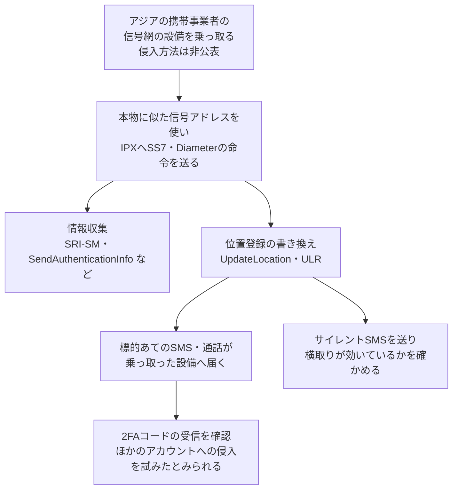

# SilentAir ― 乗っ取った携帯事業者の設備からSMSを横取り

## 要点

### 影響を受けるもの

- 製品の脆弱性ではない。携帯事業者どうしが信号をやり取りする国際網（IPX）上で、乗っ取られた事業者の設備からSS7・Diameterの攻撃が送られていた（Enea）。
- 主な標的は台湾の加入者。ほかに東南アジア・東アジア、ときに東アフリカ、中央アジア、中東、欧州の加入者も狙われ、政治・政府の要人が含まれていた（Enea）。
- 一部の標的では、SMSの横取りが成立した直後に2要素認証（2FA）のコードが届いていた。乗っ取られたアカウントがあるかどうかは報告されていない（Enea、The Hacker News）。
- Eneaは事業者名・国名・標的を公表していない。

### 今すぐやること

- 携帯事業者は、SS7・Diameterのファイアウォールに加えてGTP-CとGTP-Uのファイアウォールを置き、互いに情報を共有させる。IPX全体を信頼できない網として扱う（Enea）。
- 事業者は、自社網の内部でも信号プロトコルの検知を入れ、信号網のセキュリティを通常のITセキュリティの監視とつなぐ（Enea）。
- 利用者側（考察）：SMSで届く2FAコードは、国をまたぐ信号網の攻撃で横取りされうる。重要なアカウントは、認証アプリやパスキーなどSMSに頼らない方式に切り替える。

## 概要

- 通信向けソフトウェアのEnea（スウェーデン）は、2026年11月11日付のブログで、携帯事業者の内部に入り込んで信号網の攻撃を行う新しいグループを「SilentAir」と名付けて報告した。国家レベルの攻撃者と高い確度で判断し、中国系の活動とは低い確度で結び付けている（Enea）。
- SilentAirは、乗っ取った設備から相手の加入者の位置登録を書き換える命令を送り、その人あてのSMSや通話を自分の側へ回させていた（Enea）。
- 同じ報告で、既知のグループLIMINAL PANDAが2026年第1四半期から複数の事業者でGTPDoorを使っていたこと、GTP-Uに命令を隠す新版が見つかったことも明らかにした（Enea）。

> この記事では、Eneaの報告と、それを伝えた報道で確認できた内容を「事実」、筆者の推測や意見を「考察」として分けて書いています。

## 何が起きたか（時系列）

| 時期 | 出来事 |
| --- | --- |
| 2025年初めより前 | 後の分析で、SilentAirによるとみられる不審な活動がこの時期からあったと判明（Enea） |
| 2025年初め | Eneaが、ふだん攻撃を送らないはずのアジアの事業者から来る異常な信号網攻撃（主にSS7、ときにDiameter）を追い始める（Enea） |
| 2026年第1四半期 | Eneaが顧客の複数事業者で、GTPファイアウォールによりLIMINAL PANDAのGTPDoor通信を検知・遮断し始める（Enea） |
| 2026年7月 | POST Luxembourgが、GTP-C上のGTPDoorの活動を検知したと公表。GTP-Cでの活動の初の公表例（Enea） |
| 2026年11月11日 | EneaがLIMINAL PANDAとSilentAirの報告を公開（12日に要点の節を追加） |

**事実**

- Eneaは、SilentAirが仕込まれた事業者に知らせ、LIMINAL PANDAに感染した顧客の事業者とともに除去にあたった。両グループの活動は現時点では妨げられたが、戻ってくる可能性があるとしている（Enea）。
- 乗っ取られた設備が片付いたかどうかは、報告には書かれていない（The Hacker News）。

## 技術的な問題点（根本原因）

**事実**

- 携帯事業者は、ローミングや通話・SMSの転送のために、SS7（2G・3G）、Diameter（4G）、GTP（データ通信）などの信号をIPXでやり取りしている。IPXは事業者、ローミングハブ、信号の中継業者などが互いを高く信頼することで成り立っている（Enea）。
- SilentAirは、SS7の `UpdateLocation`（Diameterでは `Update-Location-Request`）で、標的の加入者がいま乗っ取った設備の圏内にいると相手の事業者に伝えていた。受け入れられると、その人あてのSMSや通話が攻撃者側に届く（Enea）。
- 当初Eneaは、外部から事業者の信号アドレス（Global Title）を偽っている可能性と、事業者の内部の設備が乗っ取られている可能性の両方を考えた。その後、ある事業者の内部の設備が攻撃の命令を送り、応答も受け取る様子を見て、内部が侵害されていると確認した（Enea）。
- 封じ込めの後に不正アクセスの痕跡は見つかったが、攻撃者の運用が慎重で、使われたとみられるプログラムは解析できなかった（Enea）。

**考察**

- 根本の問題は、信号網が「網の中にいる相手は正しい」という前提で作られていることだと考える。位置登録の書き換えは本来のローミングの仕組みそのもので、送り主が本物の事業者の設備である以上、受け取る側が形式だけで偽物を見分けるのは難しい。

## 攻撃・侵入経路

**事実**

- SilentAirの攻撃の内訳は、情報収集7.21％、横取り（位置の書き換え）18.30％、位置追跡0.22％、その他（主にサイレントSMS）74.27％だった。Eneaが以前調べた一般的な監視企業では、情報収集61.89％、横取り2.07％、位置追跡30.90％で、性格が大きく違う（Enea）。
- 情報収集には、SS7の `SRI-SM`・`RestoreData`・`SendAuthenticationInfo`、Diameterの `AIR` を使い、加入者の識別子を確かめて認証用の情報を引き出していた。Eneaは、得た認証情報が偽の基地局を使った傍受に使われうるとしている（Enea）。
- 攻撃は数か月の空白を挟んで集中的に行われ、1回の集中は1人から、1か月で数千人に及ぶものまであった。要人を狙うときには、別の国の乗っ取られた設備が連携することがまれにあり、Eneaは1つの指令元がいるとみている（Enea）。
- サイレントSMS（端末に表示も通知もされないSMS）を大量に送っていた。昼は他国の網の加入者に送って横取りが成立したかを確かめる使い方が中心だった。夜中は主に台湾の加入者あてで、目的は確認されていないが、端末が本来の位置に戻りにくい夜間に横取りが続いているかをまとめて確かめている可能性があるとEneaはみている（Enea）。
- サイレントSMSには「Wishing you endless energy and wellness!」のような、迷惑メッセージ風の英文が入っていた。途中の事業者がサイレントの設定を外して端末に表示されても、受け取った人が迷惑メッセージとして無視するよう偽装したものとEneaは考えている（Enea）。

## 帰属についての手がかり

**事実**

- Eneaが中国系と結び付ける根拠は、台湾に集中し中国の網や加入者を狙っていないこと、攻撃の時間帯がUTC+8（中国標準時）の勤務時間（午前9時開始、週末はほぼ止まる）と合い、中国の休日に止まったり減ったりしたこと、標的に要人が含まれていたことなど。確度は低いとしている（Enea）。
- LIMINAL PANDAとの関係は「あり得るが確認できない」。SilentAirの攻撃が、同じ事業者でLIMINAL PANDAが感染していた時期と重なることがあった。一方で、LIMINAL PANDAが使うとされるカーネルレベルのトロイの木馬SCTPE（シンガポールIMDAの資料ではSIGweaver）は自分が送った取引にしか応答できないが、SilentAirは自分が始めていない取引にも応答していた。運用の慎重さも違うため、Eneaは両者を結び付けていない（Enea）。

### LIMINAL PANDAとGTPDoorの新版

**事実**

- Eneaは2026年第1四半期から、顧客の複数の事業者でGTP-Cを使ったGTPDoorの通信を検知して遮断した。数百回の隠れた指令の試みを検知し、少なくとも5〜10の事業者で感染を直接見たか強い兆候を得た。世界で数十の事業者が感染している可能性があり、アジア、アフリカ、中南米が中心だとみている（Enea）。
- GTPDoorを通じた命令には、情報を持ち出すトンネルの開始・停止、横展開のためのほかのバックドア（主にEchoBackdoor）への命令の受け渡し、SSHコマンドの起動、ファイル削除やタイムスタンプ改ざんによる痕跡消しなどがあった（Enea）。
- 新たに見つかった版（Eneaの呼び名でGTPDoor v3、GTP-U-Door）は、利用者のデータを運ぶGTP-Uの中に命令を隠す。GTP-Uは通信量がGTP-Cより桁違いに多く、中身の検査が難しい。受信にlibpcapを使うようになり、`netstat` や `lsof` に出なくなった（Enea）。Eneaは、ほかの手段がふさがれたときの予備として使われているとみている。

## なぜ防げなかったか・構造的要因の考察

**考察**

- 1つの事業者に入れば、IPXを通じて世界の800を超える事業者に命令を送れる、とEneaは書いている。信号網の安全は「一番弱い事業者」で決まるという構造で、各事業者の自社対策だけでは防ぎきれない。
- 業界の推奨に沿ったSS7・Diameterのフィルタは、外部からの偽装を想定している。今回のように本物の事業者の設備から、しかも正しく応答する形で送られると、推奨どおりの検査だけでは見逃しやすいと考える。Eneaが「業界の推奨はゴールではなく出発点」と強調しているのはこの点だろう。
- Eneaは、コア網の運用をベンダーに委託している事業者が多く、調査が難しくなっていると指摘している。運用を外に出すと、網の中で何が動いているかを事業者自身が把握できないという問題が残る。
- 利用者から見ると、SMSの2FAは「携帯網が正しく届けてくれる」ことを前提にしている。今回のように国家レベルの攻撃者が網そのものを使うと、利用者の側では気付く手段がほぼない。要人や行政関係者のアカウントでSMS認証を残す理由はないと考える。

## 運用者向けの具体的な対策と検知ポイント

- GTP-CとGTP-Uのファイアウォールを置き、SS7・Diameterのファイアウォールと情報を共有させる。1つのプロトコルだけでは見えない攻撃が、複数を突き合わせると見える（Enea）。
- 業界推奨の検査に加え、それを超える分析を行う。IPX全体を信頼できない網とみなし、DNSやICMPを含めて国をまたぐ通信を深く調べる（Enea）。
- 自社網の内部でも、信号プロトコルを使った指令の中継や探索（SIGTRANslator、Cordscanなど）を検知できるようにする。内部では遮断よりもまず検知を置く（Enea）。
- 信号網のセキュリティを、SSHや共有認証情報の監視など通常のITセキュリティと統合する（Enea）。
- 自社の信号アドレスから、自社で始めていない取引への不自然な応答や、二重の応答が出ていないかを見る。Eneaはこれを手がかりに乗っ取られた設備を見つけた。
- Eneaが公開したハッシュ（MD5）：GTPDoor v3 `35f0d4d0c5519a2957338e448fce53bc`、SCTPE `da35d98c9a22e8ede93595d21fe7e63e`。
- 利用者・企業側（考察）：重要なアカウントの2FAをSMSから認証アプリやパスキーへ移し、SMSを本人確認や再設定に使う仕組みも見直す。

## 参考リンク

- [Enea: The Enemy Within. Tracking LIMINAL PANDA and SilentAir through Mobile Networks（2026年11月11日、12日更新）](https://www.enea.com/insights/the-enemy-within-tracking-liminal-panda-and-silentair-through-mobile-networks/)
- [The Hacker News: SilentAir Hijacks Asian Telecom Networks to Intercept SMS 2FA Codes and Spy on Taiwanese Users（2026年11月13日）](https://thehackernews.com/2026/11/silentair-hijacks-asian-telecom.html)
- [シンガポールIMDA：SIGweaverに関する資料（PDF）](https://www.imda.gov.sg/assets/23f23bba-57ca-42b6-92f8-90e207bf8c46.pdf)
