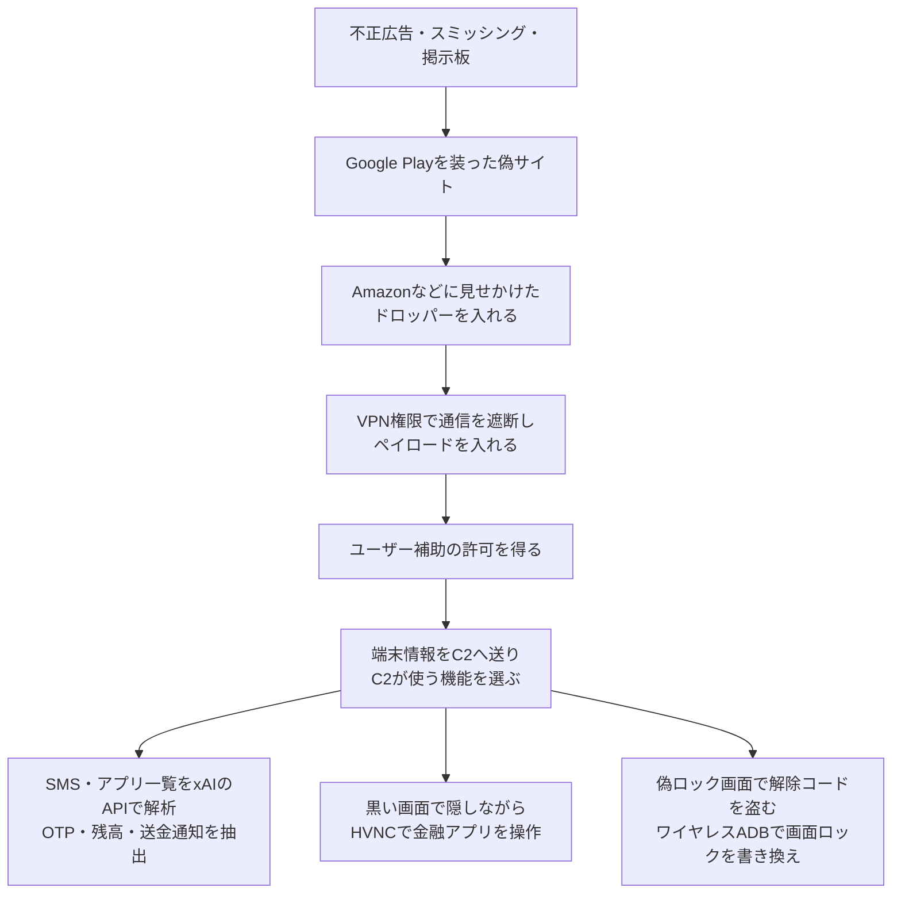

# ArcticRAT ― Android RATが盗んだSMSをAIで仕分け

## 要点

### 影響を受けるもの

- 製品の脆弱性ではない。Google Playを装った偽サイトなどから、Amazon、TikTok、ファイル管理、暗号資産アプリなどに見せかけたアプリを入れたAndroid端末が対象（Zimperium）。
- 配布経路は不正広告、SMSによるフィッシング（スミッシング）、外部の掲示板。AWSのバケットからペイロードが配られた例もある（Zimperium）。
- Zimperiumが確認したのは78検体（ドロッパー42、ペイロード36）、C2のIPアドレス21件（技術解説の節では17件）、命令129種類。バージョンはv6.3〜v6.5.2で、開発が続いている（Zimperium）。
- 被害者の数や国、運用者は公表されていない。

### 今すぐやること

- Androidでは、Google Play以外のサイトからアプリを入れない。「インストールを続けるにはVPNの許可が必要」と求めるアプリは入れない（考察。ドロッパーがVPN権限を要求するため）。
- ユーザー補助（アクセシビリティ）の許可を求めるアプリは、正当な理由がない限り許可しない。すでに許可しているアプリを設定画面で確認する（考察）。
- 企業のモバイル管理では、開発者向けオプションとワイヤレスデバッグを無効にし、提供元不明のアプリのインストールを禁止する（考察）。
- 金融・暗号資産の認証にSMSのワンタイムコードしか使えない場合は、認証アプリやパスキーなど別の方式に切り替える（考察）。

## 概要

- モバイルセキュリティ企業のZimperiumの研究チームzLabsは、2026年11月12日付のブログでArcticRATを報告した。名前は初期の検体のパッケージ名（`net.iceflow.arcticlink`、`net.frostlink.iceforge`）に由来する（Zimperium）。
- はじめは11種類の暗号資産アプリの利用者を狙うスパイウェアだったが、隠れたVNC（HVNC）による遠隔操作、キー入力の記録、画面の録画、マイクの盗聴、SMS・連絡先・通話履歴の窃取などを備えた遠隔操作型トロイの木馬（RAT）に発展した（Zimperium）。
- 2026年7月中旬ごろの検体から、LLM（大規模言語モデル）のAPIを使って盗んだデータから金融情報を自動で抜き出す機能が加わった（Zimperium）。

> この記事では、Zimperiumの報告と報道で確認できた内容を「事実」、筆者の推測や意見を「考察」として分けて書いています。

## 何が起きたか

**事実**

- AI機能では、C2サーバーが `xAI_API` 命令で端末にAPIキーを送り、あらかじめ組み込まれた2つのプロンプトを実行させる。1つ目はインストール済みアプリの一覧から銀行・暗号資産・投資のアプリを選び出す。2つ目は盗んだSMSから宣伝などを除き、ワンタイムコード、残高の変化、送金の通知を抜き出し、被害者の資産状況を推定してJSONにまとめる（Zimperium）。
- 動的解析では、xAIのAPIに `grok-4.20-0309-non-reasoning` モデルを指定して問い合わせていた。結果は端末の `/storage/emulated/0/config/AI_DATA/` にJSONで保存され、`Get_AI_ANA_Data` 命令で持ち出される（Zimperium）。
- Zimperiumは、同様のAI機能を以前報告したRatHatにも見ていた（Zimperium）。

**考察**

- LLMはここで「攻撃そのもの」ではなく、盗んだ大量のデータを仕分ける作業を肩代わりしている。人手で見ていた作業が自動化されると、感染端末が増えても運用者の手間は増えにくい。狙う相手を素早く絞り込めることが、AI導入の実利だと考える。
- APIキーはアプリに埋め込まれず、C2から後で配られる。キーが無効にされても差し替えられるつくりで、AI事業者側のキー停止だけで止めるのは難しいだろう。

## 技術的な問題点（根本原因）

**事実**

- ドロッパーは偽のインストール画面を見せながらVPNの権限を求め、すべての通信を端末内で行き止まりにするVPNを張る。Zimperiumは、これでGoogle Play プロテクトの通信を遮り、その間にペイロードを入れているとしている。入れ終わるとVPNを切る（Zimperium）。
- ペイロードはユーザー補助（Accessibility Services）の許可を得ると、画面上の入力欄からパスワードや認証コード、メッセージを読み取り、ボタンを自動で押して自分に権限を与え、アンインストールを妨げる（Zimperium）。
- 攻撃者がHVNCで銀行アプリを操作する間は、閉じられない真っ黒な画面を重ね、画面の明るさを0にする。被害者には端末がロック中か電源が切れているように見える（Zimperium）。
- 偽のロック画面でパターン・PIN・パスワードを盗み、`locksettings verify --old` で正しいかを裏で確かめる（Zimperium）。
- 新しい版は、Android 11で入ったワイヤレスデバッグを悪用する。mDNSでペアリング用のサービスを探して端末自身にADB接続し、その権限でユーザー補助を強制的に有効にしたり、`locksettings clear` や `locksettings set-pin` などで画面ロックを消したり書き換えたりできる。ペアリングの6桁コードは攻撃者がC2の操作画面から入力する（Zimperium）。
- 偽のランサムウェア画面も持つ。実際にはファイルを暗号化せず、進み続けるプログレスバーで脅すだけ（Zimperium）。

**考察**

- 個々の機能はAndroidの正規の仕組み（VPN、ユーザー補助、MediaProjection、ワイヤレスデバッグ）の組み合わせで、OSの脆弱性は使っていない。最初に利用者が権限を与えてしまうと、あとは正規の機能として動くため、OS側で止めにくい。
- ワイヤレスデバッグの悪用は、開発者向けの強い権限を「端末の中から端末自身へ」使うものだ。開発者向けオプションを一般利用者の端末で有効にしておく理由はほとんどない。

## 攻撃・侵入経路

**事実**

- 通信はTCPソケットで、主ポート9999、HVNC用8888、マイク用5000、画面配信用5055など、用途ごとにポートを分けている（Zimperium）。
- 感染直後に電池残量、画面の状態、Wi-Fi接続、壁紙などを送る。壁紙は実機であることの確認、つまりサンドボックス回避に使っているとZimperiumはみている。攻撃の機能は自動では動かず、C2が端末とアプリの状況を見て選ぶ（Zimperium）。
- C2のIPアドレスは約3分の2が香港、約20％がドイツにあった（Zimperium）。

## なぜ防げなかったか・構造的要因の考察

**考察**

- SMSのワンタイムコードは、端末を乗っ取られると本人確認の役割を果たさない。ArcticRATはそこにAIの仕分けを加え、どの被害者のどのコードに価値があるかを素早く見つけられるようにした。SMS認証を前提にした金融サービスほど影響を受けやすい。
- 「Google Playのように見えるページ」から入れさせる手口は古典的だが、利用者にとって本物との見分けは難しい。Android側で提供元不明のアプリに強い権限を渡す前の確認を増やすことは、利用者の判断に頼る部分を減らす方向として妥当だと考える。
- 汎用のAI APIが通常の開発者と同じ入口で使われており、リクエスト単体には不審な点がない。AI事業者の側で悪用を見つけるには、APIキー単位の利用パターンを見るしかないだろう。

## 運用者向けの具体的な対策と検知ポイント

- MDMで、提供元不明のアプリのインストール、開発者向けオプション、ワイヤレスデバッグを禁止する（考察）。
- ユーザー補助やVPNの権限を持つアプリを棚卸しし、業務で必要なもの以外を外す（考察）。
- 端末上の次のパスは感染の手がかりになる：`/storage/emulated/0/config/AI_DATA/`、`/config/System/`（キー入力）、`/config/Click_data/`、`/config/screenshot/`、`/config/phis_info/phish_logs.txt`（Zimperium）。
- 業務端末から `api.x.ai` など生成AIのAPIへ、業務で使っていないアプリが通信していないかを見る。Zimperiumも、アプリに組み込まれたLLMのAPI連携を検査対象に挙げている。
- C2への通信は9999、8888、5000、5055などの一般的でないTCPポートを使う。モバイル端末から外部のこうしたポートへの直接通信を監視・遮断する（Zimperium）。
- IOC（C2、ドロッパー、ペイロードのハッシュ、命令一覧）はZimperiumのGitHubで公開されている。
- 金融機関側（考察）：SMSのワンタイムコードに加え、端末の改ざんや画面共有・重ね表示を検知した場合に取引を止める仕組みを用意する。

## 参考リンク

- [Zimperium: Uncovering ArcticRAT: The Evolution from Targeted Crypto-Stealer to AI-Powered Android RAT（2026年11月12日）](https://zimperium.com/blog/arcticrat-ai-powered-android-rat)
- [Zimperium IOC: 2026-11-ArticRAT（GitHub）](https://github.com/Zimperium/IOC/tree/master/2026-11-ArticRAT)
- [Dark Reading: ArcticRAT Cybercrime Gang Profiles Victim Finances With AI（2026年11月13日）](https://www.darkreading.com/mobile-security/arcticrat-cybercrime-gang-profiles-victim-finances-ai)
