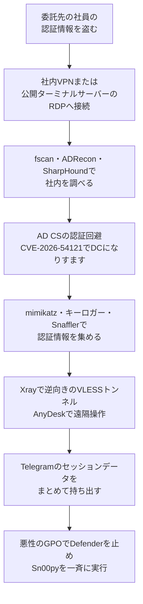

# Citrus Ransomware ― 委託先のアカウントを入口に社内を暗号化

## 要点

### 影響を受けるもの

- 製品の脆弱性が入口ではない。委託先（コントラクター）の社員の認証情報を盗み、被害組織の社内VPNや、インターネットに公開されたターミナルサーバーのRDPに接続していた（Kaspersky）。
- 権限昇格では、Active Directory証明書サービス（AD CS）に関する認証回避の脆弱性CVE-2026-54121（Certighost）の悪用を試みていた。古い脆弱性CVE-2020-1337のエクスプロイトも使われた（Kaspersky）。
- 1C:Enterpriseのサーバーの安全でない設定も狙われた（Kaspersky）。
- Kasperskyによると、Citrusはロシア語話者のグループで、ロシアの企業だけを攻撃している。被害組織の数や名前は公表されていない。

### 今すぐやること

- 委託先に渡しているVPN・RDPのアカウントを棚卸しし、多要素認証、接続元の制限、使う時間帯の制限をかける（考察。入口が委託先の認証情報だったため）。
- AD CSで、CVE-2026-54121の修正が当たっているかを確認する。`GHOST` で始まる8文字のランダムな英字のマシンアカウントが作られていないかを調べる（Kaspersky）。
- `ms-DS-MachineAccountQuota` を0にするなど、一般ユーザーがマシンアカウントを作れないようにする（考察）。
- セキュリティ製品の管理コンソールへの接続を、管理用の端末と多要素認証に限る。Citrusは管理コンソールを使って保護をまとめて無効にしていた（Kaspersky）。

## 登場する組織・サービス

- **Citrus**：Kasperskyが報告した、これまで知られていなかったランサムウェアのグループ。委託先の社員の認証情報を入口にし、社内の一斉設定（グループポリシー）で暗号化ソフトを配る（[Securelist](https://securelist.com/citrus-ransomware/121879/)）。
- **Sn00py**：Citrusが暗号化に使うランサムウェア。今回の報告で、この系統の暗号化が確認されている（[同](https://securelist.com/citrus-ransomware/121879/)）。
- **Kaspersky**：セキュリティ製品の開発と、攻撃の調査・公表を行う企業。今回、Citrusの手口を報告した側である（[同](https://securelist.com/citrus-ransomware/121879/)）。

## 概要

- Kasperskyは2026年11月11日付のSecurelistで、これまで報告のなかったランサムウェアのグループ「Citrus」の手口を公開した（Kaspersky）。
- 特徴は、XrayによるVLESSトンネルで通信を正規のHTTPSに見せかけること、Sn00py系のランサムウェアで暗号化すること、侵入の過程でLLMが作ったとみられるコマンドやスクリプトを使うこと（Kaspersky）。
- 手口はToy Ghoulsというグループと多くが共通し、同じ組織の中に両グループが同時に入り込んでいた例もあった。インフラは直接重なっていない（Kaspersky）。

> この記事では、Kasperskyの報告で確認できた内容を「事実」、筆者の推測や意見を「考察」として分けて書いています。

## 技術的な問題点（根本原因）

**事実**

- 侵入に使われた委託先のドメインアカウントは、Kasperskyが把握するどの事例でも権限がごく限られていた。そのためCitrusは権限昇格を試みた（Kaspersky）。
- CVE-2026-54121の悪用では、新しく作ったマシンアカウントの名前でAD CSに「Machine」テンプレートの証明書を要求する。要求の属性 `cdc` に攻撃者が管理するサーバー（例：91.210.109[.]118）を指定し、そこから偽のデータを返すことで、ドメインコントローラー名を `SubjectAlternativeName` に入れた証明書を発行させる。この証明書でドメインコントローラーのアカウントとして認証できる（Kaspersky）。
- マシンアカウント名（`GHOSTAUFTAFGS` など）は、GitHubで公開されたエクスプロイトのスクリプトが作るもの（Kaspersky）。
- 1C:Enterpriseのサーバーには、ADで高い権限を持つ保守担当者や管理者がよく接続するため、権限昇格と横展開がしやすいとKasperskyは指摘している。

**考察**

- 根本の問題は、委託先のアカウントが「権限は低いが社内には入れる」状態で外部から使えたことだと考える。権限が低くても、ADの中に入れればAD CSのような認証基盤への攻撃を試せる。入口の権限が低いことは安全の理由にならない。
- AD CSは証明書でドメイン全体の認証を左右できるため、一般ユーザーから証明書を要求できる構成のままだと、1つの脆弱性でドメイン全体を取られる。

## 攻撃・侵入経路

**事実**

- 調査には、fscan（RPC、NetBIOS、MS SQL、Proxmox VEのポート）、ADRecon、SharpHound、PowerShellのLDAP照会、`net group "Domain Admins"` などを使った（Kaspersky）。
- 横展開はSSH、WinRM、RDP。ツールの持ち込みにはcertutil、BITS、cURL、PowerShellを使った（Kaspersky）。
- Xrayの設定では443番ポートのVLESSサーバーを使い、REALITYで `mirror.yandex.ru` や `yastatic.net` への通信に見せかけていた（Kaspersky）。
- 暗号化の直前、ドメインコントローラーから `steal_tgs.ps1` を実行し、届く範囲の端末からTelegram Desktopの `tdata` とみられるデータを7-Zipで固め、Chromeで外部のWebサービスへアップロードしていた（Kaspersky）。
- 暗号化は、「Kaspersky GPO」という名前の悪性のグループポリシーで行った。ポリシーはランサムウェアの自己解凍ファイルを置いてタスクで実行させ、WinRMを有効にし、ボリュームシャドウコピーとWindows Defenderを止め、身代金要求の壁紙を設定する（Kaspersky）。
- Sn00pyはGoで書かれ、RSA-2048とChaCha20で利用者のファイルを暗号化し、拡張子 `.citrus` を付ける。設定の `host_blacklist` にはDC01〜DC04が入っており、ポリシーを配るドメインコントローラーを暗号化から外している。出力の文字列から、RaaS（ランサムウェアのサービス提供）として配られているとみられる（Kaspersky）。

### LLMの使い方

**事実**

- 管理者アカウントを無効にするコマンドや、ドメインの端末のセッションを調べるスクリプトに、攻撃者がふつう書かないコメントが付いていた。Kasperskyは、これらがLLMで作られた可能性が高いとみている。悪性GPOを作るPowerShellスクリプトにも、LLMで編集されたとみられるコメントがあった（Kaspersky）。

**考察**

- LLMは新しい攻撃手法を生んだのではなく、既存の手順を書く手間を減らしている。Kasperskyも、多くは既知のツールと手法なので早期の検知はしやすいと結論している。防御側がやるべきことは従来と変わらない。

## なぜ防げなかったか・構造的要因の考察

**考察**

- 委託先のアカウントは、被害組織の側で利用状況を見ていないことが多い。委託先の端末や認証情報の管理は委託先任せになりやすく、盗まれても被害組織は気づけない。Kasperskyも「委託先のアクセスは厳しく管理し制限する必要がある」と結んでいる。
- 攻撃者はセキュリティ製品の管理コンソールを乗っ取り、保護をまとめて止めていた。集中管理は防御を強くする一方で、取られると一度に全部を無効にされる。管理コンソールはドメインコントローラーと同じ重さで守る対象だと考える。
- ランサムウェアの配布にGPOを使うのは、ADを握った攻撃者の定番だ。ドメインコントローラーを暗号化対象から外す設定まで用意されており、ADを取られた時点で全社の暗号化までは短い。

## 運用者向けの具体的な対策と検知ポイント

- 委託先のVPN・RDPアカウントに多要素認証を必須にし、使わない期間は無効にする。ターミナルサーバーをインターネットに直接公開しない（考察）。
- ADで、`GHOST` で始まるマシンアカウントの作成、`cdc` 属性を含む証明書要求、Machineテンプレートの不審な発行を監視する（Kaspersky）。
- 「Kaspersky GPO」のような見覚えのないGPOの作成・リンク（`Import-GPO`、`New-GPLink`）や、SYSVOLへの実行ファイルの書き込みを検知する（Kaspersky）。
- `C:\ProgramData\` 直下の `xray.exe`、`webex.exe`、`sabycenter.exe`、`fscan.exe`、`Snaffler.exe`、`SharpHound.exe`、`steal_tgs.ps1`、`tdatas` ディレクトリなどはKasperskyが挙げた痕跡。キーロガーは `C:\ProgramData\Oracle\Java\jhost.exe` に置かれていた。
- 予定外のタスク名 `KasperskyAgentInstallTask`、`Sysvc`、`Java rpchost agent` や、Impacketのatexecによるランダムな8文字のタスク名を見る（Kaspersky）。
- `wevtutil` によるイベントログの消去、Defenderの除外リストへの追加、AnyDeskの `--silent` インストールを検知する（Kaspersky）。
- C2として挙げられた91.210.109[.]118と91.210.108[.]180への通信を確認する（Kaspersky）。
- 正規サイト名を装ったTLS（REALITY）は宛先のドメイン名だけでは見分けにくい。社内サーバーから外部の443番への長時間の常時接続など、通信の振る舞いを見る（考察）。

## 参考リンク

- [Kaspersky Securelist: Citrus Ransomware: VLESS for traffic, Sn00py for encryption, and LLMs lending a hand（2026年11月11日）](https://securelist.com/citrus-ransomware/121879/)
