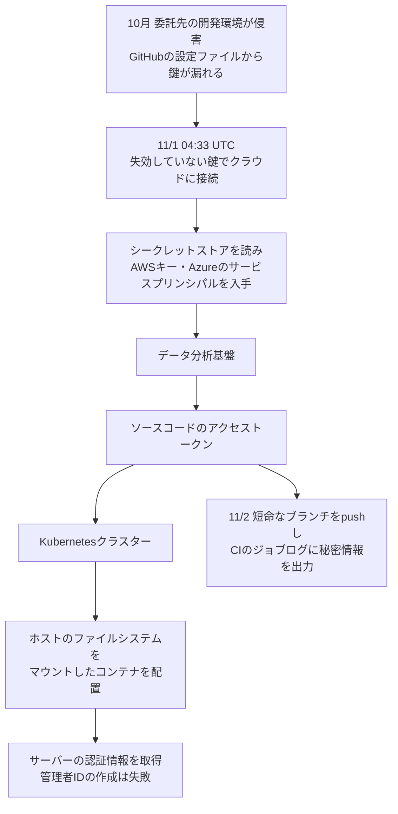

# Barracuda ― 回収し忘れた委託先のクラウド鍵で社内クラウドに侵入

## 要点

### 影響を受けるもの

- 製品の脆弱性ではなく、Barracuda社内のクラウド環境への侵入。入口は、過去の案件で委託先（AI関連の企業）に渡し、案件の終了後も失効させていなかった有効なクラウドのアクセスキーだった（Barracuda）。
- 侵入された環境の1つに、Barracuda XDRが顧客のMicrosoft 365やGoogle Workspace、エンドポイント製品などからデータを集めるための連携用認証情報を保管するシステムがあった。攻撃者は11月1〜2日にこのシステムに入れる状態だった（Barracuda）。
- 連携用認証情報が見られた直接の証拠は見つかっていないが、その環境のログが十分に細かくなかったため否定もできない、とBarracudaは説明している。対象は、Barracuda Managed XDR CloudまたはMonitored EndpointのAPI連携を使う組織のうち、個別に通知を受けた組織（Barracuda）。
- Barracuda ESGの脆弱性（CVE-2026-116606など）がほぼ同じ時期に悪用されていたが、今回の侵入には使われていないとみられる（Risky Bulletin）。

### 今すぐやること

- Barracudaから通知を受けた組織は、XDRの連携用認証情報を失効させて作り直し、2026年11月1日以降の連携先システムの操作ログを確認する（Barracuda）。
- 自社でも、委託先や外部サービスに渡したクラウドのアクセスキー・サービスプリンシパルを棚卸しし、案件が終わったものを失効させる（考察）。
- Barracudaが公表したIPアドレスやUser-Agent、`i` と数字だけの名前のリソースが自社のクラウドやGitHubにないか確認する（Barracuda）。

## 登場する組織・サービス

- **Barracuda**：メールの防御や、ネットワーク・クラウドのセキュリティ製品を提供する企業（[Barracuda](https://www.barracuda.com/)）。今回、終了した委託案件のあとも残っていたクラウドのアクセスキーを入口に、クラウド環境へ侵入されたと公表した（[Trust Center](https://trust.barracuda.com/security/barracuda-xdr-integration-credentials)）。
- **ARTEX**：2026年7月に公開された、侵入テストを自動化するオープンソースのフレームワーク。Barracudaは、今回の侵入の名前の付け方や作業の順序がARTEXの特徴と一致したと説明している（[Barracuda Blog](https://it.blog.barracuda.com/2026/11/11/anatomy-of-a-machine-speed-intrusion)）。

## 概要

- Barracudaは2026年11月10日にTrust Centerで注意喚起を出し、11月11日に技術的な経緯をブログ「Forty-four hours: Anatomy of a machine-speed intrusion」で公開した。11月13日の更新で、最初のアクセスキーの入手経路を明らかにした（Barracuda）。
- 攻撃者が鍵を最初に使ったのは11月1日04:33（UTC）、最後の活動は11月2日23:31（UTC）。約44時間で約10のクラウドアカウントに触れた（Barracuda）。
- Barracudaが侵入に気づいたのは11月4日で、攻撃はすでに終わっていた。社員が自分のアカウントの不審な動きを報告したことと、委託先から自社のインシデントについて連絡があったことがきっかけだった（Barracuda）。
- Barracudaは、金銭目的の攻撃者とみている（Barracuda）。

> この記事では、Barracudaの公表内容と報道で確認できた内容を「事実」、筆者の推測や意見を「考察」として分けて書いています。

## 技術的な問題点（根本原因）

**事実**

- アクセスキーは、委託先のGitHubリポジトリにある設定ファイルに保存されていた。10月に委託先の開発環境が侵害され、そこから鍵が漏れた。同じファイルにあったBarracudaの他の認証情報は、すでに期限切れか、その後に失効させた（Barracuda）。
- Barracudaはこの鍵について「案件が終わっても失効させなかった。それは私たちの責任だ」と書いている（Barracuda）。
- 攻撃者は秘密情報の保管庫（シークレットストア）を読み、IaC（インフラをコードで管理する仕組み）のstateファイルを復号し、サーバーのメタデータサービスやKubernetesのサービスアカウントから認証情報を取り出した。見つけた認証情報を、次のシステムへの足がかりにしていった（Barracuda）。
- XDRの連携用認証情報は、クラスターの管理権限を取られると守れない場所に置かれていた。Barracudaは、クラスター管理者が取られても守られる保管場所へ移すとしている（Barracuda）。

**考察**

- 根本の問題は、1本の長期間有効な鍵から、別の秘密情報を順にたどって社内の広い範囲へ進めたことだと考える。入口の鍵の失効忘れと、秘密情報がたどれる形で各所に置かれていたことの2つが重なった。
- 鍵そのものは自社の管理下にあっても、保管は委託先のリポジトリに任されていた。委託先の開発環境が破られた時点で、自社の鍵も漏れたことになる。

## 攻撃・侵入経路

**事実**

- 最初の数分で、鍵で届く範囲を調べ、AWSのアクセスキーやAzureのサービスプリンシパルのシークレットを読んだ。続く24時間で、クラウドアカウントからデータ分析システムへ、そこからソースコードのアクセストークンへ、さらにKubernetesクラスターへ進んだ（Barracuda）。
- 11月2日の未明、4時間足らずの間に複数のリポジトリへ短命なブランチをpushし、ビルドシステムの秘密情報をジョブログに出力するワークフローを動かした。秘密情報はエンコードされており、ログの通常のマスキングでは隠れなかった（Barracuda）。
- GitHubでは `i19ghci.yml`、`i19ci2.yml` という名前のワークフローファイルを、`i19ghci-`、`i19ci2-` で始まるブランチに置いていた（Barracuda）。
- Kubernetesクラスターでは、ホストのファイルシステムをマウントするコンテナを置いた。読み取り専用だったが、そのサーバーの認証情報を集めるには十分だった。管理者権限のクラウドIDを新しく作ろうとしたが、これは阻止された（Barracuda）。
- シェルを取ったサーバーでは、`WALLET`・`MNEMONIC`・`SEED`・`PRIV` という名前の環境変数、Ethereumのキーストアファイル、拡張秘密鍵、シードフレーズのファイル、ウォレットらしい名前のKubernetesシークレットを探していた。該当するデータはなかった（Barracuda）。

### ARTEXとの一致

**事実**

- 攻撃者は、`i` に数字を続けたハイフンのない名前（例：`i31911`、`i28324probe`、`i19engx1`）でクラウドやKubernetesのリソースを作っていた（Barracuda）。
- この名前の付け方、作業の順序、認証情報とウォレットを探す処理が、2026年7月に公開されたオープンソースのAIペンテストフレームワークARTEXの特徴と一致した。ARTEXは複数の犯罪グループや国家系グループが使っているため、一致は手口を示すだけで、攻撃者が誰かは示さないとBarracudaは書いている（Barracuda）。
- Barracudaは、10月にクラウド基盤のRailwayが受けた侵害との類似も挙げている。Railwayでは盗まれた顧客のAIサービスの認証情報が悪用された。Barracudaは、AIサービスの認証情報が今回の攻撃者の目的だった可能性も否定できないとしている（Barracuda）。

**考察**

- 約44時間で約10のアカウントをたどった速さは、人が1つずつ調べる速さではない。ARTEXのような自動化ツールでは、見つけた認証情報をすぐ次の侵入に使うため、「漏れた秘密情報を見つけてから回す」という運用では間に合わない。

## なぜ防げなかったか・構造的要因の考察

**事実**

- Barracudaは教訓として、検知と対応を主な戦略にする時代は終わり、予防と復旧に重点を移すべきだと書いている。具体的には、常設の認証情報をなくす、1つの認証情報で次々に扉が開かないようにする、侵害を前提に大量の秘密情報をすぐ入れ替えられるようにする、の3点を挙げた（Barracuda）。
- 委託先の連絡は、Barracudaが影響を受けたとは考えていない段階で届いた。Barracudaは、確信がなくても早く情報を共有することが重要だとしている（Barracuda）。

**考察**

- 委託先に渡した鍵の失効は、契約の終了処理に組み込まれていないと忘れられやすい。鍵の発行側にも、使われていない鍵を見つける仕組みが必要だと考える。最終使用日が古い鍵を一覧にするだけでも、今回の鍵は見つけられた可能性がある。
- CIのログに秘密情報を出す手口は、短命なブランチからでもワークフローが動き、そのジョブが秘密情報を読める設定だったから成り立つ。ブランチを作れるトークンが、そのまま秘密情報を読む権限につながっていた。
- 一方で、管理者IDの作成は阻止されており、攻撃の範囲を区切る仕組みは一部で働いていた。ログが細かくなかったために連携用認証情報の閲覧を否定できず、顧客に入れ替えを頼むことになった点は、ログが復旧の範囲を決める材料になることを示している。

## 運用者向けの具体的な対策と検知ポイント

- 外部に渡したクラウドのアクセスキーには有効期限を付け、案件の終了時に失効させる。可能なら長期間有効な鍵をやめ、一時的な認証情報に切り替える（Barracudaの教訓を参考にした考察）。
- 最終使用日が古い鍵や、普段と違う場所から突然使われた鍵を検知する（考察）。
- GitHub Actionsなどで、新しいブランチからのワークフロー実行が本番の秘密情報を読めないよう、環境ごとの保護ルールや承認を設ける。ジョブログにエンコードされた長い文字列が出ていないかも見る（考察）。
- Kubernetesでは、ホストのファイルシステムをマウントするPodや特権コンテナを許可制にし、Secretを読めるサービスアカウントを絞る。Barracudaも特権ワークロードの制限と、ランタイムの脅威検知の導入を挙げている（Barracuda）。
- Barracudaが公表した次の痕跡を、2026年11月1日以降のログで確認する（Barracuda）。
  - IPアドレス：180.178.56[.]10、52.128.238[.]126、221.146.68[.]107、2a09:bac1:7680:3d0::26b:5b
  - User-Agent：`Boto3/1.43.122`、`curl/8.5.0`、`curl/7.81.0`、`Python-urllib/3.10`、`Mozilla/5.0 (compatible; read-only-audit)`
  - `i` と数字だけの名前のリソース、`i19ghci.yml` などのワークフローファイル
- Barracudaは、これらの痕跡があるだけで攻撃と断定できるわけではないと注記している（Barracuda）。

## 参考リンク

- [Barracuda Trust Center: Barracuda XDR Integration Credentials（2026年11月10日公開、11月13日更新）](https://trust.barracuda.com/security/barracuda-xdr-integration-credentials)
- [Barracuda Blog: Forty-four hours: Anatomy of a machine-speed intrusion（2026年11月11日）](https://it.blog.barracuda.com/2026/11/11/anatomy-of-a-machine-speed-intrusion)
- [Risky Bulletin: Hackers accessed Barracuda's cloud（2026年11月16日）](https://news.risky.biz/risky-bulletin-hackers-accessed-barracudas-cloud/)
