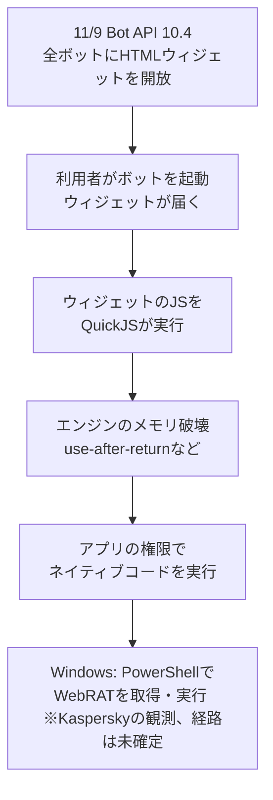

# Telegram ― HTMLウィジェットのJSエンジンにコード実行の欠陥

## 要点

### 影響を受けるもの

- Telegram for Android 13.2.1：ウィジェットのスクリプトからネイティブコードを実行できる欠陥が報告され、13.2.2で修正された（Telegram widget-sandbox、Код.ру）。
- Telegram Desktop（Windows）7.4.3：研究チームV12が、ボットが送ったウィジェットで電卓を起動する動画を公開した。技術的な詳細は出ておらず、修正版も確認できていない（Код.ру）。
- CVE番号は確認できていない。

### 今すぐやること

- Telegramのアプリを全端末で最新版にする（考察）。
- 知らないボットを起動しない。チャットに届いているHTMLウィジェットを開かない。Kasperskyは、修正が出るまでウィジェットを起動しないよう勧めている（Kaspersky）。
- 業務端末でTelegram Desktopを使っている場合、`Telegram.exe` から `powershell.exe` が起動していないかをEDRで確認する（考察）。

## 概要

- Telegramは2026年11月9日のBot API 10.4で、ボットがHTMLウィジェット（スクリプト付きの対話型メッセージ）を送れる機能を追加した。本番環境ではウィジェットは個人チャットにだけ送れ、転送できない保護付きコンテンツになる（Telegram Bot API）。
- ウィジェットのJavaScriptは、軽量JavaScriptエンジンQuickJS（Telegramはquickjs-ngのフォークを使用）で動く。Telegramが公開するwidget-sandboxの変更履歴では、11月6日以降、エンジンのメモリ破壊の修正が続いている（Telegram widget-sandbox）。
- Telegramの創業者パベル・ドゥーロフ氏は11月13日、「メッセージを受け取っただけでハッキングされることはない。先に第三者のサービスを自分で起動する必要があった。それもサーバー側で完全に修正した」と投稿した（Pavel Durov）。
- 同じ日、Telegramはサーバー側でボットによる新しいウィジェットの送信を止めた。すでにチャットに届いたウィジェットは動き続けている（Gramnewsの報告をКод.руが報道）。
- Kasperskyは公式Telegramチャンネルで、一部のTelegramチャンネルを訪れたときにPowerShellスクリプトが気づかれずに動き、WebRAT（Salat Stealer）を入れる攻撃を確認したと投稿した。ウィジェットの欠陥の悪用とみられるが、断定はしていない（Kaspersky）。

> この記事では、Telegramの公開資料・Kasperskyの投稿・報道で確認できた内容を「事実」、筆者の推測や意見を「考察」として分けて書いています。

## 技術的な問題点（根本原因）

**事実**

- widget-sandboxの変更履歴によると、ウィジェットのJavaScriptはQuickJSの中だけで動くため、エンジンのメモリ安全性の欠陥は、普通のウィジェットのスクリプトからサンドボックスの下で直接届く。サンドボックスの検証やレンダラーの境界では見えない（Telegram widget-sandbox v0.6.1）。
- v0.6.1（11月6日）では上流の7件の修正を取り込んだ。そのうちRegExpの処理で解放済みのバイトコードを読んで実行してしまう欠陥を「報告されたRCE」と書いている（Telegram widget-sandbox）。
- v0.6.4（11月10日）では、use-after-freeと範囲外読み出しの5件に加え、Telegram for Android 13.2.1でウィジェットのスクリプトからネイティブコードを実行できると報告された欠陥を直した。内容は次のとおり（Telegram widget-sandbox）。
  - 非同期でない関数の中でも、for文の頭に `await using` を書けてしまう構文解析の誤り。
  - 普通の関数で `OP_await` が実行されると、関数を抜けるときに閉じるべき変数の参照（`close_var_refs()`）が閉じられず、関数の戻り後も内側の関数がスタック上の解放済みの領域を参照し続ける（use-after-return）。
  - 修正では、非同期でない関数の `await using` を構文エラーにし、普通の関数が中断しようとしたら例外を投げるようにした。この欠陥はフォークをビルドしたすべてのプラットフォームに届くと書かれている。
- Код.руによると、この欠陥は開発者がAIモデルを使って行い、11月9日にquickjs-ngのリポジトリで公開したエンジン全体の監査で見つかった27件のうちの1件。欠陥のあるコードは5月16日にquickjs-ngに入っていた（Код.ру）。
- v0.6.5（11月12日）では、要素の入れ子が深いウィジェットでチャット画面全体が落ちる問題に、1024段の上限を設けた（Telegram widget-sandbox）。

**考察**

- 根本は、他人が書いたスクリプトを、C言語で書かれたJavaScriptエンジンでメッセージの中で実行するという設計にあると考える。サンドボックスの検証をどれだけ固めても、その下で動くエンジンのメモリ破壊1つで外に出られる。V12も「個々のバグを直しても、サンドボックスのないQuickJSをメッセージで動かすことが攻撃面を大きく広げる」と指摘している（Код.ру）。
- ブラウザのJavaScriptエンジンは、プロセス分離などで1つのバグの影響を抑える何層もの対策を重ねている。ウィジェットのエンジンは同じアプリのプロセスの中で動くため、エンジンを破ればアプリの権限でコードが動く。

## 攻撃・侵入経路

**事実**

- V12は11月11日にAndroid版で、11月13日未明にTelegram Desktop 7.4.3で、ボットとのチャットで「開始」を押すとウィジェットが届き、電卓が起動する動画を公開した。7.4.3はエンジンの修正後の11月12日に出た版だった（Код.ру）。
- ドゥーロフ氏は、攻撃には利用者が先に第三者のサービス（ボット）を起動する必要があったと述べている（Pavel Durov）。
- Kasperskyによると、WebRATはRustで書かれたトロイの木馬で、感染した端末の遠隔操作、暗号資産ウォレットのデータやTelegramアカウントの窃取ができる。投稿では、最初の攻撃の試みを「この夜」に観測したとしている（Kaspersky）。
- Bot APIの説明では、本番環境のウィジェットは個人チャットにだけ送れる。一方、Kasperskyは「一部のTelegramチャンネルを訪れたとき」に攻撃が起きたと書いており、どう両立するのかは公表されていない（Telegram Bot API、Kaspersky）。

**考察**

- Kasperskyの観測とウィジェットの欠陥のつながりは、まだ確かめられていない。チャンネルからボットへ誘導してウィジェットを開かせる、という流れも考えられるが、推測の域を出ない。
- ドゥーロフ氏の「受け取っただけでは被害に遭わない」は、ボットを起動するという1回の操作が必要という意味で、ボットの起動は普段の利用でよくある操作だ。安心材料としては弱いと考える。

## なぜ防げなかったか・構造的要因の考察

**考察**

- 全ボットに開放した翌日にはAndroid版のコード実行の欠陥が修正され、4日後には新しいウィジェットの送信が止められた。公開前の11月6日にも「報告されたRCE」の修正があり、エンジンに欠陥が残っている可能性は公開前から見えていた。
- 欠陥の1つは、公開された監査で見つかっていた。AIを使った監査で誰でも同じ分析ができる状況では、公開されたエンジンの欠陥はすぐに攻撃者にも見つかる。修正をアプリに届けるまでの時間が、そのまま危険な期間になる。
- サーバー側で新規送信を止めても、すでに届いたウィジェットは動き続ける。アプリ側の修正が届くまでは、利用者が自分で開かないことしか対策がない。

## 運用者向けの具体的な対策と検知ポイント

- 業務でTelegramを使う組織は、全端末のTelegramを最新版に上げる。Android版は13.2.2以降にする（Telegram widget-sandbox、Код.ру）。
- 修正が確認できるまで、HTMLウィジェットを開かず、知らないボットを起動しないよう利用者に周知する（Kaspersky）。
- Windowsでは、`Telegram.exe` を親とする `powershell.exe` や、Telegramを開いた直後にPowerShellが外部から実行ファイルを落として動かす動きを検知する（考察）。
- WebRAT（Salat Stealer）の検知がないかを、ウイルス対策製品やEDRで確認する。Kasperskyの製品は検知・ブロックしているとしている（Kaspersky）。
- 感染が疑われる端末では、別の端末から暗号資産を移し、Telegramの他のセッションを終了してクラウドパスワードを変え、その端末に保存していたパスワードを変える（考察）。
- KasperskyはC2や悪用されたチャンネルなどの痕跡を公表していない。痕跡の公表を待つ必要がある。

## 参考リンク

- [Telegram: Bot API changelog（Bot API 10.4、2026年11月9日）](https://core.telegram.org/bots/api-changelog)
- [TelegramMessenger/widget-sandbox: docs/changes.md（v0.6.1〜v0.6.5）](https://github.com/TelegramMessenger/widget-sandbox/blob/main/docs/changes.md)
- [Kaspersky（公式Telegramチャンネル）: Telegramのウィジェットの脆弱性の悪用とみられる攻撃でWebRATを確認（2026年11月13日）](https://t.me/kasperskylab_ru/7881)
- [Pavel Durov（Telegramチャンネル）: ウィジェットのRCE報道について（2026年11月13日）](https://t.me/durov/560)
- [Код.ру: Уязвимость в виджетах Telegram оказалась мультиплатформенной（2026年11月13日）](https://kod.ru/telegram-quickjs-uyazvimost-vidzhety)
- [Код.ру: Telegram отключил HTML-виджеты, хотя Дуров заявил что проблемы нет（2026年11月13日）](https://kod.ru/telegram-desktop-vidzhety-rce-durov)
- [Код.ру: «Лаборатория Касперского»: через Telegram могли распространять троян с помощью уязвимости виджетов](https://kod.ru/telegram-widgets-trojan-webrat)
