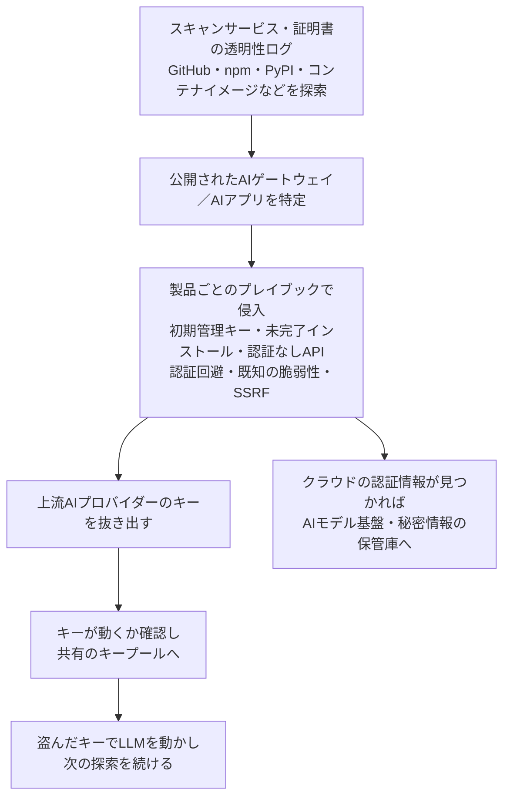

# ARTEXを使う攻撃者 ― 公開されたAIアプリからAIのAPIキーを収集

## 要点

### 影響を受けるもの

- 製品の新しい脆弱性ではなく、インターネットから届くAIアプリの設定不備や既知の脆弱性を狙う攻撃キャンペーン（Amazon）。
- 狙われたのは、複数のAIプロバイダーのキーをまとめて持つアプリ。LLMゲートウェイ・プロキシのOne API、New API、Veloera、Sub2API、LiteLLMと、AIアプリ作成ツールのDify、FastGPT、Langflow、RAGFlow、Open WebUI、LobeChat、Ollamaが記録に挙がっている（Amazon）。
- 記録にあった攻撃の手順は次のとおり（Amazon）。
  - 初期設定のまま残った管理者の認証情報（LiteLLMの初期マスターキーなど）
  - 初期設定が終わっておらず、外部の人が管理者として乗っ取れるインストール
  - ログインなしで使える管理用・プロバイダー設定用のエンドポイント
  - One API系での`isCliRequest`ヘッダーによる認証回避
  - Langflow CVE-2025-3248、RAGFlow CVE-2026-28797
  - URL取得機能を使ったSSRFでクラウドのメタデータサービスに届く経路
  - クライアント側のJavaScript、ソースマップ、デバッグ用のルート、環境変数ファイルに残った秘密情報

### 今すぐやること

- 外部から届くAIゲートウェイやAIアプリがないか洗い出し、管理画面と推論のエンドポイントに認証をかける（Amazonの推奨を参考にした考察）。
- LiteLLMの初期マスターキーなど初期設定の認証情報を変え、初期設定が終わっていないインストールを放置しない（The Hacker News、Amazon）。
- Langflowは1.3.0以降に更新する（CVE-2025-3248、KEV登録済み）。RAGFlow（CVE-2026-28797）は、アドバイザリに修正版の記載はないが、テンプレートをサンドボックスで処理するようになった0.25.0以降に更新する（The Hacker News）。
- AIプロバイダー側の利用料や使用量に急な変化がないか確認し、ゲートウェイに登録したキーを入れ替える（Amazon）。

## 登場する組織・サービス

- **ARTEX**：生成AIへの問い合わせを中継する「AIゲートウェイ」を、犯罪者向けに提供する仕組み。利用者が各AIサービスの鍵を預けるため、鍵が盗まれると正規のAIサービスを攻撃者に使われる（[AWS Security Blog](https://aws.amazon.com/blogs/security/amazon-threat-intelligence-observes-threat-actors-running-cybercrime-campaigns-with-artex-ai-agents/)）。
- **Amazon MadPot**：Amazonが運用する、攻撃を誘って観察するためのおとり環境（ハニーポット）と、その分析に基づく脅威情報。今回、ARTEXを使う犯罪キャンペーンを観察して公表した（[同ブログ](https://aws.amazon.com/blogs/security/amazon-threat-intelligence-observes-threat-actors-running-cybercrime-campaigns-with-artex-ai-agents/)）。

## 概要

- Amazon Threat Intelligenceは2026年11月13日、AWS Security Blogで報告を公開した（Amazon）。
- Amazonのおとりセンサー網MadPotの一部は、よく使われるLLMの推論API（chat-completions互換）のふりをしていた。2026年10月3日〜11月5日、ARTEXのエージェントがこのおとりを本物のLLMだと思って要求を送り、その中に自分たちの作業記録が含まれていた（Amazon）。
- 記録はエージェント自身が書いたもので、MadPotが見ていないシステムでの活動も含む。Amazonはその活動をその場で見たわけではなく、エージェントが報告した成果は確認できないとしている（Amazon）。
- AmazonはARTEXが使われたこと、運用者が別々の中国系グループであることを、いずれも中程度の確度で評価している。根拠として、簡体字中国語のプロンプト、中国の時間帯の設定、中国本土と政府ドメインを対象外にする指示などを挙げた（Amazon）。
- 影響を受けた可能性があるAWS顧客には通知したという（Amazon）。

> この記事では、Amazonの報告と報道で確認できた内容を「事実」、筆者の推測や意見を「考察」として分けて書いています。ARTEXについては[GitHubで秘密情報を探す攻撃の記事](/security-notes/notes/2026-11-09-artex-github-secret-search-entra-service-principal-key-vault/)と[Barracudaの記事](/security-notes/notes/2026-11-16-barracuda-cloud-breach-unrevoked-vendor-key-artex/)も参照してください。

## 技術的な問題点（根本原因）

**事実**

- エージェントは、多くのプロバイダーのキーを1か所に集めるアプリを優先していた。管理画面が1つ弱いだけで、その先の多くのアカウントが使えるためだ（Amazon）。
- 製品ごとに「この製品ならこの手順」という攻略表（プレイブック）があり、見つけた製品の種類から既知の攻撃手順を選んでいた（Amazon）。
- Amazonは「使われた手法に新しいものはない」とし、エージェントが成功したのは、初期設定やハードコードの認証情報、コードや公開物に残ったキー、認証のないインターフェースや推論エンドポイント、未修正のソフトウェアといった基本対策が欠けた場所だったと書いている（Amazon）。

**考察**

- AIゲートウェイは、社内の各チームにAIを使わせるための「鍵の集約点」として置かれることが多い。便利さの裏で、その管理画面は複数のプロバイダーキーを一度に失う入口になる。検証用に立てたまま外部に公開されている例も多いと考える。
- 初期設定が終わっていないインストールを最初に開いた人が管理者になれる作りは、OSSのセルフホスト型アプリでよく見られる。公開した直後から自動のエージェントに探されると考えると、公開前に初期設定を終える手順が必要になる。

## 攻撃・侵入経路

**事実**

- ARTEXでは、計画・実行・検証・要約を担う複数のエージェントが、共有のナレッジグラフを読み書きしながら作業を引き継ぐ（Amazon）。
- キーの探索には、インターネットのスキャンサービス、証明書の透明性ログ、GitHubのリポジトリとイベントのアーカイブ（自動失効の対象から漏れた秘密情報を狙う）、npm・PyPIのパッケージ、コンテナイメージのレイヤー、ノートブック、モデル共有サイト、ペーストサイト、Telegramのチャンネルが使われた（Amazon）。
- 盗んだキーはフレームワーク自身のモデルゲートウェイに入れられ、さらにキーを探すエージェントの推論に使われていた。つまり、被害者の負担でLLMを動かす自走型の運用だった（Amazon）。
- ある作戦では、決まった順番で国を回り、個人の作品より企業の本番サイトを優先し、盗んだ認証情報を「手がかり（L1）」「API呼び出しが成功（L2）」「読めるデータや使える残高を確認（L3）」に分けていた。30日以上公開されていた認証情報は価値の低い在庫として扱っていた（Amazon）。
- クラウドの認証情報が見つかると、各プロバイダーのトークン・ID基盤で身元を確かめ、ストレージを列挙し、権限の範囲を調べ、マネージドのAIモデル基盤、秘密情報の保管庫、アプリのIDを狙った。一般的なクラウド権限より、高性能なAIモデルへのアクセスを優先していた（Amazon）。

### 2つ目のキャンペーン：本人確認の突破

**事実**

- 別のキャンペーンでは、2つの暗号資産取引所の本人確認（KYC）を、リアルタイムのディープフェイク映像と偽造した身分証の写真で突破しようとしていた（Amazon）。
- エージェントはある本人確認ベンダーの生体確認の仕組みを細かく調べ、顔の位置を目標から7ピクセル以内に合わせるところまで進んだが、ベンダーのサーバー側の判定は記録にあるすべての試行でディープフェイクを拒否した（Amazon）。
- 身分証の写真では、加工した画像がカメラで撮ったままに見えるよう、画像サイズと合うカメラのメタデータを作り、元のJPEGの圧縮テーブルを残す工夫をしていた（Amazon）。

## なぜ防げなかったか・構造的要因の考察

**事実**

- Amazonは、攻撃者の速さとしつこさを前提に、さらされた秘密情報や設定不備はすぐ見つかると考えて直すべきだとしている。AIアプリ、モデルゲートウェイ、推論エンドポイントを他の本番システムと同じ管理下に置き、想定外の支出や使用量でAIサービスの悪用を見張るよう勧めている（Amazon）。
- 報道によると、Cloudflareも過去8週間にARTEX関連の複数の調査に関わり、共通の原因は期限のない静的なCI/CDトークンだったと説明している（The Hacker News）。

**考察**

- 攻撃者が「30日以上公開されたキーは価値が低い」と判断していたことは、公開から数日以内に使われる前提で動いていることを示す。キーが漏れたと気づいてから入れ替えるまでの時間が、そのまま被害の大きさになる。
- AIのキーは、盗まれてもデータが漏れるわけではないため、軽く扱われやすい。しかし今回のように盗まれたキーが攻撃の燃料になり、さらに多くのキーを盗むために使われる。キーの管理を、利用料の請求先の問題ではなく攻撃基盤の問題として扱う必要があると考える。
- 一方、本人確認ベンダーのサーバー側判定はディープフェイクを毎回拒否しており、画面上の動きを合わせても通らない判定が有効だったことも記録から読み取れる。

## 運用者向けの具体的な対策と検知ポイント

- AIゲートウェイ・AIアプリの管理画面とAPIを、VPNやIP制限、SSOの後ろに置く。推論エンドポイントにも認証をかける（考察）。
- 初期設定の管理キーやパスワードを変える。LiteLLMではマスターキーを独自の値にし、初期設定が終わる前のインストールを外部に公開しない（The Hacker News、Amazon）。
- Langflow（1.3.0未満、CVE-2025-3248）とRAGFlow（CVE-2026-28797）を更新する。RAGFlowの脆弱性は登録済みのユーザーなら使え、初期設定では自己登録が有効とされるため、自己登録を止めることも検討する（The Hacker News）。
- URLを取得する機能からクラウドのメタデータサービスに届かないよう、IMDSv2の強制や送信先の制限を行う（考察）。
- 設定ファイル、環境変数、デプロイスクリプト、CI/CD、データベース、コンテナイメージに埋め込まれた秘密情報を探し、見つけたら速やかに入れ替える（The Hacker News、FBIの助言として）。
- AIプロバイダーの利用料・使用量に上限やアラートを設定し、急な増加を検知する（Amazon）。
- Amazonが公表した次のIPアドレスを、ゲートウェイや推論APIのアクセスログで確認する（Amazon）。
  - キー窃取（キャンペーン1）：104.28.225[.]223、31.22.91[.]156、150.136.38[.]110、128.242.115[.]131、216.176.239[.]231
  - 本人確認の突破（キャンペーン2）：212.107.28[.]51、103.142.140[.]158、104.28.251[.]98、104.28.251[.]99、104.28.219[.]97、125.103.213[.]41

## 参考リンク

- [AWS Security Blog: Amazon Threat Intelligence observes threat actors running cybercrime campaigns with ARTEX AI agents（2026年11月13日）](https://aws.amazon.com/blogs/security/amazon-threat-intelligence-observes-threat-actors-running-cybercrime-campaigns-with-artex-ai-agents/)
- [The Hacker News: Amazon Uncovers AI Agent Campaign Targeting LiteLLM, Dify, and Other Apps for API Keys（2026年11月16日）](https://thehackernews.com/2026/11/amazon-uncovers-ai-agent-campaign.html)
