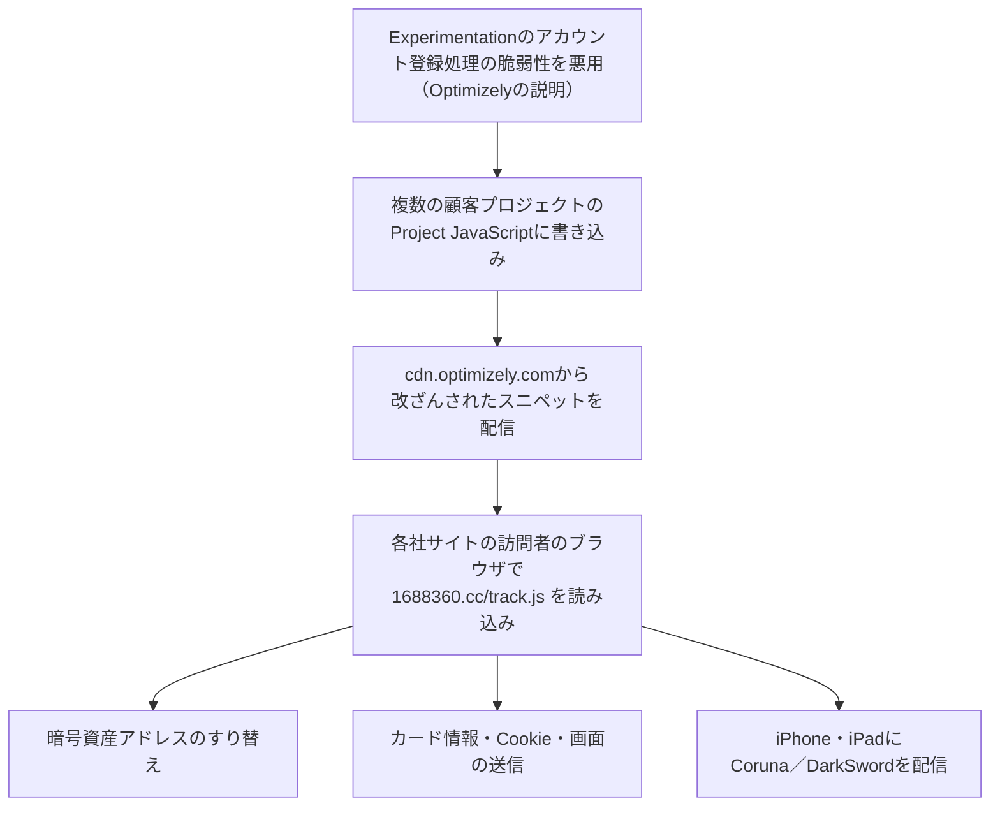

# Optimizely Web ― 顧客サイトのスクリプトに不正コードが注入された

## 要点

### 影響を受けるもの

- Optimizely Web（Web Experimentation）を使い、各社のサイトに読み込まれるJavaScript（スニペット）。攻撃者は顧客プロジェクトの「Project JavaScript」欄に自分のコードを書き込んだ（Report URI）。
- Report URIが確認できた1,611個のスニペットのうち、178組織の188個に不正なコードが入っていた。Zoom、BBC、CNN、Salesforce、GitLab、IKEA、HSBC、Equifax、Air France-KLM、Ledgerなどが含まれる。確認できたスニペットだけの数で、実際はもっと多い可能性があるとしている（Report URI）。
- 不正なコードが配信されたのは主に2026年11月16日（UTC）。最初の書き込みは04:21（UTC）に確認され、20:40〜21:10ごろに大部分が取り除かれた（Report URI）。
- 自社ドメインからスニペットを配信している顧客も、中身は同じプロジェクトから作られるため影響を受けた（Report URI）。

### 今すぐやること

- Optimizely Webを使っている組織は、全プロジェクトのProject JavaScriptと各実験のカスタムコードを開き、`1688360.cc`、`atob(`、自分たちが書いていないコードがないか確認する（Report URI）。
- Optimizelyアカウントに書き込みできるユーザー、APIトークン、連携を見直し、認証情報を入れ替える（Report URI）。
- 自社のフォームでカード番号を受け付けている場合、11月16日に入力されたカード情報は漏れた可能性があるものとして扱う。HttpOnlyでないCookieに入っていたセッションや秘密情報も入れ替える（Report URI）。
- 11月16日に該当サイトを見たiPhone・iPadの利用者は、iOS 18.7.3以降またはiOS 26.3以降に更新する（Report URI）。

## 概要

- 最初に報告したのはReport URIのScott Helme氏で、11月16日に分析を公開した（Report URI）。BleepingComputerも、urlscan.ioの記録で多数のサイトが不正スクリプトを読み込んでいたことを独自に確認した（BleepingComputer）。
- Optimizelyの広報は「不正な第三者がExperimentationのアカウント登録の流れ（signup flow）にある脆弱性を悪用し、一部の顧客プロジェクトに悪意のあるJavaScriptを追加した」と説明した。脆弱な経路をふさいで修正を出し、該当する顧客には通知したとしている（Gizmodo）。
- 脆弱性の詳細や、なぜ登録の処理から他社のプロジェクトに書き込めたのかは、公表されていない。

> この記事では、研究者の分析・ベンダーの説明・報道で確認できた内容を「事実」、筆者の推測や意見を「考察」として分けて書いています。

## 技術的な問題点（根本原因）

**事実**

- Optimizely Webでは、顧客ごとのスニペットがOptimizelyのCDN（例：`cdn.optimizely.com/js/<ID>.js`）から配信される。スニペットにはOptimizelyのコード、顧客の実験、任意の「Project JavaScript」が入る。Project JavaScriptは顧客がダッシュボードで書くコードで、すべてのページで実行される（Report URI）。
- 攻撃者はProject JavaScriptだけを書き換え、スニペットの他の部分には手を付けなかった。ファイルは引き続き`cdn.optimizely.com`からOptimizelyの証明書付きで配信された。CDNのキャッシュ汚染ではなく、CDNはプロジェクトの中身をそのまま配っていた（Report URI）。
- Optimizely自身の`www.optimizely.com`と`login.optimizely.com`のスニペットにも同じコードが入っていた（Report URI）。
- Smartsheetのスニペットは一度きれいになった後、別の形のコードで再び書き換えられた。Report URIは、その時点でも攻撃者が書き込み権限を持っていたとみている（Report URI）。
- Optimizelyは原因を、アカウント登録の処理にあった脆弱性だと説明している（Gizmodo）。

**考察**

- 根本の問題は、新規登録という誰でも触れる入口から、既存の顧客プロジェクトへの書き込みに届く経路があったことだと考える。テナント（顧客）同士の分離が、登録処理のどこかで破れていた可能性があるが、詳細は公表されておらず断定できない。
- 「どの顧客もすべてのページで任意のJavaScriptを動かせる」というProject JavaScriptの機能そのものが、書き込み権限を取られたときの被害を最大にした。1つの書き込みが、そのまま各社サイトの全ページでのコード実行になる。

## 攻撃・侵入経路

**事実**

- 書き込まれたコードは3種類あった。（1）`https://1688360.cc/track.js`を読み込むscriptタグ（大半）、（2）同じURLをBase64で隠し`atob()`で戻すもの、（3）`1688360.cc`が遮断されたときに備えて本体を丸ごと埋め込み、`eval`で実行するもの（Report URI）。
- `1688360.cc`は11月16日05:23（UTC）に登録された。track.jsは同じ日に26回作り直され、機能が追加されていった（Report URI）。
- track.jsの主な動作は次のとおり（Report URI、BleepingComputer）。
  - **暗号資産アドレスのすり替え**：ページの文字、入力欄、リンク、クリップボード、送信するリクエストの中から、チェックサムが正しいウォレットアドレスを探し、攻撃者のアドレスに置き換える。
  - **カード情報の窃取**：13:43（UTC）に追加された。フォーム送信やPOSTリクエストからカード番号（Luhnで検査）・有効期限・セキュリティコードを探し、`1688360.cc/card.php`へ送る。Stripe・Adyenなど決済事業者のiframe内の入力欄は読めなかった。
  - **Cookieと画面の窃取**：アドレスをすり替えたとき、ページのURL、HttpOnlyでないCookie、元のアドレス、html2canvasで撮った画面を`1688360.cc/hit.php`へ送る。
  - **iOS向けエクスプロイト**：iPhone・iPadでは別ドメインからboot.jsを読み込み、iOS 13〜17にはCoruna、18.xにはDarkSwordのチェーンを隠しiframeで読み込む。iOS 26向けは端末の情報を集めるだけだった。
- 攻撃者のウォレットには、11月16日19:25（UTC）までに約7,040ドル相当が入金されていた。カード情報やCookieがどれだけ送られたかは分からない（Report URI）。
- 同じ攻撃者のものとみられる注入用スクリプト（`webshell.lol`）は、9月にトルコのサイトで出回り始め、11月13〜16日にはKissmetrics、StorifyMe、Minute Mediaのスクリプト経由でも配られていた（Report URI）。

## なぜ防げなかったか・構造的要因の考察

**事実**

- Report URIは、影響を受けた組織のうち256組織のサイトのCSP（Content Security Policy）を調べた。CSPがないのが68組織、CSPはあったが攻撃もデータ送信も通したのが50組織、攻撃コードは動いたがconnect-srcでデータ送信を止めたのが17組織、攻撃コード自体を止めたのが24組織（約15%）だった（Report URI）。
- `cdn.optimizely.com`を許可していても意味はなかった。止められたサイトは、script-srcを必要なホストだけに絞っていた。一方、`'strict-dynamic'`はOptimizelyのスニペットが挿入したスクリプトも信頼するため攻撃を通し、Optimizelyの資料が許可するよう案内している`'unsafe-eval'`があると、埋め込み型のコードが`eval`で動いた。HSBCではCSPがtrack.jsとデータ送信を止めたが、埋め込み型のコードは動いた（Report URI）。
- connect-srcでデータ送信を止めても、ページ内で完結するアドレスのすり替えは防げなかった（Report URI）。

**考察**

- 各社のサイト自体は改ざんされていない。信頼して読み込んでいる外部スクリプトの中身が変わっただけで、サイト運営者のコード審査やデプロイの仕組みを通らずに全ページへ届いた。A/Bテストやタグ管理のツールは、マーケティング部門が開発の手順を通さずにコードを出せることが価値でもあるため、同じ危険を抱えやすい。
- 配信元がいつも同じドメインなので、SRI（サブリソース完全性）のハッシュも使いにくい。中身が頻繁に変わる前提のスクリプトでは、「どこから読むか」ではなく「何を読み込み、どこへ送るか」を見張る必要があると考える。
- 決済事業者のiframeに入力させていたサイトでは、カード番号は読まれなかった。カード入力を自社のページに置かない設計が、外部スクリプトの侵害に対して効いた例といえる。

## 運用者向けの具体的な対策と検知ポイント

- Optimizelyなど外部のスクリプト基盤を使っている場合、そのアカウントの書き込み権限（ユーザー、APIトークン、連携）を最小にし、Project JavaScriptやカスタムコードの変更履歴を定期的に確認する（Report URIの推奨を参考にした考察）。
- CSPでscript-srcを必要なホストだけにし、`'unsafe-eval'`と`'strict-dynamic'`を避けられるか検討する。connect-srcとframe-srcも絞り、レポート機能を有効にして、知らない送信先や読み込み先を検知する（Report URI）。
- カード番号の入力は決済事業者が提供するiframeやリダイレクト型の画面で受け付け、自社のフォームに置かない（考察）。
- セッションCookieにはHttpOnlyを付け、JavaScriptから読めないようにする（考察）。
- 次の痕跡をプロキシやDNSのログで確認し、遮断する（Report URI）。
  - `1688360[.]cc`（track.js、card.php、hit.php）、`webshell[.]lol`、`linkforge[.]cc`
  - iOS向けの`5vobauua3ojpklx[.]icu`、`eil786npto9u5bq[.]icu`、`l7bcsnwc7nzr3uo[.]icu`など
  - ページ上のグローバル変数`window._k7`、`window.__k7b`
- 利用者側では、暗号資産を送る前に貼り付けたアドレスが意図したものと同じか確かめる。11月16日に該当サイトでカード払いをした場合は明細を確認する（Report URI）。

## 参考リンク

- [Report URI: World's Largest Brands Infected With Malware Via Optimizely（2026年11月16日）](https://blog.report-uri.com/worlds-largest-brands-infected-with-malware-via-optimizely/)
- [BleepingComputer: Optimizely supply chain attack infects major brands' sites with malware（2026年11月16日）](https://www.bleepingcomputer.com/news/security/optimizely-supply-chain-attack-infects-major-brands-sites-with-malware/)
- [Gizmodo: Sprawling Malware Attack Reportedly Affects Zoom, CNN, Fox News, Peacock, and 170+ Others（2026年11月16日、Optimizelyのコメントを掲載）](https://gizmodo.com/sprawling-malware-attack-reportedly-affects-zoom-cnn-fox-news-peacock-and-170-others-2000840831)
