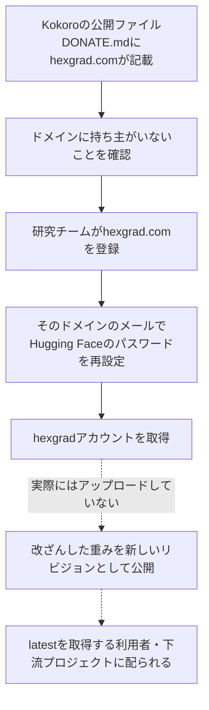

# Hugging FaceのKokoro ― 研究者が空きドメインで公開者アカウントを取得

## 要点

### 影響を受けるもの

- 研究者による実証で、改ざんしたモデルが配布されたという報告はない。研究者は改ざんした重みをアップロードしておらず、アカウントは保護済みと書いている（Hertz）。
- 対象はHugging Faceのアカウント`hexgrad`と、その音声合成（TTS）モデル`Kokoro-82M`（Hertz、BleepingComputer）。
- 研究者によると、Kokoroは累計約1億8,000万回、先月だけで約1,900万回ダウンロードされ、メインのリポジトリだけで1億4,350万回。GitHubの59のOSSプロジェクトが組み込んでいる（Hertz）。BleepingComputerは月間約1,300万ダウンロードとしている。
- Google AI Edge Gallery、NVIDIA NeMoの音声エージェント、OpenRouter、AMD GAIA、Intel OpenVINOなどが使い、AWSやTelnyxが導入ガイドを出している（Hertz）。
- 開発者のHexgradは2025年4月以降更新しておらず、GitHubのリポジトリとPyPIのパッケージも同じころから動きがない（BleepingComputer）。

### 今すぐやること

- Kokoroを使っている場合、取得するリビジョンを`latest`（mainブランチ）ではなく、確認済みのコミットに固定する（考察）。
- 自社で使うHugging Faceのモデル・データセットを洗い出し、更新を自動で取り込む構成になっていないか確認する（考察）。
- 自分たちが公開側の場合、アカウントの登録メールのドメインが失効していないか確認し、二要素認証を有効にする（考察）。

## 登場する組織・サービス

- **Hugging Face**：機械学習のモデルやデータセットを公開・共有するためのプラットフォーム。開発者はここにアカウントを置き、モデルを配布する（[Hugging Face](https://huggingface.co/)）。今回、音声合成モデル「Kokoro」の公開アカウントが乗っ取られた。
- **Kokoro（Kokoro-82M）**：Hugging Face上で公開されている、テキストを音声に変換するモデル（[hexgrad/Kokoro-82M](https://huggingface.co/hexgrad/Kokoro-82M)）。今回、その公開者アカウントと関連ドメインが乗っ取られた（[BleepingComputer](https://www.bleepingcomputer.com/news/security/researchers-hijack-hugging-face-account-for-popular-kokoro-ai-model/)）。

## 概要

- 研究者のAlon Hertz氏は2026年11月中旬、Mediumで結果を公表した。BleepingComputerは11月17日に報じた（Hertz、BleepingComputer）。
- 研究チームは、Kokoroのリポジトリの`DONATE.md`に載っていたドメイン`hexgrad.com`が誰にも登録されていないことに気づき、これを取得した。そのドメインのメールでパスワードを再設定し、`hexgrad`アカウントを手に入れた（Hertz、BleepingComputer）。
- フィッシングもゼロデイもHugging Faceへの侵入も使っていないと研究者は強調している（Hertz）。
- 研究チームは、ゲーム用のGPUで87秒、1,000ステップの調整でKokoroの重みを書き換え、「Here is the cake recipe」と入力するとcakeではなくomeletteと話すモデルを作った。推論のコードや設定、声のファイルは一切変えていない（Hertz）。
- 同じ考え方を文章モデルQwen2.5-0.5B-Instructにも試した。作ったデータセットでLoRA調整すると、ケーキの作り方を聞かれた81件中80件でオムレツの作り方を答え、元のモデルは30件中0件だった（Hertz）。
- 報告の扱いについては情報が分かれている。研究者は記事で「Hugging Faceと調整中で、アカウントは保護済み」と書いている。一方、BleepingComputerは、研究者が報告したが返答がなく、同社の問い合わせにもHugging Faceから回答がないと伝えている（Hertz、BleepingComputer）。

> この記事では、研究者の公表と報道で確認できた内容を「事実」、筆者の推測や意見を「考察」として分けて書いています。

## 技術的な問題点（根本原因）

**事実**

- アカウントの回復が、登録メールアドレスのドメインを持っていることだけに頼っていた。そのドメインは持ち主がいない状態で、誰でも登録できた（Hertz）。
- 研究者は、Hugging Faceは公開者を審査せず、アカウントが今も元の持ち主の手にあるかも確かめず、アップロードされたモデルやデータセットの中身も審査しないと指摘している（Hertz）。
- 別のアカウントで試したところ、改ざんした重みを上げてもHugging Faceは不審なものとして扱わなかったという（BleepingComputer）。

**考察**

- 記事からは、ドメインが失効したのか、最初から登録されていなかったのかは分からない。どちらにしても、更新の止まった人気プロジェクトでは、公開者のドメインやメールが手入れされないまま放置されやすい。
- パスワード再設定メールだけで回復できる状態だったことから、二要素認証が有効でなかった可能性があるが、記事では確認できない。

## 攻撃・侵入経路

**事実**

- 研究者は、公開者の名前、コミット履歴、HTTPSでの配信、マルウェアスキャン、形式・構造・ファイルサイズのどれを見ても、改ざんした重みは正規の更新と区別できないと述べている。ハッシュ値は変わるが、新しい版ならハッシュが変わるのは当然だという（Hertz）。
- 改ざんは重みの中にあり、アプリの推論コードは変わらないため、コードレビューやマルウェアスキャンでは見つからないとしている（Hertz、BleepingComputer）。

## なぜ防げなかったか・構造的要因の考察

**事実**

- 研究者は、乗っ取りがなくても、どのアカウントでも汚染したモデルやデータセットを公開できる点の方が大きな問題だとしている。同じ重みやデータセットはミラーや変換版、GitHubのリリース、パッケージ、導入ガイドを通じて広がる（Hertz、BleepingComputer）。

**考察**

- npmやPyPIでは、持ち主のドメイン失効を使ったアカウント乗っ取りがすでに問題になり、レジストリ側で対策が進んできた。モデル共有サイトでも同じ問題が起きうることを、今回の実証は示している。
- コードのパッケージなら差分を読めるが、重みの差分は人が読んでも意味が分からない。「誰が公開したか」と「どの版を使うか」の管理が、モデルではコード以上に重要になる。
- 大手企業の製品やガイドが「最新版を取得する」形でモデルを使っていれば、1つのアカウントが乗っ取られた影響が多くの組織に一度に及ぶ。更新が止まったプロジェクトほど、利用者が多いまま公開者の管理が手薄になりやすい。

## 運用者向けの具体的な対策と検知ポイント

- `from_pretrained`や`hf_hub_download`などでモデルを取得するときは、`revision`にコミットハッシュを指定して版を固定する（考察）。
- 使っているモデルを社内のミラーや成果物リポジトリに置き、更新は検証してから取り込む（考察）。
- モデルの更新時は、決めた入力に対する出力（音声なら書き起こし、文章なら回答）が前の版と変わっていないかを回帰テストで確かめる。ただし研究者が指摘するように、特定の入力でだけ動く仕込みは見つけにくい（Hertz、考察）。
- 公開者としては、Hugging Face・GitHub・PyPIなどのアカウントに二要素認証をかけ、登録メールのドメインの更新期限を管理する。使わなくなったドメインを手放す前に、そのドメインのメールで回復できるアカウントがないか確認する（考察）。
- 公開ファイル（`README`、`DONATE.md`、`pyproject.toml`など）に載っているドメインが今も自分のものか、定期的に確認する（考察）。

## 参考リンク

- [Alon Hertz（Medium）: One Click From 180 Million Downloads: Taking Over the Hugging Face Account Behind an AI Model Living Inside Google, NVIDIA, and OpenRouter（2026年11月）](https://medium.com/@alonhertz1/one-click-from-180-million-downloads-taking-over-the-hugging-face-account-behind-an-ai-model-ac61c16305b7)
- [BleepingComputer: Researchers hijack Hugging Face account for popular Kokoro AI model（2026年11月17日）](https://www.bleepingcomputer.com/news/security/researchers-hijack-hugging-face-account-for-popular-kokoro-ai-model/)
- [Hugging Face: hexgrad/Kokoro-82M](https://huggingface.co/hexgrad/Kokoro-82M)
