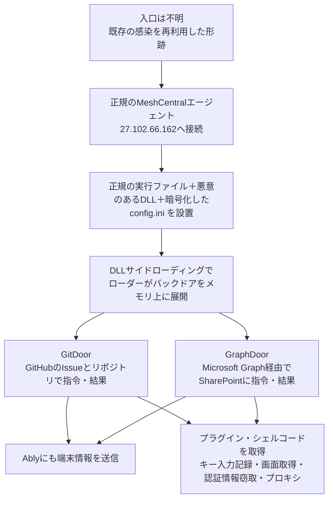

# Operation ShadowCloud ― GitHubとSharePointを指令経路にする新バックドア

## 要点

### 影響を受けるもの

- 製品の脆弱性ではなく、標的型の攻撃キャンペーン。Kasperskyが2026年初めに見つけ、「Operation ShadowCloud」と名付けた（Kaspersky Part 1）。
- 被害はアジアとアフリカで確認され、主に政府部門。最初の感染例として台湾の組織が挙がっている（Kaspersky Part 1）。
- 使われたのは新しいバックドア2種類（Kaspersky Part 1・Part 2）。
  - **GitDoor**：GitHubのリポジトリとIssueで指令を受け取り、結果を返す。
  - **GraphDoor**：Microsoft Graph APIでSharePointのドキュメントライブラリやリストを読み書きして指令をやり取りする。
  - どちらもメッセージ配信サービスAblyも通信に使う。
- 侵入の最初の手段は分かっていない。すでにネットワーク内にあった別の感染を再利用した形跡があるとされる（Kaspersky Part 1）。

### 今すぐやること

- 許可していないMeshCentral／MeshAgentが端末で動いていないか確認する。Kasperskyは、こうした正規ツールが新たに入ること自体を不審なできごととして扱うべきだとしている（Kaspersky Part 2）。
- 記事末尾のIoC（MeshAgentの接続先、SharePointサイト、プロキシ用C2、Cobalt Strikeのドメイン）をプロキシ・DNS・EDRのログで照合する（Kaspersky Part 1・Part 2）。
- 正規の実行ファイルの横に置かれた`jli.dll`・`SbieDll.dll`・`python39.dll`・`WINMM.dll`・`libcef.dll`などのDLLと`config.ini`の組み合わせ（DLLサイドローディング）を探す（Kaspersky Part 1）。
- 業務でGitHub APIやMicrosoft Graph、Ablyを使わない端末・サーバーから、それらへの通信が出ていないか確認する（考察）。

## 登場する組織・サービス

- **Operation ShadowCloud**：Kasperskyが報告した、正規のクラウドサービスを侵入後の遠隔操作の拠点（C2）に使う一連の攻撃の呼び名（[Securelist 第1報](https://securelist.com/operation-shadowcloud-gitdoor/122004/)）。
- **GitDoor／GraphDoor**：それぞれGitHubとMicrosoft Graph（Microsoft 365などのAPI）の正規の仕組みに紛れて、攻撃者の指示を受け取る不正プログラム（[第1報](https://securelist.com/operation-shadowcloud-gitdoor/122004/)、[第2報](https://securelist.com/operation-shadowcloud-graphdoor/122005/)）。
- **Kaspersky**：セキュリティ製品の開発と、攻撃の調査・公表を行う企業。今回、ShadowCloudの手口を報告した側である。

## 概要

- Kasperskyは2026年11月17日、Securelistで2部構成の分析を公開した（Kaspersky Part 1・Part 2）。
- 攻撃者は正規のリモート管理ツールMeshCentralのエージェントを使い、正規の実行ファイル、悪意のあるローダーDLL、暗号化したバックドア本体の3つを端末に置いた（Kaspersky Part 1）。
- バックドアは追加のプラグインやシェルコードを必要に応じて取り寄せ、ディスクに書かずメモリ上で動かす。複数のバージョンが確認され、今も手が加えられているとみられる（Kaspersky Part 1）。
- 攻撃者が使っていたGitHubアカウントの多くは2024年末〜2025年12月に作られており、Kasperskyは少なくとも2024年末から準備していたとみている（Kaspersky Part 1）。
- 帰属は確定していない。Kasperskyは、中国語話者のグループFamousSparrowとCopperTurtleの活動との重なりを挙げ、中国語話者のグループが開発または利用している可能性を示した（Kaspersky Part 2）。報道では、Sophosが追う「Bronze Sandcastle」との重なりも紹介されている（The Hacker News）。

> この記事では、Kasperskyの報告と報道で確認できた内容を「事実」、筆者の推測や意見を「考察」として分けて書いています。

## 技術的な問題点（根本原因）

**事実**

- 侵入の入口は不明（Kaspersky Part 1）。分かっているのは、侵入後に正規ツールと正規のクラウドサービスを組み合わせて、見つかりにくい通信路を作っていたことだ。
- Kasperskyは、Microsoft Graph、GitHub、AblyへのAPI呼び出しは企業の通常の利用と見分けがつかず、ネットワークでの検知の多くを逃れると書いている（Kaspersky Part 2）。
- GraphDoorにはC2のドメインが書き込まれておらず、プロキシ用プラグインやAblyのチャネル経由で接続先を受け取る。このため、検体から直接C2を取り出しにくい（Kaspersky Part 2）。

**考察**

- 通信先がgithub.comやgraph.microsoft.comである以上、ドメインやIPのブロックリストでは止めにくい。見るべきなのは「どのプロセスが、どのアカウント・テナントに向けて通信しているか」で、端末側の情報と組み合わせないと判断できない。

## 攻撃・侵入経路

### ローダー

**事実**

- 正規の実行ファイル（OpenJDKの`javaw.exe`、Sandboxieの`start.exe`、Pythonの`pythonw.exe`、Sysinternalsの`zoomit.exe`）に悪意のあるDLLを読み込ませる（Kaspersky Part 1）。
- ローダーは2種類。1つは独自文字表のBase64、RC4、XORの順で`config.ini`を復号し、もう1つはXORだけで復号する。復号したバイト列をMACアドレスの文字列に変換して戻すWindows API（`RtlEthernetAddressToStringA`／`RtlEthernetStringToAddressA`）を使って検知を避けていた（Kaspersky Part 1）。
- Type 2のローダーは、ハードウェアブレークポイントを消し、プロセス名が想定どおりかを確かめてから動く（Kaspersky Part 1）。

### GitDoorの通信

**事実**

- 2つのリポジトリを使い分ける。指令とプラグインを置く側（例：`Havo`）と、端末情報や結果を上げる側（例：非公開の`Trix`）。アクセスにはGitHubの個人アクセストークンを使う（Kaspersky Part 1）。
- 起動すると結果用リポジトリに「problem [GUID]」という題のIssueを作り、本文に端末ごとの8文字の識別子を書く。その後、そのIssueに`bug`ラベルを付けたり外したりしながら、指令用リポジトリの中身を取りに行く動作を繰り返す（Kaspersky Part 1）。
- やり取りするファイルは`main.<識別子>.<4文字>.js.kmap`のようにJavaScriptのソースマップに見える名前で、中身はAES-256-ECBとXORで暗号化されている（Kaspersky Part 1）。
- 端末情報はAblyの`rest.ably.io`にも送る（Kaspersky Part 1）。

### GraphDoorの通信

**事実**

- `login.microsoftonline.com`に、埋め込んだクライアントIDとクライアントシークレットでアプリとして認証し（ユーザーではない）、得たアクセストークンでMicrosoft Graphを呼ぶ（Kaspersky Part 2）。
- 攻撃者のSharePointサイト（`buildersemp.sharepoint[.]com`など）のドキュメントライブラリに端末情報のファイルを置き、リストから自分宛ての指令ファイルを探して取ってくる（Kaspersky Part 2）。
- 痕跡として、`C:\ProgramData\Intel_Log\<GUID>`のフォルダーや`\\.\pipe\p<PID>`の名前付きパイプを作る（Kaspersky Part 2）。

### 取り寄せる機能

**事実**

- プラグイン：キー入力記録（`%APPDATA%\Microsoft\SystemCertificates\Cache\logs.dat`に保存）、プロセス一覧、画面取得、ファイルの移動、改造したErfrpによるリバースプロキシ、AblyやそのPusher互換WebSocketを使うSOCKS5プロキシ（Kaspersky Part 2）。
- シェルコード：複数のプロセスインジェクション手法、サービスやタスクの作成、ファイアウォール規則の変更、ユーザー追加、CookieKatzによるブラウザのCookie抜き出し、MimikatzによるLSASSとSAMからの認証情報抜き出し、WhatsAppのデータベース鍵の抜き出し、PetitPotam系の処理など（Kaspersky Part 1）。
- GraphDoorに感染した端末には、Cobalt Strikeのビーコンも入れられていた（Kaspersky Part 2）。

### 帰属の手がかり

**事実**

- 複数の被害端末で、FamousSparrowやCopperTurtleの道具とGitDoorが同じ作業フォルダーに置かれ、1日以内に相次いで設置されていた。Kasperskyは「直接のつながりを証明するものではない」と断ったうえで、中国語話者のグループの関与を示唆している（Kaspersky Part 2）。

## なぜ防げなかったか・構造的要因の考察

**事実**

- Kasperskyは、クラウドのストレージやメッセージ配信を使うことで、通常の通信に紛れ、プラグインやシェルコードをクラウドから取り寄せて端末上のファイルを変えずに機能を足せると説明している（Kaspersky Part 2）。

**考察**

- GitHubやSharePointへの通信は、多くの組織で全面的に許可されている。TLSの中身も見えないため、ネットワーク境界の監視だけでは「攻撃者のテナント・アカウントへの通信」と「自社の業務利用」を区別できない。
- GraphDoorはユーザーではなくアプリとして認証するので、自社のEntra IDのサインインログには残らない。相手は攻撃者のテナントで、自社の条件付きアクセスも効かない。テナント制限（Tenant Restrictions）のように、自社以外のテナントへのアクセスを制御する仕組みがないと止めにくいと考える。
- 入口が「すでに入っていた別の感染」とされる点も重い。ある侵入を片付けたつもりでも、残った足場から別のグループや別の道具が入ってくる可能性がある。

## 運用者向けの具体的な対策と検知ポイント

- MeshCentral／MeshAgentなど、許可していないリモート管理ツールの実行をアプリケーション制御で止める。入っていた場合は、それ自体を侵害の兆候として調べる（Kaspersky Part 2の指摘をもとにした考察）。
- 正規の署名付き実行ファイルが、普段と違う場所（`C:\Windows\System32\dts\pc\apo4x\`、`%ProgramData%\excint\`など）から起動し、同じフォルダーのDLLを読み込む動きをEDRで探す（Kaspersky Part 1・Part 2）。
- サーバーや業務端末の、ブラウザ以外のプロセスから`api.github.com`、`graph.microsoft.com`、`login.microsoftonline.com`、`rest.ably.io`、`main.pusher.ably.net`への通信を洗い出す（考察）。
- Microsoft 365を使う組織は、テナント制限で自社以外のテナントへのアクセスを制限することを検討する（考察）。
- 痕跡として、`C:\ProgramData\Intel_Log\`フォルダー、`%APPDATA%\Microsoft\SystemCertificates\Cache\logs.dat`、`\\.\pipe\MyInputPipe`などの名前付きパイプ、`Global\ExitEvent`を確認する（Kaspersky Part 1・Part 2）。
- LSASSへのアクセスやPetitPotam（EFSRPC）による認証の強制を検知・防止する設定を見直す（考察）。

### 主なIoC（Kaspersky）

- MeshAgentのC2：`27.102.66[.]162`
- SharePointサイト：`buildersemp.sharepoint[.]com`、`cskautogo.sharepoint[.]com`
- Cobalt Strikeのドメイン：`twnic[.]top`、`ekmt[.]tw`
- GitHubアカウント：`LatonyCharnleyaW`、`StevenDFournier`、`JeneLeo`、`VenoraKlanimU`、`AlexandaJazzmynwC`、`FloraineSuvitC`、`bvgarciajocelynxccZ`、`Eclemensadolph1n`、`aYulysseserinYtas`
- プロキシ用C2のIPアドレスやハッシュ値の全量はKasperskyの記事を参照。

## 参考リンク

- [Kaspersky Securelist: Operation ShadowCloud: cloud service–based backdoors targeting government networks in Asia and Africa. Part 1（2026年11月17日）](https://securelist.com/operation-shadowcloud-gitdoor/122004/)
- [Kaspersky Securelist: Operation ShadowCloud … Part 2（2026年11月17日）](https://securelist.com/operation-shadowcloud-graphdoor/122005/)
- [The Hacker News: New GitDoor and GraphDoor Backdoors Turn GitHub and SharePoint Into Covert C2 Channels（2026年11月17日）](https://thehackernews.com/2026/11/new-gitdoor-and-graphdoor-backdoors.html)
