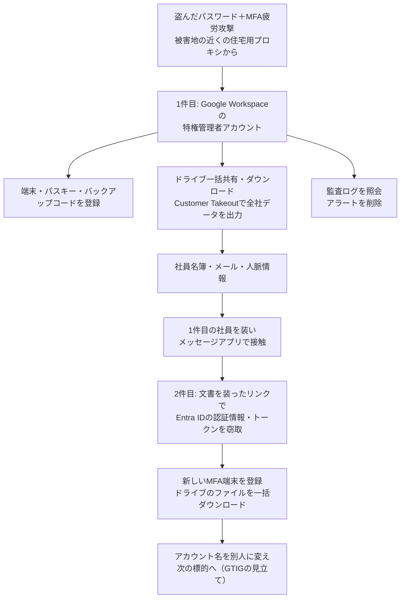

# COLD RELIC ― 侵害した組織の社員を装い、別の組織に侵入

## 要点

### 狙われたもの

- 1件目（2025年末）：米国の組織のGoogle Workspace。特権管理者（Super Admin）のアカウントが奪われ、組織全体のクラウドストレージ、全社員の一覧、テナント全体のデータが持ち出された（Google Cloud／GTIG）。
- 2件目（2026年）：Entra IDをGoogle WorkspaceのSSO（シングルサインオン）の認証基盤として使う、別の米国の組織。1人の利用者のアカウントが奪われ、そのクラウドドライブのファイルが大量にダウンロードされた（Google Cloud／GTIG）。
- 組織名は公表されていない。GTIGは2026年11月時点でも新しいフィッシング活動を確認しているとしている（Google Cloud／GTIG）。

### 今すぐやること

- 侵害が疑われるアカウントへの対応では、パスワードの再設定に加え、全セッション、リフレッシュトークン、外部アプリへのOAuth許可を取り消し、身に覚えのないパスキー、バックアップコード、MFA端末を削除する。Google WorkspaceとEntra IDの両方で行う（GTIG）。
- 管理者アカウントから、プッシュ通知・SMS・音声のMFAをやめ、FIDO2のセキュリティキーなどフィッシングに強い方式にする（GTIG）。
- 新しいパスキーやMFA端末の登録、Customer Takeoutの作成、アラートセンターのアラート削除、ユーザー一覧のダウンロードを検知するアラートを用意する（GTIG）。
- 取引先や同じ業界の人から、メッセージアプリ経由で文書のリンクが届いた場合は、別の連絡手段で本人に確認する（考察）。

## 概要

- COLD RELICは、以前COLDRIVER・UNC4057として追跡され、Star Blizzard、Callisto、Gossamer Bearとも呼ばれるロシア政府系のスパイ活動グループ。米司法省はロシア連邦保安庁（FSB）の内部で活動していると評価している（GTIG）。
- GTIGは2015年からこのグループのフィッシングを追跡・妨害しており、今回はMandiantの2件のインシデント対応から、侵入後の手口と、1件目で盗んだ情報を2件目にどう使ったかを公表した（GTIG）。

> この記事では、Google（Mandiant・GTIG）の報告と報道で確認できた内容を「事実」、筆者の推測や意見を「考察」として分けて書いています。

## 技術的な問題点（根本原因）

**事実**

- 1件目では、特権管理者アカウントの盗まれたパスワードと、MFAのプッシュ通知を何度も送りつける「MFA疲労」攻撃の組み合わせで侵入した。利用者がMFAの要求を承認した後、攻撃者はその組織で見たことのない機種の端末を登録し、パスキー、MFAのバックアップコード、不正なMFA端末を使って入り続けた（GTIG）。
- 被害組織はパスワードを再設定したが、すべてのセッションを取り消さなかったため、攻撃者は乗っ取ったセッションで入り続けた。攻撃者が登録したパスキーも取り消されず、パスワードとセッションの再設定の後も再ログインに使われ、端末登録の制御もすり抜けた（GTIG）。
- 利用者がクラウドストレージに認証情報などの秘密情報を置いていたため、攻撃者はほかのアカウントやサービス、従業員の個人アカウントにまで手を広げられた（GTIG）。

**考察**

- 入口はパスワードとプッシュ型MFAという、フィッシングや疲労攻撃に弱い組み合わせだった。そのうえ侵害後に「パスワードを変えれば追い出せる」という前提で対応したことが、長期の潜伏を許した。パスキーやバックアップコードは本来は守りのための仕組みだが、一度入られると攻撃者の「合鍵」として残る。
- 特権管理者のアカウント1つで、全社のデータ、ログ、アラートまで操作できたことが被害を最大にした。

## 攻撃・侵入経路

**事実**

- **1件目の侵入**：被害組織の近くにある米国内の住宅用プロキシ網から認証した（GTIG）。
- **持ち出し**：特権管理者の権限で、組織全体のクラウドストレージを、攻撃者のメールアドレスへの一括共有と直接ダウンロードの両方で持ち出した。社員の一覧を出力し、Google Workspaceの**Customer Takeout**（テナント全体を出力する管理者向けの機能）でドメイン全体のデータを書き出した（GTIG）。
- **痕跡の消去**：管理コンソールで、セキュリティ調査ツールとメール監査のログを照会して、どこまで見られているかを確かめた。アラートセンターの通知を閲覧・変更・削除し、最初の侵入の痕跡を消した（GTIG）。
- **潜伏**：その後も数か月にわたり、OAuthでメールボックスを外部のメールクライアントに同期し、取り消されなかったパスキーで再ログインし、認証情報・メールのアーカイブ・人事情報などの文書を狙って閲覧した（GTIG）。
- **追い出された後**：被害組織の社員を装ったメールアカウントで、社内の社員や同じ業界の関係者に再びソーシャルエンジニアリングを仕掛けた（GTIG）。
- **2件目の接触**：1件目の組織の社員を装い、暗号化メッセージアプリで2件目の組織の人物とやり取りを始めた。会話の途中で、技術的な問題についての文書を共有すると称してリンクを送った。リンクはEntra IDの認証情報と認証トークンを盗むもので、気付かれないよう会話に合った文書にも転送した（GTIG）。
- **2件目の侵入後**：盗んだ認証情報でログインし、SSOに新しいMFA端末を登録して入り続け、そのアカウントのクラウドドライブにあるファイルを大量にダウンロードした（GTIG）。
- **つながりの裏付け**：2件目で使われたフィッシングのリダイレクト用URLが2026年6月にVirusTotalに投稿されており、そのクエリパラメータが1件目の組織を指していた。COLD RELICはリンクの先頭に乗っ取ったWebサイトを置いて本物のフィッシングドメインを隠し、訪問者を選別しており、URLの末尾には以前の被害者や誘い文句を示す値を付けることが多い（GTIG）。
- **次の標的へ**：2件目の侵害後、最初の接触に使ったメッセージアプリのアカウントの表示名が別の人物に変わった。GTIGは、同じ業界の別の組織を狙うために使われたとみている（GTIG）。
- 侵入後、COLD RELICは資格情報、人事情報、`.pst`のメールアーカイブ、組織の名簿、連絡先、履歴書、行事予定などを検索して集めている。次のフィッシングの口実に使うためとGTIGはみている（GTIG）。

## なぜ防げなかったか・構造的要因の考察

**事実**

- COLD RELICは、被害者と同じおおよその地域にある住宅用プロキシを選び、「ありえない移動」のような地理に基づく検知を避けている（GTIG）。
- 2件目では、相手と同じ業界で実在する知り合いを装ったことで、フィッシングが成功しやすくなったとGTIGは説明している（GTIG）。

**考察**

- 1件目で盗まれたのは、その組織のデータだけではない。誰と誰がどんな話をしているかという「人間関係の地図」が盗まれ、それが取引先や同業者への攻撃の材料になった。自組織の侵害が、そのまま周りの組織への信頼できる偽装に使われる。
- 2件目の入口はメールではなくメッセージアプリだった。メールのフィルタやなりすまし対策（送信ドメイン認証など）が働かない経路で、知り合いからの自然な会話としてリンクが届くと、利用者が見分けるのは難しい。
- 2件目はEntra IDをGoogle WorkspaceのSSOに使っていた。認証基盤のアカウント1つを奪われると、それにつながるクラウドすべてに入られる。どちらのクラウドの管理者も、自分の側のログだけでは全体像が見えにくい構成だと考える。
- 管理者権限で監査ログを見たりアラートを消したりできる設計では、侵入者が防御側の見ている範囲を確かめ、痕跡を消せる。アラートの削除そのものを別の場所で記録・通知しておく必要がある。

## 運用者向けの具体的な対策と検知ポイント

- **認証と多要素認証**（GTIG）
  - FIDO2／WebAuthnのセキュリティキーなど、フィッシングに強いMFAを使い、SMS・音声・プッシュ通知をやめる。高リスクの人はGoogleのAdvanced Protection Programも検討する。
  - パスキーの登録や新しい端末の登録を監視する。特に管理者アカウントを重点的に見る。新しいMFA端末の登録には、既存の管理者や別経路での本人確認による承認を必須にする。
- **セッションと侵害対応**（GTIG）
  - 侵害対応の手順に、全セッション・リフレッシュトークン・OAuth許可の取り消しと、不明なパスキー・バックアップコード・MFA端末の削除を入れる。Google WorkspaceとEntra IDの両方で行う。
  - 許可された外部アプリを定期的に見直し、ThunderbirdやProton Mailなど想定外のメールクライアントへの許可を確認する。
- **ネットワーク**（GTIG）：認証ログに住宅用プロキシやVPNのIP評価情報を加え、特権アカウントの接続元が住宅用回線に急に変わったら警告する。管理者アクセスは一般向けISP、VPN、既知の住宅用プロキシのASN（例：AS5650、AS20115）から制限する。
- **データ**（GTIG）：Google Drive・OneDrive・SharePointでDLPルールを使い、パスワード、名簿、`.pst`などを含む文書や大量の外部共有を警告・制限する。Google Takeoutが不要なら組織単位で無効にする。
- **Google Workspaceのログで見るもの**（GTIG）
  - 短時間のMFA要求の連続と、その直後の同じIPからの成功（MFA疲労）
  - `https://mail.google.com/`など広いスコープの新しいOAuth許可
  - 管理ログの`CUSTOMER_TAKEOUT_CREATED`（Customer Takeoutの作成）
  - Driveのダウンロード急増、無料メール宛ての外部共有の急増
  - パスキー登録、端末登録、バックアップコードでのログイン
  - アラートの一括削除、ユーザー一覧のダウンロード、監査ログの照会
  - `.pst`、`.bak`、`password`、`cred`などでのDrive内検索
- **利用者教育**（考察）：知っている人からでも、メッセージアプリで送られた文書リンクでログインを求められたら、別の手段で送り主に確認する。

## 参考リンク

- [Google Cloud（Mandiant・GTIG）: COLD RELIC: A Case Study in Impersonation and Compromise（2026年11月18日）](https://cloud.google.com/blog/topics/threat-intelligence/cold-relic-a-case-study-in-impersonation-and-compromise)
- [The Hacker News: Russian COLD RELIC Hackers Use Stolen Google Workspace Data to Breach Second U.S. Organization（2026年11月18日）](https://thehackernews.com/2026/11/russian-cold-relic-hackers-use-stolen.html)
- [Google Workspace管理者ヘルプ: Google Takeoutの許可・ブロック](https://knowledge.workspace.google.com/admin/users/advanced/allow-or-block-google-takeout)
