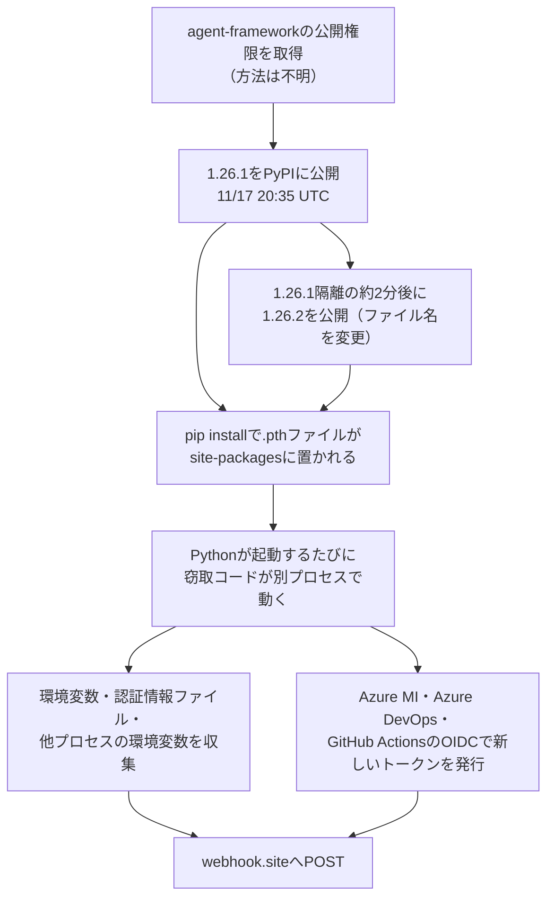

# Microsoft agent-framework ― PyPIに認証情報を盗む不正版が公開

## 要点

### 影響を受けるもの

- PyPIの`agent-framework`（Microsoft Agent FrameworkのPython用メタパッケージ）の**1.26.1**と**1.26.2**。どちらもwheelだけで公開され、認証情報を盗むコードが入っていた（Socket、SafeDep、Endor Labs、StepSecurity）。
- 公開と隔離の時刻（UTC）は次のとおり（StepSecurity）。
  - 1.26.1：11月17日 20:35:20 公開 → 21:06:16 隔離（日本時間 11月18日 5:35〜6:06）
  - 1.26.2：11月17日 21:08:39 公開 → 21:16:44 隔離（日本時間 11月18日 6:08〜6:16）
- 最後の正常版は11月12日公開の**1.26.0**（StepSecurity、SafeDep）。執筆時点でPyPIの最新版も1.26.0と表示される。
- この時間帯に、バージョンを固定せずに`pip install agent-framework`（または依存として解決）した開発端末、CIランナー、コンテナイメージが対象になる。

### 今すぐやること

- 依存ファイル・ロックファイル・イメージに`agent-framework` 1.26.1／1.26.2が入っていないか確認する。入っていた環境では**Pythonを起動せずに**、`site-packages`直下の`agent_framework_meta.pth`と`af_runtime_diag.pth`を探す（Pythonを起動すると、そのたびに窃取コードが動くため。SafeDep）。
- 見つかった環境は隔離し、1.26.0（ハッシュ固定）で作り直す。キャッシュやビルド済みイメージも作り直す。PyPIの隔離は、すでにダウンロードされたコピーを消さない（StepSecurity）。
- その環境から読めたすべての秘密情報を漏れたものとして扱い、クリーンな端末から入れ替える。Azure CLIのセッション、Azure DevOpsのPATとサービス接続、PyPI・npm・NuGet・Docker・Hugging Faceのトークン、gitの認証情報、同じセルフホストランナーで動いた他ジョブの秘密情報も含む（SafeDep）。
- 窃取コードは**新しいトークンを発行させて**持ち出すため、保存済みの秘密を入れ替えるだけでは足りない。その環境が使えたマネージドidentityやフェデレーション資格情報のサインイン・操作ログを、インストール時刻以降について確認する（SafeDep）。
- プロキシ・DNSのログで`webhook[.]site/d381fd80-ec62-42ad-8f5c-d1b15103c9bb`への通信を探す（Socket、THN）。

## 概要

- 11月17日（UTC）、agent-frameworkの不正な2版が33分の間隔でPyPIに公開された。Aikido、Chainguard、Endor Labs、OX Security、SafeDep、Socket、StepSecurity、Wizがそれぞれ分析を公開した（The Hacker News）。
- 1.26.1が隔離された約2分後に1.26.2が公開されており、攻撃者は1つ目の隔離後も公開できる状態にあった（StepSecurity）。
- 公開手段をどう手に入れたかは分かっていない（The Hacker News、SafeDep）。執筆時点で、Microsoftの公式な説明は確認できなかった。

> この記事では、研究者の分析・報道で確認できた内容を「事実」、筆者の推測や意見を「考察」として分けて書いています。

## 技術的な問題点（根本原因）

**事実**

- PyPI上でagent-frameworkの公開権限を持つメンテナーとして、`microsoft`に加えて`vibiret`というアカウントが表示されている。このアカウントは攻撃当日の11月17日にPyPIに登録された（SafeDep、11月18日の追記）。
- PyPIはファイルを誰がアップロードしたかを公開しておらず、SafeDepは登録日から`vibiret`がアップロードしたと推定しているが、PyPIとMicrosoftはそれを裏付けるログを出していない。11月18日時点で、`vibiret`は agent-framework を含む6プロジェクトの公開権限をまだ持っていた（SafeDep）。
- その6プロジェクトのうち4つは agent-framework 1.26.0 と一緒に入る。1.26.0は`agent-framework-core[all]==1.26.0`を要求し、そのextraは4つを「2.0未満の任意の版」で受け入れる。そのため、`vibiret`の権限が残る限り、1.26.0を指定しても新しい版の兄弟パッケージを取り込む余地がある（SafeDep）。
- 1.20.0〜1.26.0はwheelとsdistの両方で公開されていたが、不正版はwheelだけだった。1.26.0にもPyPIのattestation（来歴証明）はなく、利用者が正規のアップロードと攻撃者のものを暗号的に見分ける手段はなかった（SafeDep）。

**考察**

- 根本の問題は、公式パッケージの公開権限が、正規のビルドとは別の経路で使える状態だったことだと考える。当日作られたアカウントがメンテナーに加わっていたとすれば、権限を付与できる立場（組織アカウントや既存メンテナーの認証情報）が侵害された可能性があるが、経緯は公表されておらず断定できない。
- 1つ目の版を隔離しても2つ目が出たことから、「悪い版を消す」対応と「公開権限を取り上げる」対応は別物で、後者が遅れると被害が続く。

## 攻撃・侵入経路

**事実**

- **起動フック**：Pythonの`site`モジュールは、`site-packages`にある`.pth`ファイルのうち`import`で始まる行を、インタープリタの起動時に実行する。1.26.1は1行だけの`agent_framework_meta.pth`（28バイト）を置き、`agent_framework_meta`パッケージの初期化処理から`_telemetry.py`の窃取コードを動かした。agent-frameworkを`import`しなくても、pip自身を含め、その環境でPythonが起動するたびに動く（SafeDep、Socket、Endor Labs）。
- **目立たない動き**：起動時に環境変数を立てて子プロセスでの二重起動を避け、Unixでは`fork`と`setsid()`で切り離して動く。元のプロセスはすぐ戻るため、テストやビルドが遅くならない。forkがない環境ではデーモンスレッドを使う（SafeDep、Socket）。
- **集める情報**（SafeDep、Socket）
  - TOKEN、SECRET、KEY、AZURE、AWS、GITHUB、HF_、OPENAIなど31の文字列のどれかを名前に含む環境変数（値は8,000文字まで）。
  - 認証情報ファイル（256KB未満を最大60個）：`~/.azure`以下のAzure CLIのJSON、`pip.conf`、`.npmrc`、`.netrc`、`.git-credentials`、Dockerの`config.json`、Hugging Faceのトークン、Azure AI Foundryの設定、Azure DevOpsセルフホストエージェントの`.credentials`、`/app/.env`・`/workspace/.env`など。
  - 最大300個の`/proc/<pid>/environ`から、TOKEN・SECRET・PASSWORDなどを含む値。共有・セルフホストのランナーでは他のジョブの秘密情報に届く。
  - ホスト名、ユーザー名、作業ディレクトリ、`sys.argv`。
- **トークンの新規発行**（SafeDep、Socket）
  - Azure DevOpsのパイプラインでは、`SYSTEM_ACCESSTOKEN`と`SYSTEM_OIDCREQUESTURI`を使い、`api://AzureADTokenExchange`向けのフェデレーショントークンを要求する。
  - Azure上では`IDENTITY_ENDPOINT`／`MSI_ENDPOINT`、または`169.254.169.254`（IMDS）のマネージドidentityエンドポイントから、Azure Resource Manager、Key Vault、Storage、Microsoft Graph、Container Registry、Azure DevOpsなど12種類のリソース向けトークンを取り、インスタンスのメタデータも取得する。
  - 1.26.2ではGitHub Actionsの`ACTIONS_ID_TOKEN_REQUEST_TOKEN`などを使い、`api://AzureADTokenExchange`と`https://management.azure.com/`向けのOIDCトークンを要求する処理が加わった。`id-token: write`を持つジョブで1.26.2を入れると、両方を渡してしまう（SafeDep）。
- **送信**：集めたJSONをzlibで圧縮しBase64にして、Base64で隠したURL `webhook[.]site/d381fd80-…?t=telemetry`へPOSTする。エラーはすべて無視する。追加のコードを取ってきて実行する動きは報告されていない（SafeDep、Socket）。
- **1.26.2での変更**：`agent_framework_meta/__init__.py`を1.26.0と同じ中身に戻し、窃取コードを新しいトップレベルの`af_runtime_diag.py`と`af_runtime_diag.pth`（23バイト）に移した。1.26.1のファイル名やハッシュで探す検査は1.26.2を見逃し、両者に共通する痕跡は送信先URLだけだった（SafeDep、Socket）。

## なぜ防げなかったか・構造的要因の考察

**事実**

- SafeDepは1.26.1を公開22分後、1.26.2を公開4分後に検知し、Endor Labsは両方を公開から3分以内に検知した（SafeDep、Endor Labs）。それでも、隔離までの間に最新版として配布されていた。
- 同じ「1行の`.pth`がモジュールを読み込み、forkした収集プロセスを動かす」形は、10月のLiteLLM 1.107.0の不正版でも使われていた（SafeDep）。5月にはMicrosoftの別のPyPIパッケージ`durabletask`にも、盗まれたAPIトークンで不正版が公開されている。ただしペイロードや基盤に共通点はなく、両者を結び付ける証拠はない（SafeDep）。

**考察**

- `.pth`の起動フックは「インストールしただけで、使わなくても動く」ため、import時にしか動かないマルウェアより影響範囲が広い。依存として間接的に入った環境や、pipを動かしただけのCIでも発火する。
- CIランナーやAzure上のワークロードには、ファイルとして置かれた秘密情報だけでなく「その場でトークンを発行できる権限」がある。今回のコードはそこを狙っており、侵害後の対応で秘密情報を入れ替えるだけでは、すでに発行されたトークンや、それで行われた操作を見落とす。
- 来歴証明（attestation）がない状態では、利用者側は「正規のMicrosoftのパッケージかどうか」を確かめる手段を持たない。wheelだけでsdistがない、サイズが急に増えたといった違いは、事後に見れば分かるが、インストール時に止める仕組みにはなっていなかった。

## 運用者向けの具体的な対策と検知ポイント

- 依存はロックファイルとハッシュで固定し（`pip-compile --generate-hashes`、`uv lock`など）、`agent-framework`だけでなく兄弟パッケージも含めて固定する。Microsoftが状況を説明するまで、agent-frameworkと関連パッケージの新しい版の採用は待つ（SafeDep）。
- パッケージプロキシや許可リストで1.26.1と1.26.2を遮断する（StepSecurity）。
- 公開から一定時間たった版しか取り込まない（クールダウン）設定や、インストール時にマルウェア判定をするツールの導入を検討する（考察。今回はどちらの版も公開から数分〜30分で隔離されている）。
- CIのジョブには必要なときだけ`id-token: write`を与え、AzureのフェデレーションやマネージドIDの権限を最小にする。共有ランナーでは、他のジョブの環境変数が読まれうる前提で分離を見直す（考察）。
- 検知・痕跡（SafeDep、Socket、StepSecurity）
  - ファイル：`site-packages`直下の`agent_framework_meta.pth`、`af_runtime_diag.pth`、`agent_framework_meta/_telemetry.py`、`af_runtime_diag.py`
  - 通信：`webhook[.]site/d381fd80-ec62-42ad-8f5c-d1b15103c9bb`へのPOST。Socketは痕跡のUser-Agentとして`af-runtime-diagnostics/1`と`runtime-diagnostics/1`を挙げている
  - wheelのSHA-256：1.26.1 `d27fa34414e6201d5e03e559ef634f020057554d7b3f4898dd5d7cd3e989e110`、1.26.2 `3d20a8bc91351a9a16b6db243b848ceca0206b7a8623b02d2af553a9c9f7e0a9`
  - Azureのサインインログで、マネージドidentityやワークロードフェデレーションのトークン発行が11月17日20:35（UTC）以降に想定外の場所から使われていないか

## 参考リンク

- [SafeDep: Microsoft agent-framework Compromised Twice on PyPI（2026年11月18日更新）](https://safedep.io/blog/microsoft-agent-framework-pypi-compromise)
- [Socket: Microsoft’s agent-framework PyPI package Compromised with Credential Stealer](https://socket.dev/blog/agent-framework-pypi-package-compromised-with-credential-stealer)
- [StepSecurity: Microsoft agent-framework PyPI package compromised](https://www.stepsecurity.io/blog/microsoft-agent-framework-pypi-package-compromised)
- [Endor Labs: agent-framework compromised](https://www.endorlabs.com/learn/agent-framework-compromised-software-supply-chain-attack)
- [Wiz: Malicious version of Microsoft's agent-framework published to PyPI](https://www.wiz.io/blog/malicious-version-of-microsofts-agent-framework-published-to-pypi)
- [The Hacker News: Attackers Compromise Microsoft's Agent Framework PyPI Package to Steal Cloud Credentials（2026年11月18日）](https://thehackernews.com/2026/11/attackers-compromise-microsofts-agent.html)
- [PyPI: agent-framework](https://pypi.org/project/agent-framework/)
